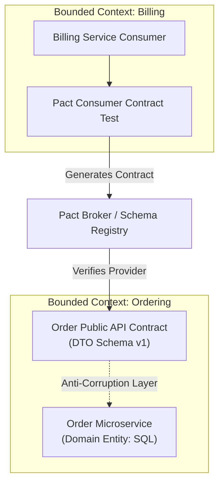

In a distributed microservice architecture, API contracts serve as the explicit binding agreement between independent engineering teams and autonomous software services. Designing API contracts before writing code ensures that service boundaries are clean, domain models are decoupled, and integration friction is minimized.

## The Problem with Code-Led Boundary Design

When microservice boundaries are defined through ad-hoc code implementation rather than upfront contract design, systems quickly devolve into distributed monoliths. Common symptoms include:
- Unstable, frequently changing API schemas that break client integrations.
- Circular network dependencies where Service A cannot process a request without synchronous calls to Service B, C, and D.
- Leaky database abstractions where internal database primary keys and internal state flags are exposed directly over HTTP REST interfaces.

## Designing Contracts with OpenAPI and Domain-Driven Design (DDD)

By applying Domain-Driven Design principles during the contract design phase, architects map business domains to bounded contexts.

1. **Identify Bounded Contexts**: Establish clear domain boundaries (e.g., Order Processing vs. Inventory Fulfillment) so that each microservice owns its data model.
2. **Define Schema Specifications**: Use OpenAPI 3.1 to formalize request payloads, response structures, HTTP status codes, and security requirements.
3. **Establish Versioning Policies**: Incorporate semantic versioning (`v1`, `v2`) or header-based API versioning to allow backward-compatible contract evolution without breaking active consumers.

## CI/CD Schema Validation and Linter Enforcements

To maintain API contract hygiene across large organizations, automated schema linting must be integrated directly into CI/CD pipelines. Tools like Spectral parse OpenAPI YAML files on every git pull request, enforcing naming conventions (camelCase vs kebab-case), mandatory error response schemas (RFC 7807 Problem Details), and complete field description coverage before code is merged.

## Conclusion

Contract-First design is not merely a documentation exercise; it is an architectural discipline that protects microservices from tight coupling. Defining service contracts first lays a resilient foundation for long-term scalability and autonomous team execution.


---

## Architectural Deep Dive: Domain Boundary Enforcement via Consumer-Driven Contracts

When applying Domain-Driven Design (DDD) to microservices, the most prevalent architectural hazard is "domain leakage"—where the internal data model of one service inadvertently becomes the shared API contract of another. By establishing explicit Consumer-Driven Contracts (CDC) before writing code, boundaries between bounded contexts remain completely decoupled.



### 1. Concrete Implementation: Consumer Contract Test with Pact in TypeScript

The following implementation defines an explicit consumer contract test that ensures the Order service cannot deploy breaking changes that disrupt Billing operations:

```typescript
import { PactV3, MatchersV3 } from '@pact-foundation/pact';
import path from 'path';

const { uuid, integer, string } = MatchersV3;

const provider = new PactV3({
  consumer: 'BillingMicroservice',
  provider: 'OrderMicroservice',
  dir: path.resolve(process.cwd(), 'pacts'),
});

describe('Order Service Boundary Contract', () => {
  it('validates order fulfillment payload structure', async () => {
    provider
      .given('an approved order exists with id 7d25e01b-c128-4ef8-8316-bc5e24c5bb20')
      .uponReceiving('a request for order billing details')
      .withRequest({
        method: 'GET',
        path: '/api/v1/orders/7d25e01b-c128-4ef8-8316-bc5e24c5bb20/billing',
        headers: { Accept: 'application/json' },
      })
      .willRespondWith({
        status: 200,
        headers: { 'Content-Type': 'application/json' },
        body: {
          orderId: uuid('7d25e01b-c128-4ef8-8316-bc5e24c5bb20'),
          totalAmountCents: integer(15499),
          currency: string('USD'),
          settlementStatus: string('AUTHORIZED'),
        },
      });

    await provider.executeTest(async (mockServer) => {
      const response = await fetch(`${mockServer.url}/api/v1/orders/7d25e01b-c128-4ef8-8316-bc5e24c5bb20/billing`, {
        headers: { Accept: 'application/json' },
      });
      const data = await response.json();
      expect(response.status).toBe(200);
      expect(data.totalAmountCents).toBe(15499);
    });
  });
});
```

---

## SRE Failure Modes & Production Troubleshooting Playbook

### Incident Scenario A: Accidental Database Entity Exposure Leaking Tenant Secrets
* **Root Cause:** A developer returned an ORM entity directly in a controller response without an explicit Data Transfer Object (DTO) mapper, leaking internal tenant database foreign keys and soft-delete flags.
* **Telemetry & Diagnostic Command:**
  ```bash
  # Check for unmapped ORM fields leaking into public JSON payloads
  curl -s http://api.service.internal/orders/123 | jq 'has("internal_tenant_id", "deleted_at")'
  ```
* **Mitigation Protocol:**
  1. Enforce strict compiler separation between domain entities and contract DTOs using TypeScript branded types or separate compile targets.
  2. Implement an Anti-Corruption Layer (ACL) in the edge gateway to sanitize response objects.

### Incident Scenario B: Uncoordinated Breaking Schema Deployment
* **Root Cause:** Team A deployed a required query parameter without notifying Consumer Team B, causing a cascade of HTTP 400 Bad Request errors in staging and production.
* **Telemetry & Diagnostic Command:**
  ```bash
  # Inspect HTTP 400 spikes grouped by caller user-agent
  kubectl logs -n production -l app=order-service | grep "status=400" | jq '.caller_service' | sort | uniq -c
  ```
* **Mitigation Protocol:**
  1. Enforce `can-i-deploy` verification gates in CI/CD using Pact Broker before promoting provider microservices.
  2. Implement graceful schema expansion policies (additive changes only; field deletions require a 3-month sunset period).

---

## Architectural Trade-off Analysis: Boundary Segregation Patterns

| Strategy | Coupling Degree | Autonomous Deployment | CI/CD Overhead | Refactoring Friction |
| :--- | :--- | :--- | :--- | :--- |
| **Shared Common DTO Library** | High (Monolithic binary lock) | Low (All services must rebuild) | Low | High across multiple repos |
| **Consumer-Driven Contracts (Pact)** | Low (Decoupled specifications) | High (Guaranteed compatibility)| Moderate | Low (Isolated evolutions) |
| **Runtime Gateway Adapter (BFF)** | Very Low (Translation at Edge) | High (Backend agnostic) | Moderate | Very Low for consumers |

---

## Service Boundary Verification Checklist

* [ ] Explicit Bounded Context boundaries documented in Domain Storytelling / Event Storming models.
* [ ] Zero shared database tables or direct cross-boundary foreign key constraints.
* [ ] Public contracts defined independently of underlying ORM persistence entities.
* [ ] Automated consumer contract tests running against Pact Broker on every PR.
* [ ] Anti-Corruption Layer (ACL) pattern deployed when integrating legacy core monoliths.
