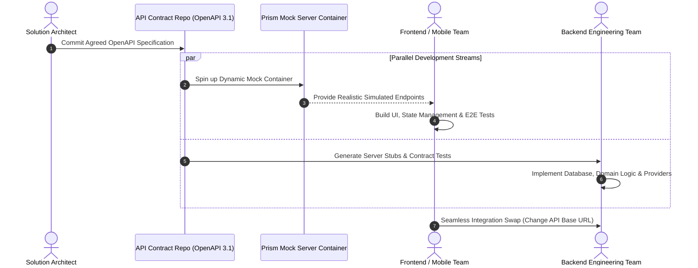

When building HTTP APIs, engineering teams generally follow one of two paradigms: **Code-First** or **API-First (Contract-First)**. While Code-First development appears faster for small prototypes, API-First is the gold standard for enterprise microservice architectures and MACH ecosystems.

This article compares both approaches and demonstrates why contract-before-code is superior for scaling software systems.

## Comparing the Paradigms

### The Code-First Approach
In Code-First development, engineers write server controllers and database models first, then generate API documentation (such as Swagger JSON) from annotations in the code.
- **Drawbacks**:
  - Exposes internal database model naming directly to API consumers.
  - Frontend developers cannot begin integration until backend implementation and staging deployments are complete.
  - Minor code refactoring in backend models can introduce accidental breaking schema changes.

### The API-First (Contract-First) Approach
In API-First development, the API specification (OpenAPI, AsyncAPI, or Protocol Buffers) is authored as a standalone design document before implementation begins.
- **Advantages**:
  - **Parallel Development**: Frontend, mobile, and backend teams work simultaneously against a shared specification.
  - **Decoupled Technology Stacks**: Client SDKs and server stubs are generated automatically across multiple programming languages.
  - **Consistent Governance**: Security schemas (OAuth 2.0, JWT) and standard error response formats are enforced globally across all services.

## Automated Mocking and Contract Testing

One of the most immediate productivity multipliers of an API-First workflow is automated mock server generation. Using tools like Prism, WireMock, or Stoplight, engineering teams can instantly launch mock servers conforming to the OpenAPI specification.

This enables frontend developers to build and test UI components against realistic mock responses weeks before backend microservices are fully implemented. Furthermore, contract testing tools like Pact ensure that neither client nor server violates the agreed API specification during continuous deployment.

## Strategic Business Impact

Adopting an API-First strategy converts APIs from ephemeral implementation details into durable digital products. This enables seamless partner integrations, rapid multi-platform client onboarding, and long-term architectural stability across enterprise cloud ecosystems.


---

## Architectural Deep Dive: Parallel Frontend/Backend Velocity with Dynamic Mocking

The decisive advantage of an API-First architecture over Code-First is eliminating development serialisation. In a legacy Code-First paradigm, frontend engineers must wait for backend engineers to implement database migrations, ORM entities, and controllers before starting UI implementation. In an API-First paradigm, the contract becomes an executable specification on Day 1.



### 1. Concrete Implementation: Instant Dynamic Mocking with Prism in Docker Compose

The following configuration demonstrates how engineering teams run local and CI/CD mock servers generated directly from OpenAPI contracts with zero custom backend mock code:

```yaml
version: '3.8'

services:
  # Dynamic Mock Server simulating the Order & Checkout API
  api-mock-server:
    image: stoplight/prism:5
    container_name: mock-order-api
    command: mock -h 0.0.0.0 -p 4010 /contracts/openapi.yaml --errors --dynamic
    volumes:
      - ./contracts/openapi.yaml:/contracts/openapi.yaml:ro
    ports:
      - "4010:4010"
    environment:
      - NODE_ENV=development
    healthcheck:
      test: ["CMD", "wget", "-qO-", "http://localhost:4010/healthz"]
      interval: 5s
      timeout: 3s
      retries: 3
```

---

## SRE Failure Modes & Production Troubleshooting Playbook

### Incident Scenario A: Mock Discrepancy During Staging Environment Promotion
* **Root Cause:** The frontend team developed against a mock server configured with loose validation, but the backend implementation applied strict database column constraints, resulting in runtime form submission crashes.
* **Telemetry & Diagnostic Command:**
  ```bash
  # Validate live backend staging responses against contract specification
  npx prism proxy ./contracts/openapi.yaml http://staging.api.internal --errors
  ```
* **Mitigation Protocol:**
  1. Run Prism in proxy mode during integration test suites to validate that live responses match contract schemas byte-for-byte.
  2. Enable `--errors` flag on mock servers so requests violating schemas fail immediately in local development.

### Incident Scenario B: Contract Drift Due to Unversioned Direct Edits
* **Root Cause:** A developer updated an API response format directly in code to fix a bug without updating the OpenAPI spec, breaking external third-party webhook integrations.
* **Telemetry & Diagnostic Command:**
  ```bash
  # Check for uncommitted contract modifications
  git status --porcelain contracts/
  ```
* **Mitigation Protocol:**
  1. Make the OpenAPI specification the single source of truth; generate backend interfaces directly via `openapi-typescript` or `oapi-codegen`.
  2. Implement pre-commit hooks that verify generated code is synchronized with contract YAML files.

---

## Architectural Trade-off Analysis: API-First vs Code-First

| Decision Factor | Code-First (Framework Annotations) | API-First (Contract-Driven) |
| :--- | :--- | :--- |
| **Initial Time to First Commit** | Faster (No upfront spec writing) | Slightly slower (Design phase required) |
| **Team Scaling Autonomy** | Poor (Frontend blocked on Backend) | Excellent (Zero wait-state via mocks) |
| **Documentation Accuracy** | Degrades over time | 100% Guaranteed by contract generation |
| **API Quality & Usability** | Biased toward internal DB schemas | Biased toward consumer developer experience (DX) |

---

## API-First Implementation Checklist

* [ ] API specification reviewed and approved by both consumer and provider leads before implementation.
* [ ] Dynamic mock server running in CI/CD pipeline for automated UI testing.
* [ ] Client SDKs and TypeScript types generated automatically from contract definitions.
* [ ] Prism proxy validation integrated into integration test environments.
* [ ] Breaking changes governed by semantic versioning and backward compatibility policies.
