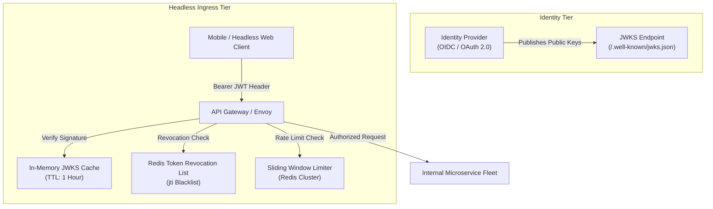

Decoupling presentation layers from backend microservices in headless architectures exposes API endpoints directly to public internet traffic. Without a robust perimeter security architecture, headless backends are vulnerable to credential stuffing, token spoofing, DDoS attacks, and unauthorized data access.

This guide details essential security controls for securing headless APIs: **OAuth 2.0**, **JSON Web Tokens (JWT)**, and **Rate Limiting**.

## 1. OAuth 2.0 Authorization Flows

Select the appropriate OAuth 2.0 grant type based on client capability:
- **Authorization Code Grant with PKCE (Proof Key for Code Exchange)**: Mandatory for Single-Page Web Applications (React, Next.js) and native mobile apps to prevent authorization code interception.
- **Client Credentials Grant**: Used for secure server-to-server microservice communication where no end-user context is involved.

## 2. Stateless Authentication with JWTs

JSON Web Tokens allow stateless authentication across distributed microservices:
- **Cryptographic Verification**: Edge API Gateways verify JWT signatures using public keys (`JWKS` endpoint) without querying an authentication database on every request.
- **Claim Scoping**: Encode fine-grained permissions (scopes) inside the JWT payload (e.g., `scope: "orders:read orders:write"`).
- **Token Invalidation**: Combine short token expiration lifetimes (e.g., 15 minutes) with refresh token rotation to minimize impact if a token is compromised.

## 3. Defense-in-Depth Rate Limiting & Throttling

Protect endpoints from abuse at the API Gateway layer:
- **Token Bucket Algorithm**: Allows short bursts of traffic while maintaining steady overall rates.
- **Multi-Tiered Limits**: Apply strict rate limits based on IP addresses, authenticated client IDs, or specific sensitive routes (e.g., login or checkout endpoints).

```nginx
# NGINX Rate Limiting Configuration
limit_req_zone $binary_remote_addr zone=api_limit:10m rate=10r/s;

server {
    location /api/v1/auth/ {
        limit_req zone=api_limit burst=5 nodelay;
        proxy_pass http://auth_service;
    }
}
```

## Conclusion

Securing headless APIs requires defense-in-depth: PKCE-enabled OAuth 2.0 for client authentication, cryptographically verified JWTs for stateless authorization, and API Gateway rate limiting for infrastructure protection.


---

## Architectural Deep Dive: JWKS Cryptographic Key Rotation & Token Revocation

In a headless cloud architecture, microservices must never share hardcoded cryptographic secrets. Instead, modern security architectures enforce **Asymmetric Public-Key Cryptography (RS256 / EdDSA)**: identity providers (Auth0, Okta, Keycloak) sign JSON Web Tokens (JWT) using a private key, while API Gateways and microservices verify token signatures using a dynamically cached **JSON Web Key Set (JWKS)** endpoint.

To address the challenge of immediate token revocation in stateless JWTs, production systems deploy distributed Bloom Filters or Redis blocklists for revoked tokens.



### 1. Concrete Implementation: Resilient JWKS Token Verification in TypeScript

The following implementation demonstrates how to verify JWT tokens with automated JWKS caching and rate limiting:

```typescript
import { Request, Response, NextFunction } from 'express';
import jwt, { JwtHeader, SigningKeyCallback } from 'jsonwebtoken';
import jwksClient from 'jwks-rsa';

const client = jwksClient({
  jwksUri: 'https://auth.machplaybook.com/.well-known/jwks.json',
  cache: true,
  cacheMaxEntries: 5,
  cacheMaxAge: 3600000, // 1 hour
  rateLimit: true,
  jwksRequestsPerMinute: 10,
});

function getKey(header: JwtHeader, callback: SigningKeyCallback): void {
  if (!header.kid) {
    callback(new Error('JWT Header missing kid (Key ID)'));
    return;
  }
  client.getSigningKey(header.kid, (err, key) => {
    if (err) {
      callback(err);
      return;
    }
    const signingKey = key?.getPublicKey();
    callback(null, signingKey);
  });
}

export const authenticateToken = (req: Request, res: Response, next: NextFunction): void => {
  const authHeader = req.headers['authorization'];
  const token = authHeader && authHeader.split(' ')[1];

  if (!token) {
    res.status(401).json({ error: 'Missing Bearer token.' });
    return;
  }

  jwt.verify(
    token,
    getKey,
    {
      algorithms: ['RS256'],
      issuer: 'https://auth.machplaybook.com/',
      audience: 'https://api.machplaybook.com/',
    },
    (err, decoded) => {
      if (err) {
        res.status(403).json({ error: 'Invalid or expired token.' });
        return;
      }
      (req as any).user = decoded;
      next();
    }
  );
};
```

---

## SRE Failure Modes & Production Troubleshooting Playbook

### Incident Scenario A: JWKS Endpoint Outage Blocking 100% of Ingress Traffic
* **Root Cause:** The external identity provider experienced transient DNS failure. Uncached microservice instances failed to fetch public keys, rejecting all authenticated traffic with HTTP 403 Forbidden.
* **Telemetry & Diagnostic Command:**
  ```bash
  # Check JWKS client error metrics in application logs
  kubectl logs -n production -l app=api-gateway | grep "JWKS_FETCH_FAILED" | head -20
  ```
* **Mitigation Protocol:**
  1. Enforce stale-while-revalidate caching on JWKS clients so the previous signing keys remain valid in memory for up to 24 hours during IdP outages.
  2. Implement an out-of-band cron job that synchronizes JWKS payloads into a local Redis cache.

### Incident Scenario B: Credential Stuffing Attack Saturating Ingress Sockets
* **Root Cause:** A distributed botnet launched brute-force credential stuffing against the `/api/v1/auth/token` endpoint across 50,000 distinct IP addresses, bypassing simple IP rate limiters.
* **Telemetry & Diagnostic Command:**
  ```bash
  # Identify target endpoint connection saturation and response codes
  awk '{print $7, $9}' /var/log/nginx/access.log | grep "/auth/token" | sort | uniq -c | sort -rn | head -10
  ```
* **Mitigation Protocol:**
  1. Enforce composite rate limiting based on `(client_ip, target_username)` pairs.
  2. Integrate Cloudflare Turnstile or edge Web Application Firewall (WAF) bot management to challenge suspicious headless requests.

---

## Architectural Trade-off Analysis: Token Architecture Strategies

| Token Pattern | Revocation Speed | Database Dependency | Payload Overhead | Microservice Autonomy |
| :--- | :--- | :--- | :--- | :--- |
| **Stateless JWT (RS256)** | Slow (Until token expiry)| Zero (Cryptographic verify) | Moderate (1-2 KB header)| High (Self-contained) |
| **Opaque Reference Token** | Immediate (Real-time DB)| High (Central DB on every hit)| Minimal (UUID string) | Low (Coupled to Auth DB) |
| **Hybrid (Short JWT + Redis Revocation)**| Near-immediate (Redis check)| Minimal (Shared Redis cluster)| Moderate | High |

---

## API Security Production Verification Checklist

* [ ] Cryptographic signing enforced via RS256 or EdDSA with keys rotated annually.
* [ ] JWKS caching configured with stale-while-revalidate to withstand IdP downtime.
* [ ] Rate limiting enforced at both IP and authenticated user / client tiers.
* [ ] CORS policies strictly whitelist trusted frontend origins (no wildcard `*` with credentials).
* [ ] Sensitive tokens stripped from logging and tracing outputs (OpenTelemetry span scrubbers).
