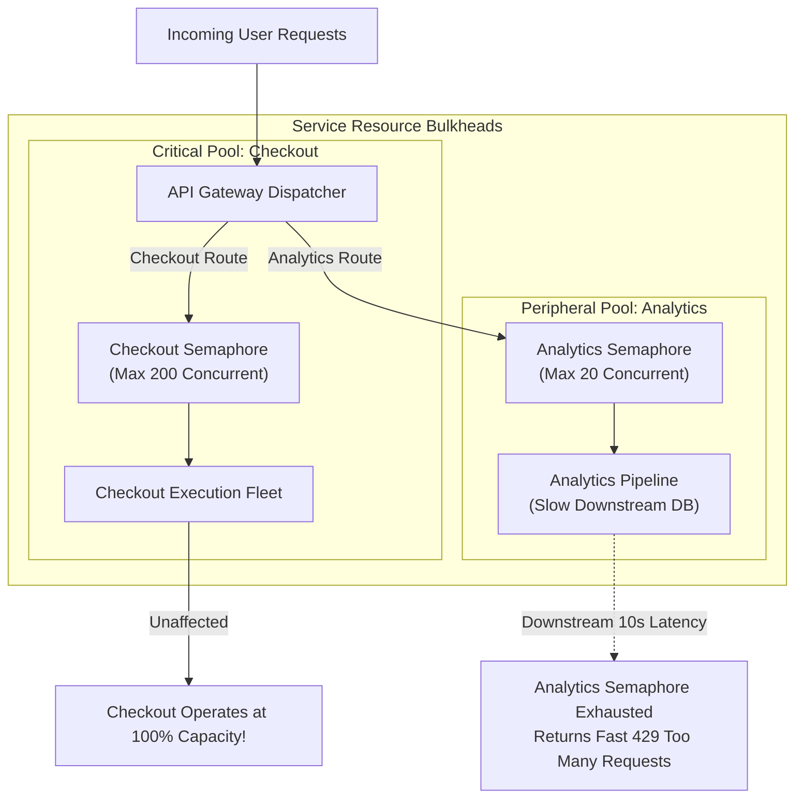

In nautical engineering, a ship's hull is divided into watertight compartments called **bulkheads**. If a rock punctures one compartment, water is contained within that single section, preventing the entire vessel from sinking.

In microservices architecture, the **Bulkhead Pattern** applies the same principle to software. It isolates thread pools, connection pools, and memory resources so that a failure or slowdown in one downstream dependency cannot exhaust system resources and crash the entire application.

## The Problem: Resource Starvation Cascades

Consider a web application handling two types of requests:
1. `GET /orders`: A critical, high-frequency customer endpoint.
2. `GET /reports`: An expensive analytics endpoint that calls a slow third-party reporting API.

If both endpoints share a single HTTP worker thread pool (e.g., 200 threads), a sudden delay in the reporting API causes analytics requests to hang. Incoming reporting requests quickly consume all 200 threads, leaving zero worker threads available to process customer orders. The entire system crashes due to resource starvation.

## Implementing Bulkhead Isolation

### 1. Thread Pool Bulkheads
Assign dedicated, isolated thread pools to distinct downstream integration dependencies:

```java
// Java Resilience4j Bulkhead Configuration
ThreadPoolBulkheadConfig orderPoolConfig = ThreadPoolBulkheadConfig.custom()
    .maxThreadPoolSize(50)
    .coreThreadPoolSize(20)
    .queueCapacity(100)
    .build();

ThreadPoolBulkheadConfig reportPoolConfig = ThreadPoolBulkheadConfig.custom()
    .maxThreadPoolSize(10)
    .coreThreadPoolSize(5)
    .queueCapacity(20)
    .build();
```

If the reporting service thread pool fills up, incoming reporting requests are rejected immediately (`BulkheadFullException`), but the order processing thread pool continues operating at full capacity.

### 2. Connection Pool Isolation
Maintain separate HTTP connection pools and database connection pools for different microservices to prevent slow database queries from blocking critical transactions.

### 3. Container Resource Bulkheads (Kubernetes)
Define explicit CPU and memory resource requests/limits in Kubernetes pod deployment manifests to prevent a memory-leaking container from starving neighboring pods on the same node.

## Conclusion

The Bulkhead pattern is a cornerstone of resilient cloud-native engineering. By partitioning thread pools, connection pools, and compute resources, systems contain localized outages and maintain continuous availability.


---

## Architectural Deep Dive: Semaphore vs Thread-Pool Bulkhead Isolation

The Bulkhead pattern derives its name from nautical compartmentalization: if a ship's hull is breached in one compartment, water-tight bulkheads prevent the entire vessel from sinking. In distributed architectures, bulkheads isolate computational resources (CPU, threads, memory, connection pools) so a failure in a slow peripheral service cannot exhaust server resources and sink the entire fleet.



### 1. Concrete Implementation: Semaphore Bulkhead Middleware in TypeScript

The following implementation demonstrates an asynchronous Semaphore Bulkhead that enforces strict concurrency caps per route without thread blocking:

```typescript
import { Request, Response, NextFunction } from 'express';

export class BulkheadSemaphore {
  private currentCapacity: number;
  private readonly maxConcurrency: number;
  private readonly queueCapacity: number;
  private queue: Array<() => void> = [];

  constructor(maxConcurrency = 50, queueCapacity = 20) {
    this.maxConcurrency = maxConcurrency;
    this.currentCapacity = maxConcurrency;
    this.queueCapacity = queueCapacity;
  }

  public middleware() {
    return (req: Request, res: Response, next: NextFunction): void => {
      if (this.currentCapacity > 0) {
        this.currentCapacity--;
        res.on('finish', () => this.release());
        res.on('close', () => this.release());
        next();
      } else if (this.queue.length < this.queueCapacity) {
        this.queue.push(() => {
          this.currentCapacity--;
          res.on('finish', () => this.release());
          res.on('close', () => this.release());
          next();
        });
      } else {
        // Bulkhead capacity exhausted: shed load immediately
        res.status(429).json({
          type: 'https://api.machplaybook.com/errors/bulkhead-exhausted',
          title: 'Bulkhead Concurrency Limit Reached',
          status: 429,
          detail: 'Downstream isolation threshold reached. Please retry with exponential backoff.',
        });
      }
    };
  }

  private release(): void {
    this.currentCapacity++;
    if (this.queue.length > 0 && this.currentCapacity > 0) {
      const nextFn = this.queue.shift();
      if (nextFn) nextFn();
    }
  }
}
```

---

## SRE Failure Modes & Production Troubleshooting Playbook

### Incident Scenario A: Semaphore Leak During Downstream Socket Hangs
* **Root Cause:** A downstream legacy SOAP service hung indefinitely on TCP handshake without emitting a socket close event. Node.js connection objects remained open, permanently depleting semaphore capacity and rejecting all subsequent requests.
* **Telemetry & Diagnostic Command:**
  ```bash
  # Check for unreleased active connections in Linux socket table
  ss -tan '( sport = :8080 )' | grep ESTAB | wc -l
  ```
* **Mitigation Protocol:**
  1. Enforce strict socket timeouts (`req.setTimeout(5000)`) and AbortSignals on all outbound fetch/gRPC requests.
  2. Implement an automatic timeout watchdog in the semaphore wrapper that forcefully releases capacity after a hard deadline.

### Incident Scenario B: Shared Connection Pool Exhaustion Starving Health Check Routes
* **Root Cause:** The database connection pool was shared globally across domain logic and `/healthz` endpoints. A spike in complex analytical queries consumed all 100 database pool connections, causing the `/healthz` endpoint to time out and triggering Kubernetes pod restarts.
* **Telemetry & Diagnostic Command:**
  ```bash
  # Check Kubernetes pod restart counts due to failed liveness probes
  kubectl get pods -n production -l app=core-api -o wide
  ```
* **Mitigation Protocol:**
  1. Completely isolate the health check probe from the application database pool; probe readiness via lightweight in-memory checks.
  2. Establish separate dedicated database connection pools for read-heavy reports vs transactional mutations.

---

## Architectural Trade-off Analysis: Bulkhead Mechanisms

| Isolation Model | Implementation Mechanism | Blast Radius | Memory Overhead | Operational Complexity |
| :--- | :--- | :--- | :--- | :--- |
| **Semaphore Concurrency** | In-memory atomic counters | Route / Endpoint | Minimal (<100KB) | Low |
| **Thread Pool Bulkhead** | Dedicated worker thread pools | Thread Group | Moderate (Thread stacks) | Moderate (Java/JVM) |
| **Pod / Container Isolation** | Kubernetes Resource Quotas | Entire Microservice | High (Container memory baseline)| High (Cluster scaling) |

---

## Bulkhead Isolation Production Checklist

* [ ] High-latency third-party integrations protected by strict semaphore concurrency limits.
* [ ] Database connection pools isolated between transactional operations and analytical queries.
* [ ] Kubernetes CPU/memory requests and limits defined explicitly on all pod specs.
* [ ] Health check (`/healthz`) endpoints completely decoupled from external database queries.
* [ ] Rapid HTTP 429 shedding validated under load testing before thread starvation occurs.
