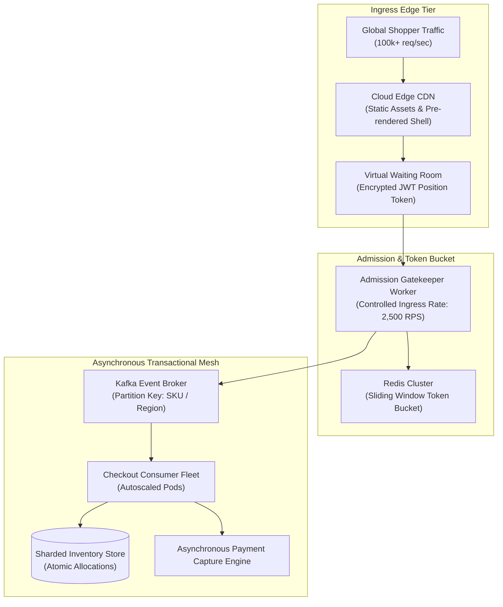

Managing high-demand global e-commerce presents unique engineering challenges. During limited-edition sneaker releases (SNKRS flash sales), traffic spikes by orders of magnitude within seconds. Legacy monolithic commerce platforms often crash under such extreme load spikes, resulting in lost revenue and customer frustration.

This case study analyzes how **Nike transitioned to a MACH (Microservices, API-first, Cloud-native, Headless) architecture** to support global flash sales and scale independent digital storefronts.

## The Legacy Monolithic Bottleneck

Prior to adopting MACH architecture, Nike relied on a centralized e-commerce platform. During high-profile shoe drops:
- Heavy database locking on inventory tables during checkout caused systemic database timeouts.
- Content updates to marketing pages required full application deployments, creating deployment bottlenecks.
- Regional storefronts shared compute resources, meaning a traffic spike in North America degraded performance for shoppers in Europe and Asia.

## The MACH Architectural Solution

### 1. Headless Presentation Layer (SNKRS App & Web)
Nike decoupled frontend mobile apps and websites from backend commerce logic:
- Static assets and product catalog pages are pre-rendered and distributed across global CDN edge nodes.
- When millions of users refresh the app during a drop, 95% of requests are served directly from edge caches without touching backend servers.

### 2. Microservice Inventory & Checkout Engine
Core capabilities were broken into specialized microservices:
- **Inventory Service**: Built on high-concurrency event-driven datastores capable of handling thousands of reservation requests per second.
- **Queueing & Entry Service**: Manages raffle drops asynchronously, validating user entries and queuing reservations without blocking main checkout databases.

### 3. Asynchronous Order Processing
Order placement emits domain events (`OrderSubmittedEvent`) to an event stream (Apache Kafka). Order validation, fraud detection, and payment capture occur asynchronously in the background.

## Key Architectural Results

- **10x Flash Sale Capacity**: Handled millions of concurrent checkout requests during major SNKRS sneaker launches with zero platform downtime.
- **Global Deployment Autonomy**: Regional teams deploy independent frontend features continuously without risking global platform stability.
- **Sub-Second Page Loads**: CDN edge caching reduced mobile app response times to sub-second levels worldwide.

## Engineering Takeaways for Enterprise Systems

1. **Decouple Flash Sale Entry from Checkout**: Never expose primary relational databases to un-throttled high-concurrency traffic during drops. Use async queuing systems.
2. **Cache Static Commerce Assets at the Edge**: Serve catalog images, descriptions, and layouts via CDNs so backend services only process transactional requests.


---

## Architectural Deep Dive: High-Concurrency Flash Sales & Drop Gatekeeper Topology

> [!NOTE]
> **Editorial Transparency & Educational Framework:** This technical breakdown represents an independent architectural analysis of cloud-native flash-sale design patterns inspired by high-velocity drops in global sportswear commerce. MACH Playbook is an independent educational publication with no formal sponsorship from Nike.

During limited-edition sneaker launches, application traffic does not ramp up linearly; it resembles an instantaneous Dirac delta function. Hundreds of thousands of concurrent users click "Submit Order" within 500 milliseconds of the countdown timer reaching zero. In a traditional monolithic setup, database connection pools exhaust immediately, thread pools lock, and entire platforms crash.

Under a modern MACH architecture, the primary transactional database is completely shielded from this explosive influx. Traffic is stratified into edge-managed queues and asynchronous reservation workers.



### 1. Concrete Implementation: High-Throughput Token Bucket Gatekeeper

The following production TypeScript implementation demonstrates an edge-compatible Sliding Window Rate Limiter & Token Gatekeeper that throttles sudden traffic spikes and prevents downstream checkout exhaustion:

```typescript
import { RedisClientType } from 'redis';

interface AdmissionRequest {
  userId: string;
  dropId: string;
  clientIp: string;
}

interface AdmissionResult {
  admitted: boolean;
  retryAfterMs?: number;
  queuePosition?: number;
}

export class FlashSaleAdmissionGatekeeper {
  private redis: RedisClientType;
  // Maximum requests admitted into the checkout mesh per second per drop
  private readonly maxRps: number;

  constructor(redisClient: RedisClientType, maxRps = 2500) {
    this.redis = redisClient;
    this.maxRps = maxRps;
  }

  /**
   * Evaluates admission using an atomic Redis Sliding Window algorithm.
   */
  public async evaluateAdmission(
    req: AdmissionRequest
  ): Promise<AdmissionResult> {
    const now = Date.now();
    const windowStart = now - 1000; // 1-second rolling window
    const windowKey = `drop:${req.dropId}:throughput`;

    // Lua script executing atomic sliding window admission
    const slidingWindowLua = `
      local key = KEYS[1]
      local now = tonumber(ARGV[1])
      local windowStart = tonumber(ARGV[2])
      local maxLimit = tonumber(ARGV[3])
      local memberId = ARGV[4]

      -- Remove requests older than the rolling window
      redis.call('ZREMRANGEBYSCORE', key, 0, windowStart)

      -- Count current active admitted requests
      local currentCount = redis.call('ZCARD', key)

      if currentCount < maxLimit then
        -- Admit into transactional flow
        redis.call('ZADD', key, now, memberId)
        redis.call('EXPIRE', key, 5) -- Short TTL for sliding window set
        return {1, currentCount + 1}
      else
        -- Throttle and place in queue tier
        return {0, currentCount + 1}
      end
    `;

    try {
      const [status, count] = (await this.redis.eval(slidingWindowLua, {
        keys: [windowKey],
        arguments: [
          now.toString(),
          windowStart.toString(),
          this.maxRps.toString(),
          `${req.userId}:${now}`,
        ],
      })) as [number, number];

      if (status === 1) {
        return { admitted: true };
      }

      // Calculate dynamic backoff jitter to prevent synchronized retries
      const jitterMs = Math.floor(Math.random() * 300) + 200;
      return {
        admitted: false,
        retryAfterMs: 1000 + jitterMs,
        queuePosition: count,
      };
    } catch (err) {
      // In the event of redis partition, fail closed for drop integrity
      return {
        admitted: false,
        retryAfterMs: 3000,
      };
    }
  }
}
```

---

## SRE Failure Modes & Production Troubleshooting Playbook

Flash sales represent the most unforgiving high-velocity events in distributed systems engineering. Below are actionable diagnostic runbooks for drop incidents:

### Incident Scenario A: Thundering Herd Connection Starvation on Redis Cluster
* **Root Cause:** Ingress proxy nodes experience a sudden cache-miss on drop metadata when the countdown reaches zero, resulting in thousands of synchronous connections flooding Redis nodes simultaneously.
* **Telemetry & Diagnostic Command:**
  ```bash
  # Check connected clients and rejected client connections in Redis Cluster
  redis-cli -h redis-cluster.commerce.internal -p 6379 info stats | \
    grep -E "rejected_connections|total_connections_received"
  ```
* **Mitigation Protocol:**
  1. Enforce aggressive single-flight request coalescing at the API Gateway layer (e.g., Go `singleflight` or Envoy response caching) so only 1 request per region queries Redis for drop metadata.
  2. Implement client-side connection pooling limits in the gateway microservice to cap maximum concurrent sockets per container.

### Incident Scenario B: Asynchronous Payment Gateway Webhook Backlog
* **Root Cause:** Third-party payment providers (Stripe, Adyen, Apple Pay) queue webhook notifications during massive traffic spikes. Webhook delivery delays cause order state machines to stall in `PENDING_PAYMENT` state.
* **Telemetry & Diagnostic Command:**
  ```bash
  # Inspect unacknowledged webhook ingestion consumer lag
  kubectl logs -n production -l app=payment-webhook-ingester --tail=200 | \
    grep -E "WEBHOOK_TIMEOUT|REPLAY_DETECTED|BUFFER_FULL"
  ```
* **Mitigation Protocol:**
  1. Decouple webhook HTTP acknowledgement (`200 OK`) from payment processing: immediately push raw webhook payloads into Kafka and respond to the payment gateway within 50ms.
  2. Implement an automated reconciliation chronojob that actively polls the payment provider's REST API for orders lingering in `PENDING_PAYMENT` longer than 180 seconds.

---

## Architectural Trade-off Analysis: Flash Sale Architectures

Choosing the right transactional strategy for high-velocity drops:

| Dimension | Synchronous ACID (Relational) | Virtual Waiting Room + Queuing | Asynchronous Draw / Raffle Model |
| :--- | :--- | :--- | :--- |
| **User Experience** | Frustrating during spikes (504 errors) | Transparent (visible queue position) | Relaxed (users enter over 15-minute window) |
| **Database Load** | Catastrophic (Lock contention) | Controlled (Deterministic throughput) | Minimal (Batch processed offline) |
| **Bot Resistance** | Very Low (Bots outspeed humans) | Moderate (Rate limits and CAPTCHAs) | High (Fair random selection after close) |
| **Infrastructure Cost** | Extremely High (Over-provisioned DB) | Moderate (Serverless Edge + Redis) | Low (Runs on standard compute baseline) |

---

## Flash Sale Production Verification Checklist

Before launching high-velocity product drops, ensure your engineering team has verified these operational gates:

* [ ] Static product imagery and catalog shells cached with high TTLs across global CDN edge nodes.
* [ ] Virtual waiting room edge workers configured with cryptographic HMAC token verification.
* [ ] Sharded inventory datastores configured with atomic Lua or CAS (Compare-And-Swap) operations to guarantee zero overselling.
* [ ] Circuit breakers active to shed peripheral services (personalized recommendations, customer reviews) to protect checkout.
* [ ] Dynamic autoscaling thresholds pre-warmed 30 minutes before drop countdown reaches zero.
