Sephora, a global prestige beauty retailer, operates hundreds of physical stores alongside e-commerce websites and mobile applications. Delivering a unified **omnichannel experience**—where physical store inventory, online loyalty rewards, personalized beauty recommendations, and mobile in-store scanning work seamlessly together—requires a modern software architecture.

This case study examines Sephora’s migration from a legacy commerce platform to a **Headless, API-first architecture**.

## The Omnichannel Data Challenge

Traditional e-commerce platforms treat online shopping and physical retail as separate channels:
- Store inventory and online warehouse stock lived in isolated databases.
- Beauty Insider loyalty points earned in-store took hours to synchronize with online user profiles.
- Mobile app features (such as scanning a product barcode in-store to view online reviews) were slow and unreliable due to tightly coupled backend systems.

## The Headless API-First Strategy

### 1. Unified Customer Data Platform (CDP) & APIs
Sephora implemented a centralized API layer that unifies customer profiles, purchase history, and loyalty status:
- A single `GET /api/v1/customer/profile` endpoint returns real-time loyalty point balances whether queried by a physical POS terminal or a mobile app.

### 2. Decoupled Content & Personalization Engine
Using a Headless CMS and AI-driven personalization services:
- Beauty advisors in physical stores use mobile tablets powered by the same API endpoints that render the online e-commerce website.
- Product recommendations dynamically adapt based on cross-channel shopping history.

### 3. Real-Time Store Inventory APIs
Integrated RFID and store inventory tracking into a high-speed GraphQL API, enabling real-time "Buy Online, Pick Up In Store" (BOPIS) capabilities.

## Key Business & Technical Outcomes

- **Unified Cross-Channel Loyalty**: Zero latency when applying in-store points to online purchases.
- **Rapid Feature Iteration**: Frontend teams launch new mobile interactive features (like virtual shade matching) in weeks rather than months.
- **Enhanced In-Store Experience**: In-store digital tools leverage the same backend infrastructure as web commerce.

## Conclusion

Sephora’s digital transformation demonstrates that headless architecture is not just a web technology trend, but an essential operational foundation for modern omnichannel retail.


---

## Architectural Deep Dive: Omnichannel State Synchronization & Distributed Inventory

> [!NOTE]
> **Editorial Transparency & Educational Framework:** This technical teardown is an independent architectural analysis derived from publicly documented conference presentations and distributed commerce engineering patterns. MACH Playbook has no direct commercial partnership or endorsement with Sephora.

When orchestrating true omnichannel retail, the hardest technical hurdle is reconciling high-velocity e-commerce cart checkouts with physical point-of-sale (POS) registers across distributed geographic stores. If a shopper in a Paris boutique purchases the last bottle of a luxury perfume at 14:02:15, an online user browsing the mobile app for "Buy Online, Pick Up In Store" (BOPIS) must see zero inventory availability within sub-second thresholds—without locking physical POS checkouts behind cloud database round-trips.

```mermaid
sequenceDiagram
    autonumber
    participant App as Mobile App / Web Frontend
    participant GW as Headless API Gateway
    participant Inv as Distributed Inventory Service
    participant Redis as Redis Cluster (Stateful Locks)
    participant Kafka as Event Broker (Kafka)
    participant POS as Physical Store POS Register

    POS->>Kafka: Publish Event: ItemScannedPhysicalCheckout (StoreID, SKU, Qty: 1)
    Kafka->>Inv: Ingest Checkout Stream via CDC / Partition Key (SKU)
    Inv->>Redis: Decrement Live Stock Cache (Lua Atomic Script)
    
    rect rgb(28, 30, 38)
        Note over App,Inv: Online BOPIS Checkout Attempt
        App->>GW: POST /api/v1/orders/reserve (StoreID, SKU)
        GW->>Inv: Validate Live Available To Promise (ATP)
        Inv->>Redis: EVALSHA AcquireTTLHold(SKU, StoreID, TTL=600s)
        alt Stock Available
            Redis-->>Inv: Hold Confirmed (HoldToken: uuid-v4)
            Inv-->>GW: 200 OK (Reservation Active)
            GW-->>App: Proceed to Payment Capture
        else Out of Stock
            Redis-->>Inv: 0 Available (StockDepleted)
            Inv-->>GW: 409 Conflict (Inventory Unavailable)
            GW-->>App: Prompt Alternative Store or Home Delivery
        end
    end
```



### 1. Concrete Implementation: Distributed Stock Hold via Redis & Atomic Lua

To eliminate overselling race conditions between physical registers and online carts, production headless engines execute an atomic *Available-to-Promise* (ATP) reserve script directly in Redis before delegating to backend ERP systems:

```typescript
import { createClient, RedisClientType } from 'redis';
import { v4 as uuidv4 } from 'uuid';

interface StockReservationRequest {
  storeId: string;
  sku: string;
  quantity: number;
  ttlSeconds: number;
}

interface ReservationResult {
  success: boolean;
  reservationId?: string;
  remainingStock: number;
  errorCode?: 'OUT_OF_STOCK' | 'CONCURRENCY_LOCK_FAILED';
}

export class OmnichannelInventoryService {
  private redis: RedisClientType;
  private readonly reserveLuaScript = `
    local stockKey = KEYS[1]
    local holdKey = KEYS[2]
    local requestedQty = tonumber(ARGV[1])
    local ttlSeconds = tonumber(ARGV[2])
    local reservationId = ARGV[3]

    local currentStock = tonumber(redis.call('GET', stockKey) or '0')
    if currentStock < requestedQty then
      return {0, currentStock}
    end

    redis.call('DECRBY', stockKey, requestedQty)
    redis.call('SET', holdKey, requestedQty, 'EX', ttlSeconds)
    return {1, currentStock - requestedQty}
  `;

  constructor(redisClient: RedisClientType) {
    this.redis = redisClient;
  }

  public async acquireBopisReservation(
    req: StockReservationRequest
  ): Promise<ReservationResult> {
    const reservationId = uuidv4();
    const stockKey = `inventory:${req.storeId}:${req.sku}:atp`;
    const holdKey = `holds:${req.storeId}:${req.sku}:${reservationId}`;

    try {
      const [status, remainingStock] = (await this.redis.eval(this.reserveLuaScript, {
        keys: [stockKey, holdKey],
        arguments: [
          req.quantity.toString(),
          req.ttlSeconds.toString(),
          reservationId
        ],
      })) as [number, number];

      if (status === 1) {
        return {
          success: true,
          reservationId,
          remainingStock,
        };
      }

      return {
        success: false,
        remainingStock,
        errorCode: 'OUT_OF_STOCK',
      };
    } catch (error) {
      // Fallback: log circuit breaker telemetry and return controlled degradation
      return {
        success: false,
        remainingStock: 0,
        errorCode: 'CONCURRENCY_LOCK_FAILED',
      };
    }
  }
}
```

---

## SRE Failure Modes & Production Troubleshooting Playbook

Managing distributed omnichannel services across hundreds of physical retail stores and global edge networks requires concrete incident runbooks:

### Incident Scenario A: Physical POS Outage & Asynchronous Queue Ingestion Backlog
* **Root Cause:** A regional fiber cut disconnects store registers. When connectivity restores, thousands of queued store checkout events flood Kafka partition brokers simultaneously, causing CDC consumer lag and stale web inventory.
* **Telemetry & Diagnostic Command:**
  ```bash
  # Inspect consumer lag across physical POS retail topic partitions
  kafka-consumer-groups.sh --bootstrap-server kafka.retail.internal:9092     --describe --group omnichannel-pos-inventory-consumer
  ```
* **Mitigation Protocol:**
  1. Temporarily activate defensive "safety buffer stock" on headless storefronts (withholding the final 2 units of in-store inventory from BOPIS availability).
  2. Scale consumer workers horizontally using Kubernetes KEDA driven by Kafka consumer group lag metrics (`kafka_consumergroup_lag > 500`).
  3. Replay transactional logs sequentially using the store register monotonic sequence identifier to prevent out-of-order state overwrites.

### Incident Scenario B: Loyalty Points Double-Spend Under Unreliable Mobile In-Store Scanning
* **Root Cause:** In-store shoppers scanning loyalty barcodes on weak physical store Wi-Fi trigger multiple retry requests, causing concurrent balance deduction attempts against the Customer Data Platform (CDP).
* **Telemetry & Diagnostic Command:**
  ```bash
  # Trace duplicate idempotency keys in ingress access logs
  kubectl logs -n production -l app=cdp-loyalty-gateway --tail=500 | \
    grep -E "409_CONFLICT|DUPLICATE_IDEMPOTENCY_KEY"
  ```
* **Mitigation Protocol:**
  1. Enforce strict client-generated UUIDv4 idempotency keys in the `X-Idempotency-Key` header with a 120-second lease in Redis.
  2. Implement an in-memory two-phase check in the loyalty microservice: if the idempotency key exists and payment is unsettled, return `429 Too Many Requests` or replay the cached original response without reprocessing points.

---

## Architectural Trade-off Analysis: Omnichannel State Synchronization

Choosing an omnichannel persistence and event propagation strategy involves explicit engineering trade-offs:

| Pattern | Data Consistency | Store Offline Resilience | Latency SLA | Architectural Cost |
| :--- | :--- | :--- | :--- | :--- |
| **Direct Synchronous Cloud RPC** | Strict ACID (Immediate) | Zero (Store registers freeze during WAN fiber drops) | High (>350ms per scan) | High bandwidth dependencies |
| **Local POS DB + CDC Eventual Sync** | Eventual Consistency (Sub-second) | High (Full offline operation with reconciliations) | Ultra-low (<10ms local POS) | Requires out-of-order conflict resolution |
| **Redis TTL Pre-Hold + Event Sourcing** | High Availability with Compensations | High (BOPIS reservations expire automatically) | Sub-second (<35ms API edge) | Moderate (Requires Redis Cluster and Kafka) |

---

## Omnichannel Headless Production Verification Checklist

Before deploying changes to omnichannel retail API gateways and inventory services, ensure the engineering platform satisfies these operational criteria:

* [ ] POS event payloads contain deterministic monotonic timestamps and store register sequence IDs.
* [ ] Atomic inventory reservation scripts validated against high-concurrency race conditions using k6 or Locust load tests.
* [ ] In-store mobile endpoints enforce client-side exponential backoff and persistent local SQLite queueing for offline scans.
* [ ] Safety buffer rules active to prevent overselling on items with fewer than 2 units in physical display inventory.
* [ ] Circuit breakers (Envoy / Istio) isolate loyalty and recommendation microservices so cart checkout remains 100% operational during downstream provider degradation.
