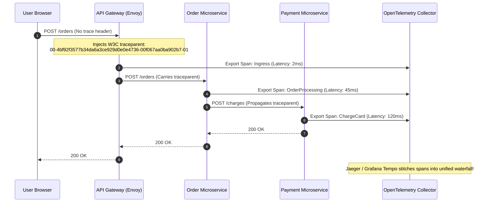

In a monolithic application, diagnosing a bug involves checking a single server log file. In a distributed microservices environment, a single user request can traverse 20 separate containers across multiple Kubernetes nodes. When a request fails or experiences latency, traditional server logging falls short.

Achieving **Centralized Observability** requires combining three core pillars: **Metrics**, **Structured Logs**, and **Distributed Tracing**, unified via vendor-neutral standards like **OpenTelemetry**.

## The Three Pillars of Distributed Observability

```
+-------------------------------------------------------------------+
|                     OPEN TELEMETRY COLLECTOR                      |
+-------------------------------------------------------------------+
       |                                |                           |
       v                                v                           v
+------------------+         +--------------------+       +------------------+
|     METRICS      |         |  DISTRIBUTED TRACE |       |  STRUCTURED LOG  |
|  (Prometheus)    |         |  (Jaeger / Tempo)  |       |  (Loki / ELK)    |
|  - Request Rate  |         |  - Span Durations  |       |  - JSON Payload  |
|  - Error Rates   |         |  - Trace Correlation|       |  - TraceID Key   |
|  - CPU / Memory  |         |  - Service Dependencies|   |  - Severity      |
+------------------+         +--------------------+       +------------------+
```

### 1. Metrics (What is happening?)
Metrics are aggregated numerical data points collected over time intervals (e.g., CPU utilization, HTTP request rates, 5xx error percentages).
- **Tooling**: Prometheus, Grafana.
- **Use Case**: Setting up real-time alerting rules (e.g., alert on-call engineer if 5xx error rate exceeds 1% over 5 minutes).

### 2. Distributed Tracing (Where is it happening?)
Distributed tracing tracks the complete lifecycle of a request as it flows across network boundaries.
- **Core Concepts**:
  - **Trace ID**: A unique identifier assigned to a request at the ingress gateway and propagated in HTTP headers (`traceparent`) across all internal microservice calls.
  - **Span**: Represents a single unit of work (e.g., an HTTP client call or a SQL query) with start time, duration, and metadata.
- **Tooling**: Jaeger, Grafana Tempo, Zipkin.

### 3. Structured Logging (Why is it happening?)
Logs provide detailed context about specific internal events.
- **Rule**: All logs MUST be output in structured JSON format and automatically include the current `trace_id` and `span_id`. This allows an engineer inspecting a trace in Grafana to jump directly to exact log lines generated during that specific trace.

## Implementing OpenTelemetry (OTel) Standard

Avoid vendor lock-in by using OpenTelemetry SDKs:

```yaml
# OpenTelemetry Collector Configuration Example
receivers:
  otlp:
    protocols:
      grpc:
      http:

processors:
  batch:

exporters:
  prometheus:
    endpoint: "0.0.0.0:8889"
  otlp/tempo:
    endpoint: "tempo:4317"
    tls:
      insecure: true

service:
  pipelines:
    traces:
      receivers: [otlp]
      processors: [batch]
      exporters: [otlp/tempo]
    metrics:
      receivers: [otlp]
      processors: [batch]
      exporters: [prometheus]
```

## Conclusion

Observability is not an afterthought; it is an active architectural requirement. By instrumenting microservices with OpenTelemetry, standardizing on JSON logging with trace propagation, and combining metrics with Jaeger tracing, platform engineering teams gain complete visibility into complex distributed environments.


---

## Architectural Deep Dive: W3C TraceContext Propagation & OpenTelemetry SDK

In distributed microservices, debugging production incidents without distributed tracing is nearly impossible. A user transaction may span 15 independent containers across 3 cloud regions. If Service C encounters a database deadlock, tracing must correlate that specific database query directly back to the initial HTTP request triggered by the user.

Modern cloud-native architectures adhere to the **W3C TraceContext standard** (`traceparent: 00-{traceId}-{spanId}-{traceFlags}`), automatically propagating cryptographic trace identifiers across HTTP headers and Kafka message metadata.



### 1. Concrete Implementation: Node.js OpenTelemetry SDK Bootstrap

The following implementation initializes the OpenTelemetry Node.js SDK before application startup, auto-instrumenting HTTP, Express, and PostgreSQL:

```typescript
import { NodeSDK } from '@opentelemetry/sdk-node';
import { getNodeAutoInstrumentations } from '@opentelemetry/auto-instrumentations-node';
import { OTLPTraceExporter } from '@opentelemetry/exporter-trace-otlp-grpc';
import { Resource } from '@opentelemetry/resources';
import { SemanticResourceAttributes } from '@opentelemetry/semantic-conventions';

const traceExporter = new OTLPTraceExporter({
  url: process.env.OTEL_EXPORTER_OTLP_ENDPOINT || 'http://otel-collector.monitoring:4317',
});

export const otelSDK = new NodeSDK({
  resource: new Resource({
    [SemanticResourceAttributes.SERVICE_NAME]: 'order-service',
    [SemanticResourceAttributes.SERVICE_VERSION]: '1.4.2',
    [SemanticResourceAttributes.DEPLOYMENT_ENVIRONMENT]: process.env.NODE_ENV || 'production',
  }),
  traceExporter,
  instrumentations: [
    getNodeAutoInstrumentations({
      '@opentelemetry/instrumentation-fs': { enabled: false }, // Reduce noise
    }),
  ],
});

otelSDK.start();

process.on('SIGTERM', () => {
  otelSDK.shutdown()
    .then(() => console.log('Tracing SDK terminated successfully.'))
    .finally(() => process.exit(0));
});
```

---

## SRE Failure Modes & Production Troubleshooting Playbook

### Incident Scenario A: Broken TraceContext Header Propagation Causing Disjointed Traces
* **Root Cause:** A developer used an un-instrumented raw HTTP client (`axios.create()` without interceptors) to query an internal billing service. The outgoing call omitted `traceparent`, fragmenting one user request into two isolated traces in Jaeger.
* **Telemetry & Diagnostic Command:**
  ```bash
  # Search traces with parent_span_id null in Jaeger API
  curl -s "http://jaeger:16686/api/traces?service=billing-service" | jq '.data[] | select(.spans[0].references == [])'
  ```
* **Mitigation Protocol:**
  1. Enforce automated OpenTelemetry instrumentation wrappers across all internal HTTP/gRPC client factories.
  2. Implement an API Gateway assertion that logs a warning whenever an internal service receives an east-west request lacking `traceparent`.

### Incident Scenario B: Metric Memory Leak via High Cardinality Path Parameters
* **Root Cause:** An application metric tracked request count using the raw request URL including UUIDs: `http_requests_total{path="/orders/7d25e01b-c128-4ef8-8316"}`. Generating 500,000 unique series crashed Prometheus.
* **Telemetry & Diagnostic Command:**
  ```bash
  # Identify top memory-consuming metric labels in Prometheus TSDB
  promtool tsdb analyze /data/prometheus
  ```
* **Mitigation Protocol:**
  1. Parameterize URL path labels (e.g., `/orders/:orderId`) in metric collection middleware before recording metrics.
  2. Implement OpenTelemetry metric view processors that drop unapproved high-cardinality labels.

---

## Architectural Trade-off Analysis: Telemetry Collection Approaches

| Collection Strategy | Implementation Friction | Performance Overhead | Distributed Context Propagation | Maintenance |
| :--- | :--- | :--- | :--- | :--- |
| **Manual Logging & Regex** | Very High (Custom formats) | High (Disk I/O) | Impossible across hops | High |
| **OpenTelemetry SDK** | Moderate (App bootstrap code) | Minimal (<1-2% CPU) | Native & Standardized | Low (CNCF standard) |
| **eBPF Zero-Code (Beyla)** | Lowest (Kernel space probe) | Ultra-low (Zero app code)| Limited (Cannot inspect custom payloads)| Minimal |

---

## Observability Production Verification Checklist

* [ ] OpenTelemetry SDK active and exporting via OTLP gRPC to centralized collectors.
* [ ] W3C `traceparent` headers forwarded across 100% of outbound HTTP and Kafka messages.
* [ ] Structured JSON logging enforced with correlated `trace_id` and `span_id` injected into every log entry.
* [ ] High-cardinality values (UUIDs, tokens, emails) barred from metric label names.
* [ ] Tail-based sampling configured in collector to drop redundant healthy traces.
