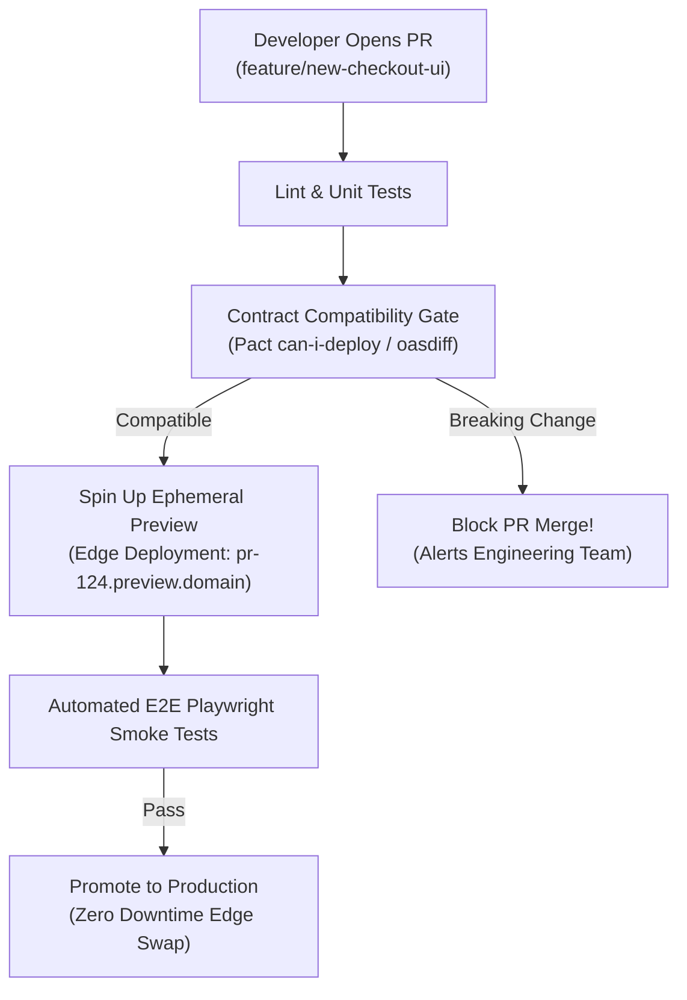

In decoupled headless platforms, frontend applications (Next.js, Remix, mobile apps) and backend microservices (catalog, cart, payment) are developed in separate repositories and deployed on independent schedules. This decoupling enables high team velocity, but introduces risk: how do we ensure a backend API deployment does not break the production frontend?

This article outlines how to build resilient **CI/CD pipelines for headless architectures** using automated contract verification, preview deployments, and zero-downtime canary rollouts.

## Key Pipeline Strategies for Headless Systems

### 1. Consumer-Driven Contract Testing in PR Pipelines
Before merging a pull request in a backend repository, the CI build pipeline must verify that proposed schema changes do not violate contracts expected by active frontends.
- Run **Pact** or **OpenAPI Spec Diff** checks automatically against published frontend consumer expectations.
- Reject the build if a breaking change (e.g., removing a field or changing a data type) is detected.

### 2. Ephemeral Preview Environments for Frontend Pull Requests
When a frontend engineer opens a pull request:
- The CI pipeline builds an ephemeral preview deployment (e.g., Vercel Preview Deployment or dynamic Kubernetes namespace).
- The preview frontend runs automated Playwright E2E tests against staging API Gateway endpoints to validate real-world integration.

```
[ Developer Pull Request ]
            |
            v
+-----------------------------------+
|  GitHub Actions CI Workflow       |
|  - Linting & Type Check           |
|  - OpenAPI Contract Verification  |
|  - Build Docker / Static Artifact |
+-----------------------------------+
            |
            v
+-----------------------------------+
|  Deploy Ephemeral Staging Pod     |
|  - Run Playwright E2E Tests       |
+-----------------------------------+
            |
            v (On Merge to Main)
+-----------------------------------+
|  Canary Release to Production     |
|  - 10% Traffic -> 100% Traffic    |
+-----------------------------------+
```

### 3. Progressive Canary Rollouts at the API Gateway Layer
When deploying a new version of a backend microservice:
1. Deploy the new container image alongside the existing version in the production cluster.
2. Configure the API Gateway (Kong, Apigee, or Kubernetes Gateway API) to route 5% of production traffic to the new container.
3. Automatically monitor error rates and latency metrics via Prometheus. If error rates increase, rollback traffic routing instantly.

## Conclusion

Decoupled architectures require decoupled CI/CD pipelines. By embedding contract testing, preview environments, and automated canary rollouts into your pipeline, teams deploy frontend and backend changes independently with complete confidence.


---

## Architectural Deep Dive: Contract-Gated CI/CD & Ephemeral Preview Environments

In a modern headless architecture, frontend and backend deployment cadences are completely decoupled: the marketing team may deploy Next.js frontend updates 15 times a day, while backend microservices deploy bi-weekly.

To guarantee that independent frontend releases never break against production backend endpoints, modern pipelines enforce **Contract-Gated CI/CD** (using Pact Broker / oasdiff) alongside **Ephemeral Preview Environments** (provisioning temporary edge deployments on Cloudflare Workers / Vercel for every Pull Request).



### 1. Concrete Implementation: GitHub Actions Contract-Gated Deployment Workflow

The following GitHub Actions workflow demonstrates how to gate frontend deployments against live backend contracts:

```yaml
name: Frontend Contract-Gated Deployment

on:
  pull_request:
    branches: [main]
  push:
    branches: [main]

jobs:
  validate-and-deploy:
    runs-on: ubuntu-latest
    steps:
      - uses: actions/checkout@v4

      - name: Setup Node.js
        uses: actions/setup-node@v4
        with:
          node-version: 20
          cache: 'npm'

      - name: Install Dependencies
        run: npm ci

      - name: Verify Consumer Contracts against Backend
        run: |
          # Query Pact Broker to ensure current frontend contract is satisfied in production
          npx pact-broker can-i-deploy \
            --pacticipant FrontendStorefront \
            --version ${{ github.sha }} \
            --to-environment production \
            --broker-base-url ${{ secrets.PACT_BROKER_URL }} \
            --broker-token ${{ secrets.PACT_BROKER_TOKEN }}

      - name: Deploy Ephemeral Preview Environment
        if: github.event_name == 'pull_request'
        run: |
          npx wrangler pages deploy ./dist --project-name=storefront-preview --branch=${{ github.head_ref }}
```

---

## SRE Failure Modes & Production Troubleshooting Playbook

### Incident Scenario A: Cache Stampede on Edge CDN After Instant Frontend Static Rebuild
* **Root Cause:** A complete site rebuild purged 100% of CDN edge cache keys simultaneously. The subsequent wave of 25,000 requests hit the origin SSR servers directly, triggering CPU exhaustion and 502 Bad Gateway errors.
* **Telemetry & Diagnostic Command:**
  ```bash
  # Check origin request rate vs edge cache hit ratio in Cloudflare Analytics
  curl -s "https://api.cloudflare.com/client/v4/zones/$ZONE_ID/analytics/dashboard" ...
  ```
* **Mitigation Protocol:**
  1. Implement Incremental Static Regeneration (ISR) and stale-while-revalidate cache headers to avoid global cache purges.
  2. Warm origin CDN caches programmatically using a crawler before switching DNS traffic.

### Incident Scenario B: Secrets Exposure in Multi-Tenant Monorepo CI Workflows
* **Root Cause:** A pull request from a fork triggered an echo of environment variables during an npm script, leaking production API keys in publicly accessible GitHub Actions workflow run logs.
* **Telemetry & Diagnostic Command:**
  ```bash
  # Audit GitHub Actions workflow logs for unmasked secret variables
  gh run view $RUN_ID --log | grep -E "AKIA[0-9A-Z]{16}|eyJh"
  ```
* **Mitigation Protocol:**
  1. Ban the use of `pull_request_target` triggers for untrusted forks; require explicit approval for external PR actions.
  2. Implement automated secret scanning tools (e.g., GitGuardian, Trivy) in pre-commit and CI phases.

---

## Architectural Trade-off Analysis: Deployment Strategies

| Strategy | Rollback Duration | Infrastructure Cost | Risk Profile | Verification Fidelity |
| :--- | :--- | :--- | :--- | :--- |
| **In-Place Deployment** | Slow (Re-run pipeline) | Lowest (Single server set) | Extreme (Downtime risk) | Poor |
| **Blue/Green Deployment** | Instant (<5s DNS / LB cut) | High (200% compute during deploy)| Minimal | High (Pre-tested green) |
| **Canary Rollout (Progressive)**| Instant (Traffic weight shift)| Moderate (Gradual compute expansion)| Lowest | Highest (Real user telemetry)|

---

## Headless CI/CD Production Verification Checklist

* [ ] Consumer-Driven Contract checks (`can-i-deploy`) pass before code is built.
* [ ] Ephemeral preview environments automatically created for every pull request.
* [ ] Edge CDN caching configured with stale-while-revalidate to prevent origin cache stampedes.
* [ ] Automated Playwright / Cypress smoke tests executed against preview environments.
* [ ] Zero-downtime Blue/Green or Canary cutover strategies active on production clusters.
