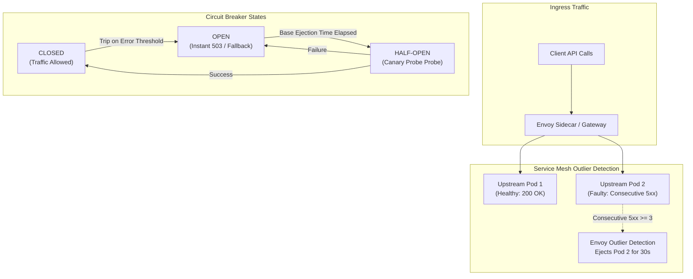

In a microservices architecture, services make frequent network calls to downstream microservices and third-party APIs. If a downstream dependency experiences an outage or severe latency, upstream callers can quickly exhaust thread pools and memory while waiting for responses, triggering a **cascading system failure**.

The **Circuit Breaker Pattern** acts as an automatic safety switch. It detects downstream failures and immediately trips, failing fast and preventing localized outages from taking down the entire platform.

## How a Circuit Breaker Works

A circuit breaker operates as a state machine with three distinct states:

```
                  +--------------------------------+
                  |             CLOSED             |
                  | (Normal Operation: Pass All)   |
                  +--------------------------------+
                                  |
                                  | Failure Threshold Exceeded
                                  v
                  +--------------------------------+
                  |              OPEN              |
                  | (Tripped: Fail Fast Immediately)|
                  +--------------------------------+
                                  |
                                  | Reset Timeout Expired
                                  v
                  +--------------------------------+
                  |           HALF-OPEN            |
                  | (Test Probe: Allow Limited Req)|
                  +--------------------------------+
                       /                            Success Rate Met/                        \Probe Failed
                     v                          v
             [ Back to CLOSED ]             [ Back to OPEN ]
```

1. **CLOSED**: Normal operation. Requests flow through to the downstream service. The breaker monitors error percentages and response latencies.
2. **OPEN**: The error rate exceeds the configured threshold (e.g., >50% failure rate over 10 seconds). The circuit breaker trips open: all incoming calls fail immediately (`CallNotPermittedException`) without sending network traffic to the unhealthy dependency. Fallback logic is executed.
3. **HALF-OPEN**: After a reset timeout (e.g., 30 seconds), the breaker allows a limited number of trial requests through to test downstream health. If trial requests succeed, the breaker returns to **CLOSED**; if they fail, it trips back to **OPEN**.

## Code Implementation Example (Resilience4j)

```java
CircuitBreakerConfig config = CircuitBreakerConfig.custom()
    .failureRateThreshold(50) // Trip if 50% of requests fail
    .waitDurationInOpenState(Duration.ofSeconds(30)) // Stay OPEN for 30s
    .slidingWindowSize(10) // Evaluate last 10 requests
    .build();

CircuitBreakerRegistry registry = CircuitBreakerRegistry.of(config);
CircuitBreaker circuitBreaker = registry.circuitBreaker("paymentService");

Supplier<String> decoratedSupplier = CircuitBreaker.decorateSupplier(
    circuitBreaker, 
    () -> paymentGatewayClient.charge()
);

// Execute with fallback response
String result = Try.ofSupplier(decoratedSupplier)
    .recover(throwable -> "Fallback: Payment Gateway Temporarily Unavailable")
    .get();
```

## Service Mesh Circuit Breaking (Istio / Envoy)

Circuit breakers can also be applied transparently at the infrastructure level without modifying application code using Service Mesh Envoy configurations:

```yaml
apiVersion: networking.istio.io/v1alpha3
kind: DestinationRule
metadata:
  name: payment-service-breaker
spec:
  host: payment-service
  trafficPolicy:
    connectionPool:
      tcp:
        maxConnections: 100
      http:
        http1MaxPendingRequests: 10
    outlierDetection:
      consecutive5xxErrors: 3
      interval: 10s
      baseEjectionTime: 30s
```

## Conclusion

Circuit breakers prevent localized microservice failures from escalating into total system outages. Combining application-level fallback logic with service mesh outlier detection provides enterprise-grade fault tolerance.


---

## Architectural Deep Dive: Outlier Detection via Envoy Proxy & Adaptive Thresholds

While application-level libraries (such as Resilience4j or Opossum) provide granular in-process circuit breaking, modern cloud-native architectures delegate failure isolation to the **Service Mesh layer (Envoy Proxy)**. Envoy monitors passive HTTP traffic and automatically ejects unhealthy upstream hosts from the load balancing pool without requiring manual code refactoring.



### 1. Concrete Implementation: Envoy Outlier Detection & Circuit Breaking Spec

The following Kubernetes Envoy / Istio `DestinationRule` configuration implements passive outlier detection and connection pool throttling:

```yaml
apiVersion: networking.istio.io/v1alpha3
kind: DestinationRule
metadata:
  name: payment-service-circuit-breaker
  namespace: production
spec:
  host: payment-service.production.svc.cluster.local
  trafficPolicy:
    connectionPool:
      tcp:
        maxConnections: 1024
      http:
        http1MaxPendingRequests: 100
        maxRequestsPerConnection: 10
    outlierDetection:
      consecutive5xxErrors: 3
      interval: 10s
      baseEjectionTime: 30s
      maxEjectionPercent: 50
      minHealthPercent: 50
```

---

## SRE Failure Modes & Production Troubleshooting Playbook

### Incident Scenario A: Premature Circuit Breaker Trip on Cold Start Microservice Deployments
* **Root Cause:** A new JVM or Node.js deployment takes 8 seconds to initialize database connection pools. Initial synthetic readiness traffic fails, causing Envoy to trip the circuit breaker and eject 100% of new pods simultaneously.
* **Telemetry & Diagnostic Command:**
  ```bash
  # Check Envoy outlier detection ejections in cluster stats
  curl -s http://127.0.0.1:15000/stats | grep "outlier_detection.ejections_enforced_total"
  ```
* **Mitigation Protocol:**
  1. Configure `initialDelaySeconds` and strict `startupProbe` definitions in Kubernetes to shield pods from traffic until initialization completes.
  2. Increase `consecutive5xxErrors` threshold during canary rollout windows.

### Incident Scenario B: Circuit Breaker Oscillation (Flapping) Causing Ingress Storms
* **Root Cause:** As soon as an upstream service recovers and the breaker enters HALF-OPEN state, a queued backlog of retried client requests floods the instance, instantly tripping the breaker back to OPEN.
* **Telemetry & Diagnostic Command:**
  ```bash
  # Monitor circuit breaker state transitions in Prometheus
  rate(envoy_cluster_outlier_detection_ejections_active[1m])
  ```
* **Mitigation Protocol:**
  1. Implement exponential backoff with full jitter on all client retry policies to prevent synchronized retry waves.
  2. Increase `baseEjectionTime` exponentially upon repeated ejections.

---

## Architectural Trade-off Analysis: Circuit Breaker Placement

| Architecture Tier | Implementation Tool | Deployment Overhead | Granular Custom Fallbacks | CPU / Latency Cost |
| :--- | :--- | :--- | :--- | :--- |
| **In-Process Library** | Opossum (Node) / Resilience4j | Embedded in application | Highest (Custom fallback objects)| Low memory overhead |
| **Sidecar Proxy (Mesh)** | Envoy / Istio | Zero application changes | Generic HTTP 503 responses | ~1-2ms proxy latency |
| **Centralized Gateway** | Kong / Apigee | Configured at Edge | Moderate (Edge cached fallbacks) | Single point of failure |

---

## Circuit Breaker Production Verification Checklist

* [ ] Outlier detection policies configured with a hard ceiling on `maxEjectionPercent` (never eject 100% of fleet).
* [ ] Health check and liveness probe endpoints exempted from circuit breaker counters.
* [ ] Client-side exponential backoff and randomized jitter enforced across all calling microservices.
* [ ] Fallback responses validated under simulated chaos conditions (Chaos Mesh / Litmus).
* [ ] Prometheus alerts configured on sustained `circuit_breaker_open` conditions.
