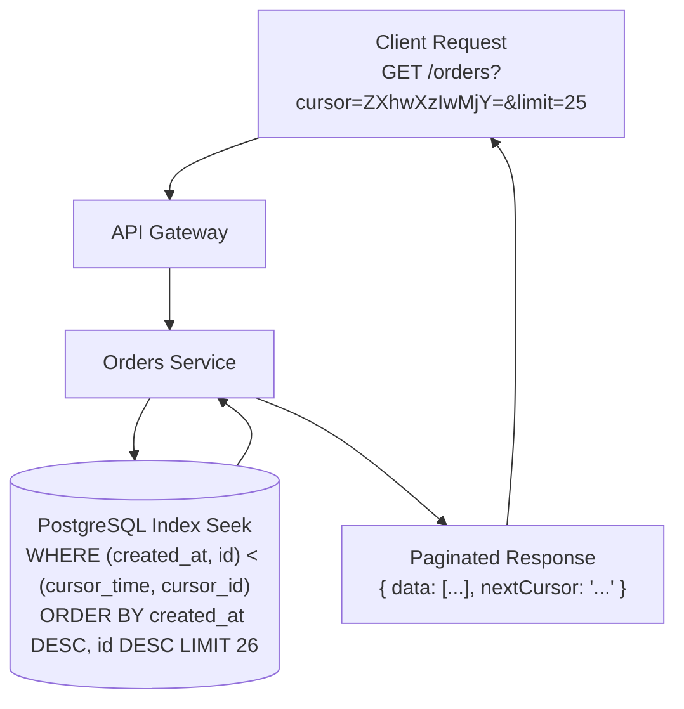

REpresentational State Transfer (REST) remains the dominant architectural style for web APIs. However, inconsistent URL conventions, improper HTTP status code usage, and unstandardized error formatting create developer friction and integration bugs.

This guide provides practical rules for designing clean, intuitive, and professional RESTful APIs.

## Core Rules for RESTful Resource URLs

### Rule 1: Use Nouns, Not Verbs, for Resource Paths
URLs should represent resources (nouns), while HTTP methods (GET, POST, PUT, DELETE) specify the operation.
- ❌ **Incorrect**: `GET /api/getUsers`, `POST /api/createNewOrder`
- ✅ **Correct**: `GET /api/v1/users`, `POST /api/v1/orders`

### Rule 2: Use Plural Nouns for Collections
Keep endpoint paths consistent by using plural nouns for collections:
- `GET /api/v1/products`: Retrieve list of products.
- `GET /api/v1/products/992`: Retrieve product with ID 992.
- `GET /api/v1/products/992/reviews`: Retrieve reviews for product 992.

### Rule 3: Use Kebab-Case for URI Paths
Use lowercase hyphen-separated strings (kebab-case) for readable URLs:
- ❌ **Incorrect**: `/api/v1/user_profiles` or `/api/v1/userProfiles`
- ✅ **Correct**: `/api/v1/user-profiles`

---

## Proper HTTP Status Code Usage

Never return `200 OK` for an error response with an embedded `{ "status": "error" }` payload. Use standard HTTP status codes:

| Category | Code | Meaning | Usage |
| :--- | :--- | :--- | :--- |
| **Success** | `200 OK` | Successful request | Standard GET/PUT response |
| | `201 Created` | Resource created | Response to successful POST |
| | `204 No Content` | Success with empty body | Response to successful DELETE |
| **Client Error**| `400 Bad Request` | Invalid client payload | Malformed JSON or validation failure |
| | `401 Unauthorized` | Missing authentication | Missing or invalid bearer token |
| | `403 Forbidden` | Authenticated but unauthorized| Lacking required scope/role |
| | `404 Not Found` | Resource does not exist | Invalid URI resource ID |
| | `429 Too Many Requests`| Rate limit exceeded | Client throttled at gateway |
| **Server Error**| `500 Internal Error` | Server code exception | Unhandled backend exception |

---

## Standardized Error Payload Format (RFC 7807)

Adopt the **RFC 7807 Problem Details** standard for error responses:

```json
{
  "type": "https://api.example.com/errors/invalid-payload",
  "title": "Invalid Request Payload",
  "status": 400,
  "detail": "The 'email' field must be a valid email address.",
  "instance": "/api/v1/users",
  "invalidParams": [
    {
      "name": "email",
      "reason": "Missing @ domain symbol"
    }
  ]
}
```

## Conclusion

Clean REST API design requires discipline: noun-based resources, proper HTTP verbs, standard status codes, and RFC 7807 error formatting. Following these principles ensures your APIs are intuitive, maintainable, and developer-friendly.


---

## Architectural Deep Dive: Cursor-Based Pagination & RFC 7807 Error Envelopes

Building enterprise-grade RESTful APIs requires engineering consistency at scale. Two common design flaws in legacy backends are: (1) using naive `offset/limit` pagination that degrades exponentially on large tables, and (2) returning generic HTTP 500 error messages with inconsistent JSON bodies.

Modern backend architectures enforce **Cursor-Based Pagination** for $O(1)$ database seek performance and **RFC 7807 Problem Details** for deterministic client error handling.



### 1. Concrete Implementation: Cursor-Based Pagination in Node.js & TypeScript

The following implementation demonstrates how to build robust, tamper-resistant base64url cursor pagination:

```typescript
import { Request, Response } from 'express';

interface OrderRecord {
  id: string;
  createdAt: string;
  totalCents: number;
}

interface CursorPayload {
  createdAt: string;
  id: string;
}

export class CursorPaginationHelper {
  public static encodeCursor(record: OrderRecord): string {
    const payload: CursorPayload = {
      createdAt: record.createdAt,
      id: record.id,
    };
    return Buffer.from(JSON.stringify(payload)).toString('base64url');
  }

  public static decodeCursor(cursorStr?: string): CursorPayload | null {
    if (!cursorStr) return null;
    try {
      const decoded = Buffer.from(cursorStr, 'base64url').toString('utf8');
      return JSON.parse(decoded) as CursorPayload;
    } catch {
      return null;
    }
  }
}

export const listOrdersHandler = async (req: Request, res: Response): Promise<void> => {
  const limit = Math.min(Math.max(parseInt(req.query.limit as string) || 20, 1), 100);
  const cursor = CursorPaginationHelper.decodeCursor(req.query.cursor as string);

  // In production: execute SQL with Keyset Seek:
  // SELECT * FROM orders WHERE (created_at, id) < (cursor.createdAt, cursor.id)
  // ORDER BY created_at DESC, id DESC LIMIT ${limit + 1};

  res.status(200).json({
    data: [], // paginated items
    pagination: {
      limit,
      hasMore: false,
      nextCursor: null,
    },
  });
};
```

---

## SRE Failure Modes & Production Troubleshooting Playbook

### Incident Scenario A: Deep Offset Pagination Causing Relational DB Starvation
* **Root Cause:** A data scraper queried `GET /api/v1/products?offset=500000&limit=50`. The database scanned 500,000 rows into memory before discarding them, exhausting database CPU and disk I/O.
* **Telemetry & Diagnostic Command:**
  ```bash
  # Inspect PostgreSQL active queries with high disk read or execution time
  SELECT pid, now() - query_start AS duration, query 
  FROM pg_stat_activity 
  WHERE state = 'active' AND query LIKE '%OFFSET%' ORDER BY duration DESC;
  ```
* **Mitigation Protocol:**
  1. Deprecate offset pagination on tables exceeding 10,000 rows; migrate endpoints strictly to keyset / cursor pagination.
  2. Implement an API Gateway rule rejecting any request where `offset > 1000`.

### Incident Scenario B: Inconsistent Exception Formats Crashing Mobile Clients
* **Root Cause:** An unhandled runtime error in a microservice returned an HTML error page from NGINX rather than RFC 7807 JSON, causing mobile application JSON parsers to throw unhandled exceptions.
* **Telemetry & Diagnostic Command:**
  ```bash
  # Count non-JSON responses from API Gateway
  awk '$9 >= 500 && $15 !~ /application\/json/ {print $7, $9}' /var/log/nginx/access.log | head -20
  ```
* **Mitigation Protocol:**
  1. Configure edge proxies and microservice global exception handlers to guarantee RFC 7807 Problem Details serialization across all 4xx and 5xx responses.
  2. Add contract assertions verifying error response Content-Type is always `application/problem+json`.

---

## Architectural Trade-off Analysis: Pagination Approaches

| Metric | Offset-Limit Pagination | Keyset / Cursor Pagination | Time-Window Partitioning |
| :--- | :--- | :--- | :--- |
| **Query Complexity** | Minimal (Trivial SQL) | Moderate (Compound indices required) | High (Partition awareness) |
| **Database Performance** | Degrades linearly $O(N)$ | Constant time $O(1)$ via index seek | Constant time within partitions |
| **Data Drift Resistance** | Poor (Items shift on insertions) | High (Deterministic point-in-time) | High for time-series streams |
| **Random Page Jumping** | Supported (Jump to Page 50) | Not supported (Sequential seek only)| Supported via date ranges |

---

## Clean REST Design Production Checklist

* [ ] Resource URIs use lowercase plural nouns without verbs (e.g., `/orders` not `/getOrders`).
* [ ] HTTP status codes align strictly with specifications (200, 201, 204, 400, 401, 403, 404, 409, 422, 429, 500).
* [ ] Error responses serialized strictly according to RFC 7807 Problem Details.
* [ ] Keyset or cursor-based pagination enforced on all high-cardinality collections.
* [ ] Idempotent operations (PUT, DELETE) safely retryable using `X-Idempotency-Key` headers.
