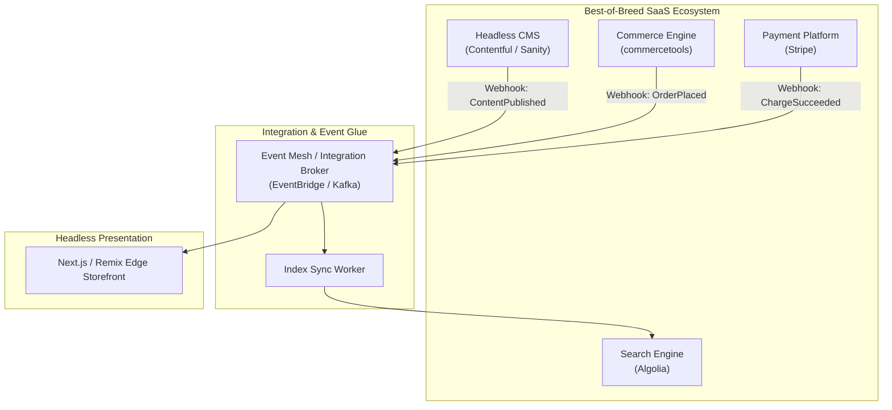

For decades, enterprise IT strategy was dominated by single-vendor monolithic software suites (e.g., legacy all-in-one ERPs and CMS suites). The pitch was enticing: buy your entire software stack from one vendor, and everything will work together out of the box.

In practice, monolithic software suites create severe **vendor lock-in**, slow innovation cadences, and mediocre feature sets across secondary modules.

The modern **Composable Enterprise** replaces monolithic suites by integrating **Best-of-Breed** specialized SaaS platforms via APIs.

## Comparing All-in-One Suites vs. Composable Best-of-Breed

```
Monolithic All-in-One Suite             Composable Best-of-Breed Architecture
+-------------------------------+       +---------------+  +---------------+  +---------------+
| SINGLE MONOLITHIC VENDOR      |       | Best Search   |  | Best CMS      |  | Best Commerce |
| - Mediocre CMS Module         |       | (Algolia /    |  | (Contentful / |  | (commercetools|
| - Slow Search Engine          |       |  Typesense)   |  |  Strapi)      |  |  / Elastic)   |
| - Legacy Checkout Engine      |       +-------+-------+  +-------+-------+  +-------+-------+
+-------------------------------+               |                  |                  |
                                                +------------------+------------------+
                                                                   | API Integration
                                                                   v
                                                     [ Unified Frontend Experience ]
```

### 1. Vendor Lock-In vs. Component Interchangeability
- **Monolithic Suite**: Migrating away from a bloated suite requires a catastrophic 2-year rewrite of your entire IT infrastructure.
- **Composable Architecture**: Because components communicate exclusively through API contracts, swapping out an search provider (e.g., moving from Elasticsearch to Algolia) requires updating a single microservice without touching your CMS or checkout engine.

### 2. Feature Quality (Jack of All Trades vs. Specialized Excellence)
- **Monolithic Suite**: The suite vendor's CMS might be acceptable, but its search engine, analytics, and mobile push modules are often outdated legacy add-ons.
- **Best-of-Breed**: Every vendor in your stack specializes 100% on their core competence (e.g., Stripe for payments, Twilio for communications, Contentful for content management).

## Architectural Guidelines for Composable Systems

1. **Enforce API Abstraction Layers**: Never call vendor APIs directly from frontend UI code. Use an API Gateway or Backend-for-Frontend (BFF) pattern to insulate your application from vendor-specific payload formats.
2. **Standardize Event Integration**: Use asynchronous event brokers (Kafka, AWS EventBridge) to propagate state changes between specialized vendors.
3. **Monitor SLA Dependencies**: Track uptime and response latencies across all third-party SaaS vendors using centralized OpenTelemetry dashboards.

## Conclusion

Composable, Best-of-Breed architecture empowers enterprises to combine market-leading SaaS solutions tailored to their exact business needs, delivering superior agility and eliminating monolithic vendor lock-in.


---

## Architectural Deep Dive: Orchestrating Packaged Business Capabilities (PBCs)

In a Composable Best-of-Breed architecture, monolithic suites (such as legacy SAP or Oracle commerce) are replaced by specialized, independent SaaS providers: an engine for catalog management (commercetools), a headless CMS for media and articles (Contentful), a search service (Algolia), and a payment gateway (Stripe).

The architectural key to avoiding chaotic point-to-point spaghetti integrations between multiple vendors is establishing a **Centralized Event-Driven Integration Mesh**:



### 1. Concrete Implementation: Resilient Vendor Webhook Ingestion Router in TypeScript

The following implementation demonstrates an asynchronous, signature-verified webhook handler that ingests third-party vendor notifications without blocking caller endpoints:

```typescript
import { Request, Response } from 'express';
import crypto from 'crypto';

interface VendorWebhookPayload {
  eventId: string;
  provider: 'commercetools' | 'contentful' | 'stripe';
  eventType: string;
  data: any;
}

export class ComposableWebhookRouter {
  private readonly secretKey: string;

  constructor(secretKey: string) {
    this.secretKey = secretKey;
  }

  public async handleWebhook(req: Request, res: Response): Promise<void> {
    const signature = req.header('X-Vendor-Signature');
    const rawBody = JSON.stringify(req.body);

    // 1. Verify HMAC cryptographic signature
    const computedHmac = crypto
      .createHmac('sha256', this.secretKey)
      .update(rawBody)
      .digest('hex');

    if (signature !== computedHmac) {
      res.status(401).json({ error: 'Invalid cryptographic signature' });
      return;
    }

    // 2. Acknowledge vendor immediately (sub-50ms) to avoid timeouts
    res.status(202).json({ received: true });

    // 3. Dispatch to background event mesh asynchronously
    const event: VendorWebhookPayload = {
      eventId: req.header('X-Event-ID') || crypto.randomUUID(),
      provider: req.body.provider,
      eventType: req.body.type,
      data: req.body.data,
    };

    await this.dispatchToEventMesh(event);
  }

  private async dispatchToEventMesh(event: VendorWebhookPayload): Promise<void> {
    // In production: push to Amazon EventBridge, Kafka, or SQS
    console.log(`[EVENT_MESH_INGESTION] Dispatched ${event.eventType} from ${event.provider}`);
  }
}
```

---

## SRE Failure Modes & Production Troubleshooting Playbook

### Incident Scenario A: Vendor API Rate-Limit Throttling Halting Checkout
* **Root Cause:** A marketing campaign generated a 5x traffic surge. The checkout microservice made synchronous REST calls to a third-party tax calculation API, exceeding the vendor's 50 req/sec limit and triggering cascading 429 Too Many Requests errors.
* **Telemetry & Diagnostic Command:**
  ```bash
  # Check for vendor rate limiting errors in gateway logs
  grep "429_TOO_MANY_REQUESTS" /var/log/nginx/access.log | grep "tax-vendor-api"
  ```
* **Mitigation Protocol:**
  1. Cache static tax lookup tables locally in Redis and refresh asynchronously via hourly scheduled batches.
  2. Implement an adaptive client-side rate limiter with exponential backoff and jitter before querying third-party SaaS vendors.

### Incident Scenario B: Vendor SDK Memory Leaks in Long-Running Node.js Workers
* **Root Cause:** A proprietary SaaS vendor SDK retained unclosed HTTP connection sockets in memory on every request, causing background worker pods to crash with Out Of Memory (OOM) errors every 4 hours.
* **Telemetry & Diagnostic Command:**
  ```bash
  # Monitor container memory growth over time
  kubectl top pods -n production -l app=catalog-sync-worker
  ```
* **Mitigation Protocol:**
  1. Prefer clean, native fetch/gRPC integrations over bulky, opaque vendor-supplied client libraries.
  2. Isolate chatty vendor sync workers into separate ephemeral Kubernetes jobs.

---

## Architectural Trade-off Analysis: Suite vs Best-of-Breed

| Dimension | All-in-One Monolithic Suite | Best-of-Breed Composable Architecture |
| :--- | :--- | :--- |
| **Vendor Lock-in** | Complete (Contractually & architecturally locked) | Minimal (Individual SaaS providers swappable)|
| **Integration Complexity**| Low initially; extremely high to customize | Moderate (Requires clean API / Event mesh) |
| **Feature Quality** | Mediocre across secondary features | Best-in-class in each specialized domain |
| **Innovation Velocity** | Tied to vendor annual release cycles | Continuous (Deploy individual modules at will)|

---

## Best-of-Breed Integration Production Checklist

* [ ] All third-party webhooks verified using cryptographic HMAC signatures before ingestion.
* [ ] Outbound vendor queries protected by circuit breakers and cached fallbacks.
* [ ] Rate-limit quotas for all external SaaS providers monitored with threshold alerts.
* [ ] Vendor integrations decoupled from user checkout paths via asynchronous event queues.
* [ ] Contract abstraction layers implemented to facilitate future vendor swapping.
