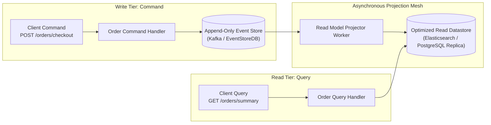

In traditional CRUD (Create, Read, Update, Delete) architectures, the same database data model is used for both writing transactions and querying data. In high-concurrency enterprise applications, this dual responsibility creates performance bottlenecks: read queries require complex database joins, while write operations require strict transactional locks on the same tables.

**Command Query Responsibility Segregation (CQRS)** and **Event Sourcing** solve this problem by completely separating the write path (Commands) from the read path (Queries).

This article explores the architecture of CQRS and Event Sourcing in data-heavy microservices.

## The CQRS Architectural Pattern

```
                                  [ Client Application ]
                                    /                                         WRITE Path/                  \READ Path
                                  /                                                     v                      v
                      +-------------------+    +-------------------+
                      |   COMMAND API     |    |    QUERY API      |
                      +---------+---------+    +---------+---------+
                                |                        ^
                                v                        | Fast Key-Value / Search
                      +-------------------+    +---------+---------+
                      |   WRITE MODEL     |    |   READ MODEL      |
                      | (Relational DB /  |    | (Elasticsearch /  |
                      |  Event Store)     |    |  Redis Cache)     |
                      +---------+---------+    +-------------------+
                                |                        ^
                                | Async Domain Events    |
                                +------------------------+
```

### 1. Command Side (Write Path)
- Handles business logic validation, state changes, and transactional enforcement.
- Optimized strictly for high-speed writes and business rule execution.
- Emits immutable **Domain Events** (e.g., `OrderPlaced`, `AddressUpdated`) upon successful execution.

### 2. Query Side (Read Path)
- Handles complex search queries, filtering, and UI page rendering.
- Consumes domain events emitted by the command side to populate read-optimized database projections (e.g., Elasticsearch for full-text search, Redis for sub-millisecond key-value lookups).
- Zero database joins required during read execution.

## Understanding Event Sourcing

Traditional databases store only the **current state** of an entity (e.g., `Order Status: SHIPPED`). **Event Sourcing** stores the entire history of state changes as an append-only sequence of immutable events in an **Event Store**.

### Benefits of Event Sourcing:
- **Complete Audit Trail**: Every change in the system is recorded with timestamp and user metadata.
- **Time Travel & State Replay**: Rebuild system state at any point in history by replaying past events.
- **Projection Flexibility**: Build new read-side databases at any time by replaying the entire historical event log into a new datastore.

## Implementation Challenges to Consider

1. **Eventual Consistency**: The read model lags slightly behind the write model (usually milliseconds). Frontend UIs must be designed to accommodate eventual consistency.
2. **Schema Evolution**: As business logic changes, event schemas evolve. Implement event versioning strategies (e.g., Avro schemas with Schema Registry).

## Conclusion

CQRS and Event Sourcing deliver unprecedented performance, scalability, and auditability for complex, data-heavy systems. By separating write operations from read projections, engineering teams build systems capable of handling massive concurrency.


---

## Architectural Deep Dive: Event Store Projections & Snapshot Optimization

In data-intensive platforms, combining **Command Query Responsibility Segregation (CQRS)** with **Event Sourcing** fundamentally restructures persistence: state is no longer overwritten via `UPDATE` statements; instead, state is represented as an append-only stream of immutable domain events (`OrderCreated`, `PaymentCaptured`, `ItemDispatched`).

To maintain millisecond read performance without replaying millions of historical events on every query, read projections asynchronously materialize optimized view tables (e.g., in Elasticsearch or PostgreSQL read replicas) using event consumers.



### 1. Concrete Implementation: Event Sourcing Aggregate & Projector in TypeScript

The following implementation demonstrates how an Order aggregate reconstructs state from past events and publishes materialized projections:

```typescript
export interface DomainEvent {
  aggregateId: string;
  version: number;
  type: string;
  payload: any;
  occurredAt: string;
}

export class OrderAggregate {
  public id!: string;
  public status: 'PENDING' | 'PAID' | 'CANCELLED' = 'PENDING';
  public totalCents = 0;
  public version = 0;

  // Reconstitute state by applying historical event stream
  public static reconstitute(events: DomainEvent[]): OrderAggregate {
    const aggregate = new OrderAggregate();
    for (const event of events) {
      aggregate.apply(event, false);
    }
    return aggregate;
  }

  public apply(event: DomainEvent, isNew = true): void {
    switch (event.type) {
      case 'OrderCreated':
        this.id = event.aggregateId;
        this.totalCents = event.payload.totalCents;
        this.status = 'PENDING';
        break;
      case 'OrderPaid':
        this.status = 'PAID';
        break;
      case 'OrderCancelled':
        this.status = 'CANCELLED';
        break;
    }
    this.version = event.version;
  }
}

// Read Model Projector Consumer
export class OrderReadModelProjector {
  public async handleEvent(event: DomainEvent, dbClient: any): Promise<void> {
    if (event.type === 'OrderPaid') {
      await dbClient.query(
        `UPDATE order_read_model 
         SET payment_status = 'PAID', last_updated = $1 
         WHERE order_id = $2`,
        [event.occurredAt, event.aggregateId]
      );
    }
  }
}
```

---

## SRE Failure Modes & Production Troubleshooting Playbook

### Incident Scenario A: Read Model Projection Lag Causing "Ghost" Order Invisibility
* **Root Cause:** A consumer worker pool stalled due to memory pressure, causing Kafka consumer lag to spike to 45,000 events. Users completed checkout but refreshing the order history UI showed an empty dashboard.
* **Telemetry & Diagnostic Command:**
  ```bash
  # Check projection consumer lag across event topics
  kafka-consumer-groups.sh --bootstrap-server kafka:9092 --describe --group order-read-projector
  ```
* **Mitigation Protocol:**
  1. Return the write-model event version in the command response and implement client-side Read-Your-Own-Writes consistency by polling until the projection reaches that version.
  2. Autoscale projector workers using Kubernetes KEDA driven by consumer lag thresholds.

### Incident Scenario B: Event Schema Serialization Failure on Historical Replay
* **Root Cause:** A developer altered the JSON schema of an event payload without maintaining backward-compatible deserializers. When rebuilding read projections from scratch, historical events failed to parse.
* **Telemetry & Diagnostic Command:**
  ```bash
  # Test historical event replay against current codebase in dry-run mode
  npm run test:replay -- --from-version=1 --to-version=latest --dry-run
  ```
* **Mitigation Protocol:**
  1. Enforce strict event upcasting (transforming v1 event shapes into v2 shapes in-memory) before applying to aggregates.
  2. Enforce schema registry validation (Confluent / Apicurio) on all published events.

---

## Architectural Trade-off Analysis: State Mutation Paradigms

| Architectural Paradigm | Auditability & History | Query Performance | System Complexity | Storage Overhead |
| :--- | :--- | :--- | :--- | :--- |
| **Traditional RDBMS (CRUD)** | Low (Requires audit triggers) | High (Direct indices) | Very Low | Minimal |
| **Pure CQRS (Separate DBs)** | Moderate | Highest (Read-optimized views) | Moderate | Moderate (Data duplication) |
| **Event Sourcing + CQRS** | Absolute (Every mutation recorded)| High via projections | Very High (Event store, projectors) | High (Append-only storage) |

---

## CQRS & Event Sourcing Production Checklist

* [ ] Domain events are strictly immutable and never mutated or deleted in storage.
* [ ] Aggregate snapshots generated periodically (e.g., every 100 events) to cap aggregate loading latency.
* [ ] Projector workers designed to be strictly idempotent using event IDs and versions.
* [ ] Event schema registry active in CI/CD to prevent breaking serialization changes.
* [ ] Projection rebuild runbooks tested in staging environments with production data volume snapshots.
