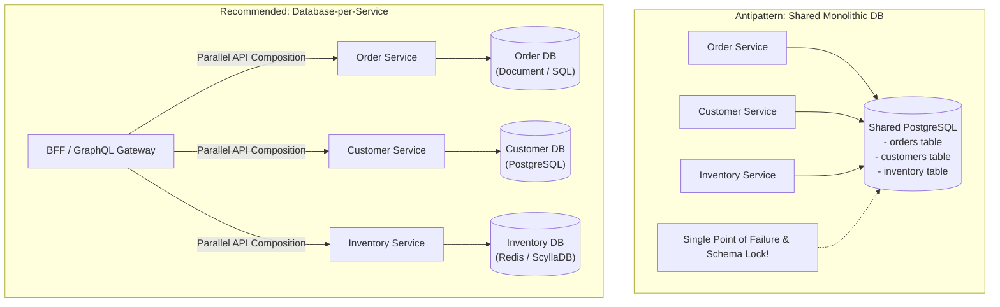

The single most critical rule of microservices architecture is: **Every microservice must exclusively own its database.** 

No external microservice or application component may query or modify another service's private database tables directly. All data access must pass through the owning service's public API or asynchronous event interfaces.

Violating this principle by sharing a central relational database across microservices destroys team autonomy, introduces tight database coupling, and turns your architecture into a distributed monolith.

## The Hazards of Shared Databases in Microservices

```
❌ SHARED DATABASE ANTIPATTERN (Tight Coupling & Failure Risk)
+--------------+       +--------------+       +--------------+
|  Sales Svc   |       | Shipping Svc |       | Billing Svc  |
+-------+------+       +-------+------+       +-------+------+
        |                      |                      |
        +----------------------+----------------------+
                               | Direct SQL Joins & Schema Dependencies
                               v
               +------------------------------+
               |  SHARED MONOLITHIC DATABASE  |
               +------------------------------+
```

1. **Schema Change Collisions**: If Team A renames a column in the shared database, Team B's microservice crashes in production without warning.
2. **Resource Lock Starvation**: A long-running reporting query executed by the `Billing Service` acquires table locks, blocking high-priority write transactions in the `Sales Service`.
3. **Impaired Polyglot Storage**: Forcing all microservices to share a relational SQL database prevents individual services from adopting specialized datastores (e.g., Redis for sessions, Neo4j for graphs, Elasticsearch for search).

## Enforcing the "Database-per-Service" Pattern

```
✅ DATABASE-PER-SERVICE PATTERN (Encapsulation & Autonomy)
+--------------+       +--------------+       +--------------+
|  Sales Svc   |       | Shipping Svc |       | Billing Svc  |
+-------+------+       +-------+------+       +-------+------+
        |                      |                      |
        v Private DB           v Private DB           v Private DB
+--------------+       +--------------+       +--------------+
| Sales DB     |       | Shipping DB  |       | Billing DB   |
+--------------+       +--------------+       +--------------+
```

### Rule 1: Private Storage Encapsulation
The database instance or schema assigned to Microservice A is accessible ONLY by Microservice A's database credentials. Network security and IAM roles must enforce this isolation.

### Rule 2: Inter-Service Data Retrieval via APIs
If `Shipping Service` needs customer address data owned by `Sales Service`, it must make an HTTP/gRPC request to `Sales Service`'s public endpoint (`GET /api/v1/customers/881/address`).

### Rule 3: Event-Driven Local Data Projections
For high-frequency read operations, `Shipping Service` can subscribe to `CustomerAddressUpdated` events emitted by `Sales Service` and store a read-optimized copy of the address in its own local database.

## Conclusion

Database per service is the non-negotiable foundation of microservice autonomy. By enforcing strict data encapsulation, teams achieve independent deployment schedules, eliminate schema lock collisions, and scale system storage effortlessly.


---

## Architectural Deep Dive: Database-per-Service Isolation & Cross-Domain Queries

The cardinal rule of microservices is that **services must own their databases**. Sharing a database across multiple microservices creates tight coupling at the data tier, eliminates schema refactoring autonomy, and allows one service's runaway query to exhaust connection pools for all other domains.

When cross-domain data aggregation is necessary (e.g., rendering an order summary that includes customer profile details and warehouse shipping estimates), modern architectures employ **API Composition** or **Change Data Capture (CDC) Read Replicas** rather than cross-database SQL joins.



### 1. Concrete Implementation: Parallel API Composition in TypeScript

The following implementation demonstrates how a Backend-for-Frontend (BFF) or API Gateway aggregates data from decoupled microservices without direct database joins:

```typescript
import { Request, Response } from 'express';

interface AggregatedOrderView {
  orderId: string;
  totalCents: number;
  customer: { id: string; email: string; name: string };
  shippingStatus: string;
}

export async function getAggregatedOrderDetails(
  req: Request,
  res: Response
): Promise<void> {
  const { orderId } = req.params;

  try {
    // 1. Fetch primary order entity
    const orderRes = await fetch(`http://order-service.internal/orders/${orderId}`);
    if (!orderRes.ok) {
      res.status(orderRes.status).json({ error: 'Order not found' });
      return;
    }
    const order = await orderRes.json();

    // 2. Fetch associated domain data in parallel with timeout budgets
    const [customerRes, shippingRes] = await Promise.allSettled([
      fetch(`http://customer-service.internal/customers/${order.customerId}`),
      fetch(`http://shipping-service.internal/shipments/by-order/${orderId}`),
    ]);

    const customer =
      customerRes.status === 'fulfilled' && customerRes.value.ok
        ? await customerRes.value.json()
        : { id: order.customerId, name: 'Unavailable', email: 'Unavailable' };

    const shipping =
      shippingRes.status === 'fulfilled' && shippingRes.value.ok
        ? await shippingRes.value.json()
        : { status: 'PENDING_DISPATCH' };

    const view: AggregatedOrderView = {
      orderId: order.id,
      totalCents: order.totalCents,
      customer,
      shippingStatus: shipping.status,
    };

    res.status(200).json(view);
  } catch (err: any) {
    res.status(500).json({ error: 'Failed to aggregate order details' });
  }
}
```

---

## SRE Failure Modes & Production Troubleshooting Playbook

### Incident Scenario A: Backdoor SQL Joins Bypassing API Domain Validation
* **Root Cause:** A business intelligence tool and an internal reporting script were granted direct read access to microservice databases. A team renamed a column in a routine migration, silently breaking executive analytics dashboards.
* **Telemetry & Diagnostic Command:**
  ```bash
  # Audit database user connection origins and roles
  SELECT usename, client_addr, count(*) FROM pg_stat_activity GROUP BY usename, client_addr;
  ```
* **Mitigation Protocol:**
  1. Revoke direct external database user privileges; expose dedicated reporting read replicas or publish analytical events to a Snowflake / BigQuery data warehouse.
  2. Enforce strict network security policies (AWS Security Groups, Kubernetes NetworkPolicies) isolating databases to their owning service pods.

### Incident Scenario B: Shared Connection Pool Exhaustion Cascading Across Services
* **Root Cause:** In a legacy shared-database setup, an unindexed query from the notification service consumed all 200 available database connections, causing the checkout service to time out and crash.
* **Telemetry & Diagnostic Command:**
  ```bash
  # Check PostgreSQL active connection pool saturation per database
  SELECT datname, numbackends FROM pg_stat_database;
  ```
* **Mitigation Protocol:**
  1. Migrate shared schemas to independent database instances or dedicated RDS clusters.
  2. Implement PgBouncer connection pooling with hard caps per database user.

---

## Architectural Trade-off Analysis: Data Isolation Models

| Isolation Model | Deployment Autonomy | Blast Radius | Cross-Entity Query Cost | Operational Complexity |
| :--- | :--- | :--- | :--- | :--- |
| **Shared Database & Schema** | Zero (Coordinated deploys) | Global (One slow query sinks all)| Lowest (Native SQL JOIN) | Low (Single instance) |
| **Shared DB, Separate Schemas**| Low | Moderate | Moderate (Cross-schema joins) | Moderate |
| **Dedicated Database per Service**| Absolute | Isolated to service | High (Network API composition) | High (Multiple clusters) |

---

## Data Ownership Production Verification Checklist

* [ ] Every microservice has its own dedicated database user and independent schema/instance.
* [ ] Zero foreign key constraints exist across microservice database boundaries.
* [ ] Cross-domain queries executed via API Composition, GraphQL Federation, or CDC read models.
* [ ] Analytical queries offloaded to asynchronous event pipelines and cloud data warehouses.
* [ ] Network security policies block all direct database connections from foreign microservices.
