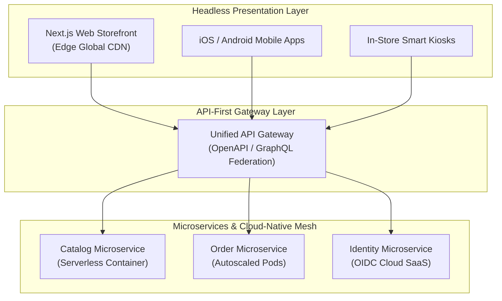

If you work in software engineering, digital product management, or e-commerce, you have likely heard the acronym **MACH**. Industry leaders and technology vendors tout MACH as the gold standard for building modern, high-performance web platforms.

But what does MACH actually stand for, and how does it differ from traditional monolithic software? This beginner's guide breaks down the core concepts of MACH architecture in plain, accessible terms.

## What Does MACH Stand For?

MACH is an acronym representing four core architectural principles:

```
M - Microservices         (Independent, small backend services)
A - API-First             (All services communicate via APIs)
C - Cloud-Native SaaS     (Elastic cloud compute & global CDNs)
H - Headless              (Frontend UI decoupled from Backend)
```

### 1. M for Microservices
Instead of building one massive application containing all business features, microservices break the system into small, independent services (e.g., an `Inventory Service`, a `Payment Service`, and a `Search Service`). Each service can be updated and deployed without touching the rest of the application.

### 2. A for API-First
Every microservice exposes its functionality through Application Programming Interfaces (APIs). APIs act as standardized contracts, allowing different applications and programming languages to exchange data seamlessly.

### 3. C for Cloud-Native SaaS
MACH applications are designed specifically to run in cloud environments (AWS, GCP, Azure). They take full advantage of serverless compute, auto-scaling container clusters (Kubernetes), and multi-tenant SaaS services.

### 4. H for Headless
In traditional software, the user interface (the "head") is tightly glued to the backend database (the "body"). Headless architecture detaches the frontend completely. The backend provides content and logic purely via APIs, allowing frontend developers to build web apps, mobile apps, and smart device interfaces using modern tools like React or Next.js.

## Key Benefits of MACH Architecture

- **Faster Time-to-Market**: Product teams launch new features independently without waiting for massive monolithic release cycles.
- **Unlimited Scalability**: Scale only the specific microservices experiencing high traffic during peak sales events.
- **Freedom from Vendor Lock-In**: Replace an outdated component (e.g., search provider) without rewriting your entire platform.

## Conclusion

MACH architecture is a modern mindset for building flexible, future-proof software systems. By adopting Microservices, API-first design, Cloud-native SaaS, and Headless presentation, enterprises deliver superior digital experiences at global scale.


---

## Architectural Deep Dive: The Four Pillars of MACH in Cloud Operations

**MACH** is not a proprietary product; it is an architectural philosophy that reclaims engineering agility for enterprise software. The four pillars operate as a cohesive system:

* **Microservices (M):** Independent, single-purpose application units deployable without cross-team dependencies.
* **API-First (A):** All capabilities are exposed via standardized, machine-readable contracts (OpenAPI, GraphQL, gRPC).
* **Cloud-Native (C):** Infrastructure leverages elastic, on-demand SaaS and serverless compute without local hardware management.
* **Headless (H):** The presentation layer is decoupled entirely from backend transactional and data logic.



### 1. Concrete Implementation: Headless GraphQL Gateway Resolver in TypeScript

The following implementation demonstrates how a modern Headless API Gateway aggregates data from independent microservices into a unified schema for frontend clients:

```typescript
import { ApolloServer } from '@apollo/server';

const typeDefs = `#graphql
  type Product {
    id: ID!
    title: String!
    priceCents: Int!
    inStock: Boolean!
  }

  type Query {
    product(id: ID!): Product
  }
`;

const resolvers = {
  Query: {
    product: async (_: any, { id }: { id: string }) => {
      // 1. Fetch catalog data from Catalog Microservice
      const catalogRes = await fetch(`http://catalog-service.internal/products/${id}`);
      const catalogData = await catalogRes.json();

      // 2. Fetch live stock from Inventory Microservice in parallel
      const stockRes = await fetch(`http://inventory-service.internal/stock/${id}`);
      const stockData = await stockRes.json();

      return {
        id,
        title: catalogData.title,
        priceCents: catalogData.priceCents,
        inStock: stockData.availableQuantity > 0,
      };
    },
  },
};

export const createGatewayServer = () => new ApolloServer({ typeDefs, resolvers });
```

---

## SRE Failure Modes & Production Troubleshooting Playbook

### Incident Scenario A: Inadvertent Monolithic Coupling Across MACH Layers
* **Root Cause:** A developer tightly coupled a frontend component to an internal backend database schema by importing an internal type definition, breaking the UI when the database table was renamed.
* **Telemetry & Diagnostic Command:**
  ```bash
  # Check for illegal cross-layer package dependencies in monorepo
  npx madge --circular --extensions ts src/
  ```
* **Mitigation Protocol:**
  1. Enforce strict repository or package boundaries between the Headless frontend and the Microservice backend.
  2. Expose backend data exclusively via versioned API contracts (OpenAPI / GraphQL).

### Incident Scenario B: Cloud Auto-Scaler Throttling during Unexpected Surge
* **Root Cause:** An un-cached promotional banner drove a 10x traffic spike. The cloud container auto-scaler took 6 minutes to provision new virtual machines, resulting in 504 Gateway Timeouts for early shoppers.
* **Telemetry & Diagnostic Command:**
  ```bash
  # Check Kubernetes Horizontal Pod Autoscaler status and scaling latency
  kubectl get hpa -n production --watch
  ```
* **Mitigation Protocol:**
  1. Pre-warm cloud compute resources 30 minutes prior to scheduled promotional campaigns.
  2. Implement aggressive edge CDN caching with short TTLs (e.g., 60 seconds) to absorb traffic surges before they hit backend containers.

---

## Architectural Trade-off Analysis: Legacy vs MACH

| Architectural Dimension | Legacy Monolith | MACH Composable Architecture |
| :--- | :--- | :--- |
| **Release Cadence** | Monthly / Quarterly deployments | Multiple independent deploys daily |
| **Scaling Granularity** | Entire application scaled as one unit| Only high-demand microservices scaled |
| **Omnichannel Flexibility**| Hardcoded to single desktop web view | Reusable APIs serve web, mobile, POS, IoT |
| **Initial Learning Curve** | Low (Single repository and language)| Moderate (Distributed systems concepts) |

---

## MACH Architecture Production Readiness Checklist

* [ ] Microservices maintain independent databases with zero direct cross-service SQL joins.
* [ ] APIs defined and governed via machine-readable contracts (OpenAPI / GraphQL).
* [ ] Cloud-native infrastructure containerized and managed via declarative infrastructure-as-code (Terraform / GitOps).
* [ ] Headless presentation layer completely decoupled from backend rendering engines.
* [ ] Distributed tracing and centralized observability active across all services.
