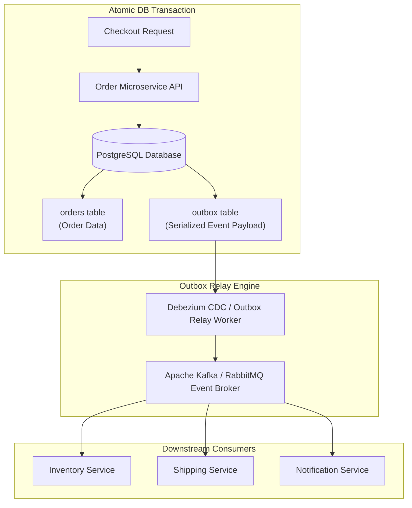

In traditional synchronous e-commerce architectures, placing an order requires a web server to make sequential HTTP calls to multiple backend services: verifying payment, reserving stock, generating invoices, sending confirmation emails, and updating warehouse shipping queues. If any one of these downstream services hangs or fails, the user's checkout request fails.

**Event-Driven Architecture (EDA)** solves this by decoupling operations using asynchronous message streams (e.g., Apache Kafka, RabbitMQ, AWS EventBridge).

This article demonstrates how EDA transforms e-commerce order processing, inventory reservation, and fulfillment.

## Synchronous vs. Asynchronous Order Processing

```
Synchronous Blocking Model (Fragile & Slow)
[ Checkout UI ] ---> (1. Charge Card) ---> (2. Reserve Stock) ---> (3. Email User) ---> (4. Update ERP)
                     *If Step 3 times out, Checkout Fails!*

Event-Driven Asynchronous Model (Fast & Resilient)
[ Checkout UI ] ---> [ Order Service ] ---> Emits: "OrderPlacedEvent"
                                                      |
                  +-----------------------------------+-----------------------------------+
                  |                                   |                                   |
                  v                                   v                                   v
        [ Payment Service ]                 [ Inventory Service ]               [ Notification Service ]
        (Listens & Charges)                 (Listens & Reserves)                (Listens & Sends Email)
```

## Key Benefits of Event-Driven E-Commerce

### 1. Instant User Checkout Confirmation
When a customer clicks "Place Order", the `Order Service` validates basic payload data, writes a pending order record, emits an `OrderPlacedEvent` to Kafka, and immediately returns a success response to the user ($<100	ext{ms}$). The customer does not wait for email generation or ERP sync.

### 2. High Availability & Fault Isolation
If the `Email Notification Service` or `Analytics Ingestion Worker` goes offline for maintenance, `OrderPlacedEvent` messages accumulate safely in the Kafka topic log. Once the notification service recovers, it resumes processing queued events with zero data loss.

### 3. Scalable Event Consumers
Multiple independent services can subscribe to the same `OrderPlacedEvent` topic without modifying the `Order Service` code. Adding a new `Fraud Detection Engine` or `Loyalty Points Service` requires simply deploying a new consumer service listening to the event bus.

## Designing Robust Domain Events

Domain events must represent immutable facts that occurred in the business:

```json
{
  "eventId": "evt-990182",
  "eventType": "OrderPlaced",
  "timestamp": "2026-04-04T12:00:00Z",
  "data": {
    "orderId": "ord-77401",
    "customerId": "cust-201",
    "totalAmount": 149.99,
    "currency": "USD",
    "items": [
      { "sku": "SHOES-BLACK-10", "quantity": 1, "price": 149.99 }
    ]
  }
}
```

## Conclusion

Event-Driven Architecture is the foundation of high-concurrency e-commerce systems. By decoupling checkout execution from background operations using asynchronous message streams, platforms achieve sub-second checkout speeds, total fault isolation, and effortless scalability.


---

## Architectural Deep Dive: The Transactional Outbox Pattern & CDC Ingestion

A catastrophic failure mode in event-driven e-commerce microservices is the **Dual-Write Hazard**: an application updates its relational database (e.g., saving an order) and immediately attempts to publish an event to Apache Kafka over the network. If the network drops or the message broker is temporarily unavailable, the database transaction has committed but the event was never published, leaving downstream inventory and shipping services permanently out of sync.

The production-grade solution is the **Transactional Outbox Pattern**: the application writes the domain entity and an outbox record inside the *same atomic database transaction*. An outbox relay worker (or Change Data Capture tool like Debezium) then guarantees at-least-once event delivery to the message broker.



### 1. Concrete Implementation: Atomic Outbox Publisher in TypeScript & PostgreSQL

The following implementation demonstrates atomic persistence of order data and outbox events in a single database transaction:

```typescript
import { PoolClient } from 'pg';
import { v4 as uuidv4 } from 'uuid';

interface CreateOrderInput {
  customerId: string;
  totalCents: number;
  items: Array<{ sku: string; quantity: number }>;
}

export async function createOrderWithOutbox(
  client: PoolClient,
  input: CreateOrderInput
): Promise<string> {
  const orderId = uuidv4();
  const eventId = uuidv4();

  try {
    await client.query('BEGIN');

    // 1. Persist domain entity
    await client.query(
      `INSERT INTO orders (id, customer_id, total_cents, status, created_at)
       VALUES ($1, $2, $3, 'PENDING', NOW())`,
      [orderId, input.customerId, input.totalCents]
    );

    // 2. Persist outbox event in the SAME transaction
    const eventPayload = {
      orderId,
      customerId: input.customerId,
      totalCents: input.totalCents,
      items: input.items,
      createdAt: new Date().toISOString(),
    };

    await client.query(
      `INSERT INTO outbox_events (id, aggregate_type, aggregate_id, event_type, payload, status, created_at)
       VALUES ($1, 'Order', $2, 'OrderCreated', $3, 'PENDING', NOW())`,
      [eventId, orderId, JSON.stringify(eventPayload)]
    );

    await client.query('COMMIT');
    return orderId;
  } catch (error) {
    await client.query('ROLLBACK');
    throw error;
  }
}
```

---

## SRE Failure Modes & Production Troubleshooting Playbook

### Incident Scenario A: Poison Pill Event Halting Consumer Partition Processing
* **Root Cause:** A corrupted event payload containing a null timestamp reached an inventory consumer, causing unhandled JSON parsing exceptions. The consumer crashed in an infinite restart loop, stalling all orders on that Kafka partition.
* **Telemetry & Diagnostic Command:**
  ```bash
  # Check for repeatedly crashing consumer pods and uncommitted partition offsets
  kubectl logs -n production -l app=inventory-consumer --tail=100 | grep "UNHANDLED_EXCEPTION"
  ```
* **Mitigation Protocol:**
  1. Wrap consumer message loops in try/catch blocks that automatically forward unparsable payloads to a Dead Letter Queue (DLQ) after 3 failed retries.
  2. Implement schema validation at the producer tier to prevent malformed events from entering broker topics.

### Incident Scenario B: Outbox Polling Worker Overloading Primary Relational DB
* **Root Cause:** An outbox relay script ran `SELECT * FROM outbox_events WHERE status = 'PENDING'` every 100 milliseconds without an index, consuming 90% of database CPU.
* **Telemetry & Diagnostic Command:**
  ```bash
  # Check PostgreSQL slow query logs for unindexed outbox polling
  SELECT query, calls, total_exec_time FROM pg_stat_statements WHERE query LIKE '%outbox_events%' ORDER BY total_exec_time DESC;
  ```
* **Mitigation Protocol:**
  1. Create a partial index: `CREATE INDEX idx_outbox_pending ON outbox_events (id) WHERE status = 'PENDING';`.
  2. Replace polling with PostgreSQL Logical Replication and Debezium Change Data Capture (CDC).

---

## Architectural Trade-off Analysis: Event Delivery Patterns

| Ingestion Pattern | Guaranteed Delivery | DB Overhead | Broker Dependency | Latency Profile |
| :--- | :--- | :--- | :--- | :--- |
| **Direct Application Publish** | No (Dual-write hazard) | Minimal | High (Broker failure breaks app) | Immediate (<15ms) |
| **Transactional Outbox Table** | Yes (At-least-once) | Moderate (Outbox writes) | Decoupled from broker uptime | Low (<150ms relay lag) |
| **Debezium CDC (WAL Streaming)**| Yes (Guaranteed) | Minimal (Reads WAL log) | High operational setup | Near real-time (<50ms) |

---

## Event-Driven Architecture Production Checklist

* [ ] Dual-write hazards eliminated via Transactional Outbox or Debezium CDC.
* [ ] All event consumers implemented to be strictly idempotent using unique message IDs.
* [ ] Dead Letter Queues (DLQ) configured on all topic consumers with alerting thresholds.
* [ ] Partition keys selected carefully (e.g., `customerId` or `orderId`) to guarantee order preservation where required.
* [ ] End-to-end distributed tracing spans propagated across Kafka message headers (`traceparent`).
