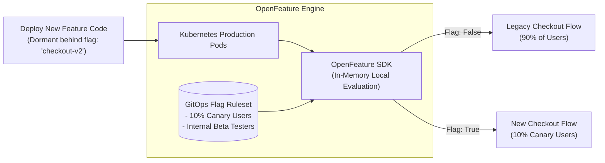

In traditional software deployment models, code deployment and feature release occurred simultaneously. If a new feature contained a critical bug, rollback required a full application re-deployment, risking extended downtime and customer disruption.

Modern cloud-native engineering separates **Code Deployment** (pushing compiled code binaries to servers) from **Feature Release** (exposing functionality to users). 

By combining **Feature Flagging** platforms (LaunchDarkly, Flagsmith, Unleash) with **Canary Rollouts**, engineering teams achieve zero-downtime releases and instant risk mitigation.

## Separating Deployment from Release

```
Traditional Deployment Model
[ Merge Code ] ===============> [ Deploy to Prod ] ===============> (All Users Exposed Immediately)
                                                                    *Bug = Full Rollback Outage*

Feature-Flagged Canary Release Model
[ Merge Code ] ---> [ Deploy Code Silently (Flag OFF) ] ---> [ Enable Flag for 1% Beta Users ]
                                                                      |
                                           (Automatic Metrics Evaluation OK)
                                                                      v
                                                            [ Roll Out to 100% ]
```

## Core Rollout Strategies

### 1. Targeted Feature Toggles
Feature flags wrap execution paths in dynamic conditional checks evaluated at runtime:

```javascript
// Example Node.js Feature Flag Check
const isNewCheckoutEnabled = await flagClient.evaluate(
  'new-checkout-flow', 
  userContext, 
  false
);

if (isNewCheckoutEnabled) {
  return renderV2Checkout(user);
} else {
  return renderV1Checkout(user);
}
```

### 2. Progressive Canary Releases
Rather than enabling a new feature for all users at once, progressive rollouts gradually increase user exposure percentage:
1. **Internal Stage**: Enable flag for internal employees and QA testers.
2. **1% Beta Traffic**: Enable flag for 1% of production users. Monitor real-time error rates and latency.
3. **Progressive Exposure**: Scale flag to 10%, 25%, 50%, and finally 100%.

### 3. Automated Kill Switches (Instant Rollback)
If a newly released feature causes an error rate spike in production, engineers toggle the feature flag to `OFF` instantly via a web dashboard or API call. **Zero code deployments or container restarts are required.**

## Best Practices for Feature Flag Hygiene

- **Short-Lived Flags**: Feature flags are temporary tools. Create Jira tickets to delete flags and clean up conditional code branches within 30 days after full rollout.
- **Default Fallbacks**: Always provide a safe, tested fallback code path if the feature flag management server becomes unreachable.
- **Audit Logging**: Track who toggles flags and when, linking flag changes to observability dashboards.

## Conclusion

Feature flagging transforms deployment risk management. By decoupling binary deployment from user feature release, engineering teams deploy code to production multiple times per day with zero downtime and instant safety toggles.


---

## Architectural Deep Dive: OpenFeature Standards & Canary Deployment Automation

The core tenet of modern cloud engineering is **separating code deployment from feature release**. Code can be deployed to production servers continuously (10 times a day) while remaining completely dormant behind **Feature Flags (Feature Toggles)**.

To avoid vendor lock-in to proprietary flagging SaaS platforms, cloud-native teams standardize on the **CNCF OpenFeature specification**, using in-memory local evaluation providers to guarantee sub-millisecond flag resolution without network latency.



### 1. Concrete Implementation: OpenFeature In-Memory Provider in TypeScript

The following implementation demonstrates how to evaluate feature flags locally with zero network latency using the official CNCF OpenFeature SDK:

```typescript
import { OpenFeature, InMemoryProvider } from '@openfeature/server-sdk';

// Define feature flag definitions with targeting rules
const flagConfig = {
  'checkout-v2-canary': {
    disabled: false,
    defaultVariant: 'off',
    variants: {
      on: true,
      off: false,
    },
    contextEvaluator: (context: any) => {
      // Canary evaluation: enable for internal employees or specific user IDs
      if (context.isInternalEmployee) return 'on';
      if (context.targetingKey && context.targetingKey.endsWith('9')) return 'on'; // 10% cohort
      return 'off';
    },
  },
};

// Initialize OpenFeature with in-memory provider
const memoryProvider = new InMemoryProvider(flagConfig);
OpenFeature.setProvider(memoryProvider);

export const featureClient = OpenFeature.getClient();

export async function shouldEnableV2Checkout(userId: string, isInternal: boolean): Promise<boolean> {
  const context = {
    targetingKey: userId,
    isInternalEmployee: isInternal,
  };

  return await featureClient.getBooleanValue('checkout-v2-canary', false, context);
}
```

---

## SRE Failure Modes & Production Troubleshooting Playbook

### Incident Scenario A: Remote Feature Flag Service Outage Blocking Application Boot
* **Root Cause:** A service initialized by making a synchronous HTTP call to an external feature flag SaaS API during startup. The vendor suffered an outage, causing all application containers to crash in a `CrashLoopBackOff` state.
* **Telemetry & Diagnostic Command:**
  ```bash
  # Check container crash logs for boot-time timeout exceptions
  kubectl logs -n production -l app=order-api --tail=50 | grep "FEATURE_FLAG_TIMEOUT"
  ```
* **Mitigation Protocol:**
  1. Always configure default fallback values in feature flag SDKs so application boot succeeds even if flag definitions are unavailable.
  2. Synchronize flag definitions to local in-memory sidecars or Redis rather than calling external APIs synchronously.

### Incident Scenario B: "Zombie Flag" Accumulation Causing Architectural Complexity
* **Root Cause:** Over 2 years, an application accumulated 180 obsolete feature flags that were permanently set to `true`. Developers forgot which code branches were active, causing accidental regressions during refactoring.
* **Telemetry & Diagnostic Command:**
  ```bash
  # Scan codebase for feature flag keys older than 90 days
  git grep -E "getBooleanValue\(['"][a-zA-Z0-9_-]+['"]" src/
  ```
* **Mitigation Protocol:**
  1. Treat feature flags as temporary architectural debt: establish automated Jira tickets to delete flag code within 30 days of reaching 100% rollout.
  2. Implement automated code analyzers that flag stale toggles in CI.

---

## Architectural Trade-off Analysis: Feature Evaluation Strategies

| Evaluation Model | Latency Overhead | Network Failure Resilience | Rule Dynamic Updates | Tooling Cost |
| :--- | :--- | :--- | :--- | :--- |
| **Synchronous Cloud API Hit** | High (50-150ms per check) | Very Poor (Outage halts app) | Instantaneous | Expensive SaaS fees |
| **In-Memory Local Provider** | Zero (<0.1ms in RAM) | Absolute (Offline resilient) | Near instant (Websocket sync) | Low maintenance |
| **Edge CDN Evaluation** | Sub-millisecond at Edge | High (Edge caching) | Fast (<5s global edge sync) | Serverless compute |

---

## Feature Flag Production Hygiene Checklist

* [ ] All flag queries specify resilient, safe default fallback values.
* [ ] Local in-memory evaluation enforced to prevent network latency penalties.
* [ ] Flags paired with an expiration date and owner assigned in project management.
* [ ] Dead/zombie flags removed from code within 30 days of 100% rollout.
* [ ] Canary metrics (error rate, p99 latency) monitored in real-time before expanding flag cohorts.
