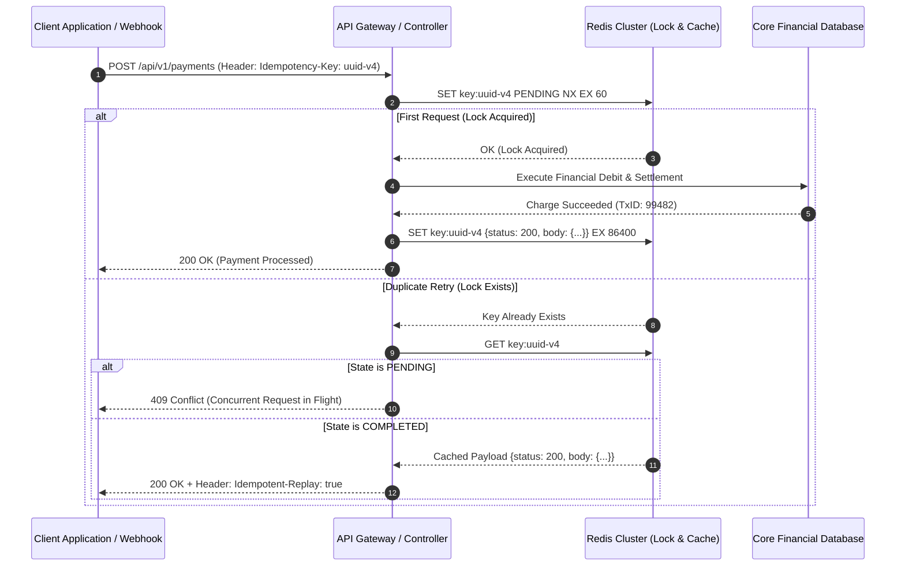

In distributed cloud networks, network requests can fail due to temporary connection drops, proxy timeouts, or server restarts. When a client application experiences a network timeout after sending a payment request (`POST /api/v1/charges`), it faces a dilemma: **Did the server process the payment before the connection dropped, or did it fail?**

If the client retries the request naively, it risks charging the customer twice.

**Idempotency** guarantees that executing an API request multiple times produces the exact same result on the server as executing it once.

This guide details how to implement idempotency mechanisms for critical financial and transactional APIs.

## HTTP Method Idempotency Standards

According to RFC 7231 standards:
- **Naturally Idempotent Methods**: `GET`, `HEAD`, `PUT`, `DELETE`, `OPTIONS`. Executing `DELETE /users/99` five times yields the same server state as executing it once.
- **Non-Idempotent Methods**: `POST`, `PATCH`. Executing `POST /orders` five times creates five distinct order records unless explicit idempotency controls are implemented.

## Implementing Idempotency-Key Header Architecture

To make `POST` endpoints safe for client retries, adopt the **Idempotency-Key** pattern:

```
Client App                                API Gateway / Backend                   Redis Cache / DB
    |                                                |                                    |
    | POST /api/v1/charges                           |                                    |
    | Idempotency-Key: "uuid-9901-key"               |                                    |
    |----------------------------------------------->| Check Idempotency-Key             |
    |                                                |----------------------------------->|
    |                                                | Key Exists? (NO)                   |
    |                                                |<-----------------------------------|
    |                                                |                                    |
    |                                                | [ Process Payment in Gateway ]     |
    |                                                | Save Key + Response Payload        |
    |                                                |----------------------------------->|
    | 200 OK (Payment Processed)                     |                                    |
    |<-----------------------------------------------|                                    |
    |                                                |                                    |
    | [ Network Drops - Client Retries Request ]     |                                    |
    | POST /api/v1/charges                           |                                    |
    | Idempotency-Key: "uuid-9901-key"               |                                    |
    |----------------------------------------------->| Check Idempotency-Key             |
    |                                                |----------------------------------->|
    |                                                | Key Exists? (YES: Return Saved Payload)
    |                                                |<-----------------------------------|
    | 200 OK (Cached Response Returned)              |                                    |
    |<-----------------------------------------------| (No Second Charge Executed!)       |
```

### 1. Client Generates Unique Key
Before sending a critical transaction request, the client generates a unique V4 UUID string (e.g., `idempotency-key: 7b92e104-82a1-432d-94b1-e284001928a3`) and attaches it as an HTTP header.

### 2. Server Key Verification in Atomic Store (Redis)
Upon receiving the request, the backend checks a high-speed cache store (Redis) for the key:
- **Key Not Found**: Atomic lock acquired. Process the transaction, write the final HTTP status code and response body to Redis with a 24-hour TTL, and return the response.
- **Key Found**: Transaction is skipped! The server immediately returns the cached HTTP response payload saved during the first execution.

## Critical Implementation Pitfalls to Avoid

- **Scope Keys by Authenticated User**: Store idempotency keys under user-scoped namespaces (e.g., `idempotency:user_102:uuid-9901-key`) to prevent malicious key collisions across different users.
- **Handle Concurrent Duplicate Requests**: If a second request with the same idempotency key arrives while the first request is still processing, return HTTP `409 Conflict` or lock-wait until the initial request completes.

## Conclusion

Enforcing idempotency on critical endpoints protects users from double charges and data corruption, ensuring system resilience over unreliable networks.


---

## Architectural Deep Dive: IETF Idempotency-Key Specification & Distributed Locking

In financial, commerce, and order processing architectures, network failures are inevitable: a client submits a payment request, the backend processes the charge, but a network drop terminates the TCP connection before the client receives the HTTP 200 response. If the client blindly retries the POST request, the user is charged twice.

Modern cloud-native backends adhere to the **IETF Draft Idempotency-Key specification**, leveraging atomic Redis distributed locks and SHA-256 payload checksums to ensure that retrying a request safely returns the exact original cached response.



### 1. Concrete Implementation: Strict Idempotency Middleware in TypeScript

The following implementation demonstrates an enterprise-grade idempotency middleware verifying payload fingerprint integrity:

```typescript
import { Request, Response, NextFunction } from 'express';
import { createHash } from 'crypto';
import { RedisClientType } from 'redis';

export class IdempotencyMiddleware {
  private redis: RedisClientType;
  private readonly ttlSeconds: number;

  constructor(redisClient: RedisClientType, ttlSeconds = 86400) {
    this.redis = redisClient;
    this.ttlSeconds = ttlSeconds;
  }

  public handle() {
    return async (req: Request, res: Response, next: NextFunction): Promise<void> => {
      const key = req.header('Idempotency-Key');
      if (!key || req.method === 'GET' || req.method === 'HEAD') {
        return next();
      }

      // Compute SHA-256 hash of payload to prevent parameter mutation attacks
      const payloadHash = createHash('sha256')
        .update(JSON.stringify(req.body || {}))
        .digest('hex');

      const redisKey = `idempotency:${key}`;

      try {
        // Attempt atomic acquisition with NX (Not Exists)
        const acquired = await this.redis.set(
          redisKey,
          JSON.stringify({ status: 'PENDING', hash: payloadHash }),
          { NX: true, EX: 120 } // 2-minute lock timeout
        );

        if (!acquired) {
          // Key exists: check status
          const existingData = await this.redis.get(redisKey);
          if (!existingData) {
            res.status(409).json({ error: 'Concurrent request conflict.' });
            return;
          }

          const parsed = JSON.parse(existingData);

          // Verify payload checksum to prevent key hijacking
          if (parsed.hash !== payloadHash) {
            res.status(422).json({
              error: 'Idempotency key reused with mismatched payload payload checksum.',
            });
            return;
          }

          if (parsed.status === 'PENDING') {
            res.status(409).json({ error: 'Original operation still in progress. Retry shortly.' });
            return;
          }

          // Return cached response
          res.setHeader('Idempotent-Replay', 'true');
          res.status(parsed.statusCode).json(parsed.body);
          return;
        }

        // Intercept response to cache it upon completion
        const originalJson = res.json.bind(res);
        res.json = (body: any) => {
          this.redis.set(
            redisKey,
            JSON.stringify({ status: 'COMPLETED', hash: payloadHash, statusCode: res.statusCode, body }),
            { EX: this.ttlSeconds }
          );
          return originalJson(body);
        };

        next();
      } catch (err) {
        next(err);
      }
    };
  }
}
```

---

## SRE Failure Modes & Production Troubleshooting Playbook

### Incident Scenario A: Concurrent Race on Identical Idempotency Key Before Lock Acquisition
* **Root Cause:** A payment terminal pulsed three identical HTTP POST requests within 2 milliseconds over parallel TCP connections. If the database relies on loose check-then-act logic without atomic Redis locks, duplicate records are created.
* **Telemetry & Diagnostic Command:**
  ```bash
  # Check for duplicate merchant transaction IDs in database
  SELECT merchant_ref, COUNT(*) FROM transactions GROUP BY merchant_ref HAVING COUNT(*) > 1;
  ```
* **Mitigation Protocol:**
  1. Enforce atomic `SET key val NX EX ttl` operations in Redis or database `INSERT ... ON CONFLICT DO NOTHING` constraints.
  2. Enforce unique database indices on the `(tenant_id, idempotency_key)` tuple.

### Incident Scenario B: Payload Tampering Under Reused Idempotency Key
* **Root Cause:** A malicious client reused an existing valid idempotency key but altered the recipient account number and amount, attempting to exploit a naive cache replay.
* **Telemetry & Diagnostic Command:**
  ```bash
  # Search application logs for idempotency payload checksum mismatches
  kubectl logs -n production -l app=payment-service | grep "422_UNPROCESSABLE_ENTITY_PAYLOAD_MISMATCH"
  ```
* **Mitigation Protocol:**
  1. Store the SHA-256 fingerprint alongside the idempotency key and reject any request with an altered checksum with HTTP 422 Unprocessable Entity.
  2. Issue security alerts if multiple distinct IP addresses attempt to submit the same idempotency key.

---

## Architectural Trade-off Analysis: Idempotency Persistence Strategies

| Persistence Strategy | Read Latency | Collision Safety | TTL Automation | Cost & Complexity |
| :--- | :--- | :--- | :--- | :--- |
| **Distributed Redis Cache** | Ultra-low (<2ms) | High (Atomic NX lock) | Native TTL expiration | Requires Redis Cluster |
| **Relational DB Unique Index** | Moderate (10-25ms) | Absolute (ACID isolation)| Requires background cleanup | Low additional tooling |
| **Event Sourcing De-duplication**| Async latency | Highest (Deterministic state) | Infinite audit trail | High operational overhead |

---

## Idempotency Production Verification Checklist

* [ ] `Idempotency-Key` header enforced on all critical POST and PATCH mutation endpoints.
* [ ] Atomic `SET ... NX` locks utilized to eliminate concurrent race conditions.
* [ ] SHA-256 payload checksum verification prevents key hijacking across altered requests.
* [ ] Idempotent replay responses flagged with explicit `Idempotent-Replay: true` headers.
* [ ] Relational databases back up Redis locks with unique constraints on idempotency keys.
