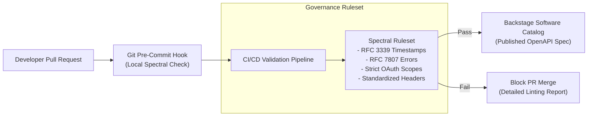

As an organization grows from 5 microservices to 50+, maintaining consistent API standards becomes a major engineering challenge. Without centralized **API Governance**, different teams invent inconsistent URL naming rules, incompatible authentication schemes, and mismatched error payloads.

API Governance enforces organizational API style guides automatically through automated CI/CD linting, centralized API Gateway policies, and developer portals.

This guide outlines a practical blueprint for establishing enterprise API governance.

## The Pillars of Modern API Governance

```
+-------------------------------------------------------------------+
|                   ENTERPRISE API STYLE GUIDE                      |
+-------------------------------------------------------------------+
                                  |
                                  v
+-------------------------------------------------------------------+
|               AUTOMATED CI/CD LINTING (Spectral)                  |
| - Enforce Kebab-Case URIs       - Enforce RFC 7807 Error Schema    |
| - Mandatory OAuth2 Security     - Require Detailed Descriptions    |
+-------------------------------------------------------------------+
                                  |
                                  v
+-------------------------------------------------------------------+
|            CENTRALIZED API GATEWAY POLICIES (Apigee / Kong)       |
| - Standard Rate Limiting        - Mandatory JWT Signature Check   |
+-------------------------------------------------------------------+
```

### 1. Authoring an Executive API Style Guide
Define explicit organizational standards covering:
- **URL Path Conventions**: Use kebab-case plural nouns (e.g., `/v1/customer-orders`).
- **HTTP Method Semantics**: Enforce REST verb usage (`GET` read-only, `POST` creation, `PUT` replacement, `DELETE` removal).
- **Error Formatting**: Standardize on RFC 7807 Problem Details payloads across all language stacks.
- **Security Baseline**: Require OAuth 2.0 / JWT headers on all non-public routes.

### 2. Automated Contract Linting in CI/CD (Stoplight Spectral)
Manual code reviews cannot catch every API style violation. Use automated linter tools like **Spectral** inside your pull request build pipelines:

```yaml
# Spectral Rule Definition (.spectral.yaml)
extends: "spectral:oas"
rules:
  paths-kebab-case:
    description: "Paths must use kebab-case formatting"
    given: "$.paths[*]~"
    then:
      function: pattern
      functionOptions:
        match: "^/([a-z0-9-]+|{[a-zA-Z0-9_]+})*$"

  rfc7807-error-response:
    description: "HTTP 400 and 500 error responses must follow RFC 7807 schema"
    given: "$.paths..responses[?(@property == '400' || @property == '500')].content['application/json'].schema"
    then:
      function: defined
```

### 3. Centralized Enforcement at the API Gateway Layer
Apply global policies across all APIs automatically at the API Gateway perimeter (Apigee, Kong, AWS API Gateway):
- Automatically strip unauthorized request headers.
- Inject CORS (Cross-Origin Resource Sharing) policies centrally.
- Enforce standard rate-limiting quotas based on consumer tier.

## Conclusion

Effective API governance is automated, not manual. By encoding style guides into Spectral CI linting rules and enforcing perimeter security policies at the API Gateway, organizations achieve high API consistency without bottlenecking engineering velocity.


---

## Architectural Deep Dive: Automated Governance Gateways via GitOps & Spectral

Scaling an enterprise microservice ecosystem across dozens of cross-functional teams inevitably produces architectural entropy: inconsistent authentication scopes, mismatched date-time formats, non-standard error structures, and orphaned "shadow APIs."

Modern API Governance avoids human bottleneck review boards by codifying standards into **automated executable linters (Spectral)** and **centralized developer service catalogs (Backstage)**.



### 1. Concrete Implementation: Enterprise Spectral Governance Ruleset

The following `.spectral.yaml` configuration codifies non-negotiable enterprise architectural standards into automated CI/CD checks:

```yaml
extends: ["spectral:oas"]

rules:
  # Enforce standardized RFC 7807 Problem Details for all error responses
  rfc-7807-error-response:
    description: "All error responses (4xx and 5xx) must use application/problem+json media type"
    given: "$.paths[*][*].responses[?(@property >= 400 && @property < 600)].content"
    then:
      field: "application/problem+json"
      function: defined
    severity: error

  # Prevent verb pollution in REST paths
  no-verbs-in-path:
    description: "Path segments must not contain CRUD action verbs (get, post, create, delete, update)"
    given: "$.paths[*]~"
    then:
      function: pattern
      functionOptions:
        notMatch: "/(get|post|create|delete|update|add|remove)($|/)"
    severity: error

  # Enforce explicit security definitions on all operations
  operation-security-defined:
    description: "Every operation must define security scopes"
    given: "$.paths[*][*]"
    then:
      field: "security"
      function: defined
    severity: error
```

---

## SRE Failure Modes & Production Troubleshooting Playbook

### Incident Scenario A: Inconsistent Authorization Scopes Leaking Multitenant Data
* **Root Cause:** A newly deployed microservice omitted tenant identification checks in its route authorization decorator, allowing authenticated users to access resources belonging to other organizational tenants.
* **Telemetry & Diagnostic Command:**
  ```bash
  # Audit all API Gateway route definitions for missing tenant validation filters
  curl -s http://gateway-admin.internal:8001/routes | jq '.data[] | select(.plugins | contains(["tenant-validator"]) | not)'
  ```
* **Mitigation Protocol:**
  1. Enforce global API Gateway authentication plugins that validate tenant IDs at the edge before proxying to backend pods.
  2. Codify mandatory security scheme assertions into CI/CD Spectral rules.

### Incident Scenario B: Shadow API Endpoints Deployed Without Observability Tags
* **Root Cause:** A team deployed a debug endpoint `/api/internal/test-dump` that bypassed standard ingress observability filters, preventing error detection during an active outage.
* **Telemetry & Diagnostic Command:**
  ```bash
  # Compare live Prometheus route labels against registered OpenAPI catalog paths
  promtool query instant http://prometheus.internal:9090 'sum by (route) (rate(http_requests_total[5m]))'
  ```
* **Mitigation Protocol:**
  1. Enforce edge gateway admission controllers that drop traffic to endpoints not registered in the central API schema registry.
  2. Implement automated discovery crawlers that alert on uncataloged URI traffic patterns.

---

## Architectural Trade-off Analysis: Governance Operating Models

| Governance Model | Enforcement Mechanism | Organizational Agility | Architectural Consistency | Overhead |
| :--- | :--- | :--- | :--- | :--- |
| **Architecture Review Board (ARB)**| Human meetings & sign-offs | Very Low (Deployments blocked) | Subjective & variable | High labor cost |
| **Shift-Left Automated Linters** | CI/CD Spectral & Contract Tests | Very High (Immediate feedback) | High (Deterministic code rules)| Low maintenance |
| **Edge Gateway Policy Enforcement** | Runtime Envoy / OPA Sidecars | High (Decoupled governance) | Absolute at the network layer | Moderate compute |

---

## API Governance Production Checklist

* [ ] Spectral ruleset active in CI/CD, blocking pull requests with linting errors.
* [ ] RFC 7807 Problem Details enforced across all 4xx and 5xx error responses.
* [ ] Centralized service catalog (e.g., Backstage) synchronizing OpenAPI specs on deployment.
* [ ] OpenID Connect (OIDC) authentication and granular scopes enforced on all public routes.
* [ ] Breaking changes tracked and gated using semantic versioning and automated contract diffing.
