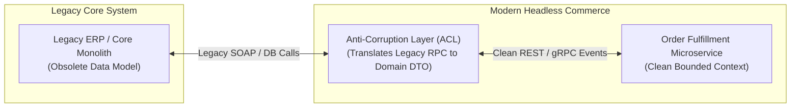

One of the most critical challenges in microservices architecture is establishing clear service boundaries. Splitting a monolithic system by arbitrary criteria—such as database tables or UI screens—frequently results in a "distributed monolith," where services are tightly coupled, require synchronized deployments, and suffer from high network latency.

To build truly autonomous microservices, software architects rely on **Domain-Driven Design (DDD)** and the concept of **Bounded Contexts**. This article details how to apply DDD strategic modeling to define resilient, loosely-coupled microservice boundaries.

## The Core Concept: Bounded Contexts

In Domain-Driven Design, a **Bounded Context** defines the explicit boundary within which a domain model applies. Inside the boundary, all terms in the **Ubiquitous Language** have an unambiguous, single meaning.

For example, consider the entity `Customer` across an e-commerce enterprise:
- **Sales Context**: A `Customer` represents a lead with contact info, payment methods, and marketing preferences.
- **Fulfillment Context**: A `Customer` represents a shipping address, delivery instructions, and package tracking metadata.
- **Billing Context**: A `Customer` represents a tax identifier, invoicing address, and credit score rating.

Trying to build a single unified `Customer` microservice with a shared database forces all three business units to coordinate schema changes. By creating three separate microservices—`Sales Service`, `Fulfillment Service`, and `Billing Service`—each service owns its specific `Customer` aggregate model and database.

```
+-------------------+       +-----------------------+       +-------------------+
|   Sales Context   |       |  Fulfillment Context  |       |  Billing Context  |
|                   |       |                       |       |                   |
| Customer Aggregate|       | Package / Delivery    |       | Invoice / Tax ID  |
| - Lead Status     |       | - Shipping Address    |       | - Credit Rating   |
+---------+---------+       +-----------+-----------+       +---------+---------+
          |                             |                             |
          +-----------------------------+-----------------------------+
                                     |
                          Asynchronous Event Bus
```

## Step-by-Step Framework for Finding Service Boundaries

### Step 1: Event Storming
Gather domain experts, software engineers, and product managers in an interactive workshop to map out **Domain Events** (things that happened in the business, e.g., `OrderPlaced`, `PaymentFailed`, `ItemShipped`).

### Step 2: Group Events into Aggregates
Identify the domain entities that handle state transitions triggered by events. An **Aggregate** is a cluster of domain objects that can be treated as a single unit for data changes (e.g., an `Order` aggregate holding `OrderItems`).

### Step 3: Draw Bounded Context Boundaries
Look for natural domain linguistic boundaries and policy changes. Draw context boundaries around related aggregates that share common business policies and transactional rules.

### Step 4: Map Inter-Context Relationships (Context Mapping)
Determine how contexts communicate:
- **Shared Kernel**: Two contexts share a subset of code or domain model (use sparingly).
- **Customer-Supplier**: A downstream service depends on upstream API deliverables.
- **Anti-Corruption Layer (ACL)**: A translation layer built into a downstream service to convert legacy or external upstream models into its internal domain model without corrupting domain logic.

## Implementing Bounded Contexts in Cloud-Native Architectures

When translating Bounded Contexts into cloud-native microservices:
1. **One Bounded Context to One (or Few) Microservices**: Never bundle multiple unrelated Bounded Contexts into a single microservice. However, a complex Bounded Context may contain two closely related microservices (e.g., an ingestion service and a query service sharing the same storage).
2. **Database per Service**: Each Bounded Context MUST own its database. Cross-database joins are replaced with asynchronous domain event publishing (e.g., Kafka or RabbitMQ).
3. **Decoupled Data Replication**: When the `Fulfillment Service` needs customer address data, it subscribes to `CustomerAddressUpdated` events emitted by the `Sales Service` and maintains its own read-optimized local projection.

## Anti-Patterns to Avoid

- **Entity-Based Microservices**: Creating a microservice for every database table (e.g., `UserService`, `AddressService`). This leads to excessive network hops and zero encapsulation.
- **Layer-Based Splitting**: Splitting microservices by technical layers (e.g., `UI Microservice`, `Business Logic Microservice`, `Database Microservice`). Service boundaries must follow business domains, not technology stacks.

## Conclusion

Structuring microservices around DDD Bounded Contexts aligns software architecture with actual business capabilities. By respecting domain boundaries, teams achieve true organizational autonomy, rapid independent deployments, and resilient software systems.


---

## Architectural Deep Dive: Context Mapping & Anti-Corruption Layers (ACL)

When decomposing complex enterprise domains into microservices, the most effective methodology is **Domain-Driven Design (DDD) Context Mapping**. Rather than slicing services by technical layers (e.g., UI service, controller service, database service), services are delineated by **Bounded Contexts**—linguistic and transactional boundaries where a specific domain model applies.

When integrating with legacy systems or disparate vendor platforms, an **Anti-Corruption Layer (ACL)** translates foreign concepts into clean internal domain models, preventing external legacy complexity from polluting modern services.



### 1. Concrete Implementation: Anti-Corruption Layer Adapter in TypeScript

The following implementation demonstrates an Anti-Corruption Layer translating legacy mainframe XML responses into a clean TypeScript domain contract:

```typescript
export interface CleanCustomerProfile {
  id: string;
  fullName: string;
  loyaltyTier: 'BRONZE' | 'SILVER' | 'GOLD';
  active: boolean;
}

// Anti-Corruption Layer Adapter
export class LegacyCustomerACLAdapter {
  private legacyEndpoint: string;

  constructor(endpoint: string) {
    this.legacyEndpoint = endpoint;
  }

  public async fetchCustomer(id: string): Promise<CleanCustomerProfile> {
    // 1. Fetch raw legacy record (e.g., SOAP XML / legacy JSON with obscure field names)
    const rawResponse = await fetch(`${this.legacyEndpoint}/CUST_REC_V2?C_ID=${id}`);
    if (!rawResponse.ok) {
      throw new Error(`LEGACY_ERROR_${rawResponse.status}`);
    }
    const legacyData = await rawResponse.json();

    // 2. Translate and sanitize legacy fields into internal Bounded Context model
    return this.translate(legacyData);
  }

  private translate(raw: any): CleanCustomerProfile {
    // Map obscure legacy fields (e.g., TX_CUST_STAT, FLG_ACT_01) to explicit domain terms
    let tier: CleanCustomerProfile['loyaltyTier'] = 'BRONZE';
    if (raw.LYL_PTS > 10000) tier = 'GOLD';
    else if (raw.LYL_PTS > 5000) tier = 'SILVER';

    return {
      id: raw.CUST_NUM_EXT,
      fullName: `${raw.FIRST_NM_VCHAR || ''} ${raw.LAST_NM_VCHAR || ''}`.trim(),
      loyaltyTier: tier,
      active: raw.FLG_ACT_01 === 'Y',
    };
  }
}
```

---

## SRE Failure Modes & Production Troubleshooting Playbook

### Incident Scenario A: Ubiquitous Language Semantic Bleed Causing Billing Inconsistencies
* **Root Cause:** The Order service defined "Account" as a credit card billing entity, while the CRM service defined "Account" as a corporate enterprise tenant. Engineers merged endpoint models, resulting in invoices billed to tenant IDs instead of payment tokens.
* **Telemetry & Diagnostic Command:**
  ```bash
  # Check for unmapped domain identifier mismatches in error logs
  kubectl logs -n production -l app=billing-service | grep "INVALID_ACCOUNT_IDENTIFIER_FORMAT"
  ```
* **Mitigation Protocol:**
  1. Document explicit Ubiquitous Language glossaries for each Bounded Context and strictly enforce domain-specific naming in DTO contracts.
  2. Implement schema boundary validation in API Gateways to reject ambiguous entity keys.

### Incident Scenario B: Legacy System Outage Bringing Down ACL Ingress Gateways
* **Root Cause:** A legacy mainframe backend slowed down to 12-second response times. The ACL adapter lacked circuit breakers, resulting in thread starvation and 504 timeouts across the modern storefront.
* **Telemetry & Diagnostic Command:**
  ```bash
  # Inspect ACL outbound request duration metrics
  curl -s http://monitoring.internal:9090/api/v1/query?query=http_client_request_duration_seconds_bucket
  ```
* **Mitigation Protocol:**
  1. Wrap all ACL integration calls in circuit breakers with aggressive timeouts (<1000ms) and local stale cache fallbacks.
  2. Asynchronously ingest legacy data via Change Data Capture (CDC) into an edge read replica to eliminate real-time synchronous calls to legacy backends.

---

## Architectural Trade-off Analysis: Bounded Context Integration Patterns

| Pattern | Autonomy | Coupling | Implementation Effort | Use Case |
| :--- | :--- | :--- | :--- | :--- |
| **Shared Kernel** | Low (Shared code) | High (Breaking changes ripple)| Minimal | Closely aligned sibling teams |
| **Customer-Supplier** | High for Supplier | Moderate (Supplier dictates) | Moderate | Upstream platform services |
| **Anti-Corruption Layer (ACL)** | Very High | Zero coupling to legacy model | Moderate to High | Integrating legacy monoliths |
| **Open Host Service (OHS)** | Very High | Standardized protocol | Moderate | Public APIs with multiple consumers |

---

## DDD Service Boundary Verification Checklist

* [ ] Explicit Bounded Contexts documented with dedicated Ubiquitous Language terms.
* [ ] Anti-Corruption Layer (ACL) deployed between modern microservices and legacy core systems.
* [ ] Zero shared database tables or shared in-memory entity models across contexts.
* [ ] Context maps reviewed by domain experts and software architects.
* [ ] Integration contracts verified via Consumer-Driven Contract testing (Pact).
