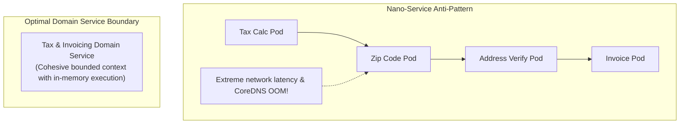

One of the most frequent questions software architects face is: *"How big or small should a microservice be?"* 

Extremes in either direction create serious engineering problems. Creating services that are too large leads back to a monolithic codebase; creating services that are too small ("nano-services") results in extreme network latency, distributed transaction failure modes, and deployment complexity.

Finding the optimal service granularity requires balancing business domain boundaries, team organization, operational capabilities, and transactional integrity.

## The Granularity Spectrum: From Monolith to Nano-Service

```
[ Monolith ] ---------> [ Macro-Service ] ---------> [ Microservice ] ---------> [ Nano-Service ]
(Single Heap)          (Domain Context)            (Single Bounded)             (Single Function)
Low Network Cost       Balanced Latency            Optimal Autonomy             High Network Cost
Coarse Boundaries      Clear Boundaries            Resilient Scaling            Extreme Complexity
```

### 1. The Nano-Service Anti-Pattern
A **nano-service** is an over-decomposed service that encapsulates a trivial amount of logic (e.g., a service dedicated solely to formatting a date or calculating a single tax percentage).
- **Warning Signs**:
  - The service cannot fulfill a single business request without making 4+ blocking synchronous calls to sibling services.
  - Modifying a feature requires making pull requests across 5 different repositories simultaneously.
  - The line count of infrastructure config (Docker, Helm, CI/CD) exceeds the lines of business logic code.

### 2. The Macro-Service (Right-Sized Service)
A **macro-service** (or properly scoped microservice) encompasses a complete, coherent business capability bounded by a single Domain-Driven Design (DDD) Bounded Context.
- **Characteristics**:
  - Owns its data store exclusively.
  - Communicates asynchronously via domain events for non-critical paths.
  - Can be developed, tested, and deployed independently by a single two-seater engineering team.

## The Granularity Decision Matrix

To evaluate whether a service should be split or merged, analyze these four engineering dimensions:

| Dimension | Indicator to Split Service | Indicator to Merge / Keep Together |
| :--- | :--- | :--- |
| **Team Ownership** | Two separate engineering teams are making concurrent edits to the same codebase. | A single developer or small team manages both components easily. |
| **Scalability Profiles** | Component A requires 100x CPU scaling (e.g., image rendering) while Component B is low-traffic CRUD. | Both components share similar CPU, memory, and scaling metrics. |
| **Data Dependencies** | Components operate on completely disjoint database tables with zero joins. | Components require ACID database transactions and frequent immediate consistency. |
| **Release Cadence** | Component A requires daily deployments while Component B is updated quarterly. | Both components are tested and released together on the same schedule. |

## Practical Heuristics for Granularity

### Heuristic 1: The Two-Shirt Rule (Team Boundaries)
Align service boundaries with Conway's Law: *"Organizations design systems that mirror their communication structures."* A service should be small enough to be owned comfortably by a single small team (4–7 engineers), but large enough that the team does not have to manage 20 separate repositories.

### Heuristic 2: The Single Database Owner Rule
If Service A directly queries or writes to Service B's database tables, your services are incorrectly sized. Merge them into a single service or refactor them to communicate strictly through public APIs and domain events.

### Heuristic 3: Transaction Boundary Heuristic
If a business transaction requires immediate ACID consistency across three operations, those operations belong inside the same service boundary. If eventual consistency is acceptable, split them and coordinate via the Saga pattern.

## Conclusion

Right-sizing microservices is an iterative architectural process, not a one-time decision. When starting new projects, prefer coarser service boundaries (macro-services). It is significantly easier to split a well-structured macro-service later than it is to untangle dozens of tightly coupled nano-services.


---

## Architectural Deep Dive: Service Granularity Scoring & CoreDNS Protection

A recurring failure in early microservice transitions is **Nano-service Proliferation**: slicing services so microscopically (e.g., separate services for `generate-order-id`, `calculate-tax`, `format-address`) that network latency, distributed serialization, and container orchestration overhead consume 80% of total compute resources.

Architects should evaluate service boundaries using the **Four Dimensions of Granularity Scoring**: Transactional Integrity, Deployment Velocity, Team Autonomy, and Scalability Divergence.



### 1. Concrete Implementation: Service Granularity Scoring Framework in TypeScript

The following evaluation utility demonstrates how architecture review boards calculate whether a proposed boundary qualifies as a viable microservice:

```typescript
export interface GranularityCriteria {
  hasAutonomousTeam: boolean; // Does a dedicated two-pizza team own this?
  divergentScalingNeed: boolean; // Does RPS differ by >10x from sibling domains?
  isolatedDataLifecycle: boolean; // Can its database be completely isolated?
  independentReleaseCadence: boolean; // Does it deploy on a different cadence?
  networkOverheadAcceptable: boolean; // Can it tolerate 15-30ms remote RPC latency?
}

export function evaluateServiceBoundary(name: string, criteria: GranularityCriteria): {
  recommendation: 'MERGE_INTO_PARENT' | 'VIABLE_MICROSERVICE';
  score: number;
} {
  let score = 0;
  if (criteria.hasAutonomousTeam) score += 25;
  if (criteria.divergentScalingNeed) score += 25;
  if (criteria.isolatedDataLifecycle) score += 20;
  if (criteria.independentReleaseCadence) score += 20;
  if (criteria.networkOverheadAcceptable) score += 10;

  return {
    recommendation: score >= 70 ? 'VIABLE_MICROSERVICE' : 'MERGE_INTO_PARENT',
    score,
  };
}
```

---

## SRE Failure Modes & Production Troubleshooting Playbook

### Incident Scenario A: Nano-Service Explosion Overwhelming Kubernetes CoreDNS
* **Root Cause:** A cluster running 450 microscopic nano-services generated 85,000 internal DNS lookups per second. CoreDNS pods ran out of memory, dropping DNS queries and causing cluster-wide HTTP 503 errors.
* **Telemetry & Diagnostic Command:**
  ```bash
  # Check CoreDNS query rate and latency in Kubernetes
  kubectl top pods -n kube-system -l k8s-app=kube-dns
  ```
* **Mitigation Protocol:**
  1. Consolidate microscopic services sharing the same bounded context back into a single cohesive service.
  2. Deploy NodeLocal DNSCache in the Kubernetes cluster to cache DNS lookups locally on each worker node.

### Incident Scenario B: God Service Bloat Re-Creating Monolithic Deployments
* **Root Cause:** A "Core Commerce" microservice accumulated 45 developers and 250 database tables over 3 years, becoming an unmaintainable monolith inside a single container.
* **Telemetry & Diagnostic Command:**
  ```bash
  # Check container image size and deployment build duration
  docker image ls core-commerce-service
  ```
* **Mitigation Protocol:**
  1. Identify divergent sub-domains using Event Storming (e.g., carving out Payment and Inventory into separate contexts).
  2. Use Domain-Driven Design Context Mapping to establish clear boundaries.

---

## Architectural Trade-off Analysis: Granularity Spectrum

| Granularity Tier | Network Overhead | Deployment Friction | Data Consistency | Operational Cost |
| :--- | :--- | :--- | :--- | :--- |
| **Nano-Services (<500 lines)** | Catastrophic (Network hop tax) | High (Dozens of CI pipelines) | Impossible | Very High |
| **Domain Microservices** | Low (Internal in-memory logic) | Low (Team autonomy) | Eventual across domains | Moderate |
| **Modular Monolith** | Zero (Direct function calls) | Lowest (Single deployment) | Absolute (ACID DB) | Lowest |

---

## Service Granularity Production Checklist

* [ ] Proposed microservice scores at least 70/100 on Granularity Scoring matrix.
* [ ] Service encapsulates a complete transactional bounded context.
* [ ] Internal operations executed in-memory rather than across multiple remote RPC hops.
* [ ] NodeLocal DNSCache active in Kubernetes to protect CoreDNS from lookup storms.
* [ ] Service boundary owned by a single cross-functional engineering team.
