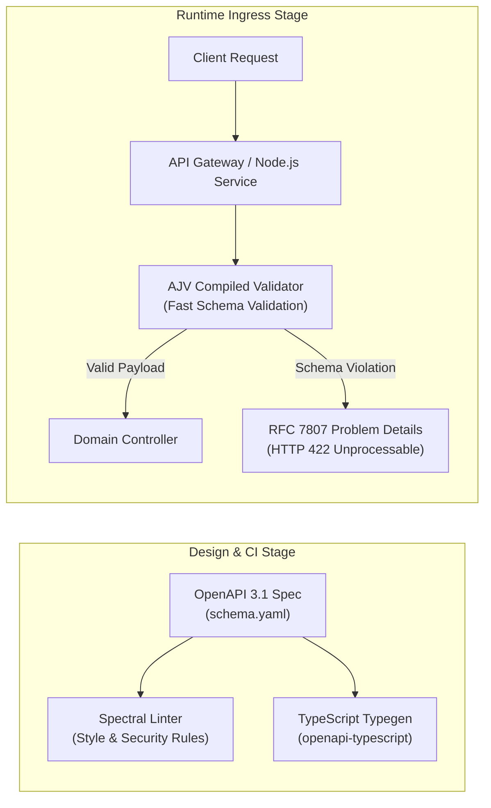

In traditional software development, frontend and backend teams often work in silos. The backend team writes code, deploys an endpoint, and verbally informs the frontend team or posts a informal message in Slack with JSON examples. This informal workflow leads to constant integration bugs, mismatched data types, and delayed releases.

**Contract-Driven Development (CDD)** using the **OpenAPI Specification (OAS 3.1)** reverses this paradigm. By designing and committing a machine-readable API specification before writing any implementation code, engineering teams establish a single source of truth that drives client SDKs, mock servers, automated testing, and API gateway routing.

This article details how to implement Contract-Driven Development with OpenAPI across the software lifecycle.

## Code-First vs. Contract-First API Workflow

```
Traditional Code-First (Siloed & Fragile)
[ Backend Coding ] ---> [ Deploy API ] ---> [ Write Docs ] ---> [ Frontend Integration Breaks ]

Contract-First Development (Parallel & Reliable)
                          +------------------------+
                          |   OpenAPI Spec (YAML)  |
                          +-----------+------------+
                                      |
         +----------------------------+----------------------------+
         |                            |                            |
         v                            v                            v
[ Auto Mock Server ]        [ Auto Client SDKs ]        [ Server Stubs & Tests ]
(Frontend Begins Now)      (iOS, Android, React)       (Backend Implementation)
```

## The Pillars of OpenAPI Contract-Driven Development

### 1. Parallel Engineering with Mock Servers
Once the OpenAPI specification is committed to the Git repository, frontend and mobile developers do not have to wait for backend engineers to build real database tables and controllers.
- Tools like **Stoplight Prism** or **MockServer** read the OpenAPI YAML file and instantly spin up a local HTTP mock server.
- The mock server returns dynamic payload data matching exact field types, enums, and response status codes specified in the contract.

```bash
# Spin up an instant mock server from an OpenAPI contract
npx @stoplight/prism-cli mock api-contract.yaml --port 4010
```

### 2. Automated SDK and Server Stub Generation
Instead of manually hand-crafting HTTP request logic and TypeScript interfaces or Swift structs, use **OpenAPI Generator** to automatically generate strongly-typed API client libraries:

```bash
# Generate TypeScript Axios client from OpenAPI spec
npx @openapitools/openapi-generator-cli generate \
  -i api-contract.yaml \
  -g typescript-axios \
  -o ./src/api-client
```
- **Benefits**: If the backend team modifies a property type in the OpenAPI contract, re-running the generator triggers immediate TypeScript compilation errors in the frontend build pipeline, catching contract violations before runtime.

### 3. Automated Request & Response Contract Testing
Ensure backend implementation matches the specification using contract testing libraries (such as `dredd` or `schemathesis`). These tools automatically execute HTTP requests against running backend controllers and validate that actual JSON responses strictly match the OpenAPI schema.

## Structuring an Enterprise OpenAPI Specification

To keep OpenAPI definitions clean and maintainable:
- **Modularize Specs**: Use `$ref` pointers to separate paths, request bodies, and schema models into distinct YAML files.
- **Enforce Spectral Linting**: Run **Stoplight Spectral** in your CI/CD pipeline to enforce organizational API standards (e.g., camelCase property naming, mandatory HTTP 400/500 error schema responses, authentication requirements).

```yaml
# Example Spectral Ruleset (.spectral.yaml)
extends: "spectral:oas"
rules:
  operation-description: error
  path-keys-no-trailing-slash: error
  component-name-pascal-case: warn
```

## Conclusion

Adopting OpenAPI and Contract-Driven Development eliminates integration surprises, accelerates delivery schedules, and aligns engineering teams. Treat API specifications as first-class architectural artifacts that govern the software development lifecycle.


---

## Architectural Deep Dive: Automated Runtime Schema Validation with AJV & Spectral

In a production Contract-Driven Development (CDD) workflow, OpenAPI specifications must not remain passive documentation artifacts; they must serve as active, runtime-enforced security boundaries. By compiling the OpenAPI schema into high-performance validator functions at application startup, backend services can reject malformed payloads before they reach business domain controllers.



### 1. Concrete Implementation: Fastify / Express Runtime OpenAPI Validation

The following implementation demonstrates how to enforce strict request body validation against an OpenAPI schema definition using compiled JSON Schema validators:

```typescript
import { Request, Response, NextFunction } from 'express';
import Ajv, { ValidateFunction } from 'ajv';
import addFormats from 'ajv-formats';

const ajv = new Ajv({ allErrors: true, coerceTypes: false });
addFormats(ajv);

// Sample extracted schema from OpenAPI components.schemas.CreateOrderRequest
const createOrderSchema = {
  type: 'object',
  required: ['customerId', 'items', 'currency'],
  additionalProperties: false, // Prevents unknown field pollution
  properties: {
    customerId: { type: 'string', format: 'uuid' },
    currency: { type: 'string', enum: ['USD', 'EUR', 'MXN'] },
    items: {
      type: 'array',
      minItems: 1,
      items: {
        type: 'object',
        required: ['sku', 'quantity', 'unitPrice'],
        additionalProperties: false,
        properties: {
          sku: { type: 'string', pattern: '^[A-Z0-9-]{6,16}$' },
          quantity: { type: 'integer', minimum: 1, maximum: 99 },
          unitPrice: { type: 'number', minimum: 0.01 },
        },
      },
    },
  },
};

const compiledValidator: ValidateFunction = ajv.compile(createOrderSchema);

export const validateCreateOrderPayload = (
  req: Request,
  res: Response,
  next: NextFunction
): void => {
  const valid = compiledValidator(req.body);
  if (!valid) {
    res.status(422).json({
      type: 'https://api.machplaybook.com/errors/validation-failed',
      title: 'Request Payload Validation Failed',
      status: 422,
      detail: 'The payload does not conform to the active OpenAPI contract.',
      invalidParams: compiledValidator.errors?.map((err) => ({
        field: err.instancePath,
        issue: err.message,
      })),
    });
    return;
  }
  next();
};
```

---

## SRE Failure Modes & Production Troubleshooting Playbook

### Incident Scenario A: Schema Drift Causing Upstream Serialization Crashes
* **Root Cause:** A backend engineer deployed a database migration converting an integer column (`order_id`) into a string UUID without updating the OpenAPI spec or generating new client SDKs. Downstream mobile apps crash when deserializing the response.
* **Telemetry & Diagnostic Command:**
  ```bash
  # Check contract drift against live response payloads using oas-diff
  oasdiff diff -base https://api.production.internal/openapi.json -revision ./openapi.yaml
  ```
* **Mitigation Protocol:**
  1. Enforce automated schema breaking change checks in CI/CD pipelines via `oasdiff` or `openapi-diff` that block PR merges on non-backward-compatible modifications.
  2. Implement a gateway response transformer that temporarily casts string IDs back to integers for legacy client user agents.

### Incident Scenario B: Spectral Lint Bypass Permitting Insecure API Patterns
* **Root Cause:** Teams used `--no-verify` or skipped Spectral linting in emergency hotfixes, introducing endpoints without authentication scopes or rate limiting tags.
* **Telemetry & Diagnostic Command:**
  ```bash
  # Run spectral scan on all repository schemas
  npx @stoplight/spectral-cli lint "apis/**/*.yaml" --ruleset .spectral.yaml
  ```
* **Mitigation Protocol:**
  1. Configure branch protection rules requiring mandatory GitHub Actions status checks for Spectral validation.
  2. Maintain a centralized, versioned enterprise Spectral ruleset distributed via an npm package.

---

## Architectural Trade-off Analysis: Contract Evolution Strategies

| Approach | Developer Velocity | Breaking Change Risk | Tooling Complexity | Ecosystem Compatibility |
| :--- | :--- | :--- | :--- | :--- |
| **Strict OpenAPI Spec-First** | High for parallel teams | Very Low (Governed in CI) | Moderate (Linters, Gen) | Universal (REST, Edge, Postman) |
| **Code-First (Decorators)** | High for solo engineers | High (Unintentional leaks) | Low (Generated on build) | Vendor locked to framework |
| **Bidirectional Pact Testing**| Moderate (Setup curve) | Near Zero (Consumer verified) | High (Pact Broker required) | Enterprise microservice fleets |

---

## OpenAPI Production Verification Checklist

* [ ] OpenAPI 3.1 specification committed to version control and linted via Spectral.
* [ ] Strict `additionalProperties: false` enforced on all request body schemas.
* [ ] Automated SDK generation (TypeScript, Go, Kotlin) verified in CI before release.
* [ ] Contract diffs evaluated against live production versions using `oasdiff`.
* [ ] Error payloads fully conform to RFC 7807 (Problem Details for HTTP APIs).
