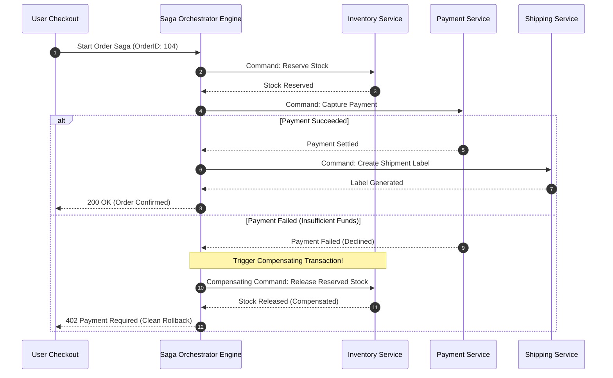

In a monolithic application, maintaining data consistency is straightforward: a single ACID database transaction wraps multiple updates, committing or rolling back atomically. In a microservices architecture with a **Database-per-Service** pattern, executing a business transaction that spans multiple services (e.g., placing an order, charging a credit card, reserving inventory) cannot rely on traditional database transactions.

Traditional **Two-Phase Commit (2PC)** protocols introduce heavy locking, latency, and single points of failure. The **Saga Pattern** provides an eventual consistency mechanism for managing distributed transactions using a sequence of local transactions and compensating actions.

This guide explores the Saga pattern, comparing **Choreography vs. Orchestration**, and detailing compensating transaction strategies.

## Why Two-Phase Commit (2PC) Fails at Scale

In a 2PC protocol, a central coordinator asks all participating databases if they are ready to commit, holding global locks until every node confirms:
- **Blocking Locks**: Database rows remain locked during network round-trips across services.
- **Availability Risk**: If one service or database goes offline during phase one, the entire system hangs, reducing overall availability ($A_{system} = A_1 \times A_2 \times ... \times A_n$).

## The Saga Architectural Pattern

A **Saga** breaks a global transaction into a series of **local transactions** ($T_1, T_2, ..., T_n$). Each local transaction updates a service's local database and emits a message or event.

If a local transaction fails (e.g., insufficient funds in step 3), the Saga executes a series of **compensating transactions** ($C_2, C_1$) in reverse order to undo the changes made by previous steps.

```
Happy Path Execution:
[Order Svc: Create Pending Order (T1)] -> [Payment Svc: Charge Card (T2)] -> [Inventory Svc: Reserve Stock (T3)] -> COMPLETE

Failure & Compensation Triggered at Step 3:
[Order Svc: Create Pending Order (T1)] -> [Payment Svc: Charge Card (T2)] -> [Inventory Svc: Out of Stock! (FAIL)]
                                                                                      |
                                                                                      v
[Order Svc: Cancel Order (C1)] <-------- [Payment Svc: Refund Card (C2)] <------------+
```

## Saga Execution Modes: Choreography vs. Orchestration

### 1. Choreography-Based Saga (Event-Driven)
In choreography, services publish and listen to domain events asynchronously via a message broker (e.g., Apache Kafka, RabbitMQ) without a centralized coordinator.

- **Flow**:
  1. `Order Service` receives a request, saves order as `PENDING`, and publishes `OrderCreatedEvent`.
  2. `Payment Service` listens to `OrderCreatedEvent`, charges the card, and publishes `PaymentProcessedEvent`.
  3. `Inventory Service` listens to `PaymentProcessedEvent`, attempts stock reservation, fails, and publishes `InventoryReservationFailedEvent`.
  4. `Payment Service` listens to `InventoryReservationFailedEvent` and refunds the charge ($C_2$).
  5. `Order Service` listens to `PaymentProcessedEvent` and updates status to `CANCELLED` ($C_1$).

* **Pros**: Simple for small workflows; loose coupling.
* **Cons**: Hard to visualize complex workflows; risk of cyclic event dependencies.

### 2. Orchestration-Based Saga (Central Controller)
In orchestration, a dedicated **Saga Orchestrator** service (or framework like Temporal, Camunda, or AWS Step Functions) explicitly commands each participant service what local transaction to execute.

- **Flow**:
  1. `Order Orchestrator` sends `ExecutePaymentCommand` to `Payment Service`.
  2. Upon receiving success response, `Order Orchestrator` sends `ReserveInventoryCommand` to `Inventory Service`.
  3. If `Inventory Service` returns a failure, `Order Orchestrator` issues `RefundPaymentCommand` to `Payment Service`.

* **Pros**: Centralized state visibility; easy to audit and debug complex multi-step sagas.
* **Cons**: Requires managing additional orchestrator infrastructure.

## Critical Implementation Rules

1. **Compensating Transactions Must Be Idempotent**: Compensating commands ($C_n$) may be retried multiple times over unstable networks. Ensure handlers can be invoked repeatedly without double-refunding or corrupting state.
2. **Use the Transactional Outbox Pattern**: When committing a local transaction, write the outgoing domain event to a local `outbox` table in the same database transaction, ensuring events are never lost if the message broker experiences a temporary outage.
3. **Handle Eventual Consistency in UI**: Design frontend user interfaces to reflect intermediate state (e.g., displaying "Processing Order..." rather than immediately confirming success) while the Saga completes asynchronously.

## Conclusion

The Saga pattern is an essential architectural design pattern for maintaining data integrity in cloud-native microservice systems. By choosing between event choreography and centralized orchestration, enforcing idempotency, and designing robust compensating workflows, software architects achieve fault-tolerant eventual consistency across distributed boundaries.


---

## Architectural Deep Dive: Orchestrated Sagas & Compensating Transactions

In distributed cloud microservices, traditional ACID transactions across multiple services are impossible because network partitions and heterogeneous databases preclude the use of Two-Phase Commit (2PC). The **Saga Pattern** solves distributed consistency by orchestrating a sequence of local transactions: each local transaction updates a service's database and emits an event that triggers the next step.

If any intermediate step fails (e.g., payment is declined after inventory was reserved), the **Saga Orchestrator** triggers compensating transactions in reverse order to revert changes and maintain eventual consistency.



### 1. Concrete Implementation: State Machine Saga Orchestrator in TypeScript

The following implementation demonstrates a stateful Saga Orchestrator executing sequential steps and handling automated compensating rollbacks:

```typescript
export interface SagaStep<TContext> {
  name: string;
  execute: (context: TContext) => Promise<void>;
  compensate: (context: TContext) => Promise<void>;
}

export class OrderSagaOrchestrator<TContext> {
  private steps: SagaStep<TContext>[] = [];

  public addStep(step: SagaStep<TContext>): this {
    this.steps.push(step);
    return this;
  }

  public async execute(context: TContext): Promise<{ success: boolean; error?: Error }> {
    const executedSteps: SagaStep<TContext>[] = [];

    for (const step of this.steps) {
      try {
        await step.execute(context);
        executedSteps.push(step);
      } catch (err: any) {
        console.error(`[SAGA_FAILURE] Step ${step.name} failed: ${err.message}. Initiating rollback.`);
        await this.rollback(executedSteps, context);
        return { success: false, error: err };
      }
    }

    return { success: true };
  }

  private async rollback(executedSteps: SagaStep<TContext>[], context: TContext): Promise<void> {
    // Execute compensating actions in reverse order
    for (const step of executedSteps.reverse()) {
      try {
        await step.compensate(context);
      } catch (compensateErr: any) {
        // Critical SRE Alert: Poison Saga State requires manual human intervention
        console.error(
          `[CRITICAL_SAGA_ROLLBACK_FAILURE] Failed to compensate step ${step.name}: ${compensateErr.message}`
        );
      }
    }
  }
}
```

---

## SRE Failure Modes & Production Troubleshooting Playbook

### Incident Scenario A: Compensating Transaction Failure Leaving Hanging Inventory Holds
* **Root Cause:** A payment authorization failed, triggering an inventory release command. However, the inventory microservice experienced a network timeout during compensation, leaving stock permanently locked.
* **Telemetry & Diagnostic Command:**
  ```bash
  # Query saga state store for unresolved or failed compensation states
  curl -s http://saga-store.internal:8080/v1/sagas?status=COMPENSATION_FAILED
  ```
* **Mitigation Protocol:**
  1. Enforce that all compensating transactions are strictly idempotent and retried indefinitely using a persistent Dead Letter Queue (DLQ).
  2. Implement an automated reconciliation chronojob that audits saga state machines lingering in `COMPENSATING` status for over 5 minutes.

### Incident Scenario B: Out-of-Order Cancellation Events Before Settlement Completion
* **Root Cause:** In an asynchronous choreographed saga, a user cancelled their order before the initial order placement transaction had completed in the shipping service, causing cancellation events to be dropped.
* **Telemetry & Diagnostic Command:**
  ```bash
  # Check for unhandled out-of-order events in Kafka Dead Letter Topics
  kafka-console-consumer.sh --bootstrap-server kafka:9092 --topic order-events-dlq --from-beginning
  ```
* **Mitigation Protocol:**
  1. Track monotonic saga state sequence numbers in distributed locks to reject out-of-order state transitions.
  2. Prefer centralized orchestrators (Temporal, AWS Step Functions) over complex choreography when transactions span more than 3 microservices.

---

## Architectural Trade-off Analysis: Saga Coordination Patterns

| Strategy | Observability | Coupling | Complexity at Scale | Rollback Management |
| :--- | :--- | :--- | :--- | :--- |
| **Choreography (Event-Driven)** | Difficult (Scattered across services) | Loose (Services listen to events)| High (Risk of cyclic event storms) | Hard to coordinate |
| **Orchestration (State Machine)**| Centralized & clear | Moderate (Orchestrator commands) | Manageable (Explicit state graph) | Deterministic & robust |
| **Two-Phase Commit (2PC)** | Trivial (ACID) | Extremely Tight (Locks held) | Unscalable in Cloud / NoSQL | Handled by DB coordinator |

---

## Saga Pattern Production Verification Checklist

* [ ] Every forward transaction step paired with an explicit, idempotent compensating transaction.
* [ ] Persistent saga state machine logged to durable storage before and after each state change.
* [ ] Dead Letter Queues (DLQ) configured for failed compensations with active PagerDuty alerting.
* [ ] Isolation anomalies (e.g., dirty reads during in-flight sagas) addressed using semantic locks.
* [ ] Load tests validate that rollback sequences execute successfully under simulated downstream latency.
