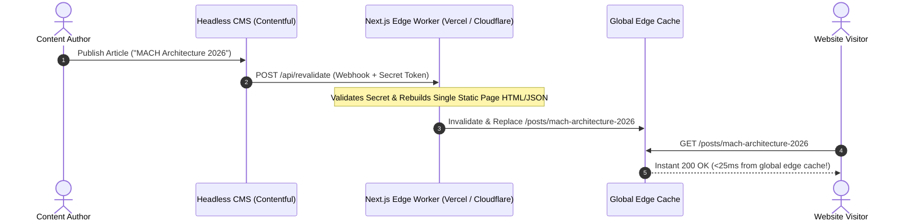

In traditional web development, Content Management Systems (CMS) like WordPress, Drupal, or Adobe Experience Manager tightly coupled content storage with HTML page rendering. While this monolithic approach worked well when websites were the sole digital touchpoint, modern enterprises must deliver content across diverse digital surfaces—including single-page web applications (React, Next.js), native mobile apps (iOS/Android), IoT displays, and smart voice assistants.

A **Headless CMS** decouples content creation and storage from the frontend presentation layer, serving content exclusively via structured APIs (REST or GraphQL).

This guide explores the architecture of Headless CMS platforms, key evaluation metrics, and integration patterns within MACH ecosystems.

## Monolithic CMS vs. Headless CMS Architecture

```
Traditional Monolithic CMS                   Decoupled Headless CMS
+---------------------------------+          +---------------------------------+
|  ADMIN DASHBOARD & CMS DB       |          |  HEADLESS CONTENT PLATFORM      |
|  - Content Authoring            |          |  (Contentful / Strapi / Sanity) |
|  - Relational Database          |          |  - Structured Schema Modeling   |
+---------------------------------+          |  - CDN-backed REST & GraphQL    |
                |                            +---------------------------------+
                v                                            |
+---------------------------------+                          | Structured JSON APIs
|  THEME ENGINE & HTML RENDERER   |                          v
|  (PHP / Templates / Monolithic) |          +---------------------------------+
+---------------------------------+          | FRONTEND CONSUMERS              |
                |                            | - Next.js / React Web App       |
                v                            | - iOS & Android Native Apps     |
        [ Single Web Page ]                  | - Digital Signage & Smart Kiosk |
                                             +---------------------------------+
```

### Traditional Monolithic CMS
- **Coupled Design**: The database, content editor UI, business logic, and HTML rendering templates reside in a single server process.
- **Limitations**: Redesigning the website requires rewriting CMS theme templates; delivering content to a mobile app requires hacking custom REST plugins into the monolith.

### Headless CMS
- **Decoupled Design**: The CMS acts purely as a content repository ("body"). The presentation layer ("head") is completely separated and consumes content as structured JSON data via APIs.
- **Omnichannel Capability**: A single blog post or product specification written in a Headless CMS can be fetched simultaneously by a static site generator (Jekyll/Gatsby), a mobile app, and a smart retail kiosk.

## Core Pillars of Headless Content Management

### 1. Structured Content Modeling
Rather than storing blob HTML pages, content in a Headless CMS is modeled as granular, typed JSON fields:
```json
{
  "id": "post-9021",
  "title": "Decoupling Microservices with Event Streams",
  "slug": "decoupling-microservices-event-streams",
  "publishedAt": "2026-04-04T12:00:00Z",
  "author": {
    "name": "Lenin Meza",
    "github": "https://merolhack.github.io/"
  },
  "tags": ["architecture", "microservices"],
  "contentBlocks": [
    {
      "type": "heading",
      "level": 2,
      "text": "Introduction to Asynchronous Events"
    }
  ]
}
```

### 2. API-First Distribution (GraphQL & REST)
Headless platforms expose high-performance APIs optimized for global CDN edge caching:
- **GraphQL**: Allows frontends to query precisely the fields needed for a specific screen, eliminating over-fetching on mobile networks.
- **Webhooks**: Triggers automated build pipelines (e.g., GitHub Actions, Vercel, Netlify) whenever content is created, updated, or published.

## Benefits for Enterprise Engineering Teams

1. **Frontend Framework Agility**: Frontend teams can build user interfaces using Next.js, Nuxt, Vue, or Svelte without being constrained by legacy CMS template syntax.
2. **Enhanced Security**: Eliminates database exposure to public web traffic. The frontend static site or serverless edge function interacts with read-only CDN endpoints.
3. **Independent Scalability**: High traffic spikes on the public web application do not impact content authoring teams working inside the CMS administration portal.

## Best Practices for Implementing Headless CMS

- **Avoid Over-Modeling**: Keep content schemas domain-focused rather than layout-focused. Do not create fields like `button_color_red` in the CMS; let the design system and frontend CSS handle presentation styling.
- **Implement Preview Environments**: Provide content creators with live draft previews by connecting CMS preview webhooks to dynamic staging deployments.
- **Leverage Edge Caching**: Position a global CDN (Cloudflare, Fastly) in front of CMS API endpoints to achieve sub-50ms response times globally.

## Conclusion

Adopting a Headless CMS transforms content from static HTML pages into dynamic data assets. By separating content management from presentation, enterprises unlock true omnichannel flexibility, superior web performance, and developer freedom.


---

## Architectural Deep Dive: Webhook-Driven Incremental Static Regeneration (ISR)

In legacy CMS architectures (WordPress, Drupal), every visitor request triggers dozens of SQL database queries and PHP rendering execution, creating severe performance bottlenecks that require complex server-side caching plugins.

In a **Headless CMS architecture**, content editors work in a decoupled cloud editing interface (Contentful, Strapi, Sanity). When an article is published or edited, the CMS fires an HTTP webhook that triggers **On-Demand Incremental Static Regeneration (ISR)** at the CDN edge, rebuilding only the specific modified page in under 300 milliseconds.



### 1. Concrete Implementation: Next.js On-Demand Revalidation Webhook Handler

The following TypeScript implementation demonstrates an on-demand revalidation endpoint that purges and rebuilds modified articles at the edge:

```typescript
import type { NextApiRequest, NextApiResponse } from 'next';

export default async function handler(req: NextApiRequest, res: NextApiResponse) {
  // 1. Validate incoming webhook secret to prevent unauthorized cache purges
  if (req.headers['x-revalidation-secret'] !== process.env.REVALIDATION_SECRET_TOKEN) {
    return res.status(401).json({ error: 'Invalid revalidation secret' });
  }

  try {
    const { slug } = req.body;

    if (!slug) {
      return res.status(400).json({ error: 'Missing slug in webhook payload' });
    }

    // 2. Trigger on-demand revalidation for the modified path
    await res.revalidate(`/posts/${slug}`);

    // Also revalidate the homepage blog feed to reflect updated articles
    await res.revalidate('/');

    return res.status(200).json({ revalidated: true, slug });
  } catch (err: any) {
    return res.status(500).json({ error: 'Error revalidating static page' });
  }
}
```

---

## SRE Failure Modes & Production Troubleshooting Playbook

### Incident Scenario A: Webhook Storm Crashing Edge Rebuild Pipeline
* **Root Cause:** A marketing intern published a batch update modifying 500 articles simultaneously, firing 500 webhooks within 2 seconds. The edge build workers ran out of concurrent execution limits, dropping 60% of revalidations and leaving stale content live.
* **Telemetry & Diagnostic Command:**
  ```bash
  # Check for HTTP 429 or 504 errors in edge function access logs
  grep -E "429|504" /var/log/edge-revalidate/access.log | wc -l
  ```
* **Mitigation Protocol:**
  1. Buffer incoming webhook notifications in an intermediate Redis queue or SQS topic and batch revalidations in 5-second debounced windows.
  2. Implement an automated fallback that relies on `stale-while-revalidate` cache-control headers.

### Incident Scenario B: Stale Content Desync Between CDN Edge and Native Mobile Clients
* **Root Cause:** Web visitors saw updated articles because edge caches were purged, but native mobile apps queried an unversioned REST API endpoint that returned cached JSON payloads with an un-invalidated 24-hour TTL.
* **Telemetry & Diagnostic Command:**
  ```bash
  # Compare response headers between desktop browser and mobile app user agents
  curl -I http://api.machplaybook.com/posts/sample -H "User-Agent: MobileApp/2.1"
  ```
* **Mitigation Protocol:**
  1. Standardize cache invalidation across both HTML and JSON Content Delivery APIs simultaneously upon webhook receipt.
  2. Include explicit ETag headers in Content Delivery API responses so mobile apps can validate freshness with lightweight `304 Not Modified` checks.

---

## Architectural Trade-off Analysis: CMS Architectures

| Architecture | Time to First Byte (TTFB) | Content Modeling Flexibility | Vulnerability Blast Radius | Editor UI Independence |
| :--- | :--- | :--- | :--- | :--- |
| **Coupled Monolith (WordPress)** | Moderate to Slow (PHP/MySQL) | Rigid (Tied to theme layout) | High (Vulnerable plugins) | Coupled to theme templates |
| **Headless SaaS (Contentful/Sanity)**| Sub-millisecond (Static Edge) | Absolute (Pure JSON schemas) | Zero (Read-only static assets) | Complete preview autonomy |
| **Git-Based Headless (Decap/Tina)** | Sub-millisecond | High (Markdown/YAML files) | Zero | Requires Git knowledge |

---

## Headless CMS Production Integration Checklist

* [ ] Content schemas designed as pure structured data without embedded HTML presentation tags.
* [ ] Webhook revalidation endpoints secured via HMAC or shared bearer secret tokens.
* [ ] On-demand Incremental Static Regeneration (ISR) active to rebuild pages within sub-second thresholds.
* [ ] Webhook storm debouncing implemented to prevent concurrent build worker exhaustion.
* [ ] Content Delivery API responses served through global edge CDN caches with stale-while-revalidate headers.
