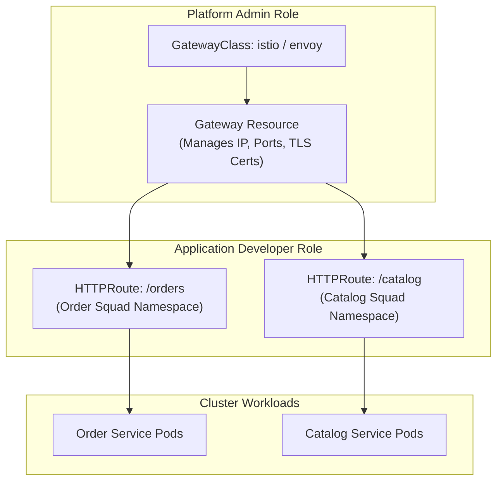

In this technical video review, we break down key concepts from leading cloud-native architecture presentations covering the evolution of Kubernetes ingress routing into the modern **Kubernetes Gateway API** and service mesh implementations (Istio, Linkerd, and Cilium).

As Kubernetes environments scale across multi-tenant clusters, traditional Ingress resources reach their design limits. This review highlights how the Gateway API standardizes ingress, egress, and intra-cluster traffic routing with role-oriented custom resource definitions (CRDs).

## Key Architectural Concepts Reviewed

### 1. The Ingress API Bottleneck vs. Gateway API Solution
The legacy `Ingress` resource attempted to force cluster operators, security teams, and application developers to edit the same single monolithic YAML spec. 

The **Kubernetes Gateway API** resolves this by separating concerns into distinct, role-based resources:
- **`GatewayClass`** (Infra Provider): Defines controller implementation (e.g., Envoy, Istio, Cilium).
- **`Gateway`** (Cluster Admin): Configures network entry points, ports, TLS certificates, and IP allocations.
- **`HTTPRoute` / `GRPCRoute`** (App Developer): Defines request matching rules, path redirects, header rewrites, and backend service destinations.

```
+-------------------------------------------------------------------+
| GatewayClass (Infra Provider: Istio / Cilium / Envoy)             |
+-------------------------------------------------------------------+
                                 |
                                 v
+-------------------------------------------------------------------+
| Gateway (Cluster Admin: Port 443, TLS Certs, Public IP)           |
+-------------------------------------------------------------------+
                                 |
        +------------------------+------------------------+
        |                                                 |
        v                                                 v
+-------------------------------+       +-------------------------------+
| HTTPRoute: Payment Service    |       | HTTPRoute: Inventory Service  |
| (Dev: /v1/payments -> SvcA)   |       | (Dev: /v1/catalog -> SvcB)    |
+-------------------------------+       +-------------------------------+
```

### 2. Advanced Traffic Splitting for Canary Deployments
One of the most valuable patterns demonstrated in the presentation is declarative canary deployment without relying on third-party CRDs.

```yaml
apiVersion: gateway.networking.k8s.io/v1
kind: HTTPRoute
metadata:
  name: checkout-route
  namespace: e-commerce
spec:
  parentRefs:
    - name: prod-gateway
  rules:
    - matches:
        - path:
            type: PathPrefix
            value: /checkout
      backendRefs:
        - name: checkout-v1
          port: 8080
          weight: 90
        - name: checkout-v2-canary
          port: 8080
          weight: 10
```
This configuration routes 90% of production traffic to `checkout-v1` while sending 10% to the `checkout-v2-canary` deployment, allowing real-world telemetry monitoring before full rollout.

### 3. Service Mesh Integration: Sidecar vs. Ambient/Sidecarless
The presentation provides an in-depth comparison of service mesh architectures:
- **Sidecar Model (Istio classic)**: Injects an Envoy sidecar proxy into every application Pod. Provides strict namespace isolation and mTLS, but increases memory usage and CPU overhead per Pod.
- **Ambient / eBPF Model (Istio Ambient, Cilium)**: Shifts proxying to node-level eBPF kernel processing and lightweight ztunnel proxies. Drastically reduces memory footprint while maintaining mTLS encryption and layer 7 policy enforcement.

## Expert Takeaways & Actionable Guidance

1. **Adopt Gateway API Early**: If you are building new Kubernetes clusters, bypass the legacy `Ingress` specification. Gateway API is the official Kubernetes standard for all future cloud-native routing.
2. **Decouple TLS Management**: Delegate certificate attachment (`secretName`) to the `Gateway` admin level so application developers cannot expose insecure unencrypted endpoints.
3. **Combine eBPF with L7 Service Mesh**: Use eBPF for fast, low-overhead layer 4 networking and mTLS, bringing in layer 7 Envoy proxies only when complex HTTP header manipulation or JWT validation is required.

## Final Verdict

This video is essential viewing for cloud engineers and platform architects transitioning from basic NGINX ingress controllers to production-grade service meshes. The practical YAML walk-throughs and clear role separation examples make it a benchmark guide for modern Kubernetes networking.


---

## Architectural Deep Dive: Kubernetes Gateway API Specification & Route Hierarchies

In this engineering breakdown, we review technical demonstrations configuring the modern **Kubernetes Gateway API (v1.0)**. For years, the legacy Kubernetes `Ingress` resource suffered from inadequate standardization, forcing platform teams to rely on non-portable vendor annotations (`nginx.ingress.kubernetes.io/...`).

The Gateway API introduces a role-oriented, highly expressive routing specification that cleanly decouples platform infrastructure management (`GatewayClass`, `Gateway`) from application routing logic (`HTTPRoute`, `GRPCRoute`).



### 1. Concrete Implementation: Kubernetes Gateway API & HTTPRoute Specification

The following manifests demonstrate production-ready traffic routing using the standardized Kubernetes Gateway API:

```yaml
apiVersion: gateway.networking.k8s.io/v1
kind: Gateway
metadata:
  name: edge-gateway
  namespace: infrastructure
spec:
  gatewayClassName: istio
  listeners:
    - name: https
      protocol: HTTPS
      port: 443
      tls:
        mode: Terminate
        certificateRefs:
          - name: wild-machplaybook-cert
      allowedRoutes:
        namespaces:
          from: All
---
apiVersion: gateway.networking.k8s.io/v1
kind: HTTPRoute
metadata:
  name: order-service-routing
  namespace: commerce
spec:
  parentRefs:
    - name: edge-gateway
      namespace: infrastructure
  hostnames:
    - "api.machplaybook.com"
  rules:
    - matches:
        - path:
            type: PathPrefix
            value: /api/v1/orders
      backendRefs:
        - name: order-service
          port: 8080
          weight: 90
        - name: order-service-canary
          port: 8080
          weight: 10 # 10% canary split
```

---

## SRE Failure Modes & Production Troubleshooting Playbook

### Incident Scenario A: Cross-Namespace Route Attachment Authorization Failure
* **Root Cause:** A developer deployed an `HTTPRoute` in the `payments` namespace, but the root `Gateway` in the `infrastructure` namespace had `allowedRoutes.namespaces.from: Same`, silently dropping all incoming traffic to the payment route.
* **Telemetry & Diagnostic Command:**
  ```bash
  # Check status conditions on HTTPRoute objects
  kubectl describe httproute order-service-routing -n commerce
  ```
* **Mitigation Protocol:**
  1. Enforce explicit `ReferenceGrant` or `allowedRoutes` policies specifying authorized namespaces for route attachment.
  2. Implement automated CI checks using `kube-linter` to validate cross-namespace references before applying manifests.

### Incident Scenario B: Hostname Collision Dropping Ingress Traffic
* **Root Cause:** Two distinct teams deployed `HTTPRoute` manifests matching the same hostname `api.machplaybook.com` with identical path prefixes, causing non-deterministic gateway routing decisions.
* **Telemetry & Diagnostic Command:**
  ```bash
  # Inspect gateway controller collision error events
  kubectl get events -n infrastructure --field-selector reason=RouteConflict
  ```
* **Mitigation Protocol:**
  1. Delineate path ownership in a centralized GitOps repository using CODEOWNERS for route manifests.
  2. Configure the Gateway controller to emit immediate alerts on `RouteConditionAccepted = False`.

---

## Architectural Trade-off Analysis: Ingress Evolution

| Specification | Role Separation | Portability | Traffic Splitting & Header Routing | Specification Maturity |
| :--- | :--- | :--- | :--- | :--- |
| **Legacy Ingress** | None (Single monolithic spec) | Low (Custom vendor annotations) | Poor (Requires vendor extensions) | Deprecated / Maintenance |
| **Custom CRDs (VirtualService)**| High | Zero (Proprietary to Istio) | Very High | Mature but vendor-locked |
| **Kubernetes Gateway API** | High (Admin vs App developer) | Universal (Vendor neutral) | Native & Expressive | CNCF Standard (GA v1.0) |

---

## Kubernetes Gateway API Production Checklist

* [ ] Gateway controller running production-certified Gateway API v1.0 CRDs.
* [ ] Clear role separation established: Platform team manages `Gateway`, app squads manage `HTTPRoute`.
* [ ] Automated TLS certificate management integrated via cert-manager.
* [ ] Canary traffic weight splitting validated under continuous synthetic testing.
* [ ] Cross-namespace route attachment guarded by explicit `ReferenceGrant` manifests.
