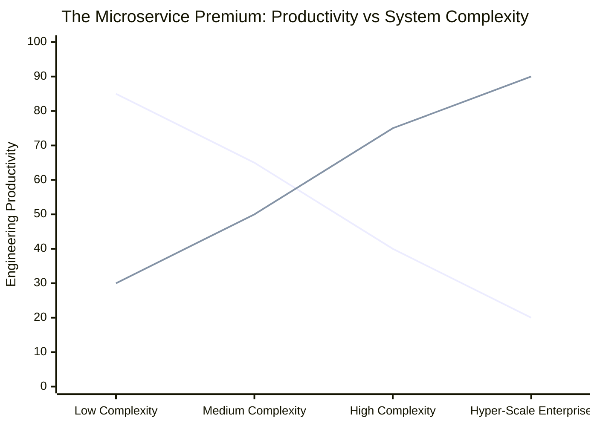

In this architecture review, we analyze foundational talks and articles by **Martin Fowler**, Chief Scientist at ThoughtWorks and a primary pioneer of modern microservice architecture definitions.

While microservices are often treated as default industry best practice today, Fowler's original thesis provides a deeply pragmatic perspective. He emphasizes that microservices are a trade-off tool designed to solve complex organizational growth, rather than a universal recommendation for every software project.

Below is an analytical summary of Fowler’s core microservice principles, key architectural trade-offs, and critical warnings.

## Core Architectural Pillars Reviewed

### 1. Componentization via Services
Traditionally, software componentization relies on in-memory libraries (e.g., JAR files, DLLs, NPM packages). Fowler highlights that microservices achieve componentization using independently deployable web services.
- **Key Insight**: A library change requires recompiling and redeploying the entire application executable. A service component change allows updating a single service boundary independently, provided the API contract remains backwards-compatible.

### 2. Smart Endpoints and Dumb Pipes
Enterprise service bus (ESB) architectures of the 2000s attempted to embed complex business rules, transformation engines, and message routing inside central middleware software.

Fowler advocates for **Smart Endpoints and Dumb Pipes**:
- Applications retain full domain intelligence within service boundaries.
- The underlying communication infrastructure (e.g., HTTP REST, gRPC, simple message queues like RabbitMQ) acts purely as a message pipe without executing business logic.

```
Legacy ESB Model (Complex Middleware)
[ Svc A ] ---> | Enterprise Service Bus (ESB) | ---> [ Svc B ]
               | - Complex Transformation     |
               | - Embedded Business Rules    |

Microservice Model (Smart Endpoints & Dumb Pipes)
+-----------------------+     Lightweight HTTP/Kafka Pipe     +-----------------------+
|  Smart Endpoint A     | ==================================> |  Smart Endpoint B     |
|  (Full Domain Logic)  |    (Zero Business Logic in Pipe)    |  (Full Domain Logic)  |
+-----------------------+                                     +-----------------------+
```

### 3. Decentralized Governance and Data Management
- **Polyglot Persistence**: Microservices allow different services to adopt database engines tailored to their domain needs (e.g., PostgreSQL for relational transaction ledgers, Neo4j for social graphs, Redis for session caching).
- **Decentralized Data Ownership**: Each microservice strictly owns its database schema. Direct cross-database joins are prohibited; services communicate solely through public APIs or domain event streams.

### 4. Infrastructure Automation and Tolerant Readers
Operational resilience in microservice systems requires two fundamental prerequisites:
- **Continuous Delivery Pipelines**: Automated testing and single-command deployments are mandatory to manage dozens of distinct service artifacts.
- **Tolerant Reader Pattern**: Services must be coded to consume incoming JSON payload updates gracefully, ignoring unexpected fields to allow seamless schema additions without breaking upstream clients.

## The "Microservice Premium" Concept

One of Fowler’s most famous quotes regarding architecture is:

> *"Don't even consider microservices unless you have a system that's too complex to manage as a monolith."*

He illustrates this trade-off using the **Microservice Premium** model:

```
Productivity / System Speed
      ^
      |     Monolith Advantage (Low Complexity)
      |    /\
      |   /  \
      |  /    \  <--- Crossover Point
      | /      \_______________________ Microservice Advantage (High Complexity)
      |/_______________________________
      +------------------------------------> System Scale & Domain Complexity
```

- For simple systems, a monolithic architecture yields significantly higher developer productivity due to low operational overhead and sub-millisecond in-memory execution.
- Only when system complexity and organizational team size cross a specific threshold does the microservice architecture outweigh its baseline operational tax.

## Key Architectural Takeaways

1. **Start with a Monolith**: Unless you have unambiguous domain boundaries and massive team scale, build a well-architected monolith first.
2. **Focus on Evolutionary Design**: Design software boundaries so that components can be cleanly separated into independent services when actual operational demand requires it.
3. **Invest in Infrastructure Prerequisite Tools**: Do not transition to microservices without robust automated CI/CD pipelines, container orchestration, and telemetry monitoring in place.

## Final Summary

Martin Fowler's architectural guidance remains a vital antidote to technology hype. His work reminds software engineers that microservices are a trade-off mechanism—trading operational simplicity for organizational scale.


---

## Architectural Deep Dive: The "Microservice Premium" Evaluation Framework

In this architecture review, we analyze Martin Fowler’s seminal address on microservice architecture tradeoffs. Fowler’s central thesis is the concept of the **Microservice Premium**: microservices introduce substantial operational overhead (distribution, event eventual consistency, distributed tracing, network latency, deployment complexity) that is only justifiable when a system’s business complexity exceeds the management capacity of a monolithic architecture.

For systems below this complexity threshold, deploying microservices imposes a severe engineering tax that slows down developer velocity rather than accelerating it.



### 1. Concrete Implementation: Architectural Readiness Assessment in TypeScript

The following automated scorecard framework demonstrates how engineering leadership evaluates whether an application has reached the threshold to justify microservice decomposition:

```typescript
export interface ArchitectureReadiness {
  activeEngineersCount: number;
  independentReleaseDomains: number;
  hasAutomatedCICD: boolean;
  hasDistributedTracing: boolean;
  monolithBuildTimeMinutes: number;
}

export function evaluateMicroservicePremium(metrics: ArchitectureReadiness): {
  recommendation: 'STAY_MONOLITH' | 'MODULAR_MONOLITH' | 'TRANSITION_TO_MICROSERVICES';
  justification: string;
} {
  if (!metrics.hasAutomatedCICD || !metrics.hasDistributedTracing) {
    return {
      recommendation: 'STAY_MONOLITH',
      justification: 'Prerequisites missing: Automated CI/CD and distributed observability are mandatory before adopting microservices.',
    };
  }

  if (metrics.activeEngineersCount < 25 && metrics.independentReleaseDomains < 4) {
    return {
      recommendation: 'MODULAR_MONOLITH',
      justification: 'Team size and domain divergence do not justify distributed network overhead. Use a Modular Monolith.',
    };
  }

  return {
    recommendation: 'TRANSITION_TO_MICROSERVICES',
    justification: 'High organizational complexity and team autonomy requirements satisfy the Microservice Premium threshold.',
  };
}
```

---

## SRE Failure Modes & Production Troubleshooting Playbook

### Incident Scenario A: Premature Microservices Adoption Exhausting Engineering Runway
* **Root Cause:** A 6-person startup decomposed a simple CRUD app into 14 microservices. The team spent 70% of their weekly capacity managing Kubernetes YAML, Envoy routing, and network debugging rather than shipping business features.
* **Telemetry & Diagnostic Command:**
  ```bash
  # Check ratio of infrastructure commits vs business logic commits in Git history
  git log --pretty=format:"%s" --since="3 months ago" | grep -iE "helm|k8s|docker|envoy|terraform" | wc -l
  ```
* **Mitigation Protocol:**
  1. Consolidate low-traffic microservices back into a single deployable Modular Monolith.
  2. Adopt managed serverless or PaaS infrastructure (GCP Cloud Run, AWS App Runner) to eliminate Kubernetes cluster maintenance overhead.

### Incident Scenario B: Lack of Baseline Operational Maturity Paralyzing Incident Response
* **Root Cause:** A team migrated to microservices without establishing centralized logging or distributed tracing. When an upstream timeout occurred, engineers had to SSH into 8 separate containers to grep log files manually, resulting in a 4-hour MTTR outage.
* **Telemetry & Diagnostic Command:**
  ```bash
  # Measure Mean Time to Resolution (MTTR) on production incidents
  curl -s http://pagerduty.internal/api/v1/analytics/mttr
  ```
* **Mitigation Protocol:**
  1. Make centralized logging and distributed tracing mandatory prerequisites before extracting any new microservice.
  2. Implement automated alerts correlated by W3C `traceparent` identifiers.

---

## Architectural Trade-off Analysis: Fowler's Architectural Paradigms

| Architectural Paradigm | Operational Overhead | Refactoring Ease | Team Scalability | Deployment Independence |
| :--- | :--- | :--- | :--- | :--- |
| **MonolithFirst** | Lowest (Single deployment) | High (Compile-time type checking)| Low (Merge conflicts past 50 devs)| Zero |
| **Modular Monolith** | Low (Single deployment) | High (Clear module boundaries) | Moderate (20-50 developers) | Single artifact |
| **Microservices** | High (Network, Sagas, CI/CD) | Low (Breaking changes across APIs)| High (Autonomous squads) | Absolute |

---

## Martin Fowler Microservice Prerequisite Checklist

* [ ] Rapid provisioning: automated cloud infrastructure deployment via code in under 10 minutes.
* [ ] Robust monitoring: centralized metrics, structured logging, and distributed tracing live.
* [ ] Rapid application deployment: automated CI/CD pipeline deploying commits to staging within minutes.
* [ ] Domain-Driven Design: bounded contexts clearly identified and validated by business experts.
* [ ] Organizational alignment: two-pizza cross-functional teams aligned to specific domain boundaries.
