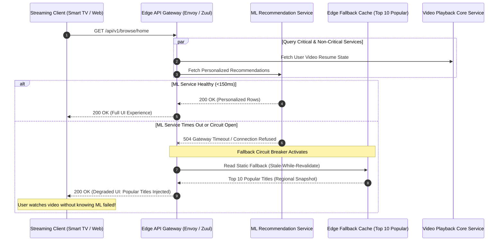

In this architecture breakdown, we react to and analyze presentations detailing **Netflix’s Global Cloud Architecture**. Operating one of the world's largest streaming video networks—accounting for a significant percentage of global downstream internet traffic—Netflix is widely recognized as a pioneer of cloud-native microservices, Chaos Engineering, and active-active multi-region cloud deployments.

While Netflix’s engineering achievements are impressive, applying their hyper-scale architectural patterns blindly to standard enterprise applications is a common engineering mistake.

This review breaks down what makes Netflix’s architecture extraordinary, identifies lessons that apply to every development team, and highlights patterns that non-hyperscale companies should avoid.

## Key Engineering Innovations Reviewed

### 1. Chaos Engineering & Immune-System Testing
Netflix pioneered **Chaos Engineering**—the practice of intentionally injecting failures into production systems to verify that infrastructure self-heals without impacting end users.
- **Chaos Monkey**: Randomly terminates production Virtual Machine instances during business hours to ensure services tolerate unexpected infrastructure dropouts.
- **Chaos Kong**: Simulates an entire AWS Region outage, forcing global DNS traffic redirection to sibling regions within minutes.

```
                    [ Active Global User Traffic ]
                                 |
                                 v
                     [ Global Route 53 DNS ]
                                 |
         +-----------------------+-----------------------+
         |                                               |
         v                                               v
+-------------------------------+             +-------------------------------+
| AWS Region US-East-1          |             | AWS Region EU-West-1          |
| - Microservice Fleet A        | <=========> | - Microservice Fleet A        |
| - Cassandra Multi-Region Sync |  Async Sync | - Cassandra Multi-Region Sync |
+-------------------------------+             +-------------------------------+
         ^                                               ^
         | [Chaos Monkey: Injects Latency]               | [Chaos Kong: Region Outage]
```

### 2. Fallback-Oriented Client Architecture
When a microservice fails in the Netflix backend, the user experience degrades gracefully rather than throwing an error screen:
- If the `Personalized Recommendation Service` times out, the client application falls back to displaying a static pre-cached list of top 10 popular movies.
- The user continues watching content seamlessly without realizing a backend microservice experienced an outage.

### 3. Active-Active Multi-Region Data Replication
Netflix operates out of multiple AWS regions simultaneously. User requests are served by the region closest to them, with underlying data (Cassandra, EVCache) continuously replicated asynchronously across global ocean cables.

---

## What 99% of Enterprise Applications SHOULD Learn

1. **Design for Failure (Graceful Degradation)**: Implement fallback mechanisms in your API layers. If an optional non-critical service (e.g., product review ratings) fails, render the product page anyway without the review scores.
2. **Automate Infrastructure Self-Healing**: Use health checks, auto-scaling groups, and Kubernetes pod restart policies to recover automatically from hardware node failures.
3. **Adopt Asynchronous Event Decoupling**: Offload non-blocking operations (e.g., sending email notifications or updating analytics indexes) to background message queues.

---

## What DOES NOT Apply to the Average Company

### 1. Custom Infrastructure Wheel Invention
At its scale, Netflix built custom internal frameworks (Eureka for service discovery, Hystrix for circuit breaking, Zuul for routing, Spinnaker for CD).
- **Reality for Most Companies**: Today, managed open-source standards—such as **Kubernetes**, **Istio**, **Envoy**, and cloud provider managed services (AWS EKS, GCP Cloud Run, Azure AKS)—provide 95% of these capabilities out of the box with zero custom framework maintenance required.

### 2. Active-Active Multi-Region Database Writes
Replicating active-active transactional database writes across geographic regions introduces extreme data conflict resolution overhead and massive cloud data egress costs.
- **Reality for Most Companies**: An active-passive primary region setup with automated secondary read replicas and snapshot backups delivers 99.99% availability at a fraction of the cost and complexity.

### 3. Running Chaos Monkey Without Baseline Observability
Executing random container termination in production before establishing basic centralized logging, distributed tracing, and automated deployments causes operational chaos without any architectural benefit.

## Conclusion

Netflix’s architecture is a masterclass in hyper-scale resilience engineering. However, software architects must distinguish between universal resilience principles (graceful degradation, circuit breakers, automated recovery) and hyper-scale infrastructure patterns that add unnecessary cost and complexity to standard enterprise applications.


---

## Architectural Deep Dive: Graceful Degradation & Fallback Circuit Breaking

> [!NOTE]
> **Editorial Transparency & Educational Framework:** This video review and technical teardown is an independent critical engineering analysis based on publicly disclosed architectural talks by Netflix engineering teams. MACH Playbook is an independent educational publication without corporate affiliation or endorsement by Netflix.

The primary takeaway from Netflix's distributed architecture is not simply that microservices enable scaling, but that **partial degradation must be engineered as a first-class feature**. When an application serves tens of millions of concurrent video streams across thousands of device types (smart TVs, game consoles, mobile phones, browsers), failures in non-critical microservices must never interrupt the primary viewing experience.

If the personalized machine-learning recommendation cluster experiences high latency or an outage, the edge API gateway should not return an HTTP 500 error. Instead, it must execute a deterministic fallback strategy.



### 1. Concrete Implementation: Fallback-Oriented Client Wrapper in TypeScript

The following production TypeScript pattern demonstrates how to implement a resilient microservice client using circuit breakers, timeout budgets, and deterministic cache fallbacks:

```typescript
export interface RecommendationItem {
  id: string;
  title: string;
  genre: string;
}

export interface ServiceResponse<T> {
  data: T;
  degraded: boolean;
  latencyMs: number;
}

export class ResilientRecommendationClient {
  private circuitOpen = false;
  private consecutiveFailures = 0;
  private lastFailureTime = 0;
  private readonly failureThreshold = 5;
  private readonly resetTimeoutMs = 15000; // 15 seconds cooldown
  private readonly timeoutBudgetMs = 250; // Strict latency budget

  // Static fallback dataset pre-warmed in memory
  private readonly staticFallback: RecommendationItem[] = [
    { id: 'm-001', title: 'Global Top Trending Title', genre: 'Action' },
    { id: 'm-002', title: 'Critically Acclaimed Drama', genre: 'Drama' },
    { id: 'm-003', title: 'Top Family Feature', genre: 'Animation' },
  ];

  /**
   * Fetches personalized recommendations with strict latency budgets and fallback.
   */
  public async getRecommendations(userId: string): Promise<ServiceResponse<RecommendationItem[]>> {
    const start = Date.now();

    // Check circuit breaker state
    if (this.circuitOpen) {
      if (Date.now() - this.lastFailureTime > this.resetTimeoutMs) {
        // Attempt half-open canary check
        this.circuitOpen = false;
        this.consecutiveFailures = 0;
      } else {
        return {
          data: this.staticFallback,
          degraded: true,
          latencyMs: Date.now() - start,
        };
      }
    }

    try {
      const data = await this.executeWithTimeout(this.fetchFromMLService(userId), this.timeoutBudgetMs);
      this.consecutiveFailures = 0;
      return {
        data,
        degraded: false,
        latencyMs: Date.now() - start,
      };
    } catch (err) {
      this.consecutiveFailures++;
      this.lastFailureTime = Date.now();

      if (this.consecutiveFailures >= this.failureThreshold) {
        this.circuitOpen = true;
      }

      // Graceful degradation: return static fallback data
      return {
        data: this.staticFallback,
        degraded: true,
        latencyMs: Date.now() - start,
      };
    }
  }

  private async executeWithTimeout<T>(promise: Promise<T>, timeoutMs: number): Promise<T> {
    let timer: NodeJS.Timeout;
    const timeoutPromise = new Promise<never>((_, reject) => {
      timer = setTimeout(() => reject(new Error('TIMEOUT_EXCEEDED')), timeoutMs);
    });
    return Promise.race([promise, timeoutPromise]).finally(() => clearTimeout(timer));
  }

  private async fetchFromMLService(userId: string): Promise<RecommendationItem[]> {
    // Simulated remote RPC call to ML recommendation cluster
    const controller = new AbortController();
    const res = await fetch(`http://ml-recs.internal/v1/user/${userId}`, {
      signal: controller.signal,
    });
    if (!res.ok) throw new Error(`HTTP_${res.status}`);
    return (await res.json()) as RecommendationItem[];
  }
}
```

---

## SRE Failure Modes & Production Troubleshooting Playbook

Streaming media platforms and high-availability systems must plan for severe distributed failures:

### Incident Scenario A: Cascading Thread Starvation Across Ingress Gateways
* **Root Cause:** A downstream metadata service develops high latency (p99 increases from 40ms to 4,500ms). Ingress proxy threads block waiting for HTTP responses, consuming all available connections and refusing new client sessions.
* **Telemetry & Diagnostic Command:**
  ```bash
  # Check Envoy / Ingress upstream connection pool saturation and pending requests
  curl -s http://127.0.0.1:15000/stats | \
    grep -E "upstream_cx_active|upstream_rq_pending_active|upstream_cx_overflow"
  ```
* **Mitigation Protocol:**
  1. Enforce aggressive upstream request timeouts (e.g., hard cap at 250ms) rather than default 30-second timeouts.
  2. Implement Envoy circuit breaking with `max_pending_requests: 100` and `max_requests: 1000` to reject excess requests before thread exhaustion occurs.

### Incident Scenario B: Cross-Region Multi-Master Replication Inconsistency
* **Root Cause:** Network latency spikes across inter-region cloud backbones cause asynchronous multi-region database replication (e.g., Cassandra / DynamoDB Global Tables) to drift out of sync, leading to conflicting write state.
* **Telemetry & Diagnostic Command:**
  ```bash
  # Check cross-region replication latency and dropped mutations
  nodetool tablestats keyspace_video | grep -E "Cross-region latency|Pending flushes"
  ```
* **Mitigation Protocol:**
  1. Pin user sessions to their home geographical region using sticky routing at the global DNS layer (Route 53 latency-based routing).
  2. Apply Last-Write-Wins (LWW) conflict resolution with monotonic NTP-synchronized clock timestamps (e.g., Amazon Time Sync Service) for non-financial profile state.

---

## Architectural Trade-off Analysis: Custom Frameworks vs Modern Cloud-Native

| Evaluation Dimension | Netflix Custom Ecosystem (Eureka/Hystrix/Zuul) | Modern Cloud-Native Standard (Kubernetes/Istio/Envoy) |
| :--- | :--- | :--- |
| **Language Dependency** | Java-centric (JVM library integration required) | Polyglot (Language-agnostic out-of-process sidecar) |
| **Application Overhead** | Heavy in-app libraries and thread management | Zero application code pollution; handled at network layer |
| **Maintenance Burden** | Extreme (Requires dedicated internal platform engineering teams) | Managed by open-source CNCF ecosystem and cloud providers |
| **Operational Suitability** | Only justifiable at extreme scale (>100k requests/sec) | Suitable for startups, mid-market, and enterprise architectures |

---

## Production Resilience & Chaos Engineering Verification Checklist

Before considering an enterprise microservice architecture resilient against catastrophic failure, verify these operational prerequisites:

* [ ] Every remote RPC and HTTP call enforces explicit timeout budgets (<300ms for user-facing reads).
* [ ] Fallback data or cached states exist for all non-essential page components.
* [ ] Chaos testing (e.g., automated pod termination during working hours) runs regularly in staging environments.
* [ ] Centralized telemetry (OpenTelemetry / Prometheus) visualizes error budgets and p99 latency regressions.
* [ ] Zero-downtime deployment strategies (Canary or Blue/Green) rollback automatically if error rates exceed 0.5%.
