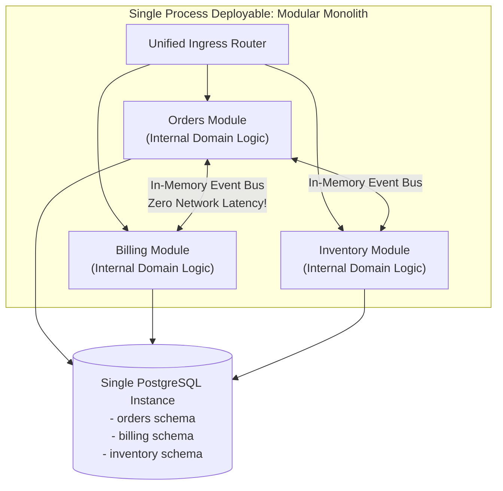

In software engineering, microservices are frequently presented as the ultimate goal for cloud-native applications. Industry blogs and conference talks focus heavily on how tech giants manage thousands of microservices. However, blindly adopting microservices without meeting essential organizational prerequisites is one of the leading causes of project delays, budget overruns, and engineering burnout.

For many projects—especially early-stage products, small teams, or volatile business domains—a **Monolithic Architecture** or a **Modular Monolith (Modulith)** is a vastly superior strategic choice.

This article provides a rigorous framework for identifying scenarios where microservices should be avoided and outlines practical alternative architectures.

## Scenarios Where Microservices Should Be Avoided

### 1. Early-Stage Startups & Unstable Business Domains
When building a new product, domain boundaries are highly fluid. Business models, user flows, and data schemas change rapidly based on market feedback.
- **The Microservice Risk**: Splitting code into microservices prematurely locks you into boundaries that will inevitably change. Refactoring domain boundaries across multiple repositories and network APIs requires 10x more effort than refactoring packages inside a single monolithic codebase.

### 2. Engineering Teams with Fewer than 25 Developers
Microservices solve organizational scaling problems when hundreds of developers cannot merge code into a single repository without constant merge conflicts.
- **The Microservice Risk**: A small team of 5–10 developers operating 30 microservices will spend more time managing Docker, Kubernetes, CI/CD pipelines, and IAM roles than shipping business features.

### 3. Systems Requiring Strict Real-Time ACID Transactions
Applications such as high-frequency trading platforms, core banking ledgers, or real-time gaming engines depend on low-latency, immediate transactional consistency.
- **The Microservice Risk**: Replacing in-memory database transactions with eventual consistency, Sagas, and distributed locks introduces unacceptable latency and complex failure states.

### 4. Lack of Dedicated Platform & DevOps Infrastructure
Operating microservices reliably requires advanced platform engineering: automated Kubernetes deployment, distributed OpenTelemetry tracing, centralized log management, and robust CI/CD automation.
- **The Microservice Risk**: If your organization lacks dedicated DevOps engineers to maintain this infrastructure, software developers will absorb the operational burden, drastically slowing feature delivery.

## The Architectural Readiness Scorecard

Evaluate your organization against these 5 criteria before embarking on a microservice migration:

| Criterion | Readiness Metric for Microservices | Recommendation if Unmet |
| :--- | :--- | :--- |
| **Team Size** | 25+ developers split into autonomous squads | Build a Monolith or Modulith |
| **Deployment Automation** | Fully automated zero-downtime CI/CD pipelines | Standardize deployment tooling first |
| **Observability** | Centralized tracing (OpenTelemetry) & structured logging | Implement tracing before splitting services |
| **Domain Stability** | Well-understood business domains & bounded contexts | Keep domain models together in one repository |
| **Infrastructure Budget** | Budget for multi-node Kubernetes clusters & SaaS APM | Optimize compute on simple Cloud VMs |

## The Alternative Solution: The Modular Monolith (Modulith)

A **Modular Monolith** is a single deployable application artifact whose internal code structure is strictly enforced by module boundaries (e.g., Java modules, Go packages, or C# projects).

```
+---------------------------------------------------------------+
|                 MODULAR MONOLITH APPLICATION                  |
|                                                               |
|  +------------------+   Internal Bus   +------------------+  |
|  |  Sales Module    | <--------------> | Billing Module   |  |
|  |  (Private Code)  |                  | (Private Code)   |  |
|  +------------------+                  +------------------+  |
|           |                                     |             |
+-----------|-------------------------------------|-------------+
            v                                     v
+---------------------------------------------------------------+
|                   SINGLE RELATIONAL DATABASE                  |
|                   (Module Schema Segregation)                 |
+---------------------------------------------------------------+
```

### Key Advantages of a Modulith:
- **Low Latency**: Module communication occurs in-memory via CPU calls (sub-microsecond execution, zero network overhead).
- **ACID Transactions**: Enables standard database transactions across modules while keeping data models logically separated.
- **Easy Future Migration**: If a specific module (e.g., `Payment Module`) eventually requires dedicated scaling, its strict package boundaries make it trivial to extract into an independent microservice later.

## Conclusion

Architecture should serve business goals, not technological trends. Start with a clean, well-structured Modular Monolith. Earn the right to adopt microservices by growing your engineering team, maturing your platform infrastructure, and establishing clear business domain boundaries.


---

## Architectural Deep Dive: The Modular Monolith (Modulith) Architecture

The most pragmatic alternative to distributed microservices for early-stage companies and medium-scale systems is the **Modular Monolith (Modulith)**. A Modulith runs inside a single deployable artifact and shares a single process memory space, but enforces strict physical and logical boundaries between domain modules.

Domain modules communicate exclusively through clean public interfaces or in-process event buses, preventing direct database or class dependencies. If a module later requires independent scaling, it can be extracted into a standalone microservice in hours with zero refactoring of business logic.



### 1. Concrete Implementation: In-Process Domain Event Bus in TypeScript

The following implementation demonstrates an in-memory asynchronous event bus that decouples modules inside a Modular Monolith with sub-millisecond execution times:

```typescript
import { EventEmitter } from 'events';

export interface InProcessEvent {
  name: string;
  payload: any;
  timestamp: string;
}

export class ModulithEventBus {
  private emitter = new EventEmitter();

  constructor() {
    this.emitter.setMaxListeners(50);
  }

  // Publish event asynchronously without blocking caller thread
  public publish(eventName: string, payload: any): void {
    const event: InProcessEvent = {
      name: eventName,
      payload,
      timestamp: new Date().toISOString(),
    };
    setImmediate(() => {
      this.emitter.emit(eventName, event);
    });
  }

  public subscribe(eventName: string, handler: (event: InProcessEvent) => Promise<void>): void {
    this.emitter.on(eventName, async (event) => {
      try {
        await handler(event);
      } catch (err: any) {
        console.error(`[MODULITH_EVENT_ERROR] Handler for ${eventName} failed: ${err.message}`);
      }
    });
  }
}
```

---

## SRE Failure Modes & Production Troubleshooting Playbook

### Incident Scenario A: Memory Leak in Peripheral Module Bringing Down Entire Monolith
* **Root Cause:** A PDF reporting module had an unclosed file stream that accumulated memory over 72 hours. Because all modules shared the same Node.js heap, the process threw an Out Of Memory (OOM) error, taking down checkout.
* **Telemetry & Diagnostic Command:**
  ```bash
  # Inspect Node.js / JVM memory heap dumps using clinic or jcmd
  clinic doctor -- node dist/server.js
  ```
* **Mitigation Protocol:**
  1. Offload heavy memory-intensive tasks (PDF generation, video transcode) to serverless workers (AWS Lambda / Cloud Run) rather than running in the core API process.
  2. Implement process auto-restarts with PM2 / Kubernetes before memory reaches OOM thresholds.

### Incident Scenario B: Accidental Direct Import Bleeding Module Boundaries
* **Root Cause:** A junior developer imported an internal entity class from `../modules/billing/internal/entity` directly into the order controller, creating tight coupling at the code level.
* **Telemetry & Diagnostic Command:**
  ```bash
  # Run architectural linter (dependency-cruiser / ArchUnit) to detect illegal cross-module imports
  npx depcruise --validate .dependency-cruiser.js src/
  ```
* **Mitigation Protocol:**
  1. Enforce strict import boundaries using tools like `dependency-cruiser` (Node.js) or `ArchUnit` (Java).
  2. Structure modules as separate TypeScript Project References or npm workspaces with explicit exports.

---

## Architectural Trade-off Analysis: Modulith vs Microservices

| Decision Dimension | Modular Monolith | Distributed Microservices |
| :--- | :--- | :--- |
| **Startup / Team Velocity** | Maximum (Single repo, instant local dev) | Low to Moderate (Env orchestration overhead) |
| **Network Latency** | Zero (In-memory execution) | 15-50ms per distributed hop |
| **Data Consistency** | Simple (ACID transactions available) | Complex (Sagas, eventual consistency required) |
| **Independent Scaling** | Whole process scales together | Granular scaling per microservice |
| **Operational Overhead** | Minimal (Single pipeline and database)| High (Kubernetes, Envoy, Helm, Kafka) |

---

## Modular Monolith Decision Checklist

* [ ] Team size is under 25 engineers (microservices overhead not yet justified).
* [ ] Domain boundaries enforced strictly via architectural linters (e.g., dependency-cruiser).
* [ ] Cross-module interactions executed via public interfaces or in-memory event buses.
* [ ] Database schemas segregated per module within the shared database instance.
* [ ] Clean extraction path verified: modules designed so they can be isolated into microservices if needed.
