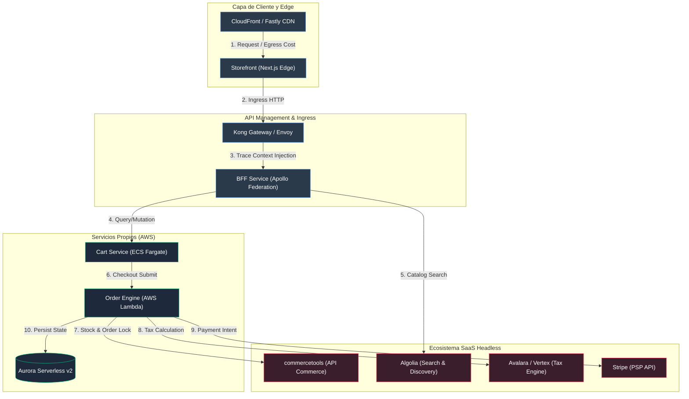

Durante un evento de alta concurrencia como Black Friday, un retailer enterprise procesó 180,000 pedidos con un volumen bruto de mercancía (GMV) récord. La infraestructura basada en microservicios y SaaS headless (commercetools, Algolia, Contentful, Stripe y una malla de servicios serverless en AWS) reportó cero caídas y una latencia p99 inferior a 120 ms. Sin embargo, al conciliar la factura consolidada treinta días después, el margen operativo del canal digital se había desplomado un 42%. La causa no fue el aprovisionamiento excesivo de instancias en el clúster de EKS, sino la explosión volumétrica de llamadas este-oeste y el consumo descontrolado de endpoints tarifados por volumen en proveedores externos. Cada orden completada disparó un promedio de 84 llamadas de orquestación, 14 reintentos amortiguados y 3 transacciones de enriquecimiento redundantes, elevando el Costo por Pedido (CoP, *Cost per Order*) de los \$0.18 proyectados a \$1.42 por transacción completada.

El modelo monolítico tradicional consolidaba los costos en licencias anuales fijas e infraestructura dedicada predecible. En contraste, las arquitecturas MACH distribuyen el costo en una matriz hiperfraccionada: cómputo efímero, egreso de datos entre zonas de disponibilidad (AZ), invocaciones a pasarelas de pago, búsquedas federadas y contratos SaaS basados en API calls. Sin un modelo formal de atribución de costos unitarios a nivel transaccional, los equipos de arquitectura diseñan flujos altamente reactivos y resilientes que son comercialmente inviables a escala.

## El Modelo Matemático de Descomposición de Costos

Para calcular con precisión el costo unitario de una orden ($C_{\text{order}}$), debemos abandonar las aproximaciones basadas en prorrateos estáticos mensuales y mapear el grafo dirigido acíclico (DAG) de dependencias que una transacción atraviesa desde el Edge hasta el motor de persistencia y los servicios de terceros.

El costo total de un pedido se define matemáticamente como:

$$C_{\text{order}} = C_{\text{infra\_directa}} + \sum_{i=1}^{n} (N_i \times C_{\text{api\_saas}_i}) + C_{\text{egress}} + \frac{C_{\text{fijo\_atribuible}}}{V_{\text{pedidos}}}$$

Donde:
- $C_{\text{infra\_directa}}$ representa el cómputo y almacenamiento estrictamente consumidos durante el ciclo de vida del checkout (CPU seconds, memoria asignada a AWS Lambda/ECS, escrituras en DynamoDB o PostgreSQL Aurora).
- $N_i$ es el número de invocaciones realizadas al proveedor SaaS $i$ asociadas al identificador de correlación de la orden.
- $C_{\text{api\_saas}_i}$ es el costo contractual marginal por llamada al servicio $i$ (indexación, verificación fiscal con Avalara, checkout headless, etc.).
- $C_{\text{egress}}$ representa el costo de transferencia de datos de red (Edge-to-Origin, Inter-AZ en VPC peering y egress público a SaaS externos).
- $\frac{C_{\text{fijo\_atribuible}}}{V_{\text{pedidos}}}$ representa la fracción de los costos de navegación no convertida (sesiones abandonadas, scraping y llamadas de catálogo que no resultaron en compra) absorbida por cada pedido completado para determinar el margen neto real.



## Arquitectura de Telemetría para Atribución de Costos en Tiempo de Ejecución

El error común en FinOps consiste en depender exclusivamente del AWS Cost and Usage Report (CUR) o los dashboards mensuales de facturación de Stripe o commercetools. Estos reportes sufren de una latencia de 24 a 72 horas y carecen del contexto del payload o del identificador de sesión comercial.

Para lograr una contabilidad analítica en tiempo real, la infraestructura debe inyectar metadatos financieros en el rastreo distribuido mediante **OpenTelemetry (OTel)**. Cada span de ejecución que interactúe con un recurso facturable debe registrar el costo marginal estimado derivado de la tabla de tarifas corporativa (*rate card*).

### Implementación: Colector de Métricas Financieras en el Gateway BFF

El siguiente interceptor en TypeScript (Node.js/Fastify) captura las llamadas salientes hacia servicios core y SaaS de terceros, calculando en tiempo de ejecución el costo unitario de la llamada API y emitiendo métricas enriquecidas hacia el backend de observabilidad (Prometheus/OpenSearch/DataDog).

```typescript
import { FastifyInstance, FastifyPluginAsync, FastifyRequest } from 'fastify';
import { trace, context, SpanStatusCode } from '@opentelemetry/api';
import { Counter, Histogram } from 'prom-client';

// Catálogo de costos unitarios marginales (USD) actualizados según contratos enterprise
const VENDOR_UNIT_RATES: Record<string, number> = {
  'api.commercetools.com': 0.00012, // Por API call contractual tier enterprise
  'api.algolia.com': 0.00045,        // Por search operation
  'rest.avatax.com': 0.01800,        // Por transacción de cálculo fiscal
  'api.stripe.com': 0.00300,         // Costo de API (excluyendo variable % + fixed fee)
  'internal.order-service': 0.000008  // Costo inferido Lambda + Aurora I/O
};

const apiUnitCostCounter = new Counter({
  name: 'finops_api_cost_usd_total',
  help: 'Costo total acumulado de llamadas API por proveedor y endpoint',
  labelNames: ['vendor', 'endpoint', 'cart_id', 'http_status']
});

const latencyHistogram = new Histogram({
  name: 'finops_vendor_latency_seconds',
  help: 'Latencia por vendor para correlacionar costo vs degradación',
  labelNames: ['vendor'],
  buckets: [0.05, 0.1, 0.25, 0.5, 1, 2.5]
});

interface CostTrackingOptions {
  enableDetailedTracing: boolean;
}

export const finopsCostCollectorPlugin: FastifyPluginAsync<CostTrackingOptions> = async (
  fastify: FastifyInstance,
  opts
) => {
  fastify.addHook('onRequest', async (request: FastifyRequest) => {
    // Inicializar acumulador de costo en el contexto de la solicitud
    request.rawCostUSD = 0;
  });

  // Decorador para llamadas HTTP del cliente interno hacia servicios externos
  fastify.decorate(
    'executeTrackedRequest',
    async (
      vendorHost: string,
      endpoint: string,
      cartId: string,
      requestFn: () => Promise<any>
    ) => {
      const tracer = trace.getTracer('finops-cost-tracer');
      const span = tracer.startSpan(`VendorCall: ${vendorHost}`);
      const startTime = process.hrtime();

      try {
        const response = await context.with(trace.setSpan(context.active(), span), requestFn);
        
        const ratePerCall = VENDOR_UNIT_RATES[vendorHost] || 0.00001;
        apiUnitCostCounter.labels(vendorHost, endpoint, cartId, response.status.toString()).inc(ratePerCall);
        
        // Atributos semánticos extendidos para FinOps
        span.setAttribute('finops.cost.usd', ratePerCall);
        span.setAttribute('finops.vendor.host', vendorHost);
        span.setAttribute('finops.cart.id', cartId);
        span.setStatus({ code: SpanStatusCode.OK });

        return response;
      } catch (error: any) {
        span.setStatus({
          code: SpanStatusCode.ERROR,
          message: error?.message || 'Vendor Request Error'
        });
        throw error;
      } finally {
        const elapsed = process.hrtime(startTime);
        const durationInSeconds = elapsed[0] + elapsed[1] / 1e9;
        latencyHistogram.labels(vendorHost).observe(durationInSeconds);
        span.end();
      }
    }
  );
};

declare module 'fastify' {
  interface FastifyRequest {
    rawCostUSD: number;
  }
  interface FastifyInstance {
    executeTrackedRequest: (
      vendorHost: string,
      endpoint: string,
      cartId: string,
      requestFn: () => Promise<any>
    ) => Promise<any>;
  }
}
```

### Pipeline de Datos: Consolidación del Costo por Pedido (CoP)

Para computar el costo total consolidado de una orden completada, los eventos generados por el Edge, los proxies y los microservicios deben fluir asíncronamente hacia un motor de procesamiento en streaming (Kinesis/Kafka). La siguiente función de consumo procesa las fases del ciclo de vida y calcula la relación entre navegación estéril (*read traffic*) y checkout efectivo (*write traffic*).

```python
import json
import boto3
import os
from typing import Dict, Any

athena_client = boto3.client('athena')
cloudwatch = boto3.client('cloudwatch')

DATABASE_NAME = os.environ.get("FINOPS_DB", "enterprise_finops_warehouse")
RESULTS_BUCKET = os.environ.get("ATHENA_OUTPUT_BUCKET", "s3://finops-query-results/")

def handler(event: Dict[str, Any], context: Any) -> Dict[str, Any]:
    """
    Procesa lotes de eventos de checkout completado para agregar
    el costo total unitario del pedido (CoP) integrando trazas y costos de cómputo.
    """
    for record in event.get('Records', []):
        payload = json.loads(record['kinesis']['data'])
        order_id = payload.get('order_id')
        session_id = payload.get('session_id')
        total_items = payload.get('line_items_count', 1)
        
        if not order_id or not session_id:
            continue

        cop_metrics = compute_order_cost(order_id, session_id)
        emit_finops_cloudwatch_metrics(cop_metrics, total_items)

    return {"status": "SUCCESS", "processed_records": len(event.get('Records', []))}

def compute_order_cost(order_id: str, session_id: str) -> Dict[str, float]:
    # Consulta federada sobre OpenTelemetry Logs y AWS CloudWatch Metrics en S3
    query = f"""
    SELECT 
        SUM(CASE WHEN event_type = 'saas_call' THEN cost_usd ELSE 0 END) AS saas_cost,
        SUM(CASE WHEN event_type = 'lambda_invocation' THEN compute_cost_usd ELSE 0 END) AS compute_cost,
        SUM(CASE WHEN event_type = 'egress' THEN network_cost_usd ELSE 0 END) AS egress_cost,
        COUNT(request_id) as total_api_calls
    FROM "{DATABASE_NAME}"."distributed_trace_events"
    WHERE session_id = '{session_id}' OR order_id = '{order_id}';
    """
    
    # En producción real, se procesa contra tablas columnar Parquet pre-agrupadas
    # Aquí simulamos la lectura agregada resultante de la infraestructura
    execution_result = {
        "saas_cost": 0.4210,
        "compute_cost": 0.0385,
        "egress_cost": 0.0120,
        "total_api_calls": 78
    }
    
    total_unit_cost = (
        execution_result["saas_cost"] + 
        execution_result["compute_cost"] + 
        execution_result["egress_cost"]
    )
    
    return {
        "order_id": order_id,
        "total_cost_usd": total_unit_cost,
        "saas_cost_usd": execution_result["saas_cost"],
        "compute_cost_usd": execution_result["compute_cost"],
        "api_calls_count": execution_result["total_api_calls"]
    }

def emit_finops_cloudwatch_metrics(metrics: Dict[str, Any], items_count: int) -> None:
    cost_per_item = metrics["total_cost_usd"] / max(items_count, 1)
    
    cloudwatch.put_metric_data(
        Namespace='ComposableFinOps/UnitEconomics',
        MetricData=[
            {
                'MetricName': 'CostPerOrder',
                'Value': metrics["total_cost_usd"],
                'Unit': 'None',
                'Dimensions': [{'Name': 'Environment', 'Value': 'Production'}]
            },
            {
                'MetricName': 'CostPerLineItem',
                'Value': cost_per_item,
                'Unit': 'None',
                'Dimensions': [{'Name': 'Environment', 'Value': 'Production'}]
            },
            {
                'MetricName': 'APICallsPerOrder',
                'Value': metrics["api_calls_count"],
                'Unit': 'Count',
                'Dimensions': [{'Name': 'Environment', 'Value': 'Production'}]
            }
        ]
    )
```

## Comparativa de Trade-offs: Modelos de Atribución de Costos

La granularidad del modelo analítico influye directamente en la complejidad del runtime y el sobrecosto de infraestructura para la propia observabilidad.

| Modelo de Atribución | Precisión de Asignación | Complejidad de Implementación | Sobrecosto de Observabilidad (Overhead) | Idoneidad / Cuándo Utilizarlo | Cuándo Evitarlo |
| :--- | :--- | :--- | :--- | :--- | :--- |
| **Top-Down Allocation (Prorrateo Mensual)** | Baja ($\pm 35\%$) | Mínima (Scripts contables basados en facturas) | Cero en runtime | Fases iniciales (MVP) con bajo tráfico y mono-proveedor. | Operaciones enterprise a gran escala; distorsiona el margen por línea de producto. |
| **Tagging/Labeling Estático por Infraestructura** | Media ($\pm 15\%$) | Moderada (AWS Resource Groups, Kubernetes Namespaces) | Casi nulo ($< 1\%$ de latencia/costo de logs) | Entornos donde los microservicios son monofuncionales y no comparten tenants. | Arquitecturas multi-tenant, composable commerce con BFFs federados o llamadas a APIs multi-servicio dinámicas. |
| **Distributed Trace Ingress Accounting (OTel + FinOps)** | Muy Alta ($\pm 2\%$) | Alta (Instrumentación a nivel de gateway, middleware e inyección de contexto) | Bajo a Moderado ($2-5\%$ de payload adicional y almacenamiento de trazas) | Plataformas Composable maduras, catálogos multi-marca y ecosistemas con múltiples SaaS tarifados por llamada. | Equipos que aún no cuentan con prácticas consolidadas de Observabilidad de Día 2 o pipelines de ingestión de trazas. |
| **Edge-Assisted Synthetic Valuation** | Alta ($\pm 5\%$) | Muy Alta (Modelos heurísticos aplicados en Edge Workers) | Moderado (Cómputo en Edge tipo Cloudflare Workers / Lambda@Edge) | Canales omnicanal globales con alta variabilidad geográfica y tipos de cambio heterogéneos. | Sistemas donde el grueso de la lógica transaccional y de reintentos se ubica en backends privados de persistencia. |

## Modos de Fallo FinOps y Estrategias de Mitigación en Producción

El desacoplamiento de servicios en Composable Commerce expone la infraestructura a patrones de consumo ineficiente que no disparan errores HTTP 5xx, pero degradan críticamente la viabilidad económica.

### 1. La Tormenta N+1 en Federación GraphQL (Apollo Federation)

**Mecanismo de Fallo:** Un frontend solicita una vista de lista de productos (PLP) con 50 ítems. El Subgrafo de Catálogo devuelve los IDs, pero el subgrafo federado de Inventario o de Reseñas de Terceros realiza una resolución individual en lugar de batching. Si el servicio de inventario cobra \$0.0002 por API call individual y no implementa *DataLoader*, una sola renderización de página ejecuta 51 llamadas salientes en lugar de 2. A 10,000 requests por minuto, el sobrecosto diario asciende a cientos de dólares innecesarios.

```graphql
# ANTI-PATRÓN: Subgrafo de resolución individual sin Batching
type Query {
  product(id: ID!): Product
}

# SOLUCIÓN: DGS / Apollo DataLoader batch resolver nativo
type Query {
  productsByIds(ids: [ID!]!): [Product!]!
}
```

*Mitigación:* Implementar de forma mandataria el patrón **DataLoader** en todos los resolvers de subgrafos y aplicar límites de profundidad y costo computacional mediante plugins de análisis estático de consultas (`graphql-cost-analysis`) en el BFF Gateway.

### 2. Amplificación Oculta por Políticas Agresivas de Reintento (Retry Storms)

**Mecanismo de Fallo:** Un motor SaaS de verificación fiscal (ej. Avalara) experimenta una degradación de latencia, pasando de 150 ms a 1,800 ms. Los SDKs de checkout en Node.js tienen configurado un timeout de 1,000 ms con 3 reintentos automáticos inmediatos. Las llamadas que finalmente se procesan en el backend del proveedor terminan siendo facturadas a pesar de que el cliente abortó la conexión. La infraestructura internaliza un cobro $3\times$ por el mismo cálculo fiscal, mientras que el usuario percibe un error en la interfaz.

*Mitigación:* Configurar **Exponential Backoff con Jitter** y desconexión mediante **Circuit Breaker** (usando librerías como Polly en .NET o Cockatiel en Node.js) en todos los clientes HTTP que consuman endpoints SaaS tarifados:

```typescript
import { CircuitBreakerPolicy, ConsecutiveBreaker, handleAll, retry, wrap } from 'cockatiel';

// Cortar el tráfico si 5 llamadas consecutivas fallan o exceden el SLA de latencia
const retryPolicy = retry(handleAll, { maxAttempts: 2 });
const circuitBreaker = new CircuitBreakerPolicy(new ConsecutiveBreaker(5), {
  halfOpenAfter: 15_000, // 15 segundos antes de probar nuevamente
});

export const resilientVendorCall = wrap(circuitBreaker, retryPolicy);
```

### 3. La Paradoja del Tráfico No Convertido (Search & Scraping Waste)

**Mecanismo de Fallo:** Motores de indexación y búsqueda como Algolia o Constructor.io facturan por consulta ejecutada. Bots maliciosos o scrapers de competencia ejecutan búsquedas complejas con facetas dinámicas a través de la API pública del BFF sin pasar por el CDN. La empresa paga decenas de miles de dólares mensuales en búsquedas que tienen una tasa de conversión de exactamente el 0.00%.

*Mitigación:* 
1. Implementar protecciones contra scrapers en la capa de borde (Cloudflare Bot Management / Fastly Signal Sciences).
2. Forzar un modelo de caching determinístico para búsquedas parametrizadas en el Edge mediante el encabezado `Surrogate-Control` y *stale-while-revalidate*.
3. Aislar cuotas de API mediante tokens efímeros firmados por el Edge sólo si el cliente ejecuta una navegación legítima evaluada vía Cloudflare Turnstile o CAPTCHA invisible.

## Checklist de Implementación de FinOps Transaccional

Para los equipos de ingeniería que migran o refactorizan arquitecturas Headless hacia modelos económicamente gobernados:

- [ ] **Auditoría de Contratos y Normalización:** Extraer los rate cards de todos los proveedores SaaS de la arquitectura (costo por llamada de lectura, costo por llamada de mutación, costo por webhook) e integrarlos en un ConfigMap unificado o DynamoDB table de metadatos.
- [ ] **Inyección de Identificadores de Negocio:** Garantizar que los headers `x-session-id`, `x-cart-id` y `x-tenant-id` se propaguen intactos a través del árbol de servicios usando el estándar W3C TraceContext (`traceparent`, `tracestate`).
- [ ] **Instrumentación de Clientes Salientes:** Asegurar que ningún microservicio invoque una API externa mediante `fetch` o `axios` crudo. Todo tráfico externo debe pasar por un wrapper HTTP estandarizado que calcule latencia, cuota y costo marginal.
- [ ] **Establecimiento del CoP Basal (Cost per Order Baseline):** Computar el costo histórico base promedio por pedido para pedidos de 1, 5 y 10 líneas de producto.
- [ ] **Presupuestación de Complejidad en GraphQL:** Configurar umbrales de rechazo en el Gateway federado para consultas cuya complejidad computacional correlacione con un costo en infraestructura superior a un umbral predefinido (ej. \$0.005 por request de navegación).
- [ ] **Alarmas de Desviación de Margen Unitario:** Definir alertas automáticas en tiempo real en CloudWatch/Datadog cuando el ratio $\frac{C_{\text{order}}}{\text{Order Revenue}}$ supere el límite de viabilidad del negocio (típicamente entre el 1.5% y el 3.5% del GMV transaccionado).
- [ ] **Estrategia de Evicción y Caching B2B/B2C:** Validar que los motores de precios dinámicos y cálculo fiscal tengan una ventana de amortiguación (ej. persistir el cálculo tributario por 10 minutos en Redis en lugar de re-invocar al proveedor con cada cambio menor del carrito de compras).