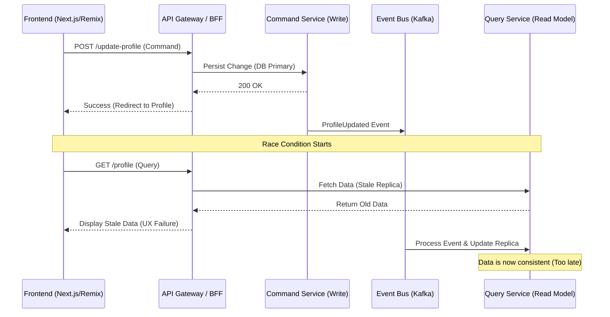

Un usuario en una plataforma de Composable Commerce de alto tráfico actualiza su dirección de envío durante el checkout. La petición `PATCH /api/v1/me/addresses/123` retorna un `200 OK`. Inmediatamente, el frontend redirige al resumen de orden. Sin embargo, el componente de resumen, que consume un Read Model optimizado en Elasticsearch o una base de datos de lectura replicada, muestra la dirección antigua. El usuario, confundido, intenta editar de nuevo o abandona el carrito. Este fenómeno, conocido como el "gap de consistencia eventual", no es un bug del código, sino una propiedad intrínseca de los sistemas distribuidos que priorizan la disponibilidad y el particionamiento (teorema CAP). En operaciones de Día 2, este desajuste entre la escritura y la lectura inmediata (Read-Your-Own-Writes o RYOW) es uno de los mayores desafíos de UX y soporte técnico en arquitecturas MACH.

El problema se agrava en ecosistemas Headless donde el frontend y el backend están desacoplados por múltiples capas de caché (CDN, Varnish, Redis) y donde el backend utiliza patrones de CQRS (Command Query Responsibility Segregation). Cuando la escritura ocurre en un clúster de base de datos primario y la lectura se sirve desde una réplica o un índice de búsqueda, la latencia de replicación —aunque sea de milisegundos— es suficiente para romper la ilusión de síncronía para el usuario final.

## El Ciclo de Vida de la Inconsistencia en Arquitecturas Event-Driven

En una arquitectura de microservicios moderna, una escritura suele desencadenar una cadena de eventos. Un servicio de "Orders" escribe en su base de datos transaccional, emite un evento a un bus (Kafka o RabbitMQ), y un "Read Model Projector" consume ese evento para actualizar una vista materializada. 



Para resolver esto sin sacrificar la escalabilidad global, debemos implementar estrategias de **Consistencia Causal**. No necesitamos que *todo el mundo* vea el cambio instantáneamente, pero el usuario que realizó la acción *debe* ver su propio cambio.

## Estrategia 1: Versionamiento de Estado y Propagación de Tokens de Sesión

La técnica más robusta para entornos Enterprise consiste en el uso de **Sequence Tokens** o **Vector Clocks** ligeros. El backend, tras una escritura exitosa, devuelve un encabezado de respuesta que indica la versión lógica o el timestamp de la última mutación para esa entidad o sesión.

### Implementación del Middleware de Consistencia

El cliente debe capturar este token y enviarlo en las peticiones de lectura subsiguientes. El servicio de lectura, al recibir el token, tiene dos opciones:
1.  **Wait-and-Read:** Bloquear la lectura (con un timeout corto) hasta que el Read Model alcance esa versión.
2.  **Bypass-to-Primary:** Si la versión solicitada es más reciente que la local, redirigir la consulta excepcionalmente a la base de datos de escritura.

#### Ejemplo de Interceptor en TypeScript (Frontend)

```typescript
// Axios Interceptor para manejar el Consistency-Token
import axios from 'axios';

const api = axios.create({ baseURL: '/api' });

api.interceptors.response.use((response) => {
  const versionToken = response.headers['x-version-token'];
  if (versionToken) {
    localStorage.setItem('last_known_version', versionToken);
  }
  return response;
});

api.interceptors.request.use((config) => {
  const token = localStorage.getItem('last_known_version');
  if (token && config.method === 'get') {
    // Informamos al backend qué versión mínima esperamos
    config.headers['x-wait-for-version'] = token;
  }
  return config;
});
```

#### Lógica de Backend (Go) para Validación de Consistencia

```go
func HandleGetProfile(w http.ResponseWriter, r *http.Request) {
    requiredVersion := r.Header.Get("x-wait-for-version")
    profileID := r.Context().Value("user_id")

    // Consultar el Read Model (ej: Redis o Read Replica)
    profile, currentVersion, _ := repository.GetProfile(profileID)

    if isStale(currentVersion, requiredVersion) {
        // Opción A: Intentar leer de la fuente de verdad (Primary DB)
        profile, _ = primaryRepository.GetProfile(profileID)
        w.Header().Set("x-consistency-source", "primary")
    } else {
        w.Header().Set("x-consistency-source", "replica")
    }

    json.NewEncoder(w).Encode(profile)
}
```

## Estrategia 2: Cache-Busting Selectivo en el Edge (CDN)

En arquitecturas Headless con tráfico global, el CDN (Cloudflare, Fastly, Akamai) suele servir peticiones GET. Si un usuario actualiza su carrito, el CDN podría seguir sirviendo el JSON antiguo debido al TTL del caché. 

La solución "bruta" es invalidar el caché por tag, pero esto puede ser lento (purging latency). Una estrategia más refinada es el **Cookie-Based Cache Bypass**. Al realizar una escritura, el backend setea una cookie de corta duración (ej: `last_update=timestamp`). El CDN, al detectar esta cookie, ignora el caché y hace un fetch directo al origen por un periodo de, por ejemplo, 5 segundos, tiempo suficiente para que la consistencia eventual se resuelva.

## Comparativa de Trade-offs Arquitectónicos

| Estrategia | Latencia de Escritura | Latencia de Lectura | Complejidad | Escalabilidad |
| :--- | :--- | :--- | :--- | :--- |
| **Optimistic UI** | Baja | Nula | Media (Frontend) | Alta |
| **Session Stickiness (Primary)** | Media | Alta (Load on Primary) | Baja | Baja |
| **Version Tokens (RYOW)** | Media | Variable (Wait/Bypass) | Alta | Alta |
| **Edge Bypass (Cookies)** | Baja | Media (Origin Fetch) | Media | Media |

## Patrones de Diseño para Mitigación de Fallos

### 1. El Anti-patrón de "Sleep" en el Frontend
NUNCA implementes un `setTimeout(() => fetchData(), 1000)` en el frontend. Es una condición de carrera no determinista. Si la red está lenta o el bus de eventos está saturado, 1000ms no serán suficientes. Si el sistema es rápido, estás penalizando la UX innecesariamente.

### 2. Sagas con Respuesta de Estado Futuro
En operaciones complejas (ej: creación de una orden), el comando de escritura puede devolver el objeto completo proyectado tal como *quedará* después de la persistencia. El frontend utiliza este objeto para actualizar su estado local (Redux, TanStack Query cache) sin necesidad de re-consultar el API inmediatamente.

### 3. Tombstones y Soft-Deletes
Al eliminar un recurso, el Read Model puede tardar en reflejar la desaparición. Implementar un "Tombstone" (un registro de que algo fue borrado recientemente) en un caché distribuido de baja latencia (Redis) permite que el Query Service filtre resultados que técnicamente aún existen en la base de datos de lectura pero que ya fueron marcados como borrados por el usuario.

## Implementación de Read-Your-Own-Writes con TanStack Query

Para equipos que utilizan React/Next.js, la librería TanStack Query (antes React Query) ofrece mecanismos para manejar RYOW mediante la manipulación manual del caché tras una mutación.

```typescript
const queryClient = useQueryClient();

const mutation = useMutation({
  mutationFn: updateAddress,
  onSuccess: (newAddress) => {
    // Actualizamos manualmente el caché de la consulta 'addresses'
    // Esto evita la necesidad de un GET inmediato que podría traer datos viejos
    queryClient.setQueryData(['addresses', newAddress.id], newAddress);
    
    // Opcionalmente, invalidamos pero mantenemos el dato fresco localmente
    queryClient.invalidateQueries({ queryKey: ['addresses'] });
  },
});
```

Este enfoque es excelente para la consistencia local del cliente, pero no resuelve el problema si el usuario refresca la página (F5) antes de que el backend sea consistente. Para cubrir el escenario de recarga de página, la **Estrategia 1 (Version Tokens)** sigue siendo obligatoria.

## Modos de Fallo Críticos y Recuperación

### El "Thundering Herd" en el Primary DB
Si implementas un bypass a la base de datos primaria cuando el Read Model está atrasado, corres el riesgo de saturar el nodo primario durante un pico de tráfico (ej: un Flash Sale).
*   **Mitigación:** Implementar un *Circuit Breaker* en el bypass. Si el ratio de lecturas dirigidas al primario excede un umbral (ej: 10% del tráfico total), el sistema debe degradarse graciosamente, aceptando la consistencia eventual y mostrando un mensaje al usuario: "Tu cambio se está procesando y será visible en unos momentos".

### Desincronización de Relojes (Clock Skew)
Si usas timestamps para la consistencia, los servidores de la base de datos y los del API deben estar sincronizados vía NTP. Un desfase de pocos milisegundos puede causar que el sistema crea que un dato es fresco cuando no lo es.
*   **Mitigación:** Preferir números de secuencia lógicos (como los LSN de PostgreSQL o los Sequence Numbers de DynamoDB) sobre timestamps de sistema.

## Checklist de Implementación para Líderes de Ingeniería

1.  **Auditoría de Latencia de Replicación:** Mide el percentil 99 (P99) de tu bus de eventos y replicación de DB. Si es > 500ms, el problema de RYOW será visible para el 100% de tus usuarios.
2.  **Definición de Entidades Críticas:** No todas las entidades necesitan RYOW. Identifica cuáles afectan la percepción de "sistema roto" (ej: Carrito, Perfil, Direcciones) y cuáles pueden tolerar retrasos (ej: Reviews, Recomendaciones).
3.  **Implementación de Headers de Versión:** Modifica tus Command Services para que incluyan un `X-Entity-Version` en la respuesta.
4.  **Configuración de CDN:** Asegúrate de que las reglas de caché consideren cookies de "última escritura" para hacer bypass selectivo.
5.  **Monitoreo de "Stale Reads":** Implementa telemetría que compare la versión solicitada por el cliente vs la versión servida por el Read Model. Esto te dará una métrica real de cuántas veces tus usuarios están viendo datos inconsistentes.

La consistencia eventual es el precio que pagamos por la escala global en la arquitectura MACH. Sin embargo, la invisibilidad de esta consistencia para el usuario final es lo que separa a una plataforma de e-commerce mediocre de una de clase mundial. Implementar RYOW no es solo una tarea técnica; es una inversión directa en la tasa de conversión y la confianza del cliente.