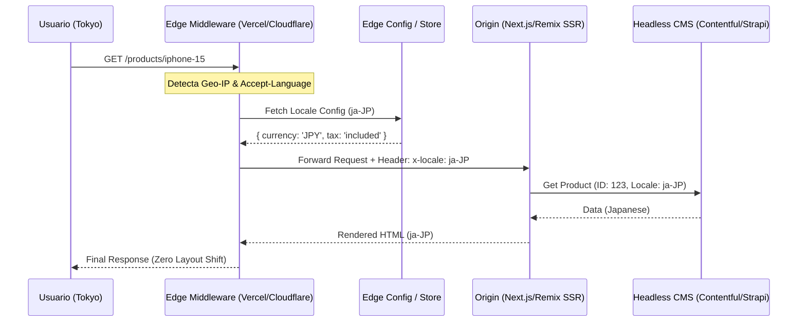

El despliegue de una plataforma de Composable Commerce en 40 mercados simultáneos suele revelar una verdad dolorosa que los entornos de staging rara vez muestran: el sistema de internacionalización (i18n) tradicional es el enemigo silencioso del Core Web Vitals y de la tasa de conversión. En una arquitectura de producción de alta escala, nos enfrentamos a un trilema arquitectónico: o enviamos bundles de JavaScript masivos que contienen todos los diccionarios (destruyendo el *Time to Interactive*), o realizamos peticiones en cascada hacia un CMS Headless para obtener traducciones en tiempo de ejecución (causando *Layout Shifts* y latencia de red), o sacrificamos la personalización regional por una caché estática agresiva.

El problema crítico surge en las operaciones de "Día 2", cuando el equipo de marketing exige cambios de contenido en tiempo real para una campaña de "Singles Day" en Asia, mientras el equipo de ingeniería lucha contra un *Hydration Mismatch* masivo en el frontend debido a que las cookies de preferencia de idioma no se sincronizaron correctamente con el renderizado en el servidor (SSR). Esta desincronización no solo degrada la experiencia del usuario con un "Flash of Untranslated Content" (FOUT), sino que penaliza el SEO internacional al entregar etiquetas `hreflang` inconsistentes.

## La Anatomía del Flujo de Localización en el Borde (Edge)

Para resolver estos cuellos de botella, debemos desplazar la lógica de resolución de localización fuera del origen y del cliente, situándola en la capa de computación de borde (Edge Computing). El objetivo es que la decisión de qué idioma, moneda y formato regional entregar se tome en menos de 50ms, interceptando la petición antes de que llegue a la lógica de renderizado principal.



## Implementación Técnica: Middleware de Borde y Tipado Estricto

En una arquitectura MACH, la internacionalización no debe ser una librería de cliente, sino un servicio de infraestructura. A continuación, presentamos una implementación de un Middleware de alto rendimiento utilizando TypeScript para un entorno de Next.js/Edge Runtime. Este patrón evita la carga de diccionarios pesados en el cliente y asegura que el servidor reciba el contexto de localización exacto.

```typescript
// middleware.ts - Implementación de resolución de localización en el Edge
import { NextRequest, NextResponse } from 'next/server';
import { match } from '@formatjs/intl-localematcher';
import Negotiator from 'negotiator';

const locales = ['en-US', 'es-MX', 'fr-FR', 'ja-JP'];
const defaultLocale = 'en-US';

function getLocale(request: NextRequest): string {
  const negotiatorHeaders: Record<string, string> = {};
  request.headers.forEach((value, key) => (negotiatorHeaders[key] = value));

  // Prioridad: Cookie > Header Accept-Language > Default
  const languages = new Negotiator({ headers: negotiatorHeaders }).languages();
  
  try {
    return match(languages, locales, defaultLocale);
  } catch (error) {
    return defaultLocale;
  }
}

export function middleware(request: NextRequest) {
  const { pathname } = request.nextUrl;
  
  // Evitar procesar assets estáticos o llamadas a API internas
  if (pathname.startsWith('/_next') || pathname.includes('/api/')) return;

  const pathnameHasLocale = locales.some(
    (locale) => pathname.startsWith(`/${locale}/`) || pathname === `/${locale}`
  );

  if (pathnameHasLocale) return;

  // Redirección inteligente basada en detección de borde
  const locale = getLocale(request);
  request.nextUrl.pathname = `/${locale}${pathname}`;
  
  // Inyectar headers para que el SSR no tenga que recalcular la lógica
  const response = NextResponse.redirect(request.nextUrl);
  response.headers.set('x-next-locale', locale);
  return response;
}
```

### El Desafío de los Diccionarios Dinámicos

El antipatrón más común es importar archivos `.json` de traducción directamente en los componentes de React. Esto aumenta el tamaño del bundle de forma lineal por cada nuevo idioma. La solución enterprise es la **Federación de Traducciones**.

En lugar de bundles, utilizamos un patrón de "Fetch & Hydrate" para diccionarios específicos por ruta, almacenados en un Edge Key-Value (como Cloudflare KV o Vercel Edge Config).

```typescript
// lib/i18n/get-dictionary.ts
const dictionaries = {
  'en-US': () => import('./dicts/en.json').then((module) => module.default),
  'es-MX': () => import('./dicts/es.json').then((module) => module.default),
};

// En un Server Component de Next.js (App Router)
export async function getDictionary(locale: string) {
  // En producción, esto se recupera de un Edge KV para permitir
  // actualizaciones sin redeploy (Hot-Reload de traducciones)
  const res = await fetch(`https://api.my-cms.com/v1/locales/${locale}`, {
    next: { revalidate: 3600, tags: ['translations'] }
  });
  return res.json();
}
```

## Trade-offs de Arquitectura: Estrategias de Localización

No existe una solución única. La elección depende de la frecuencia de actualización y el volumen de tráfico.

| Estrategia | Ventajas | Desventajas | Caso de Uso Ideal |
| :--- | :--- | :--- | :--- |
| **Static Build-time i18n** | Rendimiento máximo (0ms latencia). | Requiere redeploy para cambiar una coma. Bundle size masivo. | Sitios pequeños con pocos idiomas. |
| **Client-side Fetching** | Desacoplamiento total del backend. | FOUT (Flash of Untranslated Content), mal SEO, múltiples requests. | Dashboards B2B tras autenticación. |
| **Edge-side Injection** | SEO perfecto, latencia mínima, actualizaciones en tiempo real. | Complejidad en la configuración de la CDN/Edge. | E-commerce Global (B2C). |
| **Server-side (SSR) i18n** | Consistencia total de datos. | Aumenta el TTFB (Time to First Byte) si el CMS es lento. | Sitios con contenido altamente dinámico/precios. |

## Gestión de Fallos en Producción y Resiliencia

En un entorno geo-distribuido, la disponibilidad del servicio de traducciones es crítica. Si el Edge KV falla o el CMS está caído, el frontend no debe mostrar claves de traducción crudas (ej: `{{common.button.submit}}`).

### 1. Fallback de Jerarquía de Idiomas
Implementar una cadena de resolución. Si `es-AR` (Argentina) no tiene una clave específica, el sistema debe buscar en `es-MX` (Latam) y finalmente en `en-US` (Global). Esto se logra mediante un middleware de agregación en la capa de datos.

### 2. Stale-While-Revalidate (SWR) en el Borde
Nunca bloquees el renderizado por una traducción. Utiliza políticas de caché donde, si la traducción ha expirado, se sirve la versión "stale" mientras se actualiza en background.

```yaml
# Ejemplo de configuración de cabeceras en el Edge para traducciones
cache-control: public, s-maxage=60, stale-while-revalidate=600
```

### 3. El Problema de la Hidratación en React 18/19
Cuando el servidor renderiza en `es-MX` pero el cliente, por un error de detección de zona horaria o cookies, intenta hidratar en `en-US`, React lanzará un error de hidratación. Esto rompe el rendimiento y puede causar que la UI se vuelva no interactiva.
**Mitigación:** Forzar el locale desde el servidor mediante un `Context Provider` que reciba el valor directamente del header `x-next-locale` inyectado por el middleware, eliminando cualquier lógica de detección en el lado del cliente.

## Localización de Precios y Cumplimiento Legal (Compliance)

La internacionalización no es solo traducir texto; es adaptar la lógica de negocio. En Composable Commerce, esto implica:

*   **Display de Precios:** No basta con cambiar el símbolo de moneda. En la UE, los precios deben incluir IVA, mientras que en EE.UU. no. La lógica de cálculo debe residir en un microservicio de precios que reciba el contexto de localización validado por el Edge.
*   **Formatos de Fecha y Unidades:** Utilizar la API nativa `Intl` de JavaScript para evitar librerías pesadas como Moment.js.

```typescript
// Utilizando la API nativa para evitar bloat en el bundle
const formatter = new Intl.NumberFormat('de-DE', {
  style: 'currency',
  currency: 'EUR',
});

console.log(formatter.format(1234.56)); // "1.234,56 €"
```

## Checklist de Implementación para Equipos de Ingeniería

Para asegurar una implementación de i18n de nivel enterprise en una arquitectura MACH, siga este checklist:

1.  [ ] **Detección en el Borde:** ¿La resolución del locale ocurre en el Edge Middleware antes de llegar al origen?
2.  [ ] **Zero-JS i18n:** ¿El bundle inicial de JavaScript está libre de diccionarios de traducción?
3.  [ ] **SEO Hreflang:** ¿Se inyectan automáticamente las etiquetas `<link rel="alternate" hreflang="..." />` en el servidor basadas en la configuración de mercados?
4.  [ ] **Atomicidad de Traducciones:** ¿El CMS permite versionar las traducciones para evitar que un cambio parcial rompa la UI?
5.  [ ] **Pruebas de Latencia:** ¿Se ha medido el impacto del fetch de traducciones en el LCP (Largest Contentful Paint) en regiones con alta latencia?
6.  [ ] **Estrategia de Fallback:** ¿Existe un diccionario "hardcoded" mínimo para elementos críticos (errores 500, botones de checkout) en caso de fallo total del CMS?

## Conclusión

La internacionalización dinámica en arquitecturas Composable no es un problema de traducción, sino un desafío de distribución de datos y latencia. Al mover la lógica de resolución al borde y desacoplar los diccionarios del bundle de aplicación, transformamos un cuello de botella operativo en una ventaja competitiva. La clave del éxito en el "Día 2" reside en la capacidad de iterar sobre el contenido regional sin tocar una sola línea de código, manteniendo una consistencia absoluta entre lo que el motor de búsqueda indexa y lo que el usuario final experimenta en su dispositivo.