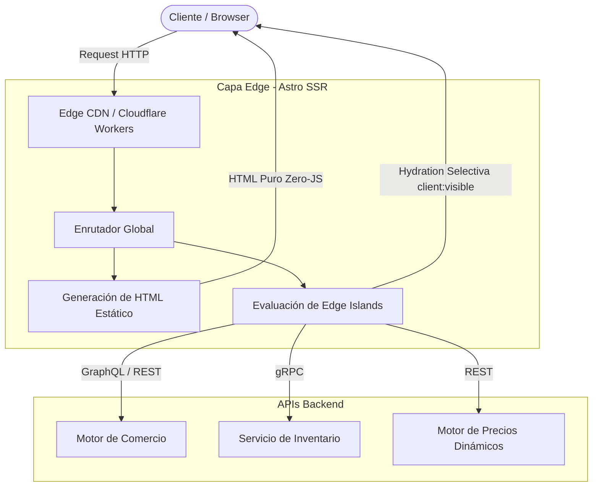

Durante el evento de lanzamiento global de temporada, el servicio de analíticas reportó una caída del 14% en la tasa de conversión móvil, a pesar de que el backend elástico basado en Kubernetes absorbió sin latencia perceptible las solicitudes a las APIs de inventario y precios. Al auditar las trazas de rendimiento en dispositivos de gama media, el cuello de botella era evidente: el hilo principal (*main thread*) del navegador permanecía bloqueado durante 1,850 milisegundos simplemente analizando, compilando y ejecutando un bundle de JavaScript de 1.4 MB proveniente de una arquitectura SPA basada en React. El cliente pagaba por un motor headless moderno, pero sufría penalizaciones severas en el *Total Blocking Time* (TBT) y el *Interaction to Next Paint* (INP), destruyendo el *Core Web Vitals* en el peor momento de transacciones concurrentes.

## El Dilema del Rendimiento en el E-Commerce Headless Tradicional

Las arquitecturas de comercio componible (*Composable Commerce*) basadas en desacoplar el motor de backend (commercelayer, Elastic Path, Commercetools) del frontend han priorizado tradicionalmente la flexibilidad de desarrollo sobre la eficiencia de entrega en el cliente. Frameworks SPA y de renderizado del lado del servidor (SSR) monolítico como Next.js fuerzan un paradigma donde la hidratación de la interfaz de usuario es de todo o nada (*all-or-nothing hydration*). Incluso componentes puramente estáticos —como la descripción legal de un producto, la tabla de tallas o los banners de marketing— cargan en el cliente árboles de DOM virtuales pesados y dependencias de estado global que requieren ejecución de JavaScript en el navegador.

En catálogos masivos con miles de SKUs, la penalización de rendimiento escala de manera no lineal. Los equipos de ingeniería intentan mitigar esto mediante *code-splitting* agresivo y carga perezosa (*lazy loading*), pero esto transfiere la complejidad al cliente, generando una cascada de solicitudes de red (waterfalls) que degradan drásticamente la métrica de *Largest Contentful Paint* (LCP). La solución arquitectónica a escala enterprise no pasa por optimizar la ejecución del JavaScript en el cliente, sino por eliminarlo por completo de las rutas críticas de renderizado mediante la arquitectura de islas (*Islands Architecture*) ejecutada en el Edge.



## Arquitectura de Edge Islands con Astro: Patrones de Diseño

Astro redefine el ciclo de vida de entrega de páginas web al adoptar HTML estático por defecto y permitir la integración de frameworks heterogéneos (React, Svelte, Vue) únicamente donde se requiere interactividad dinámica. Al combinar Astro con un runtime perimetral (*Edge runtime* como Cloudflare Workers o Vercel Edge Functions), trasladamos la computación del servidor de origen más cerca del usuario final, reduciendo la latencia de red de ida y vuelta (*Round Trip Time*) a menos de 50ms globales.

### Implementación de un Componente de Carrito con Hidratación Condicional

En una página de detalle de producto (PDP), el 95% del contenido (imágenes optimizadas, especificaciones técnicas, breadcrumbs, reseñas estáticas) no requiere interactividad basada en estado de cliente. Únicamente el selector de variantes y el botón de "Añadir al Carrito" exigen lógica de cliente. 

El siguiente componente en Astro implementa una isla perimetral que consulta precios en tiempo real mediante una API edge, renderiza HTML plano y solo hidrata el componente interactivo de React cuando el usuario hace scroll hacia él (`client:visible`).

```astro
---
// src/pages/pdp/[sku].astro
import ProductGallery from '@components/ProductGallery.astro';
import AddToCartWidget from '@components/react/AddToCartWidget.jsx';
import ProductSpecs from '@components/ProductSpecs.astro';
import { fetchProductBySku } from '@lib/commerce-client';

export const prerender = false; // Renderizado perimetral SSR dinámico

const { sku } = Astro.params;
const clientIp = Astro.request.headers.get('cf-connecting-ip') || '127.0.0.1';

// Ejecución paralela en el Edge contra APIs headless
const [productResult, pricingResult] = await Promise.allSettled([
  fetchProductBySku(sku),
  fetch(`https://pricing.enterprise.internal/v2/prices?sku=${sku}&ip=${clientIp}`, {
    headers: { 'X-Edge-Tenant': 'global-store' }
  }).then(res => res.json())
]);

if (productResult.status === 'rejected') {
  return Astro.redirect('/404');
}

const product = productResult.value;
const pricing = pricingResult.status === 'fulfilled' ? pricingResult.value : product.fallbackPrice;
---

<html lang="es">
  <head>
    <meta charset="utf-8" />
    <title>{product.name} | Enterprise Store</title>
    <meta name="viewport" content="width=device-width, initial-scale=1" />
  </head>
  <body class="bg-slate-50 text-slate-900 antialiased">
    <main class="max-w-7xl mx-auto px-4 py-8 grid grid-cols-1 lg:grid-cols-2 gap-12">
      <!-- Sección estática optimizada (Zero JavaScript enviado al cliente) -->
      <div class="space-y-6">
        <ProductGallery images={product.images} />
        <ProductSpecs specs={product.specifications} />
      </div>

      <!-- Panel de Compra Dinámico -->
      <div class="bg-white p-8 rounded-2xl shadow-sm border border-slate-200 flex flex-col justify-between">
        <div>
          <h1 class="text-3xl font-extrabold tracking-tight">{product.name}</h1>
          <p class="mt-4 text-2xl font-semibold text-emerald-600">
            {pricing.currency} {pricing.amount.toFixed(2)}
          </p>
          <p class="mt-2 text-sm text-slate-500">SKU: {product.sku}</p>
        </div>

        <!-- Isla React hidratada exclusivamente cuando entra en el viewport -->
        <AddToCartWidget 
          client:visible 
          sku={product.sku} 
          variants={product.variants} 
          inventoryStatus={product.inventory} 
        />
      </div>
    </main>
  </body>
</html>
```

### El Componente Interactivo en el Cliente (React)

El componente `AddToCartWidget` gestiona el estado local del carrito y la comunicación con el micro-frontend de checkout, pero su código fuente nunca afecta el rendimiento de carga inicial de la página gracias a la directiva de directiva de hidratación de Astro.

```tsx
// src/components/react/AddToCartWidget.tsx
import React, { useState } from 'react';

interface Variant {
  id: string;
  size: string;
  color: string;
  stock: number;
}

interface Props {
  sku: string;
  variants: Variant[];
  inventoryStatus: Record<string, number>;
}

export default function AddToCartWidget({ sku, variants, inventoryStatus }: Props) {
  const [selectedVariant, setSelectedVariant] = useState<string>(variants[0]?.id || '');
  const [loading, setLoading] = useState<boolean>(false);
  const [error, setError] = useState<string | null>(null);

  const handleAddToCart = async () => {
    setLoading(true);
    setError(null);
    try {
      const response = await fetch('/api/cart/items', {
        method: 'POST',
        headers: { 'Content-Type': 'application/json' },
        body: JSON.stringify({ sku, variantId: selectedVariant, quantity: 1 })
      });
      
      if (!response.ok) throw new Error('Error al sincronizar con el motor de carrito');
      
      window.dispatchEvent(new CustomEvent('cart:updated', { detail: { sku, variantId: selectedVariant } }));
    } catch (err: any) {
      setError(err.message || 'No se pudo procesar la solicitud');
    } finally {
      setLoading(false);
    }
  };

  return (
    <div className="mt-8 space-y-4">
      <div>
        <label className="block text-sm font-medium text-slate-700">Seleccionar Variante</label>
        <select 
          value={selectedVariant}
          onChange={(e) => setSelectedVariant(e.target.value)}
          className="mt-1 block w-full rounded-md border-slate-300 shadow-sm focus:border-indigo-500 focus:ring-indigo-500 sm:text-sm p-2 border"
        >
          {variants.map((v) => (
            <option key={v.id} value={v.id} disabled={v.stock === 0}>
              {v.size} / {v.color} {v.stock === 0 ? '(Agotado)' : ''}
            </option>
          ))}
        </select>
      </div>

      {error && <div className="p-3 text-sm text-red-600 bg-red-50 rounded-lg">{error}</div>}

      <button
        onClick={handleAddToCart}
        disabled={loading}
        className="w-full bg-slate-900 text-white py-3 px-4 rounded-xl font-medium hover:bg-slate-800 transition-colors disabled:opacity-50"
      >
        {loading ? 'Procesando...' : 'Añadir al Carrito'}
      </button>
    </div>
  );
}
```

## Comparativa de Trade-Offs Arquitectónicos

Evaluar la transición hacia una arquitectura basada en Astro y Edge Islands frente a enfoques tradicionales requiere sopesar métricas de entrega de valor frente a la complejidad operacional del equipo de ingeniería.

| Dimensión | SPA Tradicional (React/Vue/Angular) | SSR Monolítico (Next.js / Remix) | Astro + Edge Islands (Composable) |
| :--- | :--- | :--- | :--- |
| **Total Blocking Time (TBT)** | Alto (> 600ms en dispositivos móviles) | Moderado-Alto (Hidratación completa del árbol) | **Cercano a 0ms** (HTML puro en ruta crítica) |
| **Carga de Red (JS Payload)** | Masivo (> 1.2 MB iniciales) | Alto (> 600 KB incluso con code-splitting) | **Mínimo** (Solo scripts de islas activas) |
| **Latencia de Origen (TTFB)** | N/A (Hosting estático en CDN) | Variable (Requiere servidores Node.js dedicados) | **Ultra bajo** (Ejecución distribuida en Workers perimetrales) |
| **Complejidad de Estado Global** | Sencilla (Zustand, Redux en cliente) | Moderada (Requiere sincronización Server-Client) | **Desacoplada** (Estado perimetral y eventos nativos del DOM) |
| **Curva de Aprendizaje** | Estandarizada | Media | Requiere dominar restricciones de entornos Edge y componentes multi-framework |

## Modos de Fallo Comunes y Estrategias de Mitigación en Producción

La ejecución de lógica perimetral (*Edge Computing*) y renderizado híbrido introduce fallos distribuidos que difieren de los entornos tradicionales de servidores monolíticos.

### 1. Desincronización de Estado entre el Edge y el Cliente (Hydration Mismatches)
* **El Problema:** Si el runtime del Edge calcula una fecha, moneda o disponibilidad basada en la IP del usuario, pero el cliente renderiza el componente React utilizando la hora o localización local del navegador, el DOM resultante diferirá del árbol virtual inicial, provocando un error fatal de hidratación en React (`Hydration failed because the initial UI doesnot match what was rendered on the server`).
* **Mitigación:** Diseñar los componentes de islas con un patrón de carga diferida en dos fases. Renderizar un esqueleto neutro (skeleton loader) en el servidor y delegar la resolución de datos dependientes del contexto del cliente mediante un `useEffect` o utilizando directivas de carga asíncrona explícitas como `client:only="react"` para componentes altamente personalizados (por ejemplo, widgets de precios segmentados por perfil de usuario logueado).

### 2. Agotamiento de Límites de CPU en Workers Perimetrales
* **El Problema:** Los proveedores de Edge (Cloudflare Workers, Vercel) imponen límites estrictos de tiempo de CPU por solicitud (ej. 10ms a 50ms de tiempo de procesamiento activo). Si una página PDP realiza llamadas secuenciales en cascada a los microservicios de comercio, inventario y recomendación antes de ensamblar el HTML, el worker sufrirá un timeout prematuro.
* **Mitigación:** Aplicar llamadas estrictamente paralelas utilizando `Promise.allSettled()`, implementar estrategias de *Stale-While-Revalidate* (SWR) en el nivel de caché del Edge CDN para catálogos masivos y asegurar que los fallos en servicios no críticos (como motores de recomendación) devuelvan un valor por defecto en lugar de bloquear el renderizado completo de la página.

### 3. Fugas de Conexión en Middleware de Autenticación Edge
* **El Problema:** El uso incorrecto de clientes HTTP o conexiones de bases de datos no aptas para entornos sin estado (*stateless*) dentro del middleware de Astro puede agotar los descriptores de archivos o generar conexiones colgadas.
* **Mitigación:** Utilizar exclusivamente APIs basadas en fetch estándar dentro del código ejecutado en el Edge y delegar la validación de tokens JWT pesados a validadores criptográficos optimizados para Web Crypto API en lugar de librerías Node.js legacy que dependen de módulos nativos incompatibles (`crypto`, `fs`).

---

## Conclusión: Checklist de Implementación para Equipos de Ingeniería

Migrar un e-commerce enterprise hacia una arquitectura basada en Astro y Edge Islands requiere un cambio cultural en la forma en que los equipos frontend conciben la interactividad. La regla de oro es simple: **ninguna línea de JavaScript debe enviarse al cliente a menos que sea estrictamente indispensable para modificar el estado de la interfaz de usuario.**

### Checklist de Validación para Producción:
1. [ ] **Auditoría de Dependencias NPM:** Verificar que ningún paquete dentro de las islas interactivas arrastre dependencias de Node.js incompatibles con Web APIs (V8 isolates).
2. [ ] **Optimización de Core Web Vitals:** Validar mediante pruebas sintéticas (Lighthouse CI en pipelines de despliegue) que el INP se mantenga por debajo de 50ms y el TBT sea inferior a 100ms en dispositivos móviles de gama baja.
3. [ ] **Configuración de Políticas de Caché Perimetral (CDN):** Establecer cabeceras `Cache-Control` y etiquetas de purga perimetral (`Cache-Tag`) para invalidar páginas de productos de forma granular ante cambios críticos de inventario o precios.
4. [ ] **Estrategia de Fallback para APIs Headless:** Asegurar que los componentes renderizados en el Edge implementen *circuit breakers* ante la caída temporal de los microservicios del backend composable.