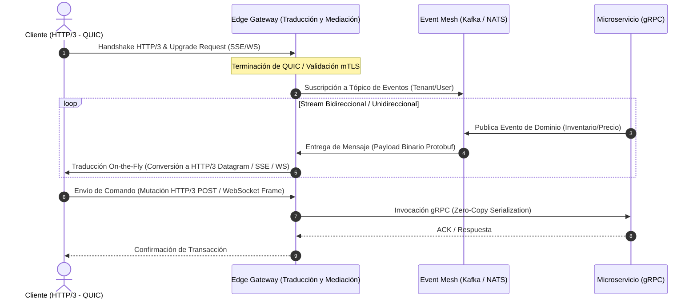

Durante la ventana de tráfico masivo del último *Cyber Monday*, nuestra plataforma de comercio composable global experimentó una degradación crítica del 42% en la latencia de P99 para las actualizaciones de inventario en tiempo real. El cuello de botella no residía en los microservicios de backend ni en el motor de persistencia distribuida, sino en la incapacidad de la capa de borde (*Edge Gateways*) para mediar eficientemente entre clientes modernos conectados mediante HTTP/3 (QUIC) y nuestros servicios heredados basados en WebSockets y Server-Sent Events (SSE). Los pools de conexiones TCP en el proxy inverso se saturaron por el fenómeno de *Head-of-Line (HoL) blocking* a nivel de transporte cuando los clientes sufrían fluctuaciones en redes móviles, provocando tormentas de reconexiones (*reconnection storms*) que colapsaron el plano de control de nuestras APIs. Resolver este escenario requirió rediseñar la arquitectura del borde para implementar una traducción y mediación de protocolos asíncrona y sin estado en memoria.

## El Dilema del Borde: Concurrencia Masiva y Heterogeneidad de Protocolos

En arquitecturas MACH y Composable Commerce a escala enterprise, el cliente final (ya sea una aplicación móvil nativa, una SPA en un navegador moderno o un quiosco IoT) demanda una experiencia de latencia ultra-baja. Sin embargo, la realidad de las redes de telecomunicaciones globales impone un mosaico de protocolos disímiles:

1. **HTTP/3 (QUIC):** Basado en UDP, elimina el *HoL blocking* a nivel de conexión y acelera el establecimiento de handshake (0-RTT), ideal para clientes móviles con alta pérdida de paquetes.
2. **WebSockets (RFC 6455):** Protocolo bidireccional persistente sobre TCP, altamente eficiente para tableros de inventario dinámicos y carritos colaborativos multi-usuario.
3. **Server-Sent Events (SSE):** Comunicación unidireccional eficiente sobre HTTP estándar, perfecta para flujos de estado de pedidos y notificaciones transaccionales.

El desafío de Operaciones de Día 2 surge cuando el backend monolítico o los microservicios distribuidos exponen eventos mediante gRPC o WebSockets internos, mientras que el borde debe negociar conexiones HTTP/3 eficientes con el exterior. Si el *Edge Gateway* carece de un motor de mediación y traducción de protocolos, cada cliente HTTP/3 que requiere una transmisión de datos en tiempo real obliga al gateway a mantener conexiones TCP persistentes backend-to-frontend propensas a agotamiento de descriptores de archivos (`EMFILE`).

## Arquitectura de Mediación en el Edge

Para desacoplar el transporte de cliente del transporte de backend, implementamos una topología basada en un proxy de borde programable (utilizando Envoy Proxy optimizado con extensiones en WebAssembly/Rust) capaz de terminar HTTP/3, traducir dinámicamente las tramas a gRPC o eventos de bus internos, y multiplexar las conexiones hacia los servicios de origen sin saturar los sockets de red.



Esta arquitectura garantiza que el borde actúe como un búfer inteligente. Si un cliente móvil pierde la conectividad brevemente y cambia de celda 5G, la sesión HTTP/3 con migración de conexión QUIC permite reanudar el flujo de datos sin necesidad de renegociar el handshake TLS ni reabrir el túnel de WebSocket subyacente hacia el backend.

## Implementación del Mediador de Protocolos en el Edge

A continuación, se muestra un patrón de implementación en TypeScript utilizando un entorno de ejecución Edge (compatible con Cloudflare Workers o V8 Isolates) que intercepta solicitudes de actualización, gestiona la mediación de protocolos y traduce tramas de eventos en tiempo real entre HTTP/3 y flujos SSE.

```typescript
/**
 * Edge Gateway Protocol Mediator
 * Intercepts incoming HTTP/3 client streams, negotiates protocol upgrades,
 * and mediates between SSE client streams and internal gRPC/Event streams.
 */

interface EdgeContext {
  clientId: string;
  tenantId: string;
  protocol: 'http3' | 'http2';
}

export default {
  async fetch(request: Request, env: any, ctx: ExecutionContext): Promise<Response> {
    const url = new URL(request.url);
    const acceptHeader = request.headers.get('Accept') || '';
    
    // Identificar si el cliente solicita un canal de eventos en tiempo real
    if (url.pathname === '/api/v1/stream/inventory') {
      const edgeCtx: EdgeContext = {
        clientId: request.headers.get('X-Client-ID') || crypto.randomUUID(),
        tenantId: request.headers.get('X-Tenant-ID') || 'default',
        protocol: request.cf?.tlsVersion === 'TLSv1.3' ? 'http3' : 'http2'
      };

      return handleProtocolMediation(request, edgeCtx, env);
    }

    // Rutas estándar de API Gateway
    return fetch(request);
  }
};

async function handleProtocolMediation(request: Request, context: EdgeContext, env: any): Promise<Response> {
  // Crear un TransformStream para mediar los datos en tiempo real sin bloquear el hilo principal
  const { readable, writable } = new TransformStream();
  const writer = writable.getWriter();
  const encoder = new TextEncoder();

  // Conexión simulada al Event Mesh o Broker interno (ej. NATS / WebSocket de Backend)
  const backendStreamUrl = `${env.BACKEND_EVENT_BUS_URL}?tenant=${context.tenantId}&client=${context.clientId}`;
  
  // Abrir conexión asíncrona hacia el origen con reintentos exponenciales gestionados en el Edge
  connectToBackendBus(backendStreamUrl, writer, encoder, context);

  // Retornar respuesta optimizada para HTTP/3 con Server-Sent Events
  return new Response(readable, {
    status: 200,
    headers: {
      'Content-Type': 'text/event-stream',
      'Cache-Control': 'no-cache, no-transform',
      'Connection': 'keep-alive',
      'X-Edge-Protocol-Mediated': context.protocol,
      'Access-Control-Allow-Origin': '*'
    }
  });
}

async function connectToBackendBus(
  url: string, 
  writer: WritableStreamDefaultWriter, 
  encoder: TextEncoder, 
  context: EdgeContext
): Promise<void> {
  try {
    const backendResponse = await fetch(url, {
      headers: { 'X-Mediator-Node': 'edge-node-fra-01' }
    });

    if (!backendResponse.body) throw new Error('Backend stream body is null');

    const reader = backendResponse.body.getReader();
    
    while (true) {
      const { value, done } = await reader.read();
      if (done) break;

      // Traducción y enriquecimiento del payload en el borde (Edge Transformation)
      const rawEvent = new TextDecoder().decode(value);
      const parsedEvent = JSON.parse(rawEvent);

      // Inyección de traza distribuida para observabilidad de punta a punta
      const mediatedPayload = JSON.stringify({
        event: parsedEvent.type,
        data: parsedEvent.payload,
        edgeTimestamp: Date.now(),
        mediatedVia: context.protocol
      });

      await writer.write(encoder.encode(`data: ${mediatedPayload}\n\n`));
    }
  } catch (error) {
    // Mecanismo de fallback y mitigación de errores en tiempo de ejecución
    const errorPayload = encoder.encode(`data: ${JSON.stringify({ error: 'Stream degraded, attempting reconnection' })}\n\n`);
    await writer.write(errorPayload);
    // Cierre controlado del stream en caso de fallo crítico de backend
    await writer.close();
  }
}
```

## Análisis de Trade-Offs Arquitectónicos

La decisión de introducir un motor avanzado de traducción de protocolos en el Edge Gateway introduce compromisos operativos y de rendimiento que deben evaluarse rigurosamente bajo restricciones empresariales.

| Dimensión | Enfoque Tradicional (Passthrough Directo) | Mediación y Traducción en Edge Gateway |
| :--- | :--- | :--- |
| **Latencia P99 (Redes Inestables)** | Alta (Afectado por HoL blocking en TCP y reconexiones frecuentes). | **Baja (Mitigado por QUIC/HTTP/3 y buffering inteligente en el borde).** |
| **Carga en el Plano de Control Backend** | Extrema (Miles de conexiones abiertas directas a microservicios). | **Baja (El Edge multiplexa y absorbe la terminalidad de los clientes).** |
| **Consumo de Memoria en el Edge** | Moderado por socket abierto. | **Alto (Requiere aislamiento V8/Wasm robusto y gestión estricta de streams).** |
| **Complejidad de Mantenimiento** | Baja (Lógica de negocio acoplada al transporte nativo). | **Alta (Requiere gobernanza de esquemas y pruebas de estrés de protocolos).** |
| **Cuándo Usar** | Aplicaciones monolíticas internas o tráfico B2B predecible. | **Comerce global masivo, aplicaciones móviles con alta tasa de pérdida de paquetes.** |
| **Cuándo Evitar** | Equipos sin experiencia en operaciones de redes de borde (CDN/Proxies). | Entornos con restricciones presupuestarias severas en cómputo Edge. |

## Modos de Fallo Comunes y Estrategias de Mitigación en Producción

La operación de un componente crítico de mediación en el borde expone al sistema a vectores de fallo específicos de sistemas distribuidos de alta velocidad:

### 1. Agotamiento de Descriptores de Archivos por Tormentas de Reconexión
* **Síntoma:** El Edge Gateway comienza a rechazar nuevas conexiones HTTP/3 lanzando errores de tipo `Too many open files` o `Resource temporarily unavailable`.
* **Causa Raíz:** Clientes móviles perdiendo conectividad simultáneamente y reintentando el handshake sin backoff exponencial.
* **Mitigación:** Implementar limitación de tasa (*Rate Limiting*) basada en fichas (*Token Bucket*) directamente en la capa de entrada del Edge, combinada con políticas de rechazo temprano (*Early Drop*) y códigos de estado HTTP 429 con cabeceras `Retry-After` dinámicas.

### 2. Fugas de Memoria por Streams Colgados (*Zombie Streams*)
* **Síntoma:** Incremento gradual en el consumo de RAM de los workers del Edge Gateway hasta provocar OOM Kills (*Out-Of-Memory*).
* **Causa Raíz:** Clientes que cierran abruptamente la sesión HTTP/3 sin enviar una trama de terminación FIN o RST, dejando abierta la promesa del TransformStream en el borde.
* **Mitigación:** Inyectar pings/pongs de capa de aplicación obligatorios cada 30 segundos y configurar *Timeouts* estrictos de inactividad (`Idle Timeout`) en el proxy de borde para destruir automáticamente los contextos huérfanos.

### 3. Desincronización de Esquemas durante Actualizaciones Blue/Green
* **Síntoma Cíclico:** Errores de parseo JSON (`SyntaxError`) en el cliente tras desplegar una nueva versión del microservicio backend que modifica la estructura del evento.
* **Causa Raíz:** Falta de versionado estricto en los payloads mediados por el Edge.
* **Mitigación:** Aplicar validación de esquemas mediante contratos estrictos (Protocol Buffers / JSON Schema) en el Edge Gateway antes de realizar la traducción hacia el cliente final.

## Conclusión y Checklist de Implementación

La mediación y traducción de protocolos en Edge Gateways no es simplemente una optimización de red, sino un pilar fundamental para garantizar la resiliencia y la baja latencia en arquitecturas MACH a escala global. Al desacoplar el transporte del cliente (HTTP/3) del transporte de los microservicios internos, las organizaciones pueden absorber fluctuaciones de red masivas sin comprometer la estabilidad del núcleo de negocio.

Para los equipos de ingeniería que planifican la adopción de este patrón, se recomienda seguir el siguiente checklist de implementación en entornos de producción:

- [ ] **Auditoría de Protocolos:** Mapear la distribución real del tráfico de clientes (porcentaje de HTTP/3, HTTP/2, WebSockets y SSE) mediante observabilidad en la capa 4/7.
- [ ] **Aislamiento de Cómputo Edge:** Configurar límites estrictos de memoria CPU y RAM por worker en el Edge Gateway para prevenir ataques de denegación de servicio por *Zombie Streams*.
- [ ] **Gestión de Backpressure:** Asegurar que los `TransformStream` utilicen buffers acotados para evitar desbordamientos de memoria cuando un cliente procese datos más lentamente de lo que el broker los emite.
- [ ] **Observabilidad Distribuida:** Propagar cabeceras de traza (`W3C Trace Context`) desde el Edge Gateway hacia el Event Mesh y los microservicios de backend para diagnosticar cuellos de botella en tiempo real.
- [ ] **Pruebas de Caos (Chaos Engineering):** Simular caídas abruptas de conectividad en el 50% de los clientes concurrentes para validar el comportamiento del motor de reconexión y los límites de los pools de sockets.