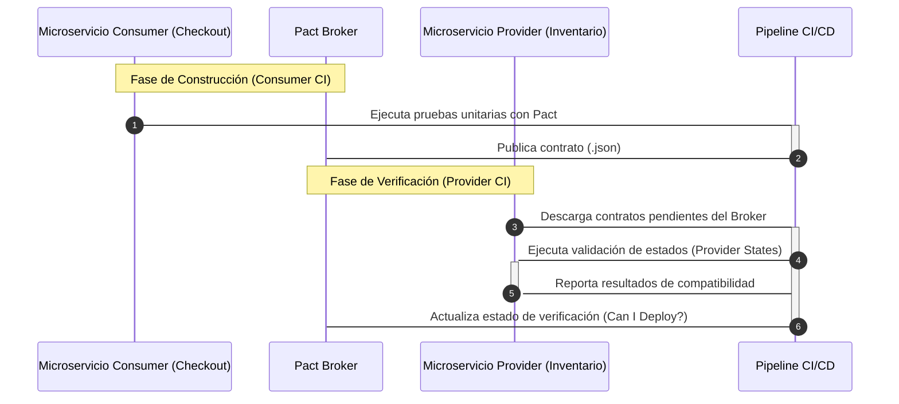

Durante el pico de tráfico del último Black Friday, el servicio de gestión de inventarios (Consumer) desplegó una actualización menor para refactorizar sus modelos de datos internos. Aparentemente, la API REST consumida por el motor de checkout (Provider) no sufrió cambios en sus rutas principales. Sin embargo, un campo booleano opcional fue renombrado internamente y, aunque la respuesta HTTP devolvía un código `200 OK`, el deserializador del lado del cliente falló silenciosamente, corrompiendo la sesión de miles de carritos de compra. Las pruebas de integración end-to-end (E2E) basadas en entornos de Staging no detectaron la anomalía debido a la divergencia en el estado de los datos mockeados. Este escenario expone el talón de Aquiles de las arquitecturas altamente desacopladas: los contratos implícitos entre microservicios no sobreviven a la velocidad de entrega continua sin una gobernanza automatizada y estricta en la fase de CI/CD.

## El Dilema de las Pruebas E2E y el Acoplamiento Temporal

En una arquitectura *Composable Commerce*, donde decenas de dominios independientes evolucionan a ritmos asíncronos, depender de entornos de prueba integrados monolíticos es un anti-patrón operativo. Las suites E2E tradicionales son frágiles, costosas de mantener, introducen latencia artificial en los pipelines de despliegue y sufren de fatiga de mocks. 

Para romper este acoplamiento temporal y espacial, la estrategia de gobernanza debe migrar hacia las **Pruebas de Contrato Basadas en el Consumidor** (Consumer-Driven Contract Testing). A diferencia del testing tradicional donde el proveedor dicta la especificación (OpenAPI/Swagger) y el consumidor espera que funcione, el patrón Pact invierte la responsabilidad: el consumidor define sus expectativas exactas en un artefacto JSON (el contrato o *pact*), el cual se verifica de forma independiente contra el proveedor en entornos de CI aislados, eliminando por completo la necesidad de levantar infraestructuras completas de Staging para validar integraciones.



## Implementación de Contratos con Pact en un Ecosistema TypeScript

Para ilustrar la implementación en un entorno nativo de microservicios basados en Node.js y TypeScript, analizaremos cómo un consumidor define la interacción esperada y cómo el proveedor valida dicho contrato antes de permitir el merge a producción.

### 1. Definición del Contrato por el Consumidor

El consumidor especifica la estructura exacta de la carga útil (*payload*) y los encabezados requeridos. Cualquier modificación no comunicada romperá esta prueba unitaria antes de que el código sea empaquetado.

```typescript
// inventory-consumer.spec.ts
import { PactV3, MatchersV3 } from '@pact-foundation/pact';
import { getStockLevel } from './inventory-client';
import { path } from 'path';

const { integer, string } = MatchersV3;

const provider = new PactV3({
  consumer: 'CheckoutService',
  provider: 'InventoryService',
  dir: path.resolve(process.cwd(), 'pacts'),
});

describe('API Inventory Service Contract', () => {
  it('retorna el nivel de stock disponible para un SKU válido', async () => {
    // Definición de la expectativa
    provider
      .given('el SKU "SKU-998877" existe en el almacén central', { sku: 'SKU-998877' })
      .uponReceiving('una solicitud GET para consultar el inventario')
      .withRequest({
        method: 'GET',
        path: '/api/v1/inventory/SKU-998877',
        headers: {
          'Accept': 'application/json',
          'Authorization': string('Bearer token-xyz')
        }
      })
      .willRespondWith({
        status: 200,
        headers: {
          'Content-Type': 'application/json; charset=utf-8'
        },
        body: {
          sku: 'SKU-998877',
          availableQuantity: integer(42),
          warehouseLocation: string('WH-CENTRAL-01')
        }
      });

    await provider.executeTest(async (mockServer) => {
      const client = new InventoryClient(mockServer.url);
      const response = await client.getStock('SKU-998877', 'Bearer token-xyz');
      
      expect(response.availableQuantity).toBe(42);
      expect(response.warehouseLocation).toBe('WH-CENTRAL-01');
    });
  });
});
```

### 2. Verificación del Contrato por el Proveedor

El proveedor descarga los contratos publicados en el Pact Broker y levanta su framework de pruebas para asegurar que cada "Provider State" configurado por el consumidor retorne exactamente lo esperado.

```typescript
// inventory-provider.spec.ts
import { Verifier } from '@pact-foundation/pact';
import { app } from '../src/app'; // Aplicación Express del Provider
import { dataSource } from '../src/database';

const server = app.listen(8081);

describe('Pact Verification para Inventory Service', () => {
  it('valida las expectativas de los consumidores registrados', async () => {
    const verifier = new Verifier({
      providerBaseUrl: 'http://localhost:8081',
      pactBrokerUrl: process.env.PACT_BROKER_BASE_URL,
      pactBrokerToken: process.env.PACT_BROKER_TOKEN,
      provider: 'InventoryService',
      publishVerificationResult: true,
      providerVersion: process.env.COMMIT_SHA || '1.0.0',
      stateHandlers: {
        'el SKU "SKU-998877" existe en el almacén central': async () => {
          await dataSource.getRepository('Inventory').save({
            sku: 'SKU-998877',
            availableQuantity: 42,
            warehouseLocation: 'WH-CENTRAL-01'
          });
          return Promise.resolve();
        }
      },
    });

    try {
      const output = await verifier.verifyProvider();
      console.log('Pact Verification Complete!', output);
    } catch (error) {
      console.error('Pact Verification Failed:', error);
      throw error;
    } finally {
      server.close();
    }
  });
});
```

---

## Análisis de Trade-Offs: OpenAPI/Swagger vs. Pact Contract Testing

Para arquitectos evaluando el mecanismo de gobernanza adecuado para integraciones de alta criticidad, la siguiente matriz contrasta los enfoques de especificación estática frente a las pruebas de contrato dinámicas.

| Dimensión | Especificación OpenAPI / Swagger (Design-First) | Pruebas de Contrato con Pact (Consumer-Driven) |
| :--- | :--- | :--- |
| **Enfoque de Validación** | Estático. Valida la sintaxis del esquema contra el código del proveedor. | Dinámico. Valida el comportamiento real y el uso efectivo del consumidor. |
| **Detección de Cambios Rompedores** | Baja automatización en tiempo de compilación para verificar uso real. | Alta. Falla el pipeline si el consumidor utiliza un campo eliminado. |
| **Carga Operativa Inicial** | Baja. Generación automática desde anotaciones de código o editores visuales. | Media-Alta. Requiere disciplina en equipos de desarrollo independientes. |
| **Acoplamiento Temporal** | Desacoplado. El proveedor publica especificaciones sin conocer a los clientes. | Acoplado por contrato explícito gestionado en un Broker central. |
| **Mitigación de Fugas de Datos** | Inexistente. No valida semántica de negocio ni estados específicos. | Alta, mediante la implementación estricta de *Provider States*. |
| **Escalabilidad Multi-Consumer** | Pobre. Los cambios en la API afectan a todos los consumidores a ciegas. | Excelente. Permite identificar qué consumidor exacto se verá afectado. |

---

## Orquestación en CI/CD y el Patrón "Can I Deploy?"

La gobernanza de APIs en una arquitectura MACH no termina con la ejecución de pruebas aisladas. El cuello de botella operacional surge al intentar determinar si un artefacto específico puede ser promovido a producción sin romper dependencias cruzadas. Aquí es donde el **Pact Broker** actúa como fuente de verdad mediante la CLI `pact-broker can-i-deploy`.

### Integración en GitHub Actions para el Proveedor

```yaml
name: Provider CI Pipeline

on:
  push:
    branches: [ main ]

jobs:
  verify-and-publish:
    runs-on: ubuntu-latest
    steps:
      - name: Checkout Code
        uses: actions/checkout@v4

      - name: Setup Node.js
        uses: actions/setup-node@v4
        with:
          node-version: '20'

      - name: Install Dependencies & Run Tests
        run: |
          npm ci
          npm run test:pact-provider
        env:
          PACT_BROKER_BASE_URL: ${{ secrets.PACT_BROKER_BASE_URL }}
          PACT_BROKER_TOKEN: ${{ secrets.PACT_BROKER_TOKEN }}
          COMMIT_SHA: ${{ github.sha }}

      - name: Check if Safe to Deploy to Production
        run: |
          npx pact-broker can-i-deploy \
            --pactee provider=InventoryService \
            --version ${{ github.sha }} \
            --to-prod \
            --broker-base-url ${{ secrets.PACT_BROKER_BASE_URL }} \
            --broker-token ${{ secrets.PACT_BROKER_TOKEN }}
```

Este comando consulta la matriz de compatibilidad en el Broker. Si el consumidor `CheckoutService` ha introducido un contrato nuevo que el proveedor actual no satisface, la herramienta bloquea el despliegue de manera determinista, previniendo incidentes en producción.

---

## Modos de Fallo Comunes y Mitigaciones Operativas

1. **Proliferación Huérfana de Contratos (Stale Pacts):**
   * *Síntoma:* Contratos antiguos de clientes ya deprecados bloquean permanentemente los despliegues del proveedor.
   * *Mitigación:* Implementar políticas de retención y limpieza en el Pact Broker utilizando etiquetas de entorno (`main`, `test`, `prod`) y la funcionalidad de borrado automático de versiones obsoletas mediante *Pact Broker Matrix Tags*.

2. **Acoplamiento Excesivo por Mocking Riguroso:**
   * *Síntoma:* Los contratos reflejan detalles de implementación internos de la base de datos del proveedor en lugar de contratos de negocio desacoplados.
   * *Mitigación:* Estipular en las directrices de ingeniería que los *matchers* de Pact deben enfocarse en tipos de datos y estructuras requeridas por el negocio, evitando aserciones sobre valores exactos de campos autoincrementales o metadatos de infraestructura.

3. **Inconsistencia en los Estados del Proveedor (*Provider States*):**
   * *Síntoma:* Las pruebas del proveedor fallan de forma intermitente (flakiness) debido a condiciones de carrera en la base de datos de pruebas.
   * *Mitigación:* Aislar cada estado del proveedor utilizando transacciones efímeras por prueba o bases de datos en memoria (SQLite/Testcontainers) que garanticen un estado determinista antes de evaluar la petición HTTP simulada.

---

## Conclusión y Checklist de Implementación Enterprise

La adopción de pruebas de contrato automatizadas con Pact transforma la gobernanza de APIs de un proceso burocrático y manual de revisión de documentación a una verificación matemática y continua dentro del ciclo de vida del software. En sistemas distribuidos complejos, la confianza no debe basarse en la esperanza de que los equipos se comuniquen todos los cambios, sino en la validación computacional estricta.

### Checklist de Implementación para Equipos de Ingeniería

- [ ] **Despliegue del Pact Broker:** Configurar una instancia centralizada de Pact Broker (o PactFlow) con autenticación basada en OIDC/Tokens y alta disponibilidad.
- [ ] **Estandarización de Naming Conventions:** Establecer nombres estables y semánticos para consumidores y proveedores en los repositorios de código.
- [ ] **Automatización de CI/CD:** Integrar la publicación de contratos en el pipeline del consumidor y la verificación obligatoria junto con el comando `can-i-deploy` en el pipeline del proveedor.
- [ ] **Definición de Políticas de Versionado:** Adoptar versionado semántico en los microservicios y etiquetar adecuadamente las versiones desplegadas en entornos efímeros y de producción (`prod`).
- [ ] **Capacitación en Provider States:** Entrenar a los equipos backend en la gestión limpia y determinista de estados para evitar pruebas frágiles o falsos positivos.