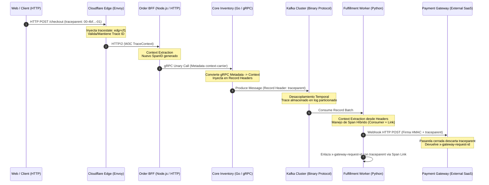

A las 03:14 AM durante un evento de alta concurrencia, el motor de pagos de una plataforma Composable Enterprise comienza a reportar transacciones duplicadas y latencias de checkout que superan el percentil p99 de 12 segundos. La consola del APM central muestra cientos de *traces* que nacen en el API Gateway en el Edge, atraviesan limpiamente el orquestador BFF (*Backend for Frontend*), pero mueren de forma abrupta al alcanzar el clúster de Apache Kafka. 

Minutos después, un servicio desconectado procesa el cobro en la pasarela de pagos externa con un nuevo identificador de traza generado localmente. La correlación transaccional se rompió por completo. 

El resultado: los ingenieros de guardia deben rastrear logs dispersos con *grep* a través de cinco proveedores SaaS y tres infraestructuras en nubes distintas, mientras los clientes sufren cobros duplicados.

En arquitecturas MACH maduras, la ilusión de la observabilidad unificada suele desmoronarse en los límites entre protocolos y proveedores de software. Cuando las peticiones cruzan fronteras de red heterogéneas (HTTP REST, RPC binario con gRPC, mensajería asíncrona desacoplada con Kafka y llamadas webhook de terceros), la propagación de contexto deja de ser un detalle de configuración automática de los SDKs para convertirse en un problema crítico de ingeniería de sistemas distribuidos.

---

## La Anatomía de W3C TraceContext y el Problema de la Corrupción de Cabeceras

El estándar W3C TraceContext fue concebido para erradicar la fragmentación provocada por estándares propietarios (`x-datadog-trace-id`, `X-Amzn-Trace-Id`, `x-b3-traceid`). Se fundamenta en dos cabeceras principales:

1. **`traceparent`**: Una cadena inmutable y de longitud fija (55 caracteres estructurados en cuatro campos delimitados por guiones):
   ```
   00-4bf92f3577b34da6a3ce929d0e0e4736-00f067aa0ba902b7-01
   |  |                                |                |
   |  |-- Trace ID (16 bytes hex)      |-- Parent Span  |-- Trace Flags
   |                                       (8 bytes hex)    (8 bits)
   |-- Versión (00)
   ```
2. **`tracestate`**: Una lista separada por comas de pares clave-valor que transporta metadatos específicos del sistema de telemetría de cada proveedor (ej. `rojo=1,azul=2`). Diseñada para preservar la coexistencia multi-vendor sin reescribir el `traceparent`.

El problema en producción surge porque `traceparent` no se autotransporta a nivel de transporte de red. Requiere que cada *hop* intermedio extraiga (`extract`), deserialice, propague internamente en el hilo/rutina de ejecución, serialice e inyecte (`inject`) las cabeceras en el siguiente protocolo de salida.

Cuando un intermediario (como una pasarela API legacy, un ingress controller mal configurado o un broker SaaS cerrado) descarta cabeceras no estándar, trunca `tracestate` debido a límites de tamaño de buffers de red, o reinicia el `span_id` asumiendo que es el origen del tráfico, la causalidad de todo el árbol distribuido colapsa.

---

## Topología de Propagación a través de Protocolos Híbridos

En una arquitectura headless empresarial, una única intención del usuario transita típicamente por múltiples protocolos y contextos de ejecución:



El diagrama anterior ilustra los puntos de corte donde las transiciones de protocolos exigen convertidores (*custom carriers*) dedicados:

1. **HTTP/1.1 a HTTP/2 / gRPC**: Mapeo de cabeceras HTTP planas a metadatos binarios de gRPC (`metadata.MD`).
2. **gRPC a Mensajería Asíncrona (Kafka)**: Serialización de cabeceras en los `RecordHeaders` de Kafka (que son arreglos de tuplas clave/valor de bytes), garantizando que no se muten los bits de muestreo (`TraceFlags`).
3. **Frontera Asíncrona a SaaS de Terceros**: Las APIs SaaS externas suelen ignorar o filtrar cabeceras `traceparent`. Para mitigar este vacío negro, se utilizan **Span Links** que asocian el ID propietario de la transacción retornado por el SaaS con el contexto padre original.

---

## Implementación de Extracción e Inyección Multi-Protocolo en Go

El siguiente bloque de código implementa una solución de producción en Go utilizando OpenTelemetry (OTel). Expone un *pipeline* que consume un contexto entrante vía gRPC, realiza procesamiento de negocio y lo propaga a un mensaje de Apache Kafka utilizando `confluent-kafka-go`, preservando el estándar W3C y soportando la mutación de `tracestate`.

```go
package tracer

import (
	"context"
	"fmt"

	"github.com/confluentinc/confluent-kafka-go/v2/kafka"
	"go.opentelemetry.io/otel"
	"go.opentelemetry.io/otel/propagation"
	"go.opentelemetry.io/otel/trace"
	"google.golang.org/grpc/metadata"
)

// GrpcMetadataCarrier adapta los metadatos de gRPC para el TextMapPropagator de OpenTelemetry
type GrpcMetadataCarrier struct {
	MD *metadata.MD
}

func (c GrpcMetadataCarrier) Get(key string) string {
	values := c.MD.Get(key)
	if len(values) == 0 {
		return ""
	}
	return values[0]
}

func (c GrpcMetadataCarrier) Set(key, value string) {
	c.MD.Set(key, value)
}

func (c GrpcMetadataCarrier) Keys() []string {
	keys := make([]string, 0, len(*c.MD))
	for k := range *c.MD {
		keys = append(keys, k)
	}
	return keys
}

// KafkaHeaderCarrier adapta los RecordHeaders de Kafka para la inyección de contexto
type KafkaHeaderCarrier struct {
	Headers *[]kafka.Header
}

func (c KafkaHeaderCarrier) Get(key string) string {
	for _, h := range *c.Headers {
		if h.Key == key {
			return string(h.Value)
		}
	}
	return ""
}

func (c KafkaHeaderCarrier) Set(key, value string) {
	// Remover clave previa si existe para evitar duplicación
	for i, h := range *c.Headers {
		if h.Key == key {
			(*c.Headers)[i].Value = []byte(value)
			return
		}
	}
	*c.Headers = append(*c.Headers, kafka.Header{
		Key:   key,
		Value: []byte(value),
	})
}

func (c KafkaHeaderCarrier) Keys() []string {
	keys := make([]string, len(*c.Headers))
	for i, h := range *c.Headers {
		keys[i] = h.Key
	}
	return keys
}

// PropagateGrpcToKafka extrae el contexto W3C desde gRPC y lo inyecta en el mensaje de Kafka
func PropagateGrpcToKafka(ctx context.Context, tracer trace.Tracer, msg *kafka.Message) (context.Context, trace.Span, error) {
	// 1. Extraer metadata gRPC del contexto entrante
	md, ok := metadata.FromIncomingContext(ctx)
	if !ok {
		md = metadata.New(nil)
	}

	// 2. Extraer W3C TraceContext usando el propagador global configurado
	propagator := otel.GetTextMapPropagator()
	extractedCtx := propagator.Extract(ctx, GrpcMetadataCarrier{MD: &md})

	// 3. Iniciar un nuevo Span hijo vinculado causalmente a la traza padre
	spanCtx, span := tracer.Start(extractedCtx, "kafka.produce",
		trace.WithSpanKind(trace.SpanKindProducer),
	)

	// 4. Preparar el carrier para los headers de Kafka
	if msg.Headers == nil {
		msg.Headers = make([]kafka.Header, 0)
	}
	kafkaCarrier := KafkaHeaderCarrier{Headers: &msg.Headers}

	// 5. Inyectar el nuevo estado de la traza (traceparent y tracestate actualizados)
	propagator.Inject(spanCtx, kafkaCarrier)

	// Validar inyección crítica
	if kafkaCarrier.Get("traceparent") == "" {
		span.RecordError(fmt.Errorf("fallo crítico: traceparent no fue inyectado en Kafka headers"))
	}

	return spanCtx, span, nil
}
```

---

## Intercepción y Normalización de Cabeceras en Envoy Proxy

En infraestructuras basadas en Kubernetes con Service Mesh (Istio o Envoy puro), es común que gateways de borde o microservicios antiguos descarten `tracestate` o manejen únicamente cabeceras B3 (`x-b3-traceid`). En lugar de reescribir código legacy, se implementa la normalización de contexto directamente en la capa de datos de la malla con una configuración de `EnvoyFilter` que traduce dinámicamente B3 a W3C antes del enrutamiento interno.

```yaml
apiVersion: networking.istio.io/v1alpha3
kind: EnvoyFilter
metadata:
  name: trace-context-normalizer
  namespace: istio-system
spec:
  workloadSelector:
    labels:
      istio: ingressgateway
  configPatches:
    - applyTo: HTTP_FILTER
      match:
        context: GATEWAY
        listener:
          filterChain:
            filter:
              name: "envoy.filters.network.http_connection_manager"
              subFilter:
                name: "envoy.filters.http.router"
      patch:
        operation: INSERT_BEFORE
        value:
          name: envoy.filters.http.lua
          typed_config:
            "@type": type.googleapis.com/envoy.extensions.filters.http.lua.v3.Lua
            inlineCode: |
              function envoy_on_request(request_handle)
                local traceparent = request_handle:headers():get("traceparent")
                local b3_traceid = request_handle:headers():get("x-b3-traceid")
                local b3_spanid = request_handle:headers():get("x-b3-spanid")
                local b3_sampled = request_handle:headers():get("x-b3-sampled") or "01"

                -- Si traceparent no existe pero B3 está presente, reconstruir W3C
                if not traceparent and b3_traceid and b3_spanid then
                  -- Alinear el Trace ID a 32 caracteres hexadecimales
                  local normalized_traceid = string.format("%032s", b3_traceid):gsub(" ", "0")
                  local normalized_spanid = string.format("%016s", b3_spanid):gsub(" ", "0")
                  local flags = (b3_sampled == "1") and "01" or "00"
                  
                  local generated_traceparent = string.format("00-%s-%s-%s", normalized_traceid, normalized_spanid, flags)
                  request_handle:headers():add("traceparent", generated_traceparent)
                  request_handle:headers():add("tracestate", "legacy_mesh_translated=1")
                end
              end
```

---

## Comparativa de Mecanismos de Propagación de Contexto

La elección del modelo de transporte del contexto no debe tomarse a la ligera. A continuación, se evalúan las principales estrategias en arquitecturas multi-proveedor:

| Mecanismo de Propagación | Pros | Contras | Caso de Uso Ideal | Cuándo Evitarlo |
| :--- | :--- | :--- | :--- | :--- |
| **W3C TraceContext Nativo** (`traceparent` + `tracestate`) | • Estándar universal sin *vendor lock-in*.<br>• Mínimo *overhead* de red (55 bytes base).<br>• Nativo en OpenTelemetry. | • Proveedores SaaS antiguos pueden filtrar la cabecera.<br>• Sensible a mutaciones no estándar. | Microservicios modernos, APIs cloud-native, gRPC, mTLS. | Ecosistemas basados íntegramente en AWS X-Ray sin capa OTel. |
| **Dual-Header Bridging** (W3C + B3 / X-Amzn) | • Máxima compatibilidad retrospectiva.<br>• Previene caídas en sistemas legacy. | • Mayor consumo de ancho de banda.<br>• Riesgo de divergencia de Trace IDs si un proxy muta solo uno. | Migraciones graduales de arquitecturas monolíticas a MACH. | Redes IoT o de latencia ultrabaja con límites estrictos de MTU. |
| **Payload Envelope Injection** (Contexto embebido en JSON/Avro) | • Inmune a la eliminación de cabeceras HTTP o de transporte.<br>• Persistente en sistemas batch y datalakes. | • Rompe la separación de responsabilidades (mezcla metadatos con payload).<br>• Requiere alterar esquemas de datos. | Procesamiento asíncrono con brokers que no admiten metadatos nativos. | APIs públicas de alto rendimiento o estándares abiertos OpenAPI/REST. |
| **Distributed Baggage Propagation** (`baggage` W3C) | • Permite propagar atributos de negocio (`tenant_id`, `client_tier`) en toda la topología. | • Vulnerabilidad de seguridad si se transmiten datos PII.<br>• Multiplica el tamaño de cada request. | Enrutamiento dinámico multitenant, FinOps distribuido por cliente. | Servicios que expongan tráfico directo hacia el cliente sin sanitización. |

---

## Modos de Fallo Críticos en Producción y Mitigaciones

### 1. El Dilema del Consumo por Lotes (Batching) en Kafka
**El Fallo:** Un microservicio consumidor procesa lotes de 500 registros de Kafka en una sola ejecución (`poll()`). Si el framework extrae el contexto del primer mensaje y establece ese contexto para todo el hilo, los 499 mensajes restantes se asociarán erróneamente a la traza del primer mensaje, corrompiendo la fidelidad causal de las trazas.
**Mitigación:** Separar el span del "Receive Batch" de los spans individuales de procesamiento. Para cada mensaje del lote, se debe extraer su propio contexto y crear un Span individual que incluya un **Span Link** hacia el span general del lote, o ejecutar el procesamiento de cada mensaje dentro de su propio `context.Context` aislado.

```go
// Extracción por registro individual evitando el envenenamiento de trazas
for _, msg := range messages {
    msgCarrier := KafkaHeaderCarrier{Headers: &msg.Headers}
    msgCtx := otel.GetTextMapPropagator().Extract(context.Background(), msgCarrier)
    
    // El span de ejecución vincula causalmente al productor individual
    _, procSpan := tracer.Start(msgCtx, "process.order.item", 
        trace.WithSpanKind(trace.SpanKindConsumer),
    )
    processRecord(msg)
    procSpan.End()
}
```

### 2. Truncamiento y Descarte Silencioso en Pasarelas de Terceros
**El Fallo:** Pasarelas de pago o motores de impuestos de terceros (SaaS) descartan cabeceras `traceparent` por directivas de seguridad internas, y los webhooks de respuesta asíncronos son emitidos con una traza completamente nueva.
**Mitigación:** Implementar un almacén temporal de correlación (Redis / DynamoDB) de baja latencia con un TTL corto. Antes de enviar la transacción al SaaS, se almacena una tupla `(ExternalTransactionID, CurrentW3CTraceContext)`. Cuando el webhook entra, se extrae el ID externo, se consulta el almacén y se enlaza la nueva traza mediante un `SpanLink` hacia el contexto original.

### 3. Mutación Arbitraria de Sampling Flags
**El Fallo:** Un balanceador intermedio sobrescribe el byte `TraceFlags` a `00` (no muestreado), provocando que servicios aguas abajo dejen de enviar métricas y spans hacia el recolector, perdiendo visibilidad de errores 5xx críticos en servicios internos.
**Mitigación:** Configurar reglas de muestreo a nivel de Collector de OpenTelemetry (Tail-Based Sampling) en lugar de depender exclusivamente del muestreo en el Edge (Head-Based Sampling). En la cabecera `traceparent`, forzar que los servicios internos respeten el muestreo si el contexto ya venía activo desde el Edge, prohibiendo a los proxies degradar flags arbitrariamente.

---

## Checklist de Implementación para Equipos de Ingeniería

Para garantizar la integridad de la observabilidad en una red multi-vendor, el equipo de plataforma debe auditar los siguientes puntos en sus despliegues de Día 2:

- [ ] **Configuración Unificada de Propagadores en el SDK:** Verificar que en todas las bases de código (Go, Node.js, Python, Java) el propagador global esté configurado explícitamente para combinar W3C TraceContext y Baggage:
  ```go
  otel.SetTextMapPropagator(propagation.NewCompositeTextMapPropagator(
      propagation.TraceContext{},
      propagation.Baggage{},
  ))
  ```
- [ ] **Auditoría de Ingress y CDNs:** Validar mediante pruebas E2E automatizadas que ni Cloudflare, Fastly, AWS CloudFront ni los Ingress Controllers eliminen las cabeceras `traceparent` o `tracestate` en peticiones entrantes o salientes.
- [ ] **Serialización de Cabeceras en Mensajería:** Asegurar que los componentes de publicación en Kafka, AWS SQS o RabbitMQ inyecten los headers de tracing como metadatos nativos del broker y no codificados de manera ad-hoc dentro del cuerpo JSON/Protobuf.
- [ ] **Sanitización de `tracestate`:** Implementar mecanismos de filtrado para prevenir que `tracestate` exceda el límite del estándar de 512 bytes al transitar entre múltiples vendors, descartando claves obsoletas antes de que los proxies rechacen las peticiones por cabeceras HTTP demasiado grandes (*431 Request Header Fields Too Large*).
- [ ] **Span Links en Webhooks de Proveedores Cerrados:** Verificar que los receptores de webhooks no intenten recrear artificialmente una traza lineal falsa, sino que utilicen `SpanLink` para conectar el procesamiento del webhook con la traza que originó la llamada externa.
- [ ] **Pruebas de Inyección de Falla de Contexto (Chaos Engineering):** Ejecutar tests continuos en entornos de staging donde se envíen deliberadamente cabeceras `traceparent` malformadas para corroborar que los microservicios generan un nuevo Trace ID válido sin romper la ejecución transaccional del negocio.