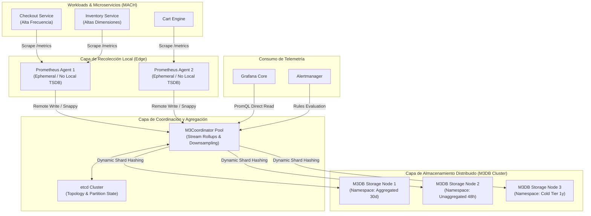

El despliegue de un release a producción durante un evento de ventas masivas introdujo una etiqueta no saneada en el middleware de telemetría de una plataforma de comercio distribuida: `payment_intent_id`. En cuestión de ocho minutos, el espacio de estados de series temporales activas pasó de 450,000 a más de 38 millones. 

El resultado operativo fue catastrófico: las instancias centrales de Prometheus superaron su límite de memoria asignado de 64 GB, detonando un ciclo infinito de `OOMKilled` (Exit Code 137). Al reiniciar, el tiempo de replay del Write-Ahead Log (WAL) superó los 25 minutos, solo para volver a colapsar inmediatamente bajo la presión del búfer de ingesta acumulado. Los equipos de ingeniería quedaron completamente ciegos ante la degradación de las pasarelas de pago.

Este fallo no fue un error fortuito del recolector; es la manifestación directa de las limitaciones algorítmicas del motor TSDB de Prometheus cuando se somete a problemas de alta cardinalidad combinados con retención a largo plazo. 

Para sostener arquitecturas MACH con cientos de servicios desacoplados, despliegues efímeros en Kubernetes y métricas multidimensionales, es necesario desacoplar la recolección local del almacenamiento indexado distribuido. Aquí es donde M3DB, combinado con pipelines estrictos de pre-agregación, transforma un punto único de falla en una infraestructura de observabilidad horizontalmente escalable.



---

## La Falla Estructural de Prometheus Vanilla ante la Explosión Combinatoria

Prometheus está diseñado bajo la premisa de una estructura de almacenamiento temporal local (*local-node TSDB*). Su memoria de trabajo está gobernada por el bloque *Head*, que mantiene en memoria RAM activa los fragmentos (*chunks*) de las series en curso y una estructura de índice invertido (*Inverted Index Postings List*).

El cálculo de la cardinalidad de una métrica responde al producto cartesiano de los valores únicos de sus dimensiones:

$$\text{Cardinalidad}(M) = \prod_{i=1}^{n} |L_i|$$

Donde $|L_i|$ representa el número de valores únicos del label $i$. Si introducimos variables dinámicas no acotadas como `user_id`, `order_token` o IPs de clientes, el índice invertido experimenta lo siguiente:

1. **Fragmentación y Consumo de Heap:** Cada serie nueva requiere la asignación de estructuras `memSeries` en Go. La tabla hash interna que mapea el hash de las etiquetas (*Series ID*) al puntero en memoria sufre constantes reasignaciones y bloqueos de exclusión mutua (`sync.RWMutex`), estrangulando el tiempo de CPU en pausas del Garbage Collector.
2. **Amplificación de Entrada/Salida (I/O Thrashing):** Al alcanzar el umbral de corte temporal (típicamente 2 horas), Prometheus debe consolidar y descargar el bloque *Head* al disco mediante compactación. Si la cantidad de series es de varias decenas de millones, el proceso de cálculo de *postings*, reordenamiento de cadenas e indexación en el disco degrada severamente el I/O del sistema operativo (elevando el `iowait`), causando timeouts en las operaciones de raspado (*scraping*) activas.
3. **El Bucle de Recuperación Crítica (WAL Replay):** Cuando la instancia se estrella por `OOMKilled`, Prometheus debe reconstruir el estado del bloque *Head* leyendo el registro de escritura anticipada (*Write-Ahead Log*). El análisis y verificación de integridad de millones de registros no compactados satura la memoria durante el arranque, colapsando el pod repetidamente antes de exponer el socket HTTP.

---

## Arquitectura de Alta Escala: M3DB como Backing Engine Distribuido

Para desacoplar el consumo de memoria del ciclo de vida del índice invertido, la arquitectura de grado enterprise migra Prometheus al modo de operación **Agent** (o servidores de retención ultracorta de solo dos horas) con `remote_write` apuntando a un clúster de **M3DB**.

M3DB, concebido originalmente en Uber para procesar miles de millones de métricas por segundo, ataca la raíz del problema mediante cuatro mecanismos fundamentales:

### 1. Índice Invertido Inmutable y Particionado por Bloques de Tiempo (M3Index)
A diferencia de Prometheus, que mantiene un índice activo masivo en RAM para todas las series del bloque actual, M3DB particiona el índice espacialmente (mediante shards criptográficos respaldados por `etcd`) y temporalmente en bloques cerrados. 

El índice emplea estructuras inspiradas en Apache Lucene con tablas de términos FST (*Finite State Transducers*) y listas de postings codificadas en bloques compactos de enteros mediante compresión *Roaring Bitmaps*. Una vez que el bloque de tiempo concluye, el índice se vuelve inmutable y se mapea directamente en memoria virtual mediante `mmap()`, permitiendo que el kernel de Linux descarte páginas frías de la memoria física sin provocar caídas de la aplicación.

### 2. Algoritmo de Compresión M3 TSZ
La serie de tiempo se comprime utilizando una variación avanzada del algoritmo TSZ (descendiente del paper Gorilla de Facebook). En lugar de almacenar timestamps y valores absolutos, se computa la doble diferencia de tiempo (*delta-of-deltas*) combinada con una codificación XOR sobre los flotantes IEEE 754 de 64 bits:

$$D = (T_{i} - T_{i-1}) - (T_{i-1} - T_{i-2})$$

$$V_{xor} = V_i \oplus V_{i-1}$$

M3DB agrupa las series en bloques comprimidos autocontenidos. Si un segmento no recibe escrituras dentro de la ventana del namespace, se sella y no requiere readjudicaciones en memoria dinámica.

### 3. Namespaces con Retención y Agregación Asíncrona Desacoplada
M3DB implementa el concepto de *Namespaces* a nivel de storage engine. Esto permite segregar el tráfico de métricas según su ciclo de vida y resolución, evitando que las consultas históricas tengan que escanear datos con granularidad de segundos:

* **Unaggregated Namespace:** Retención de 48 horas, resolución completa (muestras nativas cada 10 segundos). Se utiliza exclusivamente para dashboards de operaciones en tiempo real y disparo de alertas críticas.
* **Aggregated Tier 1:** Retención de 30 días, resolución agrupada a 1 minuto. Las series pierden etiquetas transitorias y conservan únicamente dimensiones estructurales.
* **Aggregated Tier 2 (Long-term Cold Storage):** Retención de 1 a 3 años, resolución de 10 o 60 minutos para análisis de tendencias de negocio y planificación de capacidad.

---

## Implementación Técnica: Pipeline de Ingesta, Sharding y Agregación

Para proteger el clúster de M3DB de degradación por fragmentación excesiva de shards, la defensa en profundidad comienza en el extremo de la recolección con Prometheus y la configuración de capas de pre-agregación en el `m3coordinator`.

### Configuración de Prometheus: Endurecimiento de Recolección y Enrutamiento

En los clústeres de microservicios, Prometheus se configura en modo de envío directo, descartando etiquetas de alta variabilidad antes de que toquen la red mediante `write_relabel_configs`:

```yaml
# prometheus-edge-agent.yml
global:
  scrape_interval: 10s
  scrape_timeout: 8s
  evaluation_interval: 10s

scrape_configs:
  - job_name: 'commerce-core-microservices'
    kubernetes_sd_configs:
      - role: pod
    relabel_configs:
      - source_labels: [__meta_kubernetes_pod_annotation_prometheus_io_scrape]
        action: keep
        regex: true
      - source_labels: [__meta_kubernetes_pod_label_app_kubernetes_io_name]
        target_label: service
      - source_labels: [__meta_kubernetes_namespace]
        target_label: environment

    metric_relabel_configs:
      # Saneamiento de seguridad: Descartar de raíz labels con tokens, hashes o IDs únicos
      - regex: "(payment_intent_id|cart_token|user_uuid|order_id|trace_id|session_id)"
        action: labeldrop

      # Limitar la creación de series huérfanas por endpoints no parametrizados (e.g. /v1/order/12345 -> /v1/order/:id)
      - source_labels: [__name__, path]
        regex: "(http_request_duration_seconds_bucket|http_requests_total);.*/[0-9a-f]{8}-[0-9a-f]{4}-[0-9a-f]{4}-[0-9a-f]{4}-[0-9a-f]{12}.*"
        action: drop

remote_write:
  - url: "http://m3coordinator-cluster.monitoring.svc.cluster.local:7201/api/v1/prom/remote/native"
    remote_timeout: 15s
    queue_config:
      max_samples_per_send: 5000
      max_shards: 100
      min_shards: 16
      max_backoff: 5s
      capacity: 50000
    metadata_config:
      send: false # Eliminar metadata no crítica para ahorrar ancho de banda
```

### Configuración del M3Coordinator: Streaming Aggregations y Rollup Rules

El `m3coordinator` actúa como un proxy inteligente y motor de agregación en streaming. Intercepta las muestras crudas, las comprime y evalúa reglas de rollup en memoria antes de persistir los datos en los nodos de almacenamiento `m3dbnode`:

```yaml
# m3coordinator.yml
listenAddress:
  value: "0.0.0.0:7201"

metrics:
  scope:
    prefix: "m3coordinator"
  prometheus:
    handlerPath: /metrics
    listenAddress: 0.0.0.0:7203

clusters:
  - client:
      config:
        service:
          env: default_env
          zone: embedded
          service: m3db
          etcdClusters:
            - zone: embedded
              endpoints:
                - etcd-0.etcd.monitoring.svc.cluster.local:2379
                - etcd-1.etcd.monitoring.svc.cluster.local:2379
                - etcd-2.etcd.monitoring.svc.cluster.local:2379
      namespaces:
        - namespace: default_unaggregated
          type: unaggregated
          retention: 48h
        - namespace: metrics_1m_aggregated
          type: aggregated
          retention: 720h
          resolution: 1m
        - namespace: metrics_10m_aggregated
          type: aggregated
          retention: 8760h
          resolution: 10m

# Reglas de Agregación Dinámica (Rollup Rules)
# Agrupar histogramas de alta resolución eliminando etiquetas dinámicas de pods
rollups:
  rules:
    - name: "http-latency-downsampling-1m"
      filter: '__name__:http_request_duration_seconds_bucket'
      transforms:
        - type: "Rollup"
          rollup:
            metricName: "http_request_duration_seconds_bucket:rollup_1m"
            groupBy: ["service", "environment", "method", "status", "le"]
            aggregations: ["sum"]
      storage:
        namespaces:
          - namespace: metrics_1m_aggregated
```

### Script Go de Validación de Cardinalidad y Mitigación Preventiva

Para evitar que despliegues descontrolados introduzcan etiquetas letales, el siguiente proceso automatizado corre en un pipeline de CI/CD para auditar endpoints de métricas expuestos por nuevos microservicios antes de ser promovidos al clúster:

```go
package main

import (
	"bufio"
	"fmt"
	"io"
	"net/http"
	"os"
	"regexp"
	"strings"

	dto "github.com/prometheus/client_model/go"
	"github.com/prometheus/common/expfmt"
)

// CardinalityGuard valida que ninguna métrica supere el umbral máximo de combinaciones de labels permitidas
type CardinalityGuard struct {
	MaxCombinations int
	ForbiddenLabels *regexp.Regexp
}

func (cg *CardinalityGuard) AuditEndpoint(metricsURL string) error {
	resp, err := http.Get(metricsURL)
	if err != nil {
		return fmt.Errorf("error conectando al endpoint de métricas: %w", err)
	}
	defer resp.Body.Close()

	if resp.StatusCode != http.StatusOK {
		return fmt.Errorf("código HTTP no válido: %d", resp.StatusCode)
	}

	reader := bufio.NewReader(resp.Body)
	var parser expfmt.TextParser
	metricFamilies, err := parser.TextToMetricFamilies(reader)
	if err != nil {
		return fmt.Errorf("error parseando payload de Prometheus: %w", err)
	}

	for name, family := range metricFamilies {
		totalSeries := len(family.Metric)
		if totalSeries > cg.MaxCombinations {
			return fmt.Errorf("violación de arquitectura: la métrica '%s' expone %d series (límite: %d)",
				name, totalSeries, cg.MaxCombinations)
		}

		for _, m := range family.Metric {
			for _, label := range m.Label {
				labelName := label.GetName()
				if cg.ForbiddenLabels.MatchString(labelName) {
					return fmt.Errorf("etiqueta no permitida detectada: '%s' en la métrica '%s'", labelName, name)
				}
				// Detectar valores con aspecto de IDs/UUIDs o tokens de alta entropía
				if len(label.GetValue()) > 64 || isUUID(label.GetValue()) {
					return fmt.Errorf("posible fuga de alta cardinalidad: etiqueta '%s' tiene un valor con patrón UUID/Hash: '%s'",
						labelName, label.GetValue())
				}
			}
		}
	}

	fmt.Println("Auditoría de cardinalidad superada exitosamente.")
	return nil
}

func isUUID(value string) bool {
	uuidRegex := regexp.MustCompile(`(?i)^[0-9a-f]{8}-[0-9a-f]{4}-[0-9a-f]{4}-[0-9a-f]{4}-[0-9a-f]{12}$`)
	return uuidRegex.MatchString(value)
}

func main() {
	guard := &CardinalityGuard{
		MaxCombinations: 1500, // Máximo de series por métrica individual permitida
		ForbiddenLabels: regexp.MustCompile(`(?i)(token|uuid|id|key|hash|email|user|order)`),
	}

	target := "http://localhost:8080/metrics"
	if len(os.Args) > 1 {
		target = os.Args[1]
	}

	if err := guard.AuditEndpoint(target); err != nil {
		fmt.Fprintf(os.Stderr, "Falla en el pipeline de observabilidad: %v\n", err)
		os.Exit(1)
	}
}
```

---

## Análisis Comparativo de Motores para Telemetría a Escala Masiva

Elegir el backing engine adecuado implica balancear costos operacionales, concurrencia de lectura y tolerancia a picos de escritura.

| Criterio de Selección | Prometheus Local TSDB | Thanos Architecture | Grafana Mimir / Cortex | M3DB Cluster |
| :--- | :--- | :--- | :--- | :--- |
| **Pico de Ingesta (Series/sec)** | Bajo (< 1M) | Medio (~2M - 5M) | Muy Alto (> 50M) | Ultra Alto (> 100M) |
| **Consumo de RAM para Índices** | Ineficiente (OOM bajo churn) | Dependiente del Bucket de Object Storage | Elevado (Invertido en Memoria vía Ingesters) | Altamente Eficiente (`mmap` sobre FST inmutables) |
| **Resiliencia a Explosiones de Etiquetas** | Nula (Crash-Loop) | Baja (Satura compactadores) | Media (Mitigada con Sharding de Ingesters) | Alta (Namespaces y Buffer Segmentado) |
| **Modelo de Almacenamiento Primario** | Disco Local POSIX | Object Storage (S3/GCS) | Object Storage (S3/GCS) | Bloques Distribuidos Locales (EBS/NVMe) |
| **Latencia de PromQL en Bloques Fríos** | N/A (Retención limitada) | Alta (Sujeta a latencia de red S3) | Media (Cacheado agresivo de bloques) | Muy Baja (Acceso directo a shards locales indexados) |
| **Complejidad Operacional (Día 2)** | Muy Baja | Media | Alta | Alta (Requiere gestión de etcd y topologías) |
| **Escenario de Descarte Inmediato** | Proyectos Cloud-Native con > 20 microservicios | Métricas que requieran alertas en < 1 segundo sobre datos fríos | Presupuestos limitados en IOPS de red y storage local | Infraestructuras sin personal senior de operaciones Linux/K8s |

---

## Modos de Fallo Críticos y Mitigaciones en Operaciones Día 2

Operar un clúster de M3DB en entornos críticos requiere prever condiciones donde el almacenamiento, la topología o la red se degradan:

### 1. Desincronización y Bootstrap Timeout tras Inestabilidad en etcd
* **Mecanismo del Fallo:** Si el clúster de `etcd` que gestiona la topología de M3DB experimenta contención de disco o particiones de red, los nodos de almacenamiento (`m3dbnode`) fallan al adquirir el *lease* de topología. Al reiniciarse un nodo, entra en fase de *Bootstrap*. Si no logra descargar los rangos de shards asignados desde los nodos vecinos dentro del tiempo límite configurado (`bootstrapper.commitlog.recovery`), el proceso finaliza abruptamente.
* **Mitigación Operativa:** Separar físicamente la infraestructura de `etcd` utilizada por Kubernetes de la dedicada exclusivamente a M3. Configurar discos de alto rendimiento (NVMe directo o volúmenes EBS tipo `gp3` con un mínimo de 3,000 IOPS fijos) para los nodos de etcd. Ajustar la directiva de arranque:

```yaml
# Fragmento de mitigación en m3dbnode.yml
bootstrap:
  resolvers:
    - name: commitlog
    - name: peers
  commitlog:
    returnUnfulfilledForCorruptCommitLogFiles: true
  peers:
    recoveryTimeout: 45m
    pool:
      workerPoolSize: 64
```

### 2. Thrashing del Cache de Páginas Virtuales (`vm.max_map_count`)
* **Mecanismo del Fallo:** M3DB utiliza intensivamente el mapeo de memoria (`mmap`) para acceder a los segmentos de índice sin incurrir en lecturas tradicionales bloqueantes del kernel. El valor por defecto de `vm.max_map_count` en la mayoría de las distribuciones de Linux (65,530) se agota en pocas horas de ingesta masiva con namespaces particionados, provocando fallas del tipo `cannot allocate memory` aunque la memoria RAM física muestre disponibilidad.
* **Mitigación Operativa:** Aplicar cambios a nivel del kernel del nodo huésped mediante un `DaemonSet` de inicialización o vía `sysctl` en la configuración de aprovisionamiento:

```bash
# Aplicación de límites a nivel de nodo en Linux
sudo sysctl -w vm.max_map_count=3000000
sudo sysctl -w fs.file-max=3000000
sudo sysctl -w vm.swappiness=1
```

```yaml
# En el PodSpec del StatefulSet de m3dbnode:
initContainers:
  - name: init-sysctl
    image: busybox:1.36
    command: ["sysctl", "-w", "vm.max_map_count=3000000"]
    securityContext:
      privileged: true
```

### 3. Starvation de la Cola en Remote-Write de Prometheus
* **Mecanismo del Fallo:** Si la latencia de ingestión de los `m3coordinator` sube momentáneamente (e.g., durante un GC pause o rebalanceo de shards), los agentes locales de Prometheus acumulan muestras en su cola de memoria. Si `max_samples_per_send` y `max_shards` están mal dimensionados, la memoria del agente de Prometheus se satura, desatendiendo el raspado y creando vacíos de datos irremediables (*gaps* temporales en las gráficas).
* **Mitigación Operativa:** Monitorear permanentemente la métrica:

```promql
rate(prometheus_remote_write_samples_dropped_total[5m]) > 0
```

Si esta condición se cumple, se debe incrementar el paralelismo de shards dinámicos en Prometheus, configurar alertas en la tasa de reencolamiento (`prometheus_remote_write_retries_total`) y escalar horizontalmente el pool de instancias stateless de `m3coordinator`.

---

## Runbook de Producción: Checklist de Implementación para Ingenieros de Plataforma

Para garantizar que la arquitectura de observabilidad no se convierta en una fuente de inestabilidad durante picos de demanda operativa, el equipo de plataforma debe validar los siguientes controles estructurales:

- [ ] **Aislamiento de la Recolección:** Ningún Prometheus central con retención mayor a 2 horas debe recolectar métricas directamente desde aplicaciones transaccionales. Toda la capa de ingestión debe configurarse como Prometheus Agent o con almacenamiento de corto alcance.
- [ ] **Sanitización de Esquemas en Edge:** Todo endpoint de métricas debe pasar por validación automatizada en pipelines de CI/CD para impedir que se añadan dimensiones de alta entropía (UUIDs, hashes, firmas criptográficas o marcas de tiempo).
- [ ] **Configuración Segura del Kernel:** Nodos de base de datos M3DB aprovisionados con `vm.max_map_count >= 3000000` y disco de persistencia aprovisionado con I/O garantizado (evitar discos burstables para commitlogs).
- [ ] **Topología de Namespaces Desacoplada:** Garantizar la existencia de al menos un namespace agregado (e.g., resolución 1 minuto) para la persistencia superior a 15 días, reservando los datos crudos a una ventana fija de un máximo de 48 horas.
- [ ] **Reglas de Agregación en Streaming:** Reglas de rollup habilitadas en `m3coordinator` para compactar histogramas nativos de latencia HTTP eliminando variables dependientes del pod (`pod_name`, `instance_ip`).
- [ ] **Alertas de Prevención de Cardinalidad:** Paneles de monitoreo configurados sobre `prometheus_tsdb_head_series` y `m3coordinator_ingest_latency_seconds_bucket` con umbrales de alerta temprana cuando la tasa de crecimiento exceda un 25% por encima de la media histórica en ventanas de 15 minutos.