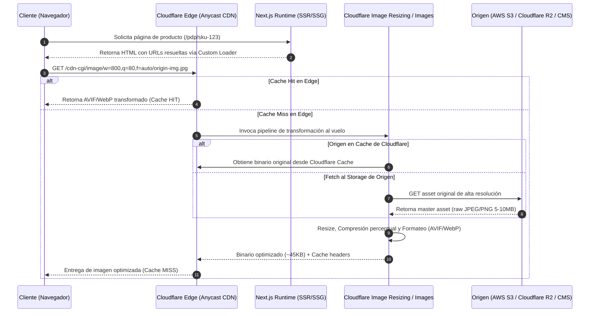

Durante un evento de alto tráfico como Black Friday o una venta flash global, el cuello de botella más letal en una arquitectura frontend headless basada en Next.js rara vez es la compilación de componentes de React o la hidratación en el cliente. El colapso típico sobreviene en los pods de Node.js cuando el tráfico orgánico bombardea el endpoint interno `/_next/image`. La ejecución concurrente de `libvips` (el motor nativo detrás de Sharp) recalculando dimensiones, convirtiendo a WebP/AVIF y recomprimiendo catálogos masivos de productos genera un pico de CPU instantáneo del 100%, saturación de memoria por búferes de imagen y, finalmente, un ciclo destructivo de *OOMKills* (Out Of Memory Kills) en Kubernetes. 

Delegar la manipulación de binarios pesados al runtime de renderizado SSR es un anti-patrón arquitectónico. Para sostener catálogos de e-commerce con millones de SKUs y miles de peticiones concurrentes sin degradar el Time to First Byte (TTFB), la computación de transformación visual debe desacoplarse por completo del ciclo de vida del servidor de aplicaciones y trasladarse al Anycast Edge de una red de distribución de contenidos especializada, como Cloudflare Images y Cloudflare Image Resizing.

## El Dilema del Renderizado: Edge Compute vs. Node.js Runtime

El componente estándar `next/image` ofrece una API ergonómica excelente: previene el Cumulative Layout Shift (CLS) exigiendo dimensiones o contenedores explícitos, genera dinámicamente atributos `srcset` y negocia formatos modernos de compresión mediante el header `Accept`. Sin embargo, su implementación por defecto asume que el backend que sirve el frontend es el encargado de procesar la transformación.



Al transferir esta responsabilidad a Cloudflare Images o a la funcionalidad de Cloudflare Image Resizing en la zona de CDN, el servidor Node.js/Vercel/Kubernetes únicamente procesa cadenas de texto para generar el marcado HTML. El trabajo matemático intensivo de re-muestreo bicúbico, cálculo de tablas de cuantización y codificación AVIF/WebP se absorbe en los centros de datos distribuidos del Edge, a pocos milisegundos de distancia del usuario final.

---

## Implementación de un Custom Loader Empresarial en Next.js

Para evitar que Next.js enrute las imágenes a través de `/_next/image`, se debe implementar un cargador personalizado (`custom loader`). Este componente traduce los parámetros internos de Next (`src`, `width`, `quality`) al esquema de transformación parametrizado de Cloudflare.

Existen dos vías de integración principales con Cloudflare:
1. **Cloudflare Images (Standalone/SaaS):** Emplea IDs dedicados gestionados dentro del almacenamiento de Cloudflare y URLs con variantes nombradas (ej. `imagedelivery.net/<account-hash>/<image-id>/<variant-name>`).
2. **Cloudflare Image Resizing (Zone-based):** Se ejecuta dentro del proxy de la propia zona, utilizando el prefijo reservado `/cdn-cgi/image/` sobre URLs de origen arbitrarias o relativas. Esta opción es la más flexible en arquitecturas MACH donde las imágenes maestras residen en AWS S3, Cloudflare R2 o en un CMS Headless (Contentful, Sanity).

A continuación se detalla la implementación con **Cloudflare Image Resizing**, incorporando normalización de anchos para maximizar la tasa de aciertos de caché (Cache Hit Ratio) y mitigación de llamadas maliciosas.

### 1. Configuración del Loader (`cloudflare-loader.ts`)

```typescript
// lib/cloudflare-loader.ts

interface CloudflareLoaderParams {
  src: string;
  width: number;
  quality?: number;
}

interface CloudflareOptions {
  width: number;
  quality: number;
  format: 'auto' | 'avif' | 'webp' | 'json';
  fit: 'scale-down' | 'contain' | 'cover' | 'crop' | 'pad';
  metadata: 'none' | 'keep' | 'copyright';
  trim?: string;
}

/**
 * Normaliza los anchos a buckets específicos para evitar la fragmentación de la caché.
 * Si el cliente solicita w=384, se aproxima a un escalón fijo de la CDN.
 */
function normalizeWidth(targetWidth: number): number {
  const allowedWidths = [320, 480, 640, 768, 1024, 1280, 1600, 1920];
  const matched = allowedWidths.find((w) => w >= targetWidth);
  return matched || allowedWidths[allowedWidths.length - 1];
}

export default function cloudflareLoader({
  src,
  width,
  quality,
}: CloudflareLoaderParams): string {
  // Manejo de orígenes absolutos versus relativos
  const isAbsolute = src.startsWith('http://') || src.startsWith('https://');
  
  // Normalizar los anchos solicitados por el layout
  const normalizedWidth = normalizeWidth(width);
  const targetQuality = quality || 80;

  const options: CloudflareOptions = {
    width: normalizedWidth,
    quality: targetQuality,
    format: 'auto', // Cloudflare negocia AVIF -> WebP -> JPEG mediante Accept header
    fit: 'scale-down',
    metadata: 'none', // Stripping agresivo de perfiles EXIF/ICC para recortar bytes innecesarios
  };

  const params = Object.entries(options)
    .map(([key, val]) => `${key}=${val}`)
    .join(',');

  // Si la imagen es un SVG, evitamos el resizing para prevenir rasterizado indeseado
  if (src.endsWith('.svg')) {
    return src;
  }

  // Si estamos en entorno de desarrollo local, servimos directamente el origen sin pasar por /cdn-cgi/image/
  if (process.env.NODE_ENV === 'development' && !process.env.NEXT_PUBLIC_CF_PROXY_DEV) {
    return src;
  }

  if (isAbsolute) {
    // Para URLs externas, deben estar prefijadas con el endpoint del dominio que posee Cloudflare activado
    const cdnBase = process.env.NEXT_PUBLIC_CDN_BASE_URL || 'https://assets.machcommerce.com';
    return `${cdnBase}/cdn-cgi/image/${params}/${encodeURIComponent(src)}`;
  }

  // Rutas relativas alojadas en el mismo origen proxyado
  return `/cdn-cgi/image/${params}${src.startsWith('/') ? src : `/${src}`}`;
}
```

### 2. Integración en `next.config.js`

El runtime de Next.js debe estar configurado explícitamente para desacoplar el optimizador por defecto:

```javascript
// next.config.js
/** @type {import('next').NextConfig} */
const nextConfig = {
  images: {
    loader: 'custom',
    loaderFile: './lib/cloudflare-loader.ts',
    deviceSizes: [320, 480, 640, 768, 1024, 1280, 1600, 1920],
    imageSizes: [16, 32, 48, 64, 96, 128, 256],
    formats: ['image/avif', 'image/webp'],
    minimumCacheTTL: 31536000, // 1 año de inmutabilidad en la CDN
  },
};

module.exports = nextConfig;
```

### 3. Consumo en Componente Server-Side o Client-Side

```tsx
// components/ProductCard.tsx
import Image from 'next/image';

interface ProductImageProps {
  slug: string;
  title: string;
  mediaUrl: string;
}

export function ProductImage({ slug, title, mediaUrl }: ProductImageProps) {
  return (
    <div className="relative aspect-square w-full overflow-hidden rounded-md bg-neutral-100">
      <Image
        src={mediaUrl}
        alt={`Fotografía detallada de ${title}`}
        fill
        sizes="(max-width: 640px) 100vw, (max-width: 1024px) 50vw, 33vw"
        priority={false}
        className="object-cover transition-opacity duration-300"
        // Atributo decoding nativo asíncrono para liberar el hilo principal del DOM
        decoding="async"
      />
    </div>
  );
}
```

---

## Seguridad: Mitigación de Ataques de Re-dimensionamiento Masivo mediante HMAC

Uno de los mayores riesgos operacionales al abrir endpoints de optimización de imágenes al vuelo (`/cdn-cgi/image/*`) es el **Ataque de Fragmentación de Caché y Denegación de Billetera (Denial of Wallet)**. Un atacante puede iterar millones de combinaciones de anchos y altos aleatorios (`w=801,h=401`, `w=802,h=402`) forzando a Cloudflare a recalcular cada variación, evadiendo la caché, generando costos de CPU y eventualmente saturando los límites de la cuenta.

Para neutralizar esto en entornos corporativos, se implementa la firma criptográfica de URLs vía HMAC-SHA256, validada en el Edge mediante un Cloudflare Worker antes de despachar hacia el motor de resizing.

### Generador de URLs Firmadas en Next.js (Servidor o Build Time)

```typescript
// lib/secure-image-signer.ts
import { createHmac } from 'crypto';

const SIGNING_KEY = process.env.IMAGE_SIGNING_SECRET as string;

export function generateSignedImageUrl(
  imagePath: string,
  transformations: Record<string, string | number>
): string {
  const sortedParams = Object.keys(transformations)
    .sort()
    .map((key) => `${key}=${transformations[key]}`)
    .join(',');

  const payload = `${sortedParams}/${imagePath}`;
  
  // Generamos un token HMAC-SHA256 truncado a 16 bytes (32 caracteres hex)
  const signature = createHmac('sha256', SIGNING_KEY)
    .update(payload)
    .digest('hex')
    .slice(0, 32);

  return `/cdn-cgi/image/sig=${signature},${sortedParams}/${imagePath}`;
}
```

### Validador en el Edge (Cloudflare Worker)

Este Worker intercepta el tráfico antes de que alcance el pipeline de `/cdn-cgi/image/`.

```javascript
// workers/image-firewall.js
export default {
  async fetch(request, env, ctx) {
    const url = new URL(request.url);

    // Solo interceptar peticiones de transformación
    if (!url.pathname.startsWith('/cdn-cgi/image/')) {
      return fetch(request);
    }

    const segments = url.pathname.replace('/cdn-cgi/image/', '').split('/');
    const rawParams = segments[0];
    const imageOriginPath = segments.slice(1).join('/');

    const paramsArray = rawParams.split(',');
    const sigParam = paramsArray.find((p) => p.startsWith('sig='));

    if (!sigParam) {
      return new Response('Forbidden: Acceso Denegado sin Firma Criptográfica.', { status: 403 });
    }

    const clientSignature = sigParam.split('=')[1];
    const cleanParams = paramsArray
      .filter((p) => !p.startsWith('sig='))
      .sort()
      .join(',');

    // Recrear HMAC con Web Crypto API en el Worker
    const encoder = new TextEncoder();
    const key = await crypto.subtle.importKey(
      'raw',
      encoder.encode(env.IMAGE_SIGNING_SECRET),
      { name: 'HMAC', hash: 'SHA-256' },
      false,
      ['verify']
    );

    const payload = `${cleanParams}/${imageOriginPath}`;
    const verified = await crypto.subtle.verify(
      'HMAC',
      key,
      hexStringToUint8Array(clientSignature),
      encoder.encode(payload)
    );

    if (!verified) {
      return new Response('Unauthorized: Firma de Transformación Inválida.', { status: 401 });
    }

    // Firma válida: procedemos a la ejecución nativa de Image Resizing
    return fetch(request);
  },
};

function hexStringToUint8Array(hexString) {
  const bytes = new Uint8Array(hexString.length / 2);
  for (let i = 0; i < bytes.length; i++) {
    bytes[i] = parseInt(hexString.substr(i * 2, 2), 16);
  }
  return bytes;
}
```

---

## Comparativa Arquitectónica de Soluciones de Media

| Parámetro | Next.js Default (`_next/image` con Sharp) | Cloudflare Image Resizing / Images | Microservicio Propio (Thumbor / Imaginary en K8s) | SaaS Especializado (Cloudinary / Imgix) |
| :--- | :--- | :--- | :--- | :--- |
| **Punto de Ejecución** | Pod SSR / Contenedor Node.js | Anycast Edge (Cloudflare PoPs) | Pods Dedicados en Kubernetes | Edge Propietario / Multi-Cloud |
| **Impacto en CPU de la App** | **Crítico**: Bloqueo de event loop bajo tráfico concurrente. | **Cero**: No consume recursos de Node.js. | **Bajo**: Aislado en nodos K8s independientes. | **Cero**: Computación 100% externalizada. |
| **Tasa de Acierto de Caché (Hit Ratio)** | Variable (limitado al disco/memoria del Pod o CDN frontal). | **Extrema**: Cache distribuido escalonado (Tiered Cache). | Moderada (requiere diseñar storage layer compartido con Redis/NFS). | **Extrema**: CDN global preconfigurada. |
| **Latencia Cold-Start** | Alta si la imagen original es pesada y el nodo sufre *I/O throttling*. | Ultra-baja: pipelines C++ optimizados en el PoP de Cloudflare. | Media: sujeta al autoscaling de pods (HPA) y asignación de CPU. | Ultra-baja. |
| **Complejidad de Mantenimiento** | Baja (out of the box). | Media (requiere Custom Loader y reglas de firewall). | **Muy Alta**: Gestión de parches CVE en `libvips`, escalado de nodos y tuning de Linux. | Muy Baja (SDKs listos para usar). |
| **Modelo de Costos** | Oculto: Aumento drástico de infraestructura de cómputo SSR. | Predecible (por número de peticiones transformadas y almacenadas). | Costo fijo de infraestructura K8s + alto mantenimiento operativo. | **Exponencial**: Costoso en millones de impresiones mensuales. |

---

## Modos de Fallo Críticos y Mitigación en Producción

### 1. Inundación de Solicitudes al Almacenamiento de Origen (Origin Choke)
* **El Problema:** Ante un despliegue global o purga masiva de caché, miles de peticiones golpean simultáneamente a Cloudflare. Si las imágenes no están transformadas, Cloudflare solicita las imágenes maestras a tu bucket S3 o Cloudflare R2 simultáneamente, saturando las IOPS de origen y disparando tarifas de egress en AWS.
* **Mitigación:** Habilitar **Cloudflare Tiered Cache** con arquitectura jerárquica. Esto consolida las solicitudes de los PoPs perimetrales en un grupo selecto de PoPs primarios (*Upper Tier*), amortiguando las peticiones concurrentes y protegiendo el bucket de origen mediante *Origin Shielding*. Si el storage se migra a **Cloudflare R2**, las tasas de egress son virtualmente nulas ($0/GB).

### 2. Layout Shifts Indeseados (Degradación de CLS) con Elementos Responsive
* **El Problema:** La mala configuración del atributo `sizes` en Next.js fuerza al navegador a descargar una imagen optimizada para móvil en una pantalla de escritorio retina (DPR 2x o 3x) antes de calcular el layout final, provocando saltos de renderizado y degradando el Largest Contentful Paint (LCP).
* **Mitigación:** Nunca permitir que `sizes` quede implícito si se utiliza la propiedad `fill`. La regla debe coincidir exactamente con los breakpoints de CSS definidos en tu sistema de diseño (ej. Tailwind CSS):

```tsx
// Anti-patrón:
<Image src={url} fill alt="Product" />

// Patrón Óptimo de Producción:
<Image 
  src={url} 
  fill 
  sizes="(min-width: 1280px) 25vw, (min-width: 768px) 33vw, 100vw"
  alt="Product description"
  className="object-cover"
/>
```

### 3. Falla de Formato: Fallback Silencioso de AVIF a JPEG Degradado
* **El Problema:** La codificación en tiempo real de AVIF es computacionalmente costosa. Bajo picos de carga imprevistos, si el motor de transformación perimetral alcanza un timeout procesando un archivo masivo (>15MB), puede recurrir a devolver un JPEG básico sin compresión o fallar con un HTTP 524 (A Timeout Occurred).
* **Mitigación:** Configurar reglas de pre-procesamiento asíncrono o restringir el peso de subida en el CMS Headless a un máximo de 5MB por imagen maestra. Complementariamente, configurar un Worker para que intercepte estados 5xx y retorne una variante estándar pre-renderizada (fallback graceful):

```javascript
// Worker Fallback Strategy
const response = await fetch(transformedRequest);
if (!response.ok && response.status >= 500) {
  // Retorna la imagen cruda sin transformar para evitar que el usuario vea un asset roto
  return fetch(originalAssetUrl);
}
return response;
```

---

## Checklist de Despliegue e Integración para Equipos de Ingeniería

Para certificar que la infraestructura de optimización visual está lista para entornos enterprise, verifica cada uno de los siguientes hitos:

- [ ] **Desacoplamiento Verificado:** Comprobar que en las herramientas de red del navegador ninguna petición de imagen pase por `/_next/image*`. Todas deben resolverse en `/cdn-cgi/image/` o en el host dedicado `imagedelivery.net`.
- [ ] **Headers de Control de Caché en el Origen:** Asegurarse de que el almacenamiento de origen (S3, R2 o CMS) emita cabeceras `Cache-Control: public, max-age=31536000, immutable` para evitar validaciones condicionales `ETag/304` repetitivas.
- [ ] **Negociación Automática de Formatos:** Confirmar la presencia de la cabecera `Vary: Accept` en las respuestas de Cloudflare y comprobar mediante cURL que solicitando `Accept: image/avif` el `Content-Type` resultante sea efectivamente `image/avif`.
- [ ] **Firma Criptográfica Activada:** Implementar el Cloudflare Worker de validación de firma HMAC y desplegar pruebas de penetración automatizadas para verificar que las peticiones con combinaciones arbitrarias de `w=` y `h=` sin firma sean rechazadas con HTTP 403.
- [ ] **Mapeo Riguroso de Breakpoints:** Sincronizar el array `deviceSizes` y `imageSizes` del archivo `next.config.js` con el helper `normalizeWidth` del Custom Loader para evitar la fragmentación de la memoria caché.
- [ ] **Estrategia LCP Priority:** Enriquecer las imágenes clave que aparecen en el primer pliegue visual (Above The Fold) con el atributo `priority={true}` y `loading="eager"`, garantizando la inyección automática del link rel tag `<link rel="preload">` en el `<head>` del documento generado por Next.js.
- [ ] **Observabilidad Perimetral:** Configurar alertas en Cloudflare Analytics basadas en la tasa de HTTP 524 y el porcentaje de Edge Cache Hit Ratio, manteniendo el umbral de aceptación por encima del 92% para el tráfico global de media.