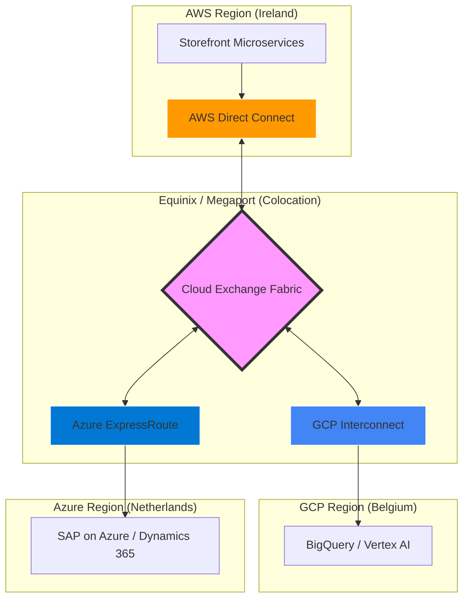

El lunes por la mañana, tras el cierre del primer trimestre fiscal, el CTO de una de las mayores plataformas de *Composable Commerce* en Europa se enfrentó a una anomalía en el dashboard de FinOps: el costo de transferencia de datos hacia el exterior (*Egress*) superaba el gasto combinado de cómputo de sus clusters de Kubernetes en AWS y GCP. No se trataba de un ataque de denegación de servicio, ni de un error en la lógica de reintentos. Era el resultado de una arquitectura multi-cloud mal orquestada donde la sincronización de catálogos entre un ERP en Azure, un motor de búsqueda en GCP y el checkout en AWS estaba "desangrando" el presupuesto operativo a través de la red pública.

Este escenario no es una excepción, sino la norma en las operaciones de Día 2 de empresas que adoptan el paradigma MACH sin una estrategia de conectividad de Capa 3. La interconectividad entre nubes, si se deja al azar de los endpoints públicos, se convierte en un impuesto variable e impredecible que destruye los *Unit Economics* de cualquier producto digital.

## El Dilema del "Data Gravity" y el Costo de la Fragmentación

En una arquitectura de microservicios distribuida entre múltiples proveedores, el movimiento de datos es constante. El problema reside en que los proveedores de nube (CSP) han diseñado sus estructuras de precios para incentivar la entrada de datos (*Ingress* es gratuito) y penalizar la salida (*Egress* es costoso). Cuando un servicio en AWS consume una API de búsqueda en GCP, los datos viajan por el internet público, incurriendo en latencias inconsistentes y, lo más grave, en tarifas de transferencia que oscilan entre los $0.08 y $0.12 por GB.

Para una organización que mueve 500 TB mensuales entre nubes para tareas de analítica en tiempo real o sincronización de estados, estamos hablando de un gasto "fantasma" de aproximadamente $50,000 USD mensuales solo por mover bits de un rack a otro.

### Topología de Conectividad de Alto Rendimiento

Para mitigar esto, la arquitectura debe evolucionar de una comunicación basada en Internet/VPN hacia un modelo de **Cloud Exchange** o **Direct Peering**.



## Estrategias de Optimización de Capa de Red (L3/L4)

### 1. Implementación de Cross-Cloud Interconnect
La solución definitiva para el escalado enterprise es el uso de circuitos dedicados. GCP introdujo "Cross-Cloud Interconnect", que permite conectar directamente con AWS o Azure sin pasar por un proveedor de colocation intermedio en muchos casos, reduciendo el costo por GB hasta en un 70% en comparación con el tráfico por internet.

### 2. Private Service Connect y PrivateLink
El uso de endpoints privados evita que el tráfico salga a la red pública, incluso si no hay un circuito dedicado. Al mapear servicios de un CSP como si fueran recursos locales de la VPC del otro, se eliminan los saltos de NAT Gateway, que en AWS, por ejemplo, añaden un costo de $0.045 por GB procesado, adicional al costo de transferencia.

### 3. Ajuste de MTU (Maximum Transmission Unit)
Un error común en túneles VPN entre nubes es mantener el MTU estándar de 1500 bytes. Debido al overhead del encapsulamiento IPsec, esto provoca fragmentación de paquetes, aumentando el número de paquetes enviados y, por ende, el costo procesado y la latencia. Configurar un MSS (Maximum Segment Size) clamping adecuado es vital para la eficiencia del throughput.

## Optimización de la Capa de Aplicación (L7): El Protocolo Importa

No todo es infraestructura. La forma en que serializamos y transportamos los datos impacta directamente en el volumen de bytes transferidos.

### De JSON a Protocol Buffers (gRPC)
En una arquitectura MACH, la comunicación entre microservicios suele ser el mayor consumidor de ancho de banda. Cambiar payloads JSON por gRPC/Protobuf puede reducir el tamaño del mensaje en un 40-60%.

```typescript
// Ejemplo de optimización de payload en un servicio de Inventario (Node.js)
// En lugar de enviar un JSON masivo, usamos una definición de Protobuf

syntax = "proto3";

message ProductInventory {
  string sku = 1;
  int32 stock_level = 2;
  string warehouse_id = 3;
  int64 last_updated = 4;
}

// En el microservicio de AWS que consume de GCP:
const client = new InventoryServiceClient(
  'gcp-internal-lb.private',
  grpc.credentials.createInsecure()
);

// El ahorro en Egress es proporcional a la reducción del tamaño del binario
```

### Compresión Adaptativa en el Edge
Implementar algoritmos de compresión modernos como **Brotli** o **Zstandard (zstd)** en el nivel de API Gateway permite reducir drásticamente el volumen de datos salientes hacia el cliente final o hacia otros servicios cloud.

## Comparativa de Trade-offs Arquitectónicos

| Estrategia | Latencia | Costo Implementación | Ahorro Egress | Complejidad Op. |
| :--- | :--- | :--- | :--- | :--- |
| **Public Internet / VPN** | Alta/Inconsistente | Bajo | 0% | Baja |
| **Transit Gateway (AWS)** | Media | Medio | 15% - 20% | Media |
| **Direct Connect / Interconnect** | Muy Baja | Alto (CAPEX/Mensual) | 60% - 80% | Alta |
| **Payload Optimization (gRPC)** | Baja | Medio (Refactor) | 40% - 50% | Media |
| **Cloud Exchange (Megaport)** | Baja | Medio | 50% - 70% | Media |

## Patrones de Diseño para la Resiliencia y el Costo

### El Patrón "Data Locality"
Para servicios con alta intensidad de datos (como motores de recomendación), el patrón recomendado es mover el cómputo hacia los datos y no los datos hacia el cómputo. Si tus datos de entrenamiento residen en Google Cloud Storage, el entrenamiento de modelos debe ocurrir en Vertex AI, exportando únicamente los pesos del modelo (KB) hacia el servicio de inferencia en AWS, en lugar de streamear TB de datasets por la red.

### Caché de Egress (Sidecar Proxy)
Implementar un sidecar (Envoy o Nginx) que realice caching de respuestas de APIs inter-cloud. Si 100 microservicios en AWS solicitan la misma configuración de moneda desde un servicio en Azure, el tráfico debería salir de la red de Azure solo una vez.

```yaml
# Ejemplo de configuración de Envoy para caching de respuestas inter-cloud
static_resources:
  clusters:
  - name: azure_erp_service
    connect_timeout: 0.25s
    type: STRICT_DNS
    lb_policy: ROUND_ROBIN
    load_assignment:
      cluster_name: azure_erp_service
      endpoints:
      - lb_endpoints:
        - endpoint:
            address:
              socket_address:
                address: erp.azure.internal
                port_value: 443
    transport_socket:
      name: envoy.transport_sockets.tls
    # Configuración de caché para evitar egress repetitivo
    typed_extension_protocol_options:
      envoy.extensions.filters.http.cache.v3.CacheConfig:
        typed_config:
          "@type": type.googleapis.com/envoy.extensions.filters.http.cache.v3.CacheConfig
          allowed_vary_headers:
            - name: accept-encoding
```

## Modos de Fallo Comunes y Mitigación

1.  **BGP Flapping en Circuitos Dedicados:**
    *   *Fallo:* El enrutamiento dinámico falla y el tráfico se desvía automáticamente por la VPN de respaldo o internet público, disparando los costos y la latencia.
    *   *Mitigación:* Implementar alertas de CloudWatch/Stackdriver basadas en el atributo `ConnectionState` y establecer cuotas de presupuesto (*Budget Alarms*) específicas para la red.

2.  **MTU Mismatch:**
    *   *Fallo:* Pérdida de paquetes o rendimiento degradado (throughput bajo) en transferencias masivas.
    *   *Mitigación:* Realizar pruebas de `path mtu discovery` y forzar el MSS en los firewalls perimetrales.

3.  **Ruteo Subóptimo (Hairpinning):**
    *   *Fallo:* El tráfico de la Región A (AWS) a la Región B (GCP) viaja a través de un data center on-premise debido a una configuración de BGP mal definida.
    *   *Mitigación:* Utilizar herramientas de visualización de topología como *Network Intelligence Center* (GCP) para auditar los saltos de red.

## Checklist de Implementación para Equipos de Ingeniería

Para asegurar que su arquitectura MACH no sea financieramente inviable a escala, sigan este checklist:

- [ ] **Auditoría de Tráfico:** Identificar los 3 flujos de datos inter-cloud con mayor volumen mediante logs de VPC Flow.
- [ ] **Cálculo de Unit Economics:** Determinar el "Costo de Red por Transacción de Negocio" (ej: ¿cuánto nos cuesta en red que un usuario añada un producto al carrito?).
- [ ] **Evaluación de Conectividad:** Si el tráfico inter-cloud supera los 10 TB/mes, iniciar la transición a *Partner Interconnect* o *Direct Connect*.
- [ ] **Serialización:** Migrar servicios críticos de REST/JSON a gRPC o Avro para reducir el tamaño del payload.
- [ ] **Políticas de Caching:** Implementar TTLs agresivos en el Edge y en capas intermedias para evitar re-fetching de datos estáticos entre nubes.
- [ ] **FinOps Observability:** Crear un dashboard unificado que correlacione el throughput de red con el costo facturado en tiempo real, no a final de mes.

La optimización del Egress no es solo una tarea de ahorro de costos; es una disciplina de ingeniería de sistemas que separa a las arquitecturas teóricas de las plataformas rentables y escalables en producción. En el ecosistema MACH, donde la modularidad es reina, la red es el tejido conectivo que determina si su sistema respira con agilidad o se asfixia bajo el peso de su propia distribución.