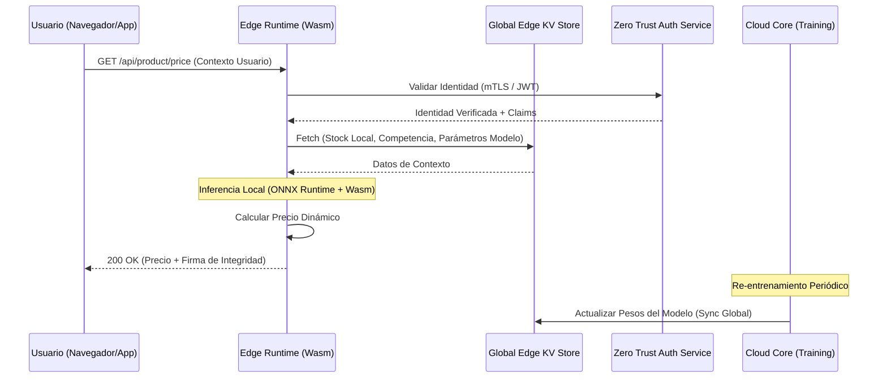

Durante el último Black Friday, un gigante del retail global vio cómo su tasa de conversión caía un 22% en menos de diez minutos. El culpable no fue una caída del sistema, sino un pico de latencia en el p99 que alcanzó los 2.4 segundos. El cuello de botella se localizó en el motor de pricing dinámico: un microservicio centralizado en Python que, ante la avalancha de peticiones, colapsó intentando realizar inferencias de modelos de propensión de compra y elasticidad de precios en tiempo real. Cada petición requería un viaje de ida y vuelta (RTT) desde el borde de la red hasta el centro de datos regional, sumado al tiempo de ejecución de un modelo de Machine Learning (ML) no optimizado para baja latencia.

En el ecosistema del Composable Commerce, el precio ya no es un atributo estático en una base de datos; es una variable calculada en milisegundos basada en el inventario en tiempo real, el comportamiento del usuario, la geolocalización y la presión de la competencia. Mover esta lógica al **Edge** no es una opción estética, es una necesidad operativa para mantener la competitividad sin sacrificar la experiencia de usuario.

## El Dilema de la Inferencia Centralizada vs. Edge Computing

Tradicionalmente, la inferencia de ML se ha mantenido en el lado del servidor (Cloud Core) debido a la disponibilidad de recursos (CPU/GPU) y la facilidad de despliegue. Sin embargo, en arquitecturas MACH, este enfoque introduce una "tasa de latencia" inaceptable. El desafío técnico radica en cómo ejecutar modelos de regresión o clasificación complejos en entornos de ejecución restringidos como Cloudflare Workers, Fastly Compute o AWS Lambda@Edge, donde los límites de memoria suelen rondar los 128MB y los tiempos de CPU están estrictamente acotados.

La solución emerge mediante la combinación de **WebAssembly (Wasm)** y la **cuantización de modelos**. Al convertir modelos entrenados en frameworks pesados (PyTorch, TensorFlow) al formato **ONNX (Open Neural Network Exchange)** y aplicar técnicas de reducción de precisión, podemos ejecutar inferencias directamente en el punto de presencia (PoP) más cercano al usuario.

### Arquitectura de Inferencia Distribuida en el Edge

Para implementar un sistema de pricing dinámico que respete los principios de Zero Trust y alta disponibilidad, debemos desacoplar el entrenamiento (offline) de la ejecución (online/edge).



## Implementación Técnica: Inferencia con ONNX y Wasm

El núcleo de esta arquitectura es el uso de un runtime de ONNX compilado a WebAssembly. Esto permite que el modelo sea agnóstico al lenguaje del Edge (aunque típicamente usaremos TypeScript o Rust) y se ejecute a velocidades cercanas a las nativas.

### Paso 1: Cuantización del Modelo

Un modelo de pricing basado en Gradient Boosting (como XGBoost o LightGBM) puede pesar varios cientos de megabytes. Mediante la cuantización de FP32 a INT8, reducimos el tamaño del modelo hasta en un 75% con una pérdida de precisión marginal (inferior al 0.5% en la mayoría de los casos de uso de retail).

```python
# Ejemplo de conversión y cuantización con onnxruntime
import onnx
from onnxruntime.quantization import quantize_dynamic, QuantType

model_fp32 = "pricing_model.onnx"
model_quant = "pricing_model_quantized.onnx"

quantize_dynamic(model_fp32, model_quant, weight_type=QuantType.QInt8)
```

### Paso 2: Ejecución en el Edge (TypeScript/Wasm)

En el Edge Worker, cargamos el modelo cuantizado. Es crítico utilizar estrategias de *caching* para el binario del modelo y el runtime de Wasm para evitar el "Cold Start penalty".

```typescript
import * as ort from 'onnxruntime-web';

// Configuración del Runtime para entorno restringido
const sessionOptions = {
  executionProviders: ['wasm'],
  graphOptimizationLevel: 'all',
};

async function getDynamicPrice(features: number[]): Promise<number> {
  // El modelo se carga desde el KV o se incluye en el bundle si es pequeño
  const session = await ort.InferenceSession.create('./models/pricing_v1.onnx', sessionOptions);
  
  // Preparación de tensores
  const inputTensor = new ort.Tensor('float32', new Float32Array(features), [1, features.length]);
  
  // Inferencia
  const feeds = { input: inputTensor };
  const results = await session.run(feeds);
  
  const predictedPrice = results.output.data[0];
  return Math.round(predictedPrice * 100) / 100;
}
```

## Seguridad Zero Trust en el Cálculo de Precios

Mover la lógica de precios al Edge introduce riesgos de seguridad. Un actor malicioso podría intentar manipular los inputs de la inferencia para obtener precios irrisorios. Aquí es donde el pilar de **Seguridad Zero Trust** se vuelve indispensable.

1.  **Validación de Contexto Firmado:** El Edge no debe confiar en los datos enviados por el cliente (ej. `user_segment: 'VIP'`). En su lugar, debe validar un JWT firmado por el servicio de identidad que contenga los *claims* necesarios.
2.  **Integridad del Modelo:** El binario del modelo (.onnx) debe estar firmado digitalmente. El Edge Worker verifica el hash antes de la ejecución para asegurar que no ha sido manipulado en el KV Store.
3.  **Egress Filtering:** El Worker tiene prohibido realizar peticiones externas arbitrarias. Solo puede comunicarse con el Feature Store (KV) y el servicio de logging de telemetría.

## Trade-offs Arquitectónicos: ¿Cuándo ir al Edge?

No todos los modelos de pricing deben vivir en el Edge. La siguiente tabla desglosa los criterios de decisión para un Principal Architect:

| Criterio | Inferencia en el Core (Cloud) | Inferencia en el Edge (Wasm) |
| :--- | :--- | :--- |
| **Latencia p99** | Alta (200ms - 2s) | Ultra-baja (< 50ms) |
| **Complejidad de Modelo** | Alta (Deep Learning, LLMs) | Media/Baja (XGBoost, Regresiones) |
| **Costo de Computo** | Basado en instancias/nodos | Basado en tiempo de CPU (ms) |
| **Frescura de Datos** | Real-time global | Eventualmente consistente (KV Sync) |
| **Privacidad (GDPR)** | Datos viajan a región central | Datos procesados cerca del usuario |
| **Mantenibilidad** | Alta (Standard CI/CD) | Media (Gestión de artefactos Wasm) |

## Modos de Fallo y Mitigación en Producción

### 1. Model Drift (Deriva del Modelo)
En el Edge, es más difícil monitorear el desempeño del modelo en tiempo real. 
*   **Mitigación:** Implementar un sistema de "Shadow Inference". El Edge calcula el precio, pero periódicamente envía una muestra de los inputs a un servicio asíncrono en el Core para comparar la predicción del Edge con un modelo "Champion" más pesado. Si la discrepancia supera un umbral, se dispara una alerta de re-entrenamiento.

### 2. Límites de Memoria (OOM en el Worker)
Los runtimes de Wasm pueden exceder los límites de memoria si el modelo es demasiado grande o si hay fugas de memoria en el manejo de tensores.
*   **Mitigación:** Utilizar `session.release()` y gestionar manualmente el ciclo de vida de los objetos de ONNX. Establecer un presupuesto estricto de memoria para el modelo (ej. < 40MB).

### 3. Inconsistencia del Feature Store
Si el stock cambia rápidamente, el KV Store en el Edge podría tener datos desactualizados por unos milisegundos (propagación global).
*   **Mitigación:** Implementar una estrategia de "Read-through" con TTLs agresivos y utilizar *Global Write/Local Read* con mecanismos de invalidación basados en eventos (Webhooks de inventario).

## Estrategia de Implementación: Checklist para Ingeniería

Para los equipos que buscan transicionar hacia un pricing dinámico en el Edge, este es el roadmap recomendado:

- [ ] **Fase 1: Benchmarking de Latencia.** Medir el impacto actual del RTT en la conversión. Si el p99 > 300ms, el caso de negocio para el Edge es sólido.
- [ ] **Fase 2: Exportación a ONNX.** Entrenar el modelo actual y exportarlo. Validar la pérdida de precisión tras la cuantización INT8.
- [ ] **Fase 3: PoC en Edge Runtime.** Desplegar un Worker que realice una inferencia estática. Medir el tiempo de ejecución (debe ser < 10ms).
- [ ] **Fase 4: Integración con Feature Store.** Conectar el Worker con un almacén de datos de baja latencia (Cloudflare KV, Upstash Redis, etc.) para alimentar los inputs del modelo.
- [ ] **Fase 5: Rollout Progresivo (Canary).** Utilizar un balanceador de carga para dirigir el 1% del tráfico al motor del Edge y comparar métricas de negocio (AOV, Conversión) contra el motor centralizado.

## Conclusión

El pricing dinámico en el Edge representa la convergencia perfecta entre la agilidad del Composable Commerce y la potencia de la Inteligencia Artificial moderna. Al eliminar la dependencia de servicios centralizados y reducir la latencia al mínimo físico posible, las organizaciones no solo mejoran su p99, sino que habilitan experiencias de usuario que antes eran técnicamente imposibles. La clave del éxito no reside en el modelo más complejo, sino en la ejecución más eficiente y segura en el punto de interacción con el cliente. En 2026, la ventaja competitiva no se mide en la precisión del cuarto decimal del precio, sino en los milisegundos que tardas en entregarlo.