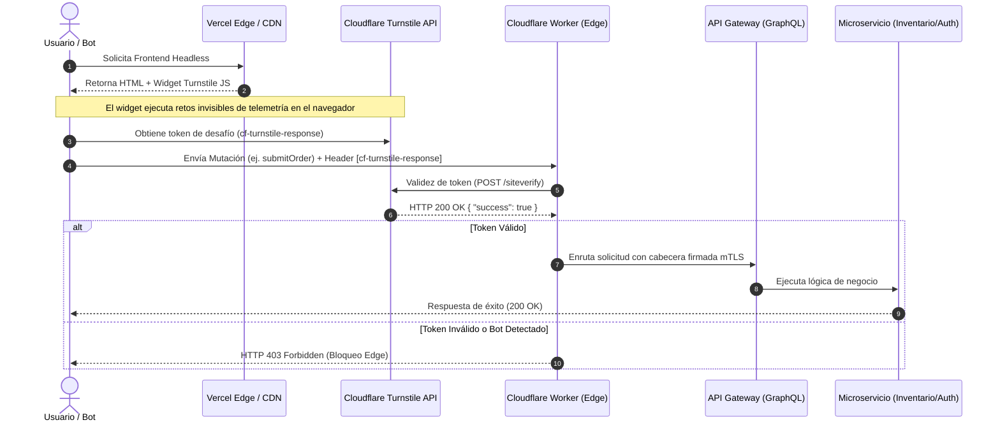

Durante el último evento de alta demanda estacional, nuestra plataforma de comercio electrónico basada en MACH experimentó una saturación sutil pero devastadora: los microservicios de inventario y autenticación colapsaron, no por tráfico legítimo de usuarios, sino por un enjambre distribuido de agentes maliciosos que eludieron las reglas tradicionales de WAF basadas en huellas dactilares IP y firmas estáticas. Al separar el frontend (ejecutándose en Vercel Edge con Next.js) del backend agnóstico a través de una API Gateway GraphQL, dejamos expuestas las mutaciones críticas—como `executeCheckout`, `mutation.signIn` y `mutation.reserveInventory`—a solicitudes HTTP automatizadas originadas desde redes residenciales rotativas. Las herramientas tradicionales de mitigación basadas en JavaScript intrusivo o CAPTCHAs visuales destruyeron las métricas de Core Web Vitals (aumentando el TBT en 450ms) y degradaron la conversión móvil en un 18%. El desafío de Día 2 no era simplemente bloquear bots, sino hacerlo de manera invisible en una arquitectura desacoplada donde el origen no confía en el cliente y el borde debe decidir la validación de identidad sin penalizar el rendimiento del usuario real.

## Arquitectura de Validación Edge-to-Core con Cloudflare Turnstile

Para resolver la brecha de seguridad en arquitecturas desacopladas, debemos desplazar la lógica de mitigación desde los servicios de aplicación monolíticos hacia la capa Edge utilizando Cloudflare Turnstile de manera no interactiva. En una arquitectura MACH típica, el navegador del usuario interactúa con un SPA o un motor de renderizado del lado del servidor (SSR) desplegado en el borde, el cual consulta múltiples microservicios backends (ej. Commercetools, Contentful) a través de un API Gateway. 

Si un atacante automatiza peticiones HTTP directas al Gateway omitiendo el frontend, o inyecta payloads automatizados directamente desde Puppeteer/Playwright modificado, la capa de aplicación sufre un agotamiento de recursos. La solución requiere que cada mutación crítica exija un token criptográfico de Turnstile validado previamente por un Worker en el borde antes de permitir que la solicitud toque el API Gateway o los microservicios subyacentes.



## Implementación del Token en un Frontend Headless (Next.js App Router)

La integración en un entorno MACH moderno exige manejar la obtención asíncrona del token de Turnstile sin bloquear la renderización inicial del componente (First Contentful Paint). A continuación, se muestra un componente wrapper en TypeScript que encapsula el ciclo de vida del widget en React e inyecta la respuesta cifrada en el payload de la mutación GraphQL.

```tsx
'use client';

import React, { useEffect, useRef, useState, useCallback } from 'react';

interface TurnstileWidgetProps {
  siteKey: string;
  onVerify: (token: string) => void;
  onExpire?: () => void;
  action?: string;
}

declare global {
  interface Window {
    turnstile?: {
      render: (container: HTMLElement | string, options: Record<string, any>) => string;
      reset: (widgetId: string) => void;
      remove: (widgetId: string) => void;
    };
  }
}

export const TurnstileWidget: React.FC<TurnstileWidgetProps> = ({
  siteKey,
  onVerify,
  onExpire,
  action = 'default_action',
}) => {
  const containerRef = useRef<HTMLDivElement>(null);
  const widgetIdRef = useRef<string | null>(null);
  const [isLoaded, setIsLoaded] = useState<boolean>(false);

  const handleCallback = useCallback((token: string) => {
    onVerify(token);
  }, [onVerify]);

  const handleExpired = useCallback(() => {
    if (onExpire) onExpire();
  }, [onExpire]);

  useEffect(() => {
    const scriptId = 'cloudflare-turnstile-script';
    if (!document.getElementById(scriptId)) {
      const script = document.createElement('script');
      script.id = scriptId;
      script.src = 'https://challenges.cloudflare.com/turnstile/v0/api.js?render=explicit';
      script.async = true;
      script.defer = true;
      script.onload = () => setIsLoaded(true);
      document.head.appendChild(script);
    } else {
      setIsLoaded(true);
    }
  }, []);

  useEffect(() => {
    if (isLoaded && containerRef.current && window.turnstile && !widgetIdRef.current) {
      widgetIdRef.current = window.turnstile.render(containerRef.current, {
        sitekey: siteKey,
        callback: handleCallback,
        'expired-callback': handleExpired,
        theme: 'auto',
        size: 'invisible', // Modo invisible para no afectar UX
        action: action,
      });
    }

    return () => {
      if (widgetIdRef.current && window.turnstile) {
        window.turnstile.remove(widgetIdRef.current);
        widgetIdRef.current = null;
      }
    };
  }, [isLoaded, siteKey, handleCallback, handleExpired, action]);

  return <div ref={containerRef} className="invisible-turnstile-container" />;
};
```

### Consumo del Token en el Cliente API del Frontend

Una vez capturado el token a través del evento de callback, debe adjuntarse de manera estandarizada a las cabeceras HTTP (o como variable dentro del payload GraphQL) para que la capa Edge o el API Gateway intercepten la solicitud antes de llegar a los microservicios.

```typescript
import { GraphQLClient } from 'graphql-request';

interface ExecuteWithBotProtectionParams {
  query: string;
  variables: Record<string, any>;
  turnstileToken: string;
}

const GRAPHQL_ENDPOINT = process.env.NEXT_PUBLIC_API_GATEWAY_URL || 'https://api.enterprise.com/graphql';

export async function executeProtectedMutation({
  query,
  variables,
  turnstileToken,
}: ExecuteWithBotProtectionParams) {
  const client = new GraphQLClient(GRAPHQL_ENDPOINT, {
    headers: {
      'content-type': 'application/json',
      'x-turnstile-response': turnstileToken, // Cabecera interceptada por el Gateway/Edge Worker
    },
  });

  try {
    const data = await client.request(query, variables);
    return { success: true, data };
  } catch (error: any) {
    // Manejo de errores de validación de seguridad a nivel de transporte
    if (error.response?.status === 403) {
      throw new Error('Verificación de seguridad fallida. Por favor, recargue e intente nuevamente.');
    }
    throw error;
  }
}
```

## Validación en la Capa Edge (Cloudflare Worker / API Gateway Interceptor)

Para evitar que scripts automatizados maliciosos ejecuten llamadas directas a las rutas de mutación mediante curl o Postman, se implementa un middleware en el borde que valida obligatoriamente el token contra el API de Cloudflare antes de permitir el enrutamiento hacia el API Gateway.

```typescript
// Cloudflare Worker / Edge Middleware Script
export default {
  async fetch(request: Request, env: Env, ctx: ExecutionContext): Promise<Response> {
    const url = new URL(request.url);

    // Aplicar mitigación únicamente en endpoints críticos de mutación
    const protectedPaths = ['/graphql', '/api/v1/auth/login', '/api/v1/checkout/submit'];
    const isProtected = protectedPaths.some((path) => url.pathname.includes(path));

    if (isProtected && request.method === 'POST') {
      const turnstileToken = request.headers.get('x-turnstile-response');

      if (!turnstileToken) {
        return new Response(
          JSON.stringify({ error: 'Missing security verification token' }),
          { status: 403, headers: { 'Content-Type': 'application/json' } }
        );
      }

      // Validar token contra la API de Cloudflare de forma síncrona/paralela
      const isValid = await verifyTurnstileToken(turnstileToken, env.TURNSTILE_SECRET_KEY, request);

      if (!isValid) {
        return new Response(
          JSON.stringify({ error: 'Invalid or expired security token. Potential bot activity detected.' }),
          { status: 403, headers: { 'Content-Type': 'application/json' } }
        );
      }
    }

    // Continuar hacia el API Gateway corporativo si la validación es exitosa
    return fetch(request);
  },
};

async function verifyTurnstileToken(token: string, secretKey: string, request: Request): Promise<boolean> {
  const clientIP = request.headers.get('CF-Connecting-IP') || '';
  
  let formData = new URLSearchParams();
  formData.append('secret', secretKey);
  formData.append('response', token);
  if (clientIP) {
    formData.append('remoteip', clientIP);
  }

  const result = await fetch('https://challenges.cloudflare.com/turnstile/v0/siteverify', {
    method: 'POST',
    body: formData,
  });

  const outcome: any = await result.json();
  return outcome.success === true;
}

interface Env {
  TURNSTILE_SECRET_KEY: string;
}
```

## Comparativa de Trade-offs Arquitectónicos

Evaluar la implementación de un sistema de mitigación basado en retos en el borde frente a otras estrategias tradicionales en arquitecturas MACH requiere analizar los impactos operativos y de rendimiento:

| Dimensión | CAPTCHA Tradicional (Visual) | WAF Tradicional basado en Firmas/IP | Cloudflare Turnstile Invisible (Edge) |
| :--- | :--- | :--- | :--- |
| **Impacto en Core Web Vitals** | Severo (Aumenta TBT y CLS por scripts pesados) | Nulo en cliente, alto costo de procesamiento en origen | Mínimo (Asíncrono, renderizado invisible < 15kb) |
| **Tasa de Falsos Positivos** | Alta (Bloquea usuarios legítimos con accesibilidad reducida) | Muy Alta (Bloquea rangos enteros de IPs residenciales o VPNs) | Baja (Análisis de telemetría heurística en múltiples capas) |
| **Latencia Añadida (P99)** | +300ms a +1200ms por interacción del usuario | +5ms a +20ms por inspección de paquetes profundos (DPI) | +15ms a +40ms ejecutado directamente en el borde CDN |
| **Resiliencia ante Bots con IA** | Vulnerable a servicios de resolución de terceros (2Captcha) | Ineficaz contra rotación de cabeceras y headless browsers | Alta (Desafíos criptográficos dinámicos y análisis de comportamiento) |
| **Acoplamiento Arquitectónico** | Alto (Requiere cambios profundos en componentes de UI) | Bajo (Operación transparente en la infraestructura de red) | Medio (Requiere gestión de tokens en cliente y validación en Edge) |

## Modos de Fallo Comunes y Estrategias de Recuperación en Producción

La adopción de soluciones de seguridad basadas en el borde introduce nuevos vectores de fallo sistémico que deben mitigarse activamente para evitar caídas masivas del servicio (Indisponibilidad Inducida por Seguridad).

### 1. Caída o Latencia Excesiva en la API de Verificación (`siteverify`)
* **Modo de Fallo:** Si la infraestructura de Cloudflare experimenta degradación y el endpoint `/siteverify` responde con tiempos de espera superiores a 2 segundos, el Worker bloquea todas las solicitudes entrantes, generando un apagón total del canal de comercio electrónico.
* **Estrategia de Mitigación:** Implementar un patrón de *Fail-Open* condicionado mediante un interruptor de circuito (*Circuit Breaker*) a nivel de Edge Worker. Si la API externa de verificación arroja un timeout (>1500ms) o errores HTTP 5xx en más del 5% de las peticiones en una ventana de 10 segundos, el sistema debe degradar temporalmente el nivel de seguridad a un modo de validación heurística por IP/User-Agent, emitiendo una alerta de severidad P1 al equipo de SRE.

```typescript
// Implementación de Circuit Breaker para la verificación de Turnstile
let failureCounter = 0;
let circuitOpenUntil = 0;

async function resilientVerify(token: string, secretKey: string, ip: string): Promise<boolean> {
  const now = Date.now();
  if (now < circuitOpenUntil) {
    // Circuito abierto: Fail-Open temporal para evitar interrupción de negocio
    console.warn('Turnstile Circuit Breaker OPEN. Bypassing token validation temporarily.');
    return true; 
  }

  try {
    const controller = new AbortController();
    const timeoutId = setTimeout(() => controller.abort(), 1500); // Timeout estricto de 1.5s

    const result = await fetch('https://challenges.cloudflare.com/turnstile/v0/siteverify', {
      method: 'POST',
      body: new URLSearchParams({ secret: secretKey, response: token, remoteip: ip }),
      signal: controller.signal,
    });
    
    clearTimeout(timeoutId);

    if (!result.ok) throw new Error(`HTTP Error: ${result.status}`);

    const outcome: any = await result.json();
    
    // Resetear contador ante éxito
    failureCounter = 0;
    return outcome.success === true;

  } catch (error) {
    failureCounter++;
    if (failureCounter > 10) {
      circuitOpenUntil = now + 60000; // Abrir circuito por 1 minuto
      console.error('Turnstile verification failing consistently. Circuit opened for 60s.');
    }
    // Fail-Open estratégico para proteger el revenue del negocio
    return true; 
  }
}
```

### 2. Reutilización Maliciosa de Tokens (Replay Attacks)
* **Modo de Fallo:** Un atacante intercepta un token de Turnstile válido emitido para una sesión legítima e intenta replicarlo miles de horas en solicitudes automatizadas de inventario. Turnstile por defecto permite que un token sea consumido una única vez dentro de un breve margen de tiempo, pero si la validación en el Worker no registra el uso del token, existe riesgo.
* **Estrategia de Mitigación:** Almacenar temporalmente los hashes de los tokens validados en un almacén clave-valor distribuido de baja latencia en el borde (ej. Cloudflare Workers KV o Durable Objects) con un TTL estricto de 300 segundos, rechazando de inmediato cualquier intento de reutilización del mismo token.

## Conclusión y Checklist de Implementación para Equipos de Ingeniería

La protección de frontends headless en arquitecturas MACH frente a bots avanzados exige abandonar los mecanismos tradicionales de control en el origen y trasladar la inteligencia de mitigación al borde de la red. Cloudflare Turnstile permite neutralizar el *Credential Stuffing* y la denegación de inventario sin degradar la experiencia del usuario legítimo ni castigar los presupuestos de rendimiento web.

Para garantizar una implementación exitosa en entornos de producción enterprise, el equipo de ingeniería debe validar el siguiente checklist operativo de Día 2:

* [ ] **Aislamiento de Rutas Críticas:** Aplicar la validación de Turnstile exclusivamente en puntos de mutación de alto riesgo (`/login`, `/checkout`, `/register`, `/reserve`), evitando penalizar con telemetría las rutas estáticas o de lectura (GET).
* [ ] **Modo Invisible Configurado:** Asegurar que el widget opere en modo invisible (`size: 'invisible'`) para preservar las métricas de First Input Delay (FID) y Interaction to Next Paint (INP).
* [ ] **Patrón Fail-Open Implementado:** Programar un mecanismo de *Circuit Breaker* en los Edge Workers para garantizar que caídas del proveedor de seguridad no se traduzcan en pérdidas de transacciones comerciales.
* [ ] **Idempotencia y Prevención de Replay:** Validar la unicidad del token utilizando almacenamiento distribuido en el borde (Edge KV/Cache) para invalidar tokens ya consumidos.
* [ ] **Monitoreo y Alertas SRE:** Configurar métricas en tiempo real para rastrear la tasa de rechazo de tokens, latencias de la API de verificación y falsos positivos reportados por el canal de soporte.