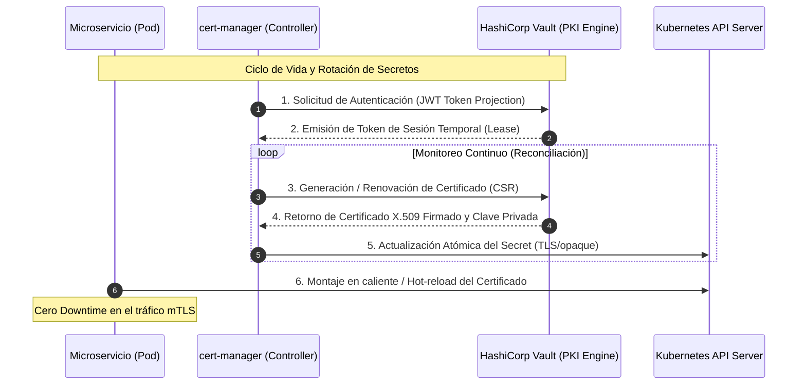

El pasado trimestre, una plataforma global de comercio composable sufrió una interrupción de 42 minutos en su capa de API Gateways. El origen no fue una caída de base de datos ni un ataque volumétrico de denegación de servicio, sino un certificado TLS autofirmado que expiró silenciosamente en un clúster de Kubernetes periférico. A pesar de contar con herramientas de monitoreo, los equipos de operaciones dependían de scripts manuales y notificaciones estáticas por correo electrónico para renovar las claves criptográficas. En una arquitectura MACH compuesta por cientos de microservicios distribuidos que intercambian millones de peticiones diarias mediante mTLS, la gestión estática de secretos es una bomba de tiempo operativa. La dependencia de procesos humanos para rotar certificados y llaves de cifrado en reposo viola de forma directa los principios fundamentales de una postura de seguridad Zero Trust.

Para erradicar este vector de fallo en Operaciones de Día 2, la industria exige un desacoplamiento estricto entre el ciclo de vida de la infraestructura de cómputo y el aprovisionamiento criptográfico. La integración nativa entre `cert-manager` y HashiCorp Vault dentro de clústeres Kubernetes bajo una arquitectura cloud-native permite automatizar la emisión, validación y rotación de certificados x509 y secretos simétricos sin intervención humana ni tiempo de inactividad en los servicios de borde.

---

## Arquitectura de Emisión y Rotación Dinámica

Implementar una cadena de confianza automatizada en un entorno multi-tenant requiere coordinar identidades de carga de trabajo, emisores de autoridad certificadora (CA) y controladores de sincronización de secretos en tiempo real. HashiCorp Vault actúa como la Autoridad Certificadora Raíz e Intermedia centralizada, mientras que `cert-manager` opera como el agente orquestador dentro del plano de control de Kubernetes, reconciliando continuamente el estado deseado de los recursos `Certificate` con el estado real en los backends criptográficos.

El siguiente diagrama detalla el flujo de trabajo de emisión, validación y rotación automática de certificados TLS y claves de cifrado, utilizando autenticación basada en tokens de servicio (ServiceAccount Token Volume Projection) para evitar credenciales estáticas en disco.



### Configuración del Issuer en Kubernetes

Para conectar `cert-manager` con el motor PKI de Vault utilizando autenticación segura basada en tokens JWT proyectados, se debe configurar un recurso `ClusterIssuer`. Este enfoque elimina la necesidad de almacenar tokens de acceso estáticos en los secretos de Kubernetes.

```yaml
apiVersion: cert-manager.io/v1
kind: ClusterIssuer
metadata:
  name: vault-pki-issuer
spec:
  vault:
    path: pki/sign/mach-enterprise-role
    server: https://vault.internal.enterprise.net:8200
    caBundle: LS0tLS1CRUdJTi... # Certificado Root CA codificado en Base64
    auth:
      kubernetes:
        mountPath: /v1/auth/kubernetes
        role: cert-manager-pki-role
        serviceAccountRef:
          name: cert-manager
          namespace: cert-manager
```

El rol configurado en Vault (`cert-manager-pki-role`) valida estrictamente que únicamente el ServiceAccount del controlador `cert-manager` tenga privilegios para firmar certificados bajo los dominios autorizados de la organización (`*.mesh.enterprise.net`).

---

## Automatización y Rotación de Claves Criptográficas en Capa de Aplicación

Más allá de los certificados TLS para el tráfico de red, los microservicios headless requieren la rotación periódica de claves de cifrado simétrico (AES-GCM) utilizadas para proteger datos sensibles en reposo (tokens de sesión, payloads de transacciones de pago, metadatos de clientes). 

El siguiente script en Python demuestra cómo un microservicio consume un secreto rotado dinámicamente desde un volumen inyectado por Vault Agent Sidecar, implementando un mecanismo de reintento en caliente ante eventos de cambio de clave (`SIGHUP` o lectura de archivo modificado).

```python
import os
import time
import hmac
import hashlib
from cryptography.hazmat.primitives.ciphers.aead import AESGCM

SECRET_PATH = "/vault/secrets/encryption-key"

class SecureKeyRotator:
    def __init__(self, secret_path: str):
        self.secret_path = secret_path
        self.current_key = self._load_key()
        self.last_mtime = os.path.getmtime(secret_path)

    def _load_key(self) -> bytes:
        """Lee la clave simétrica generada dinámicamente por Vault Agent."""
        try:
            with open(self.secret_path, "rb") as f:
                key_hex = f.read().strip()
                return bytes.fromhex(key_hex.decode('utf-8'))
        except Exception as e:
            raise RuntimeError(f"Fallo crítico al leer la clave criptográfica: {str(e)}")

    def check_and_rotate(self):
        """Verifica si el archivo de claves ha sido actualizado en caliente."""
        current_mtime = os.path.getmtime(self.secret_path)
        if current_mtime != self.last_mtime:
            print("[INFO] Rotación de clave detectada. Actualizando contexto criptográfico...")
            self.current_key = self._load_key()
            self.last_mtime = current_mtime

    def encrypt_payload(self, plaintext: bytes) -> bytes:
        self.check_and_rotate()
        aesgcm = AESGCM(self.current_key)
        nonce = os.urandom(12)
        ciphertext = aesgcm.encrypt(nonce, plaintext, None)
        return nonce + ciphertext

if __name__ == "__main__":
    rotator = SecureKeyRotator(SECRET_PATH)
    # Simulación de ciclo de vida del microservicio
    while True:
        try:
            encrypted = rotator.encrypt_payload(b"Payload crítico de comercio composable")
            print(f"[SUCCESS] Datos cifrados correctamente. Longitud: {len(encrypted)}")
        except Exception as ex:
            print(f"[ERROR] Incidente criptográfico: {ex}")
        time.sleep(30)
```

---

## Análisis de Trade-Offs Arquitectónicos

La adopción de un esquema automatizado de gestión de claves y certificados mediante Vault y `cert-manager` introduce beneficios operativos exponenciales, pero también impone restricciones de diseño que deben evaluarse rigurosamente frente a arquitecturas centralizadas tradicionales.

| Dimensión Arquitectónica | Enfoque Automatizado (`cert-manager` + Vault) | Enfoque Tradicional / Manual |
| :--- | :--- | :--- |
| **Seguridad (Zero Trust)** | Emisión bajo demanda, credenciales efímeras, revocación nativa y aislamiento de tenants por políticas RBAC. | Claves de larga duración almacenadas estáticamente en repositorios de código o wikis internas. |
| **Disponibilidad Operativa** | Alta disponibilidad inherente; la rotación ocurre de forma transparente sin intervención del operador. | Dependencia de alertas manuales y despliegues de emergencia ante caducidades imprevistas. |
| **Complejidad de Infraestructura** | Alta complejidad inicial en la configuración de PKI, autenticadores OIDC/JWT y políticas de Vault. | Baja complejidad inicial, pero curva de deuda técnica exponencial a medida que escala el parque de servicios. |
| **Costo de Recuperación (MTTR)** | Cercano a cero para incidentes por certificados caducados; mitigación automatizada en minutos. | Elevado (MTTR > 60 minutos), requiriendo parches de emergencia y caída de servicios en producción. |

---

## Modos de Fallo Comunes y Estrategias de Mitigación

Operar sistemas criptográficos automatizados a escala enterprise expone a los equipos de ingeniería a escenarios de fallo sistémico específicos que deben anticiparse en la fase de diseño.

### 1. Saturación y Deadlocks en el Motor PKI de Vault
* **Modo de fallo:** Una mala configuración en el parámetro `renewBefore` de `cert-manager` puede provocar que miles de microservicios soliciten la renovación simultánea de sus certificados exactamente al mismo tiempo, saturando las conexiones HTTP de Vault y generando un cuello de botella por bloqueo de base de datos interna.
* **Mitigación:** Implementar un desfase aleatorio (*jitter*) en los controladores de `cert-manager` y configurar políticas de limitación de tasa (*Rate Limiting*) estrictas en el ingress de Vault combinadas con un clúster de Vault con almacenamiento distribuido (Integrated Storage Raft) de alto rendimiento.

### 2. Desincronización de Volúmenes en Contenedores de Larga Duración
* **Modo de fallo:** Los demonios o procesos hijos que cargan certificados TLS en memoria al iniciar no detectan los cambios realizados por Vault Agent en el sistema de archivos montado, manteniendo en uso la clave privada anterior y provocando rechazos de handshake mTLS tras la expiración.
* **Mitigación:** Utilizar herramientas de recarga de certificados en caliente como `Reloader` (K8s operator) o estructurar la aplicación para observar cambios en el inodo del archivo de certificado mediante descriptores `inotify` y reiniciar de forma controlada el pool de conexiones TLS.

---

## Conclusión y Checklist de Implementación para Ingeniería

La eliminación de la intervención humana en la rotación de claves criptográficas y certificados TLS no es una mejora cosmética, sino un requisito innegociable para mantener una postura de seguridad resiliente en arquitecturas MACH. Delegar esta responsabilidad en la sinergia de `cert-manager` y HashiCorp Vault garantiza la observabilidad, auditoría y el cumplimiento normativo exigido por estándares corporativos globales.

### Checklist de Implementación en Producción:
- [ ] Configurar el motor PKI en Vault con un periodo de vida (*TTL*) razonable para certificados de servicio (máximo 30 a 90 días).
- [ ] Establecer políticas estandarizadas de RBAC en Vault limitando el acceso por Namespace y ServiceAccount de Kubernetes.
- [ ] Configurar el parámetro `renewBefore` en los recursos `Certificate` de `cert-manager` a un tercio de su ciclo de vida total (ej: renovar a los 20 días para certificados de 60 días).
- [ ] Validar que todas las aplicaciones críticas implementen mecanismos de recarga en caliente (*hot-reload*) para evitar reinicios innecesarios de Pods.
- [ ] Establecer alertas de Prometheus basadas en las métricas de `cert-manager` (`certmanager_certificate_expiration_timestamp_seconds`) para detectar fallos de renovación antes de la ventana crítica.