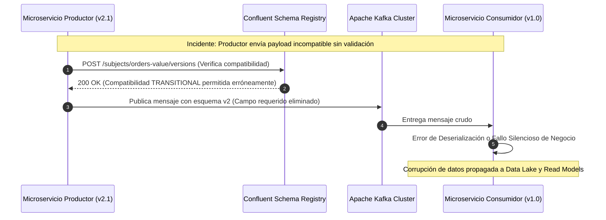

A las 03:14 AM, el pipeline de procesamiento de órdenes en tiempo real de una plataforma de comercio B2B global procesó silenciosamente un millón de eventos `OrderCreated` con un campo numérico reubicado de `integer` a `string` por un equipo de microservicios periféricos. Ninguna excepción se lanzó en los brokers de Apache Kafka; los productores emitieron alegremente JSON estructurado dinámicamente y los consumidores downstream continuaron interpretando el payload. Doce horas después, al cierre del ciclo contable, los motores de reconciliación financiera reportaron discrepancias de múltiples millones de dólares debido a truncamientos de precisión numérica y errores de deserialización fantasma en bases de datos analíticas. El sistema había fallado no por falta de disponibilidad de infraestructura, sino por la ausencia absoluta de un contrato de datos versionado y validado en la capa de transporte asíncrono.

## Anatomía del Fallo en Sistemas Asíncronos Basados en JSON

En arquitecturas orientadas a eventos (EDA) a escala enterprise, adoptar serialización basada en texto plano o JSON Schema sin validación centralizada en tiempo de escritura introduce una deuda técnica invisible. Los equipos asumen que la responsabilidad del contrato reside en la documentación de la API o en repositorios OpenAPI descentralizados. Sin embargo, en un ecosistema de microservicios desacoplados bajo principios MACH, los productores de eventos evolucionan a ritmos diferentes que los consumidores.

Cuando un productor decide renombrar una propiedad de `totalAmount` a `orderTotal`, o cambiar un tipo de dato primitivo de `float` a `double` para prevenir pérdida de precisión monetaria, los consumidores que dependen del esquema original sufren fallos catastróficos silenciosos (*silent data corruption*) o bloqueos por excepciones de tipo no controlado (`ClassCastException` o `JsonMappingException`). 



Mitigar este riesgo requiere desplazar la validación del contrato desde el tiempo de ejecución del consumidor hacia una puerta de enlace de esquemas centralizada (*Schema Registry*) combinada con un formato de serialización binaria compacta como Apache Avro.

## Integración de Apache Avro y Schema Registry en el Pipeline de Mensajería

Apache Avro utiliza un esquema definido en JSON para estructurar los datos y serializa los objetos en un formato binario altamente optimizado. A diferencia de JSON o XML, Avro almacena el esquema de forma separada del payload, lo que reduce drásticamente el tamaño del mensaje en la red y elimina la redundancia de metadatos repetitivos por cada evento transmitido.

### Definición del Esquema Inicial (`OrderCreated` v1)

```json
{
  "namespace": "com.enterprise.ecommerce.orders.events",
  "type": "record",
  "name": "OrderCreatedEvent",
  "fields": [
    { "name": "eventId", "type": "string", "doc": "Identificador único universal del evento" },
    { "name": "timestamp", "type": "long", "doc": "Epoch time en milisegundos de la ocurrencia" },
    { "name": "customerId", "type": "string" },
    { "name": "totalAmount", "type": "double", "doc": "Monto total de la orden con impuestos incluidos" }
  ]
}
```

Para asegurar que cualquier productor que intente escribir en el tópico `enterprise.orders.v1` cumpla rigurosamente con este contrato, el cliente de Kafka Producer no envía el esquema completo en cada mensaje. En su lugar, el interceptor de serialización de Avro interactúa con el Schema Registry mediante el siguiente flujo operativo:

1. El productor serializa el objeto de dominio utilizando el esquema local.
2. Consulta (o utiliza caché local) del ID de esquema asignado por el Schema Registry para el fingerprint SHA-256 del esquema.
3. Antepone un byte mágico (`0x0`) seguido de un entero de 4 bytes que representa el ID del esquema global.
4. Adjunta el payload binario resultante al registro de Kafka.

### Implementación del Productor en Python con Confluent Kafka

```python
from confluent_kafka import Producer
from confluent_kafka.serialization import StringSerializer
from confluent_kafka.schema_registry import SchemaRegistryClient
from confluent_kafka.schema_registry.avro import AvroSerializer
import time
import uuid

# Configuración de Conexión al Schema Registry y Cluster Kafka
sr_conf = {'url': 'https://schema-registry.enterprise.internal:8081'}
schema_registry_client = SchemaRegistryClient(sr_conf)

schema_str = """
{
  "namespace": "com.enterprise.ecommerce.orders.events",
  "type": "record",
  "name": "OrderCreatedEvent",
  "fields": [
    { "name": "eventId", "type": "string" },
    { "name": "timestamp", "type": "long" },
    { "name": "customerId", "type": "string" },
    { "name": "totalAmount", "type": "double" }
  ]
}
"""

avro_serializer = AvroSerializer(
    schema_registry_client,
    schema_str,
    lambda obj, ctx: obj  # Conversor de objeto de dominio a diccionario
)

producer_conf = {
    'bootstrap.servers': 'kafka-broker-1.enterprise.internal:9092,kafka-broker-2.enterprise.internal:9092',
    'security.protocol': 'SASL_SSL',
    'sasl.mechanisms': 'SCRAM-SHA-512',
    'sasl.username': 'order-service',
    'sasl.password': 'secure-prod-secret'
}

producer = Producer(producer_conf)

def delivery_report(err, msg):
    if err is not None:
        print(f"Error crítico en entrega de evento: {err}")
    else:
        print(f"Evento entregado exitosamente a {msg.topic()} [Partición: {msg.partition()}] con offset {msg.offset()}")

def publish_order(customer_id: str, amount: float):
    order_data = {
        "eventId": str(uuid.uuid4()),
        "timestamp": int(time.time() * 1000),
        "customerId": customer_id,
        "totalAmount": amount
    }
    
    # El serializador intercepta el mensaje, valida contra Schema Registry y añade el Magic Byte + Schema ID
    producer.produce(
        topic='enterprise.orders.v1',
        key=StringSerializer('utf_8')(order_data['eventId']),
        value=avro_serializer(order_data, SerializationContext('enterprise.orders.v1', MessageField.VALUE)),
        on_delivery=delivery_report
    )
    producer.poll(0)

if __name__ == "__main__":
    publish_order("cust-998822", 1250.75)
    producer.flush()
```

## Estrategias de Compatibilidad y Reglas de Evolución de Esquemas

El verdadero valor de utilizar Schema Registry radica en la aplicación estricta de políticas de compatibilidad (*Compatibility Rules*). Cuando un equipo necesita evolucionar un esquema (por ejemplo, añadir un nuevo campo para auditoría o soporte multimoneda), el registro evalúa el nuevo esquema frente a las versiones históricas registradas bajo el mismo *subject*.

### Modos de Compatibilidad Soportados

| Modo de Compatibilidad | Descripción Técnica | Impacto en Productores / Consumidores | Cuándo Usarlo |
| :--- | :--- | :--- | :--- |
| **BACKWARD** (Por defecto) | Los consumidores que leen datos con el **nuevo** esquema pueden leer datos escritos con el **viejo** esquema. | Permite actualizar consumidores antes que productores. | Microservicios de lectura desacoplados que deben tolerar datos históricos. |
| **FORWARD** | Los consumidores que leen datos con el **viejo** esquema pueden leer datos escritos con el **nuevo** esquema. | Permite actualizar productores antes que consumidores (siempre que los consumidores ignoren campos desconocidos). | Canales donde no se pueden actualizar todos los consumidores simultáneamente. |
| **FULL** | El esquema es simultáneamente Backward y Forward compatible. | Máxima flexibilidad. Requiere estricta disciplina en los cambios permitidos. | Entornos altamente distribuidos con despliegues independientes asíncronos. |
| **NONE** | Desactiva toda validación de compatibilidad. | Alto riesgo de corrupción de datos en producción. | Entornos de desarrollo efímeros o pruebas de concepto locales. |

### Reglas de Modificación Segura en Avro

Para mantener compatibilidad `BACKWARD`, se deben seguir reglas estrictas en la estructura del archivo `.avsc`:
1. **Adición de campos**: Siempre se deben añadir con un valor por default (`"default": null` o un valor primitivo por defecto), de modo que los consumidores antiguos puedan ignorar el campo o los consumidores nuevos puedan asumirlo cuando lean mensajes antiguos.
2. **Eliminación de campos**: Solo se pueden eliminar campos si estos poseían un valor por defecto en las versiones anteriores.
3. **Renombramiento de campos**: Está estrictamente prohibido renombrar campos directamente a menos que se utilicen alias (`"aliases": ["old_name"]`).

### Ejemplo de Evolución Compatible (`OrderCreated` v2)

```json
{
  "namespace": "com.enterprise.ecommerce.orders.events",
  "type": "record",
  "name": "OrderCreatedEvent",
  "fields": [
    { "name": "eventId", "type": "string" },
    { "name": "timestamp", "type": "long" },
    { "name": "customerId", "type": "string" },
    { "name": "totalAmount", "type": "double" },
    { 
      "name": "currencyCode", 
      "type": ["null", "string"], 
      "default": null, 
      "doc": "Código ISO 4217 de la moneda. Añadido en v2 de forma compatible." 
    }
  ]
}
```

## Modos de Fallo Comunes y Estrategias de Mitigación en Producción

A pesar de contar con una arquitectura robusta basada en Schema Registry, la operación en entornos distribuidos masivos expone vulnerabilidades operativas críticas en el Día 2.

### 1. Caída o Inaccesibilidad del Schema Registry

**Síntoma:** El clúster de Schema Registry sufre una partición de red o caída por agotamiento de memoria, provocando que los productores lancen excepciones de tiempo de espera (*SchemaRegistryTimeoutException*) y detengan la ingesta de transacciones críticas.

**Mitigación Arquitectónica:**
* **Caché Local de Esquemas:** Los clientes de Confluent implementan una caché local de esquemas basada en los IDs ya consultados. Configure los clientes para permitir la reutilización de esquemas cacheados durante fallas transitorias de la red de registro, garantizando la continuidad operativa si el esquema ya ha sido utilizado previamente por esa instancia de servicio.
* **Alta Disponibilidad del Registry:** Desplegar Schema Registry en un clúster mínimo de 3 nodos respaldados por el almacenamiento interno de Kafka (utilizando KRaft o topics internos compactados), asegurando que el plano de control de esquemas comparta la misma resiliencia que el plano de datos.

### 2. Contaminación por Deserialización Fallida en Consumidores de Streaming

**Síntoma:** Un consumidor procesa un mensaje cuyo esquema ha evolucionado de forma incompatible (por una mala configuración del modo de compatibilidad a `NONE`), generando errores masivos de deserialización que saturan el hilo de procesamiento e inducen bucles infinitos de reintentos (*poison pill pattern*).

**Mitigación Arquitectónica:**
* **Implementación de Dead Letter Queues (DLQ):** Configurar políticas de reintento acotadas en el consumidor (ej. Spring Kafka `SeekToCurrentErrorHandler` o equivalentes nativos) que, tras agotar los intentos de deserialización o procesamiento, desvíen el mensaje corrupto a un tópico de DLQ dedicado (`enterprise.orders.dlq`).
* **Monitoreo y Alertas de Deserialización:** Instrumentar métricas Prometheus sobre la tasa de excepciones de tipo `org.apache.kafka.common.errors.SerializationException` para disparar alertas automáticas en PagerDuty antes de que el lag de los consumidores degrade los SLAs de los microservicios core.

## Conclusión y Checklist de Implementación para Ingeniería

La adopción de Kafka Schema Registry y Apache Avro no es una simple optimización de almacenamiento o formato; constituye la piedra angular del gobierno de datos en arquitecturas orientadas a eventos y modelos composables. Sin esta disciplina contractual, la velocidad de entrega de los microservicios independientes se convierte rápidamente en caos sistémico y pérdida de integridad transaccional.

Para garantizar una implementación exitosa en entornos de producción enterprise, valide el siguiente checklist técnico con su equipo de ingeniería:

- [ ] **Modos de Compatibilidad Globales:** Configurar el Schema Registry con nivel de compatibilidad estricto (`BACKWARD` o `FULL`) a nivel de contexto global o por *subject* predeterminado, prohibiendo explícitamente el modo `NONE`.
- [ ] **Validación en CI/CD:** Integrar herramientas de validación de esquemas (como el plugin de Maven/Gradle de Confluent o plugins de GitHub Actions) para verificar la compatibilidad de los archivos `.avsc` contra el Schema Registry antes de permitir el merge de código fuente.
- [ ] **Gestión de IDs y Versionado:** Asegurar que los productores utilicen serialización basada en ID de registro y nunca incrusten el esquema completo en el payload del mensaje.
- [ ] **Estrategia de DLQ Robusta:** Diseñar tópicos de *Dead Letter Queue* aislados con retención extendida para capturar mensajes con errores de serialización o esquemas corruptos sin bloquear el flujo principal de consumo.
- [ ] **Observabilidad y Alertas:** Monitorear de cerca métricas clave del Schema Registry (tasa de peticiones HTTP, latencia de registro de esquemas, uso de memoria JVM) y las tasas de error de deserialización en las flotas de consumidores.