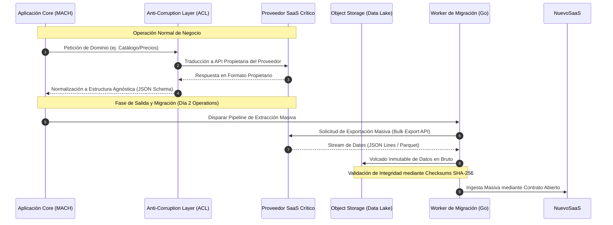

Un proveedor clave de comercio composable basado en SaaS decide unificar sus clústeres multi-tenant de forma unilateral, introduciendo una latencia p99 de 1,200ms en el motor de precios y degradando las transacciones de checkout en plena temporada de Black Friday. Al revisar el contrato legal (MSA) y los SLAs adjuntos, descubres que el proveedor calcula el tiempo de actividad basándose en promedios mensuales globales que enmascaran micro-interrupciones, la cláusula de salida exige una retención de datos propietaria sin formato estructurado (bloqueando el volcado a S3 o Parquet), y el costo de transferencia de egreso por recuperar 4TB de catálogos y transacciones asciende a miles de dólares imposibles de justificar sin penalizaciones recíprocas. El verdadero costo técnico de un bloqueo (*vendor lock-in*) no reside en las líneas de código acopladas, sino en la incapacidad operativa y financiera de ejecutar una migración limpia cuando la infraestructura del proveedor colapsa.

En arquitecturas MACH (*Microservices, API-first, Cloud-native, Headless*), la gobernanza de múltiples proveedores externos (*Multi-Vendor Governance*) y la ingeniería financiera (*FinOps*) son tan críticas como el diseño de los microservicios. Depender de componentes SaaS críticos sin una estrategia de salida blindada contractualmente y sin métricas de rendimiento agregadas en el código expone a la empresa a riesgos catastróficos de Día 2.

---

### Arquitectura de Desacoplamiento de Datos y Portabilidad de Salida

Para mitigar el riesgo de bloqueo estructural, la arquitectura no debe consumir APIs propietarias de manera directa y acoplada. Se debe implementar una capa de abstracción mediante adaptadores (*Anti-Corruption Layer* o ACL) que garantice que el esquema de datos entrante y saliente cumpla con contratos agnósticos, permitiendo la portabilidad de cargas hacia otro proveedor SaaS o hacia una implementación interna (*Open-Source*) en cuestión de días.

El siguiente diagrama muestra el flujo de ingesta, sincronización y la ruta de escape de datos ante la terminación de un contrato SaaS, utilizando una arquitectura orientada a eventos mediante un patrón Outbox y almacenamiento intermedio en Parquet.



---

### Implementación del Patrón de Abstracción y Métricas de SLAs Agregados

Un error común en las negociaciones contractuales es aceptar los SLAs predeterminados del proveedor (ej. 99.9% de disponibilidad mensual sin penalizaciones escalonadas). Los ingenieros de arquitectura deben definir SLAs agregados que midan el impacto real en el negocio: latencia p99, tasa de errores HTTP 5xx ponderada por criticidad de transacción, y el tiempo de recuperación (RTO).

A continuación, se presenta un componente en TypeScript que actúa como un proxy adaptador (*Circuit Breaker* + *Metrics Collector*) para auditar programáticamente el cumplimiento del SLA del proveedor SaaS en tiempo de ejecución, registrando violaciones que servirán como evidencia técnica durante auditorías de facturación o aplicación de créditos de servicio (*Service Credits*).

```typescript
import { CircuitBreaker } from 'opossum';
import { Counter, Histogram } from 'prom-client';

interface SaaSClientOptions {
  timeout: number;
  errorThresholdPercentage: number;
  resetTimeout: number;
}

// Métricas Prometheus para auditoría de SLA en tiempo real
const saasLatencyHistogram = new Histogram({
  name: 'saas_vendor_latency_seconds',
  help: 'Latencia de llamadas al proveedor SaaS externo',
  labelNames: ['vendor', 'operation', 'status']
});

const saasSlaBreachCounter = new Counter({
  name: 'saas_sla_breach_total',
  help: 'Conteo de violaciones de SLA detectadas (latencia > 500ms o error 5xx)',
  labelNames: ['vendor', 'reason']
});

export class EnterpriseSaaSApiProxy {
  private breaker: CircuitBreaker;
  private vendorName: string;

  constructor(private upstreamClient: any, options: SaaSClientOptions, vendorName: string) {
    this.vendorName = vendorName;
    
    // Configuración del Circuit Breaker para aislar fallos del proveedor
    this.breaker = new CircuitBreaker(this.callUpstream.bind(this), {
      timeout: options.timeout,
      errorThresholdPercentage: options.errorThresholdPercentage,
      resetTimeout: options.resetTimeout
    });

    this.initListeners();
  }

  private async callUpstream(endpoint: string, payload: any): Promise<any> {
    const startTime = process.hrtime();
    try {
      const response = await this.upstreamClient.post(endpoint, payload);
      const [seconds, nanoseconds] = process.hrtime(startTime);
      const durationMs = (seconds * 1000) + (nanoseconds / 1000000);

      saasLatencyHistogram.labels(this.vendorName, endpoint, 'success').observe(durationMs / 1000);

      // Violación de SLA por latencia agregada (p.ej. SLA interno exige < 400ms)
      if (durationMs > 400) {
        saasSlaBreachCounter.labels(this.vendorName, 'high_latency').inc();
        console.warn(`[SLA BREACH] Proveedor ${this.vendorName} excedió el umbral de latencia: ${durationMs}ms`);
      }

      return response.data;
    } catch (error: any) {
      const [seconds, nanoseconds] = process.hrtime(startTime);
      const durationMs = (seconds * 1000) + (nanoseconds / 1000000);
      
      saasLatencyHistogram.labels(this.vendorName, endpoint, 'error').observe(durationMs / 1000);
      saasSlaBreachCounter.labels(this.vendorName, 'http_error_5xx').inc();
      
      throw error;
    }
  }

  public async execute(endpoint: string, payload: any): Promise<any> {
    return this.breaker.fire(endpoint, payload);
  }

  private initListeners() {
    this.breaker.on('open', () => {
      console.error(`[CRITICAL] Circuit Breaker ABIERTO para el proveedor SaaS: ${this.vendorName}. Activando fallback.`);
    });
  }
}
```

---

### Automatización de la Extracción de Datos para Cláusulas de Salida (*Data Portability*)

Una cláusula de salida sólida (*Exit Clause*) debe obligar contractualmente al proveedor a proporcionar un volcado completo de los datos en un formato estándar (Apache Parquet o JSON Lines comprimido en GZIP) en un plazo no mayor a 72 horas tras la notificación de rescisión, sin costos ocultos de egreso. 

El siguiente script en Python demuestra cómo automatizar la validación de integridad y el almacenamiento seguro de los datos extraídos de un SaaS durante el proceso de transición o desmantelamiento del servicio.

```python
import hashlib
import gzip
import json
import logging
import os
from typing import Dict, Generator
import boto3

logging.basicConfig(level=logging.INFO)
logger = logging.getLogger("SaaSMigrationExport")

class DataExportValidator:
    def __init__(self, bucket_name: str, aws_region: str):
        self.bucket_name = bucket_name
        self.s3_client = boto3.client('s3', region_name=aws_region)

    def calculate_checksum(self, file_path: str) -> str:
        sha256_hash = hashlib.sha256()
        with open(file_path, "rb") as f:
            for byte_block in iter(lambda: f.read(4096), b""):
                sha256_hash.update(byte_block)
        return sha256_hash.hexdigest()

    def stream_and_upload(self, data_stream: Generator[Dict, None, None], target_filename: str) -> str:
        temp_path = f"/tmp/{target_filename}.gz"
        
        # 1. Comprimir stream localmente en formato JSON Lines
        with gzip.open(temp_path, 'wt', encoding='utf-8') as gz_file:
            for record in data_stream:
                gz_file.write(json.dumps(record) + '\n')

        file_hash = self.calculate_checksum(temp_path)
        logger.info(f"Archivo comprimido generado. SHA-256: {file_hash}")

        # 2. Subir al Data Lake de la empresa (S3) asegurando persistencia independiente del SaaS
        s3_key = f"migration-exit/{target_filename}.gz"
        with open(temp_path, "rb") as f:
            self.s3_client.upload_fileobj(
                f, 
                self.bucket_name, 
                s3_key,
                ExtraArgs={
                    'Metadata': {'sha256-checksum': file_hash},
                    'ServerSideEncryption': 'AES256'
                }
            )
        
        logger.info(f"Datos exportados y asegurados exitosamente en s3://{self.bucket_name}/{s3_key}")
        
        # Limpieza de recursos locales
        os.remove(temp_path)
        return file_hash

# Ejemplo de uso simulado del pipeline de salida
if __name__ == "__main__":
    # Simulación de un stream de registros extraídos del SaaS saliente
    def mock_saas_data_generator() -> Generator[Dict, None, None]:
        for i in range(10000):
            yield {"id": f"sku-{i}", "price": 99.99, "attributes": {"color": "blue", "size": "XL"}}

    # export_validator = DataExportValidator(bucket_name="enterprise-migration-data-lake", aws_region="us-east-1")
    # export_validator.stream_and_upload(mock_saas_data_generator(), "catalog_export_2026")
```

---

### Trade-offs Arquitectónicos y Financieros en la Contratación SaaS

La selección y negociación de contratos con proveedores SaaS bajo un enfoque MACH requiere ponderar la flexibilidad técnica frente a la complejidad financiera y operativa. La siguiente tabla detalla las opciones arquitectónicas y sus implicaciones a nivel enterprise.

| Estrategia de Contratación / Arquitectura | Ventajas (Pros) | Desventajas (Contras) | Cuándo Usarlo | Cuándo Evitarlo |
| :--- | :--- | :--- | :--- | :--- |
| **SaaS Nativo Acoplado (API Directa)** | Time-to-market ultra rápido; menor mantenimiento de infraestructura propia. | Alto riesgo de *vendor lock-in*; dependencias de rendimiento fuera de control. | Componentes no críticos o de diferenciación baja (ej. pasarela de correo secundaria). | Dominios core del negocio (ej. motor de precios, gestión de órdenes, identidad). |
| **SaaS con Capa de Abstracción (ACL + Outbox)** | Portabilidad de datos garantizada; resistencia a caídas del proveedor mediante Circuit Breakers. | Esfuerzo de ingeniería inicial elevado; duplicación lógica de modelos de datos. | Sistemas SaaS enterprise críticos donde la salida o migración futura es inevitable. | MVPs o proyectos temporales con presupuesto y vida útil acotados. |
| **Implementación Híbrida / Open Source Autogestionada** | Propiedad absoluta de los datos y la infraestructura; control total de SLAs y costos operativos (FinOps). | Costo operacional de mantenimiento (Day-2 operations, parches, escalado manual/K8s). | Alta volumetría transaccional donde el modelo SaaS resulta prohibitivo financieramente. | Equipos sin experiencia en infraestructura Cloud-Native o Kubernetes. |

---

### Modos de Fallo Comunes y Estrategias de Recuperación en Producción

Durante el ciclo de vida de un contrato SaaS enterprise, los equipos de ingeniería suelen encontrarse con incidentes críticos que escapan al control directo del código. A continuación se detallan los modos de fallo más frecuentes y sus mitigaciones arquitectónicas:

1. **Degradación Silenciosa del Rendimiento (SLA Eviscerado)**
   - *Síntoma:* El proveedor cumple formalmente con el 99.9% de uptime (servidores respondiendo HTTP 200), pero la latencia p99 pasa de 150ms a 2,500ms debido a saturación en el multi-tenant.
   - *Mitigación:* Implementar umbrales de latencia basados en percentiles dentro de las métricas de la API Gateway o Proxy ACL. Si la latencia supera el SLA acordado contractualmente durante más de 15 minutos consecutivos, activar automáticamente un mecanismo de *Graceful Degradation* (servir datos desde una caché en el Edge o respuestas estáticas predeterminadas) y generar un reporte automatizado firmado criptográficamente para reclamar créditos de servicio.

2. **Bloqueo por Tarifas de Egreso Abusivas (*Data Egress Ransom*)**
   - *Síntoma:* Al intentar rescindir el contrato, el proveedor impone costos de transferencia de datos exorbitantes o limita el ancho de banda de descarga a 1 Mbps.
   - *Mitigación:* Incluir cláusulas obligatorias de "Costo Cero de Egreso para Migración Masiva" (*Zero-Cost Bulk Export*) y exigir la compatibilidad con protocolos de transferencia directa a almacenamiento cloud estándar (S3 compatible o pre-signed URLs) durante el proceso de licitación (RFP).

3. **Incompatibilidad de Esquemas en Actualizaciones Forzosas**
   - *Síntoma:* El proveedor actualiza su API rompiendo la retrocompatibilidad sin previo aviso, colapsando los microservicios consumidores.
   - *Mitigación:* Aplicar rigurosamente el diseño *Contract-First* mediante esquemas estrictos (JSON Schema o OpenAPI) en el límite del ACL, rechazando payloads malformados y manteniendo versiones estables aisladas mediante *API Version Pinning* exigido por contrato.

---

### Conclusión y Checklist para Equipos de Ingeniería

La negociación de contratos SaaS en arquitecturas MACH no debe dejarse exclusivamente en manos de los departamentos de compras o legales. Los arquitectos de software y líderes técnicos deben participar activamente en la definición de las cláusulas técnicas que determinan la viabilidad operativa a largo plazo. 

Utilice el siguiente checklist de implementación para validar su próximo contrato SaaS enterprise:

- [ ] **Cláusula de Portabilidad de Datos:** ¿El contrato obliga al proveedor a exportar la totalidad de los datos en formatos estándar e interoperables (Parquet, JSON Lines) en un plazo menor a 72 horas ante la rescisión?
- [ ] **Exención de Costos de Egreso:** ¿Se encuentran explícitamente exentos de cobro los volúmenes de datos transferidos fuera de la plataforma durante las auditorías de salida o migraciones planificadas?
- [ ] **SLAs Granulares Basados en Latencia y Errores Ponderados:** ¿Los indicadores de nivel de servicio contemplan el percentil p99 y la tasa de errores transaccionales, y no meramente la disponibilidad de red (ping/uptime)?
- [ ] **Créditos de Servicio Automáticos:** ¿Existe una cláusula de penalización financiera automática (créditos en factura) vinculada a métricas de rendimiento recolectadas mediante instrumentación propia (Prometheus/OpenTelemetry)?
- [ ] **Aislamiento mediante ACL y Circuit Breakers:** ¿El código de la aplicación desacopla el consumo del SaaS mediante una capa de abstracción que permita reemplazar al proveedor sin refactorizar el dominio del negocio?
- [ ] **Versionado y Políticas de Depreciación (*Deprecation Policy*):** ¿El proveedor garantiza contractualmente un periodo mínimo de convivencia de 12 meses ante cambios breaking en sus contratos de API?