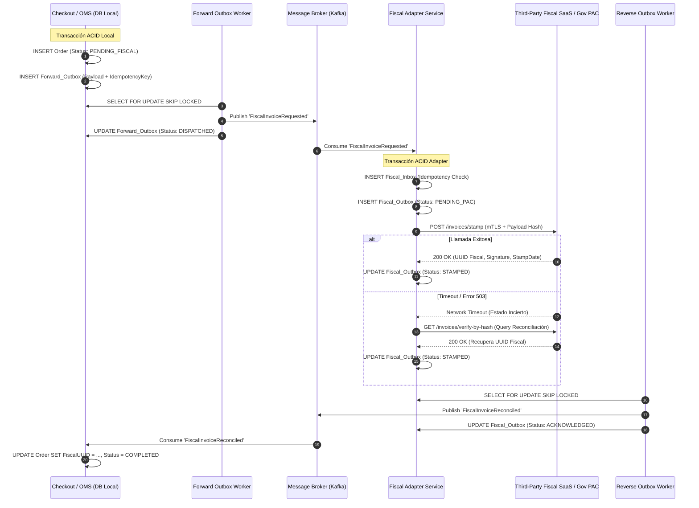

El reloj marca las 00:03 durante un evento de alta concurrencia. La pasarela de pagos (Stripe/Adyen) confirma con éxito el cobro de 12,000 órdenes por minuto mediante webhooks asíncronos. Sin embargo, a los 18 minutos del inicio, la entidad de certificación tributaria (el PAC fiscal en México para CFDI, la API del SII en Chile, o los endpoints de VeriFactu en España) comienza a responder con latencias superiores a 25 segundos y tasas de error HTTP 503 intermitentes. 

En un intento desesperado por evitar bloqueos en el hilo de checkout, los microservicios de facturación encolan peticiones con reintentos lineales. El resultado en el Día 2 es catastrófico: facturas duplicadas para una misma transacción comercial, folios fiscales emitidos sin pago asentado debido a condiciones de carrera, multas por discrepancia contable y una base de datos de órdenes desfasada irreversiblemente respecto al libro mayor (General Ledger).

El patrón transaccional *Outbox* tradicional garantiza que un microservicio persista un cambio de estado y emita un evento de dominio sin sufrir inconsistencias de doble escritura (*dual-write hazard*). No obstante, en ecosistemas Composable Commerce y arquitecturas MACH donde convergen múltiples plataformas SaaS (pasarelas de pago, ERPs, proveedores fiscales y motores de órdenes), un Outbox unidireccional resulta insuficiente. Cuando el sistema externo opera con sus propios ciclos de vida, reglas de negocio asíncronas y restricciones legales inmutables, se requiere una arquitectura de **Outbox Bidireccional** con conciliación transaccional de ciclo cerrado.

## La Anatomía de la Falla: Por qué el Outbox Simple Colapsa en Escenarios Fiscales

En un modelo tradicional de Outbox, el microservicio de Checkout guarda la orden y escribe un registro en la tabla `outbox_events` dentro de la misma transacción ACID de base de datos. Un proceso en segundo plano (vía Change Data Capture con Debezium o un poller transaccional) extrae el registro y publica el evento `OrderPaid` en Apache Kafka o RabbitMQ:

```
[Checkout Tx: Order + Outbox] ──(CDC)──> [Kafka] ──> [Fiscal Service] ──> [Gov/Tax API]
```

Este enfoque unidireccional ignora deliberadamente tres realidades críticas de los servicios tributarios externos:

1. **Incertidumbre de Estado en Tiempos de Espera (Timeouts Zombis):** Si la llamada HTTP al servicio fiscal expira después de 30 segundos, el emisor no sabe si la factura fue timbrada/firmada digitalmente en el servidor tributario antes de la caída de la conexión o si fue descartada.
2. **Asimetría de Cancelación:** Si un usuario solicita la cancelación de una orden antes de que el motor fiscal reporte el estatus de la emisión, el sistema puede disparar una nota de crédito o cancelación fiscal sobre un documento que técnicamente aún no existe para el ERP, generando una desincronización legal irreversible.
3. **Pérdida de Retornos Asíncronos:** Muchas autoridades tributarias y plataformas SaaS de Enterprise Invoicing (Avalara, Sovos) responden con un acuse de recibo provisional (`Accepted`) y entregan el resultado definitivo (folio fiscal, sello criptográfico, URL del XML) horas más tarde mediante un webhook inverso o un mecanismo de consulta (*polling*).

El **Patrón Outbox Bidireccional** soluciona esta asimetría tratando la integración con sistemas fiscales y de pago como un diálogo transaccional de dos vías compuesto por:
- Un **Forward Outbox** en el dominio de origen (ej. Checkout / OMS) que emite intenciones comerciales firmadas criptográficamente.
- Un **Fiscal Inbox/Outbox** en el servicio de integración fiscal que adquiere contratos de arrendamiento transaccionales (*leasing*), implementa deduplicación estricta y emite de vuelta eventos de conciliación inmutables mediante su propio outbox local.

---

## Arquitectura y Topología de Estados

A continuación se detalla la topología de ciclo cerrado del Outbox Bidireccional, mostrando la interacción entre los límites de contexto (*bounded contexts*), colas de mensajería y la API tributaria externa:



---

## Implementación Técnica de Producción

Para garantizar resiliencia extrema en PostgreSQL, implementaremos el esquema de persistencia y el procesamiento concurrente con exclusión mutua mediante `FOR UPDATE SKIP LOCKED`.

### 1. Esquema de Base de Datos para el Outbox Bidireccional (PostgreSQL)

```sql
-- Dominio de Integración Fiscal: Registro de salida hacia el PAC y reconciliación inversa
CREATE TYPE fiscal_execution_state AS ENUM (
    'PENDING', 
    'PROCESSING', 
    'STAMPED', 
    'RECONCILIATION_REQUIRED', 
    'FAILED_FATAL'
);

CREATE TABLE fiscal_transactions (
    transaction_id UUID PRIMARY KEY DEFAULT gen_random_uuid(),
    order_id UUID NOT NULL,
    idempotency_hash VARCHAR(64) NOT NULL UNIQUE, -- SHA256(order_id + amount + tax_id)
    payload_snapshot JSONB NOT NULL,
    fiscal_uuid VARCHAR(128) NULL,
    digital_stamp TEXT NULL,
    error_detail JSONB NULL,
    state fiscal_execution_state NOT NULL DEFAULT 'PENDING',
    retry_count INT NOT NULL DEFAULT 0,
    locked_until TIMESTAMPTZ NULL,
    created_at TIMESTAMPTZ NOT NULL DEFAULT NOW(),
    updated_at TIMESTAMPTZ NOT NULL DEFAULT NOW()
);

-- Outbox Reverso para notificar al OMS/Ledger sobre la resolución del timbrado
CREATE TABLE reverse_fiscal_outbox (
    outbox_id UUID PRIMARY KEY DEFAULT gen_random_uuid(),
    transaction_id UUID NOT NULL REFERENCES fiscal_transactions(transaction_id),
    event_type VARCHAR(64) NOT NULL,
    event_payload JSONB NOT NULL,
    dispatched BOOLEAN NOT NULL DEFAULT FALSE,
    dispatched_at TIMESTAMPTZ NULL,
    created_at TIMESTAMPTZ NOT NULL DEFAULT NOW()
);

CREATE INDEX idx_fiscal_transactions_lease 
ON fiscal_transactions (state, locked_until) 
WHERE state IN ('PENDING', 'PROCESSING', 'RECONCILIATION_REQUIRED');

CREATE INDEX idx_reverse_outbox_pending 
ON reverse_fiscal_outbox (dispatched) 
WHERE dispatched = FALSE;
```

### 2. Procesador Transaccional Concurrente con Recuperación de Timeouts (TypeScript / Node.js)

El siguiente componente procesa registros del outbox fiscal adquiriendo un arrendamiento temporal (*lease*). Si el servicio externo falla con un error de red o timeout, la transacción no se reintenta inmediatamente a ciegas; entra en un estado `RECONCILIATION_REQUIRED` para ejecutar una verificación por hash antes de solicitar un nuevo timbrado.

```typescript
import { Pool, PoolClient } from 'pg';
import crypto from 'crypto';

interface FiscalPayload {
  orderId: string;
  taxPayerId: string;
  totalAmount: number;
  taxAmount: number;
  items: Array<{ sku: string; price: number; taxRate: number }>;
}

export class BidirectionalFiscalWorker {
  constructor(
    private readonly dbPool: Pool,
    private readonly fiscalSaaSClient: ExternalFiscalClient,
    private readonly workerId: string
  ) {}

  /**
   * Procesa el lote de transacciones pendientes utilizando bloqueos optimistas basados en tiempo.
   */
  async processBatch(batchSize: number = 20): Promise<void> {
    const client: PoolClient = await this.dbPool.connect();

    try {
      await client.query('BEGIN');

      // Adquisición segura mediante SKIP LOCKED evitando contención entre pods
      const selectQuery = `
        SELECT transaction_id, order_id, idempotency_hash, payload_snapshot, state, retry_count
        FROM fiscal_transactions
        WHERE (state IN ('PENDING', 'RECONCILIATION_REQUIRED') AND (locked_until IS NULL OR locked_until < NOW()))
        ORDER BY created_at ASC
        LIMIT $1
        FOR UPDATE SKIP LOCKED;
      `;

      const { rows } = await client.query(selectQuery, [batchSize]);

      if (rows.length === 0) {
        await client.query('COMMIT');
        return;
      }

      const txIds = rows.map((r) => r.transaction_id);
      
      // Asignar arrendamiento (Lease) de 60 segundos al worker actual
      await client.query(
        `UPDATE fiscal_transactions 
         SET state = 'PROCESSING', locked_until = NOW() + INTERVAL '60 seconds', updated_at = NOW()
         WHERE transaction_id = ANY($1::uuid[])`,
        [txIds]
      );

      await client.query('COMMIT');

      // Ejecución individual para aislar fallos de red
      for (const record of rows) {
        await this.handleSingleTransaction(record);
      }
    } catch (error) {
      await client.query('ROLLBACK');
      console.error(`[Worker ${this.workerId}] Error crítico en ejecución del lote:`, error);
      throw error;
    } finally {
      client.release();
    }
  }

  private async handleSingleTransaction(record: any): Promise<void> {
    const client = await this.dbPool.connect();
    const payload: FiscalPayload = record.payload_snapshot;

    try {
      let fiscalResponse: FiscalResult;

      if (record.state === 'RECONCILIATION_REQUIRED') {
        // Consultar primero si el PAC ya procesó este hash previamente (Desambiguación)
        fiscalResponse = await this.fiscalSaaSClient.queryByHash(record.idempotency_hash);
        
        if (!fiscalResponse.isStamped) {
          // Si el PAC no lo tiene registrado, procedemos al timbrado original
          fiscalResponse = await this.fiscalSaaSClient.stampDocument(payload, record.idempotency_hash);
        }
      } else {
        // Flujo estándar: timbrado directo
        fiscalResponse = await this.fiscalSaaSClient.stampDocument(payload, record.idempotency_hash);
      }

      // Transacción atómica: Actualizar estado fiscal e insertar en Outbox Reverso
      await client.query('BEGIN');

      await client.query(
        `UPDATE fiscal_transactions 
         SET state = 'STAMPED', 
             fiscal_uuid = $1, 
             digital_stamp = $2, 
             locked_until = NULL, 
             updated_at = NOW()
         WHERE transaction_id = $3`,
        [fiscalResponse.uuid, fiscalResponse.digitalStamp, record.transaction_id]
      );

      // Escribir en el Reverse Outbox dentro de la misma transacción ACID local
      const reconciliationEvent = {
        orderId: record.order_id,
        fiscalUuid: fiscalResponse.uuid,
        digitalStamp: fiscalResponse.digitalStamp,
        status: 'SUCCESS',
        reconciledAt: new Date().toISOString()
      };

      await client.query(
        `INSERT INTO reverse_fiscal_outbox (transaction_id, event_type, event_payload)
         VALUES ($1, 'ORDER_FISCAL_RECONCILED', $2)`,
        [record.transaction_id, JSON.stringify(reconciliationEvent)]
      );

      await client.query('COMMIT');
    } catch (err: any) {
      await client.query('ROLLBACK');
      await this.handleFailure(record, err);
    } finally {
      client.release();
    }
  }

  private async handleFailure(record: any, error: any): Promise<void> {
    const isNetworkTimeout = error.code === 'ETIMEDOUT' || error.status === 504 || error.status === 503;
    const client = await this.dbPool.connect();

    try {
      await client.query('BEGIN');

      if (isNetworkTimeout) {
        // En timeout de red, el PAC pudo haber timbrado. Pasar a RECONCILIATION_REQUIRED
        await client.query(
          `UPDATE fiscal_transactions 
           SET state = 'RECONCILIATION_REQUIRED', 
               retry_count = retry_count + 1, 
               locked_until = NOW() + (INTERVAL '30 seconds' * (retry_count + 1)),
               error_detail = $1,
               updated_at = NOW()
           WHERE transaction_id = $2`,
          [JSON.stringify({ message: error.message, code: error.code }), record.transaction_id]
        );
      } else {
        // Error de validación fiscal (fatal, p. ej. RFC/NIF incorrecto)
        await client.query(
          `UPDATE fiscal_transactions 
           SET state = 'FAILED_FATAL', 
               locked_until = NULL,
               error_detail = $1,
               updated_at = NOW()
           WHERE transaction_id = $2`,
          [JSON.stringify({ message: error.message, stack: error.stack }), record.transaction_id]
        );

        // Notificar al Reverse Outbox de la falla definitiva para intervención manual o reversión
        await client.query(
          `INSERT INTO reverse_fiscal_outbox (transaction_id, event_type, event_payload)
           VALUES ($1, 'ORDER_FISCAL_REJECTED', $2)`,
          [record.transaction_id, JSON.stringify({ orderId: record.order_id, reason: error.message })]
        );
      }

      await client.query('COMMIT');
    } catch (e) {
      await client.query('ROLLBACK');
      console.error(`Error crítico registrando fallo para ${record.transaction_id}:`, e);
    } finally {
      client.release();
    }
  }
}

interface FiscalResult {
  isStamped: boolean;
  uuid: string;
  digitalStamp: string;
}

interface ExternalFiscalClient {
  stampDocument(payload: FiscalPayload, idempotencyKey: string): Promise<FiscalResult>;
  queryByHash(hash: string): Promise<FiscalResult>;
}
```

---

## Modos de Fallo Críticos y Mitigaciones en Producción

### 1. El PAC Timbra pero la Red Cae Antes de Recibir el Payload de Respuesta
- **Problema:** El proveedor fiscal recibe la solicitud, consume un folio fiscal oficial, aplica el certificado criptográfico del emisor y genera el UUID. Sin embargo, un corte en el enlace WAN aborta la conexión TCP. Si el worker reintenta el timbrado con un payload estándar, el proveedor responderá con un error `409 Conflict: Duplicated Folio`, marcando la orden como errónea cuando en realidad está timbrada.
- **Mitigación:** Toda llamada de timbrado debe ir respaldada por una llave de idempotencia derivada criptográficamente: `SHA256(order_id + total_amount + customer_tax_id)`. Antes de realizar cualquier reintento tras un fallo de red (`ETIMEDOUT`, `503`, `504`), el worker entra en modo `RECONCILIATION_REQUIRED` y consulta el endpoint de búsqueda por hash del proveedor. Solo si el proveedor retorna un código `404 Not Found` en la búsqueda por hash, se permite solicitar un nuevo timbrado.

### 2. Disparidad Temporal de Cancelación (Cancel-Before-Stamp Race Condition)
- **Problema:** Durante el lapso en el que la factura se encuentra encolada o en proceso de timbrado en el PAC, el usuario final ejecuta una cancelación de compra o la pasarela de pagos emite un evento de fraude. El servicio de órdenes procesa la cancelación e intenta invalidar la factura antes de que el motor de facturación haya completado la emisión.
- **Mitigación:** Implementar un **Semáforo Semántico de Estado** en el modelo de dominio. El estado de la orden cambia a `CANCELLATION_REQUESTED`. Si el evento reverso del Outbox llega como `ORDER_FISCAL_RECONCILED`, la orden entra de inmediato en un proceso de compensación automático (emisión de Nota de Crédito o anulación fiscal). Ningún documento fiscal se cancela sin que el Outbox Reverso confirme primero su persistencia con un identificador fiscal formal.

### 3. Degradación Severa de Base de Datos por Polling Intensivo
- **Problema:** En picos de 20,000 transacciones por minuto, ejecutar continuamente `SELECT FOR UPDATE SKIP LOCKED` sobre la tabla principal genera contención severa de CPU y bloat en PostgreSQL, ralentizando las escrituras de nuevas órdenes.
- **Mitigación:** 
  1. Particionamiento declarativo por rango (`PARTITION BY RANGE (created_at)`) de las tablas de outbox (eliminando particiones archivadas diariamente hacia almacenamiento frío S3/Parquet).
  2. Implementar un bus de señales en memoria: Cuando se inserta un registro en el Outbox, se envía una notificación `LISTEN/NOTIFY` de PostgreSQL hacia los workers locales para activar el polling únicamente cuando hay datos reales en la cola, utilizando el polling periódico solo como mecanismo secundario de seguridad (*heartbeat fallback*).

---

## Análisis Comparativo de Trade-Offs Arquitectónicos

| Patrón Arquitectónico | Consistencia de Datos | Latencia en el Checkout | Complejidad de Implementación | Resiliencia ante Caídas del PAC | Costo Operativo |
| :--- | :--- | :--- | :--- | :--- | :--- |
| **Sincrónico con Two-Phase Commit (2PC / XA)** | Fuerte (Bloqueante) | Inaceptable (> 5000ms, propensa a colapsos) | Crítica (Rara vez soportada por SaaS externos) | Nula (Si el PAC cae, todo el checkout se detiene) | Extremo |
| **Outbox Unidireccional Simple** | Eventual No Segura (Riesgo de desincronización) | Muy Baja (< 150ms) | Baja | Pobre (Genera discrepancias en errores de timeout) | Medio (Alto costo de conciliación manual) |
| **Saga Coreografiada Clásica (Sin Outbox Local)** | Eventual | Baja (< 200ms) | Alta (Propensa a pérdidas de mensajes en crash de pods) | Media (Depende exclusivamente de reintentos del broker) | Medio |
| **Outbox Bidireccional con Arrendamiento (Este enfoque)** | Eventual Garantizada (Ciclo Cerrado y Criptográfico) | Mínima (< 100ms, asíncrona hacia el PAC) | Media-Alta | Máxima (Aislada por leasing, auto-recuperable y reconciliada) | Bajo (Totalmente automatizado en Día 2) |

---

## Checklist de Implementación para Equipos de Ingeniería

Para llevar a producción una arquitectura de conciliación fiscal y de pagos basada en Outbox Bidireccional, verifique que su implementación cumpla rigurosamente con los siguientes puntos de control:

- [ ] **Aislamiento Transaccional Estricto:** La orden comercial y el evento del *Forward Outbox* se escriben dentro del mismo bloque de transacción ACID (`BEGIN...COMMIT`) en la base de datos de origen.
- [ ] **Hash Determinista de Idempotencia:** El payload fiscal contiene una firma criptográfica única (`SHA-256`) indexada con restricción `UNIQUE` en la base de datos para impedir duplicados físicos.
- [ ] **Arrendamiento Seguro (*Leasing* Concurrente):** La selección de registros para despacho utiliza `SELECT ... FOR UPDATE SKIP LOCKED` acompañado de un campo `locked_until` para evitar que múltiples pods tomen la misma transacción en caso de crash del proceso.
- [ ] **Estrategia para Timeouts Zombis:** Ante un fallo de red o error `5xx` del proveedor fiscal, el registro transiciona a un estado intermedio (`RECONCILIATION_REQUIRED`) que obliga a ejecutar una consulta de validación por hash previo a cualquier reintento de timbrado.
- [ ] **Outbox Reverso Implementado:** El resultado de la facturación (sea exitoso con folio oficial o fallido con error terminal) se persiste en una tabla local de *Reverse Outbox* y se despacha asíncronamente hacia el Ledger/OMS.
- [ ] **Tolerancia a Eventos Desordenados:** El servicio consumidor del evento reverso implementa un verificador de secuencia o versionado semántico; nunca sobrescribe un estado `CANCELLED` con un estado `COMPLETED` sin antes activar la saga de compensación (nota de crédito).
- [ ] **Estrategia de Mantenimiento de Tablas:** Se cuenta con un job de purga o particionamiento particionado diario para las tablas `fiscal_transactions` y `reverse_fiscal_outbox`, impidiendo el desbordamiento de índices y la degradación del motor relacional.