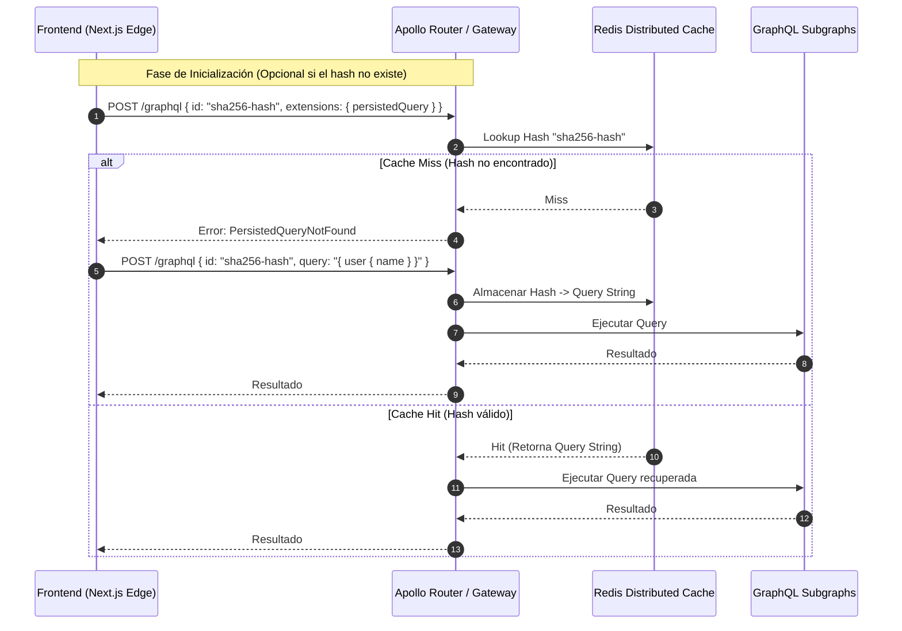

Durante la campaña de ventas de mayor conversión del cuarto trimestre, una plataforma de comercio *headless* basada en GraphQL experimentó una saturación total de sus clústeres de microservicios backend. El desencadenante no fue un volumen masivo de peticiones HTTP, sino una única consulta estructurada de forma maliciosa por un cliente externo. Al anidar profundamente las relaciones entre `customer`, `orders`, `lineItems`, `productVariants` y `categoryHierarchy` con una directiva de expansión recursiva (`depth: 15`), la carga generada colapsó el pool de conexiones de la base de datos relacional y provocó fallos en cadena (*cascading failures*) en los servicios downstream. Los mecanismos tradicionales de limitación de tasa (*rate limiting*) basados en IP resultaron completamente ineficaces, ya que la petición anómala consistía en una única solicitud POST con cabeceras y credenciales válidas.

Este incidente expone la vulnerabilidad fundamental de las arquitecturas GraphQL orientadas a gráficos de datos complejos: la flexibilidad de consulta otorgada al consumidor se convierte en un vector de ataque de denegación de servicio (DoS) a nivel de aplicación (*Resource Exhaustion*). En un ecosistema MACH donde las APIs exponen dominios de negocio interconectados mediante Packaged Business Capabilities (PBCs), delegar la validación de la complejidad al motor de ejecución monolítico en el servidor es un anti-patrón de arquitectura de Operaciones de Día 2. 

La defensa requiere una estrategia de mitigación en múltiples capas (*Defense-in-Depth*), trasladando la inspección semántica, el análisis de coste estático y dinámico, y el bloqueo de consultas abusivas desde el núcleo de la aplicación hasta el API Gateway y el Edge Computing.

## Arquitectura de Validación en el Borde y el Gateway

Para evitar que consultas recursivas o de alta cardinalidad alcancen los microservicios core, la topología de red debe interceptar, analizar y computar el coste de la operación antes de la resolución del esquema (*schema resolution*). La implementación de un interceptor basado en WebAssembly (WASM) en el API Gateway o Cloudflare Workers permite evaluar la sintaxis y el árbol de la consulta en milisegundos, rechazando payloads maliciosos antes de consumir ciclos de CPU en el runtime de GraphQL.

```mermaid
graph TD
    Client[Cliente / Frontend Headless] -->|HTTP POST /graphql| Edge[Cloudflare Edge / WASM Interceptor]
    Edge -->|Validación de Límite de Profundidad| Gateway[API Gateway / Kong o Apollo Router]
    Gateway -->|Análisis de Complejidad de Costes| Router[Federated GraphQL Router]
    
    subgraph "Capa de Defensa Perimetral"
        Edge
        Gateway
    end

    subgraph "Runtime Core (Seguro)"
        Router -->|Subgráfico A| MS1[Servicio de Catálogo]
        Router -->|Subgráfico B| MS2[Servicio de Órdenes]
    end

    Edge -.->|Rechazo HTTP 422 (Over-fetching)| Client
    Gateway -.->|Rechazo HTTP 429 (Complexity Exceeded)| Client
```

El flujo operativo se divide en tres fases críticas de inspección:
1. **Inspección Sintáctica en el Edge**: Validación de la profundidad máxima del árbol AST (*Abstract Syntax Tree*) para bloquear bucles o consultas excesivamente profundas.
2. **Análisis de Complejidad en el Gateway**: Cálculo ponderado del coste basado en los campos solicitados y los multiplicadores de listas (*list arguments* como `first` o `limit`).
3. **Persistencia de Consultas (Persisted Queries)**: Restricción absoluta del tráfico anónimo en producción mediante el uso exclusivo de hashes de consultas preautorizadas.

---

## Implementación del Motor de Cálculo de Complejidad

El análisis de complejidad estático requiere asignar un peso base a cada campo del esquema. Las operaciones que retornan listas escalan el coste multiplicativamente en función de los argumentos de paginación. 

A continuación, se presenta un middleware de producción desarrollado en TypeScript para Apollo Server / Router que implementa un algoritmo de análisis de complejidad con penalización por recursividad y listas:

```typescript
import { GraphQLSchema, DocumentNode, visit, Kind } from 'graphql';

interface ComplexityOptions {
  maximumCost: number;
  scalarCost?: number;
  objectCost?: number;
  listFactor?: number;
}

export function calculateQueryComplexity(
  query: DocumentNode,
  schema: GraphQLSchema,
  options: ComplexityOptions
): number {
  const {
    maximumCost,
    scalarCost = 1,
    objectCost = 2,
    listFactor = 10,
  } = options;

  let totalCost = 0;
  let currentDepth = 0;
  let maxDepthEncountered = 0;

  visit(query, {
    Field: {
      enter(node) {
        currentDepth++;
        if (currentDepth > maxDepthEncountered) {
          maxDepthEncountered = currentDepth;
        }

        // Determinar si el campo es una lista o un objeto complejo
        // En una implementación real, se inspecciona el tipo en el esquema SDL
        const isList = node.arguments?.some(
          (arg) => arg.name.value === 'first' || arg.name.value === 'last'
        );

        let fieldCost = objectCost;
        if (!node.selectionSet) {
          fieldCost = scalarCost;
        }

        if (isList) {
          const limitArg = node.arguments?.find(
            (arg) => arg.name.value === 'first' || arg.name.value === 'last'
          );
          const limitValue = limitArg && limitArg.value.kind === Kind.INT 
            ? parseInt(limitArg.value.value, 10) 
            : listFactor; // Límite por defecto si no se especifica

          totalCost += fieldCost * limitValue;
        } else {
          totalCost += fieldCost;
        }
      },
      leave() {
        currentDepth--;
      },
    },
  });

  if (totalCost > maximumCost) {
    throw new Error(
      `Consulta rechazada: Complejidad calculada (${totalCost}) excede el límite máximo permitido (${maximumCost}). Profundidad máxima: ${maxDepthEncountered}`
    );
  }

  return totalCost;
}
```

Este middleware debe integrarse en el ciclo de vida del servidor antes de la ejecución del resolvedor (*resolver*), asegurando que cualquier consulta que supere el umbral predefinido sea interceptada y devuelva un error HTTP `422 Unprocessable Entity` con un mensaje estructurado.

---

## Análisis Comparativo de Estrategias de Mitigación

La elección de la técnica de mitigación depende directamente del modelo de operación del negocio (B2C masivo vs. B2B enterprise) y de la madurez de la infraestructura de desarrollo.

| Estrategia de Mitigación | Ventajas Arquitectónicas | Desventajas / Riesgos | Cuándo Usar | Cuándo Evitar |
| :--- | :--- | :--- | :--- | :--- |
| **Límite de Profundidad Estático (*Depth Limiting*)** | Computacionalmente muy económico; previene bucles infinitos de relaciones. | No detecta consultas planas pero con colecciones masivas de campos. | Como primera línea de defensa perimetral en todos los gateways. | Como única medida de seguridad en APIs transaccionales complejas. |
| **Análisis de Complejidad de Costes (*Cost Analysis*)** | Granularidad alta; protege contra el consumo excesivo de bases de datos. | Requiere mantenimiento continuo de los pesos del esquema y metadatos. | En APIs de Composable Commerce con múltiples servicios federados. | En entornos con esquemas altamente dinámicos y cambios diarios sin control. |
| **Consultas Persistidas (*Persisted Queries*)** | Seguridad absoluta; elimina la inyección de consultas arbitrarias en producción. | Requiere sincronización estricta entre el pipeline de CI/CD del frontend y backend. | En aplicaciones móviles y frontends web corporativos cerrados. | En entornos abiertos donde terceros consumen la API libremente (APIs públicas). |
| **Rate Limiting Basado en Tokens (Token Bucket)** | Limita el uso abusivo global por cliente o sesión de manera intuitiva. | Difícil de calibrar; una consulta compleja puede consumir la cuota de 50 consultas simples. | Como complemento de control de tráfico en pasarelas API. | Como solución aislada frente a ataques de complejidad de consulta. |

---

## Arquitectura de Consultas Persistidas en Entornos Federados

Para eliminar por completo el riesgo de consultas arbitrarias maliciosas en entornos de producción, el estándar de oro en arquitecturas MACH es el uso de **Persisted Queries (APQs)**. En este modelo, el cliente no envía el cuerpo de la consulta GraphQL, sino un hash criptográfico (SHA-256) del string de la consulta.



### Configuración del Router para Forzar Consultas Persistidas

En arquitecturas empresariales basadas en Apollo Router o pasarelas nativas de Rust/Go, se puede configurar una directiva estricta en el archivo de configuración YAML (`router.yaml`) para rechazar cualquier petición que contenga un cuerpo de consulta en crudo (`query`) si proviene de dominios de producción:

```yaml
supergraph:
  listen: 0.0.0.0:4000

persisted_queries:
  enabled: true
  require_persisted_queries: true
  cache:
    redis:
      addresses: ["redis-cluster.internal.net:6379"]
      timeout: 500ms

security:
  introspection:
    enabled: false # Deshabilitar introspección en producción
  query_limits:
    max_depth: 7
    max_cost: 2500
    ast_nodes_limit: 1500
```

Deshabilitar la introspección del esquema en producción combinada con la exigencia de *Persisted Queries* neutraliza el 99% de las herramientas de descubrimiento automatizado de vulnerabilidades utilizadas por atacantes.

---

## Modos de Fallo Comunes y Recuperación en Producción

Durante la operación de sistemas GraphQL a gran escala, los equipos de plataforma suelen enfrentarse a fallos recurrentes debido a una mala configuración de las políticas de seguridad:

1. **Falsos Positivos en Costes por Paginación Dinámica**: 
   * *Síntoma*: Clientes legítimos con consultas optimizadas reciben errores HTTP 429 de forma intermitente.
   * *Causa Raíz*: El multiplicador de listas asume un tamaño máximo (`first: 100`) cuando el cliente envía un tamaño menor pero el algoritmo calcula el peor caso estático.
   * *Mitigación*: Implementar un análisis de coste híbrido (estático a nivel de estructura y dinámico evaluando los argumentos reales recibidos en tiempo de ejecución en el Gateway).

2. **Agotamiento de Memoria en el Gateway por AST en Árboles Gigantescos**:
   * *Síntoma*: El API Gateway experimenta reinicios por OOM (*Out of Memory*) al recibir consultas con miles de fragmentos repetitivos (`fragment spread`).
   * *Causa Raíz*: Ataques de expansión de fragmentos (similares a la "Bomba XML" o *Billion Laughs*).
   * *Mitigación*: Establecer un límite estricto en el número total de nodos AST permitidos antes de iniciar la fase de parsing (`ast_nodes_limit`).

---

## Conclusión y Checklist de Implementación

La protección de APIs GraphQL en arquitecturas Composable y Cloud-native no puede recaer exclusivamente en el código de los microservicios. La defensa debe ser una responsabilidad perimetral gestionada en el Gateway y el Edge. 

Para garantizar un estándar de seguridad Zero Trust en despliegues productivos, el equipo de ingeniería debe certificar el siguiente checklist:

- [ ] **Desactivación de Introspección**: Asegurar que la introspección del esquema (`__schema`) esté estrictamente deshabilitada en los entornos de producción.
- [ ] **Implementación de Profundidad Máxima**: Configurar un límite estricto de profundidad en el árbol AST (máximo recomendado: 7 a 9 niveles).
- [ ] **Motor de Costes Activo**: Desplegar un analizador de complejidad que pondere tanto los campos escalares como los objetos y las listas con argumentos de paginación.
- [ ] **Forzado de Consultas Persistidas (APQs)**: Obligar a los clientes oficiales (Web, App Móvil) a operar exclusivamente mediante hashes SHA-256 registrados en el pipeline de CI/CD.
- [ ] **Límites de Nodos AST**: Establecer restricciones en el tamaño total del payload de la consulta para prevenir ataques de expansión de fragmentos.
- [ ] **Monitoreo y Alertas en el Edge**: Configurar métricas en Prometheus/Grafana para monitorizar la tasa de rechazo por exceso de complejidad (`graphql_query_rejected_total`) y detectar intentos de sondeo malicioso.