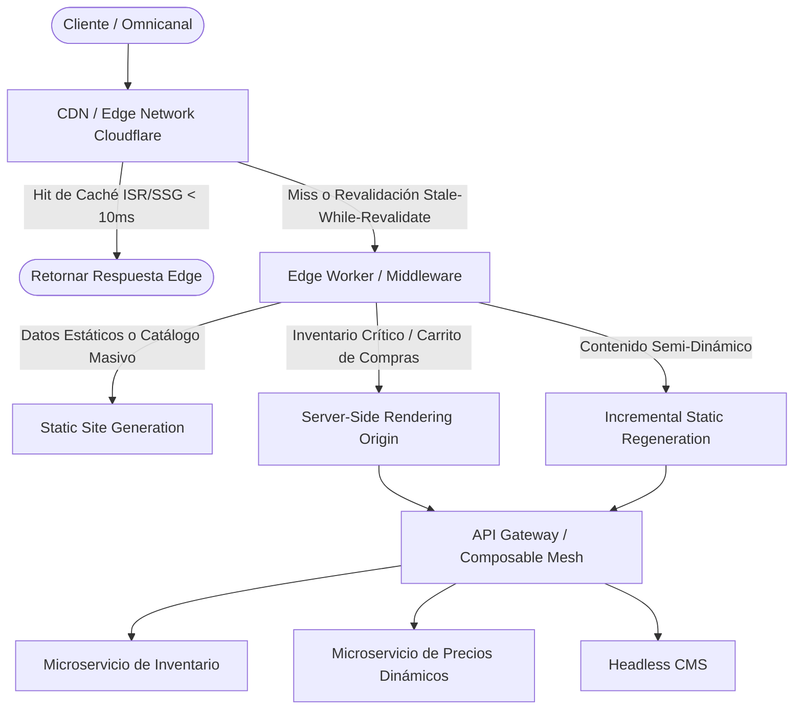

Durante el evento de pico de tráfico masivo del último Black Friday, nuestra plataforma de comercio electrónico headless —impulsada por un enfoque composable basado en microservicios y una API Gateway centralizada— colapsó no por un fallo en la base de datos transaccional, sino por una tormenta de peticiones (*thundering herd*) contra el motor de renderizado del lado del servidor (SSR). Con más de 450,000 usuarios concurrentes intentando acceder simultáneamente a las páginas de producto dinámicas, los nodos de Node.js en los contenedores Kubernetes saturaron su bucle de eventos (*event loop*) al intentar resolver llamadas síncronas paralelas a tres microservicios diferentes (Inventario, Precios y CMS Headless). El resultado: latencias de respuesta que superaron los 8.2 segundos, una tasa de errores HTTP 504 Gateway Timeout del 41%, y una pérdida estimada de ingresos de seis cifras en menos de treinta minutos. La infraestructura cloud auto-escalaba en CPU, pero el cuello de botella residía en la serialización de componentes y la falta de una estrategia de caché distribuida y renderizado híbrido orientada al Edge.

## El Dilema Arquitectónico: SSG, SSR e ISR en Entornos Composable

En una arquitectura MACH pura, el desacoplamiento entre el backend y el frontend traslada una carga significativa de procesamiento a la capa de presentación. Elegir una única estrategia de renderizado para toda la plataforma omnicanal es un anti-patrón de diseño. Dependiendo de la volatilidad del dato, la criticidad del inventario y la necesidad de personalización en tiempo real, los arquitectos deben implementar una matriz de decisión híbrida que combine Static Site Generation (SSG), Server-Side Rendering (SSR) y Incremental Static Regeneration (ISR).

El desafío principal en Operaciones de Día 2 radica en mantener la frescura del catálogo sin degradar el rendimiento del origen. Cuando un microservicio de precios dinámicos experimenta una actualización de tarifas masiva, invalidar la caché de miles de páginas estáticas genera picos de E/S (*cache stampede*) que pueden derribar el clúster de origen.

### Topología del Flujo de Peticiones y Capas de Renderizado Híbrido

El siguiente diagrama en sintaxis Mermaid detalla la ruta de decisión de una petición entrante a través del CDN global, determinando si el contenido se sirve desde la caché Edge (ISR), se procesa dinámicamente (SSR) o se recupera de un almacenamiento estático (SSG):



## Implementación en Producción: Middleware de Revalidación ISR en Next.js

Para mitigar el cuello de botella en el origen durante picos de tráfico, implementamos un patrón de revalidación incremental optimizado en el Edge. Este enfoque permite servir páginas instantáneamente desde la caché del CDN mientras se dispara una actualización en segundo plano (*stale-while-revalidate*).

El siguiente bloque de código en TypeScript demuestra un componente con ISR adaptativo y manejo de reintentos con retroceso exponencial (*exponential backoff*) para consumir APIs de microservicios resilientes:

```typescript
import { GetStaticProps, GetStaticPaths } from 'next';
import { FC } from 'react';

interface ProductPageProps {
  product: {
    id: string;
    sku: string;
    title: string;
    price: number;
    inventoryCount: number;
  };
  cachedAt: string;
}

export const getStaticPaths: GetStaticPaths = async () => {
  // En producción, precargamos solo los top 1000 SKUs más vendidos (SSG parcial)
  // El resto utiliza fallback: 'blocking' para ISR bajo demanda.
  return {
    paths: [],
    fallback: 'blocking', 
  };
};

export const getStaticProps: GetStaticProps = async ({ params }) => {
  const sku = params?.sku as string;
  const maxRetries = 3;
  let attempt = 0;

  while (attempt < maxRetries) {
    try {
      const response = await fetch(`https://api.internal.enterprise.com/v1/products/${sku}`, {
        headers: {
          'X-Internal-Service-Token': process.env.INTERNAL_SERVICE_TOKEN || '',
          'Cache-Control': 'no-cache',
        },
        signal: AbortSignal.timeout(2000), // Timeout estricto de 2s para evitar bloqueos
      });

      if (!response.ok) {
        throw new Error(`Error upstream: ${response.status} ${response.statusText}`);
      }

      const product = await response.json();

      return {
        props: {
          product,
          cachedAt: new Date().toISOString(),
        },
        // ISR configurado a 60 segundos. Si hay tráfico, regenera en background.
        revalidate: 60, 
      };
    } catch (error) {
      attempt++;
      if (attempt >= maxRetries) {
        console.error(`[ISR Failure] Fallo crítico al obtener SKU ${sku} tras ${maxRetries} intentos:`, error);
        // Retornar fallback o página de error gracefully
        return { notFound: true };
      }
      // Retroceso exponencial: 100ms, 200ms, 400ms...
      await new Promise((resolve) => setTimeout(resolve, Math.pow(2, attempt) * 100));
    }
  }

  return { notFound: true };
};

const ProductDetailView: FC<ProductPageProps> = ({ product, cachedAt }) => {
  return (
    <main className="container mx-auto px-4 py-8">
      <h1 className="text-3xl font-bold">{product.title}</h1>
      <p className="text-xl text-green-600 font-semibold">${product.price.toFixed(2)}</p>
      <div className="mt-4 text-sm text-gray-500">
        <span>SKU: {product.sku}</span> | 
        <span className="ml-2">Stock disponible: {product.inventoryCount} unidades</span>
      </div>
      <div className="mt-2 text-xs text-gray-400">
        Renderizado en Edge / ISR Timestamp: {cachedAt}
      </div>
    </main>
  );
};

export default ProductDetailView;
```

## Análisis de Trade-Offs: SSG vs. SSR vs. ISR

La selección de la estrategia de renderizado impacta directamente en los costes de infraestructura, la latencia percibida por el usuario (Core Web Vitals) y la consistencia de los datos de inventario. La siguiente tabla detalla los trade-offs arquitectónicos evaluados en entornos de nivel enterprise:

| Estrategia | Latencia Media (TTFB) | Carga en Origen (Backend) | Consistencia de Datos | Costes de Operación (Cloud) | Cuándo Usar | Cuándo Evitar |
| :--- | :--- | :--- | :--- | :--- | :--- | :--- |
| **SSG (Static Site Generation)** | Ultra Baja (< 20ms) | Nula (Servido desde CDN) | Eventual (Requiere rebuild total) | Bajos (Almacenamiento plano) | Landing pages, blogs, catálogos estáticos masivos. | E-commerce con inventario fluctuante en tiempo real o catálogos hiper-dinámicos (>10M items). |
| **SSR (Server-Side Rendering)** | Alta (200ms - 800ms+) | Muy Alta (Procesamiento por request) | Inmediata (Lectura en vivo) | Altos (Cómputo intensivo en clústeres de origen) | Carrito de compras, páginas de pago (*checkout*), paneles de usuario autenticados. | Páginas de alto tráfico de lectura (catálogos de producto) donde el origen puede colapsar. |
| **ISR (Incremental Static Regeneration)** | Ultra Baja (< 30ms) | Media (Regeneración asíncrona controlada) | Eventual Controlada (TTL configurable) | Moderados (Caché Edge + cómputo bajo demanda) | Catálogos de comercio electrónico, páginas de producto con cambios frecuentes de precio. | Datos hiper-personalizados por usuario que no pueden ser cacheados a nivel público. |

## Modos de Fallo Comunes y Estrategias de Mitigación

Operar arquitecturas de renderizado híbrido a escala expone al sistema a fallos sistémicos sutiles. A continuación se detallan los modos de fallo más críticos identificados en producción y sus mitigaciones correspondientes:

1. **Tormentas de Revalidación (*Cache Stampede*) en ISR:**
   - *El Problema:* Cuando una página popular expira su TTL en el CDN, miles de peticiones simultáneas provocan que el Edge dispare múltiples funciones de regeneración hacia el origen de forma concurrente, saturando los microservicios backend.
   - *Mitigación:* Implementar bloqueo de solicitudes concurrentes (*request collapsing* / *lock-step revalidation*) a nivel de CDN o Edge Worker. Solo una petición ejecuta la regeneración mientras las demás reciben la versión `stale` anterior de forma instantánea.

2. **Inconsistencia de Precios e Inventario por Caché Agresiva:**
   - *El Problema:* Un usuario añade un producto al carrito basándose en un precio o stock servido desde una caché ISR con un TTL de 5 minutos, pero el inventario real se agotó hace 3 minutos.
   - *Mitigación:* Combinar renderizado híbrido en el Edge con hidratación dinámica del lado del cliente (*Client-Side Fetching*) para componentes críticos como botones de compra y contadores de stock mediante WebSockets o llamadas ligeras optimizadas con SWR (Stale-While-Revalidate) de bibliotecas frontend.

3. **Fugas de Memoria en el Servidor SSR por SSR de Componentes Pesados:**
   - *El Problema:* Renderizar componentes complejos con librerías de terceros no optimizadas para SSR en Node.js provoca aumentos exponenciales en el consumo de memoria heap, derivando en reinicios por OOM (*Out Of Memory*) en Kubernetes.
   - *Mitigación:* Establecer límites estrictos de recursos en los contenedores frontend, aplicar perfiles de memoria continuos en entornos de pre-producción y migrar la ejecución de lógica pesada a entornos Serverless nativos en el Edge (como Cloudflare Workers o Vercel Edge Runtime) donde el aislamiento de memoria es por instancia de ejecución ligera.

## Conclusión y Checklist de Implementación

La adopción de estrategias de renderizado híbrido no es una simple optimización de código frontend, sino una decisión arquitectónica fundamental de diseño de sistemas distribuidos en plataformas MACH. El éxito en entornos omnicanal de alta concurrencia depende de desplazar la carga computacional hacia el Edge y aplicar políticas de consistencia eventual controlada.

### Checklist de Implementación para Equipos de Ingeniería:

- [ ] **Auditoría de Rutas:** Clasificar el 100% de las rutas de la aplicación según su volatilidad de datos para asignar SSG, ISR o SSR de forma granular.
- [ ] **Configuración de TTL y Stale-While-Revalidate:** Establecer políticas de caché robustas en la capa de CDN con cabeceras `Cache-Control` y `s-maxage` claramente definidas.
- [ ] **Request Collapsing en el Edge:** Habilitar el bloqueo de peticiones simultáneas en el CDN/Edge Worker para evitar tormentas de revalidación (*cache stampedes*).
- [ ] **Hidratación Parcial / Dinámica:** Aislar componentes altamente transaccionales (carrito, inventario en tiempo real, pasarela de pagos) para ser resueltos mediante llamadas asíncronas en el cliente.
- [ ] **Timeouts y Circuit Breakers:** Implementar tiempos límite estrictos y patrones *Circuit Breaker* en las llamadas del motor de renderizado hacia los microservicios backend para evitar fallos en cascada.
- [ ] **Monitoreo de Core Web Vitals y TTFB:** Configurar alertas de observabilidad para detectar degradaciones en el *Time to First Byte* (TTFB) y tasa de aciertos de caché (*cache hit ratio*) en el Edge.