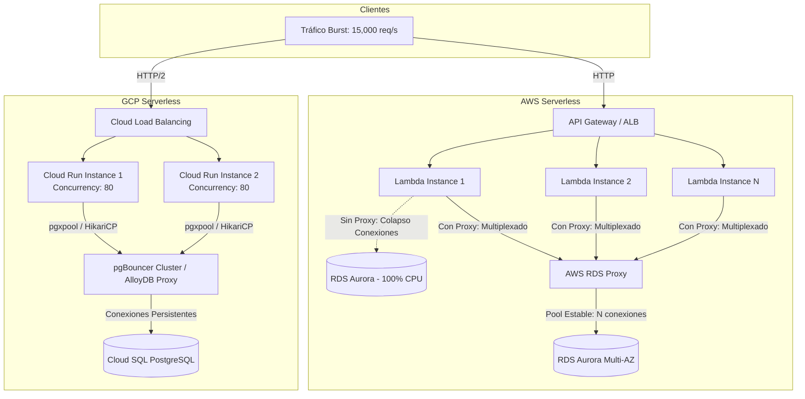
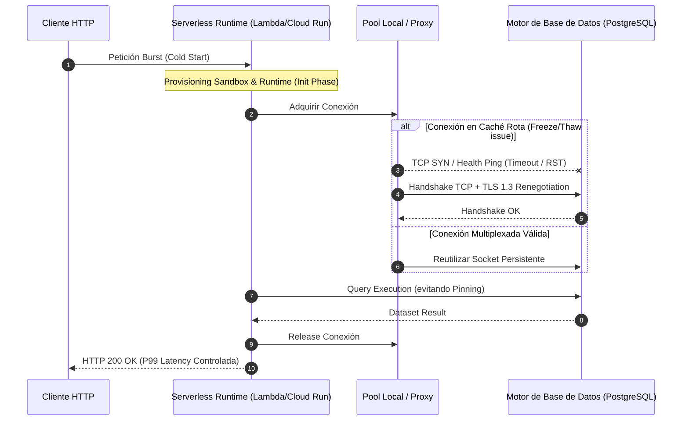

Durante un evento de alta concurrencia como un flash sale o el cierre fiscal, un pico abrupto de 15,000 peticiones por segundo en un microservicio de checkout puede destruir tu capa de persistencia en menos de 30 segundos. El comportamiento es predecible: AWS Lambda escala horizontalmente de 50 a 3,500 microVMs Firecracker; en paralelo, Google Cloud Run aprovisiona cientos de instancias en gVisor. Si cada entorno de ejecución levanta un pool de conexiones tradicional hacia PostgreSQL o MySQL, el clúster transaccional alcanza de inmediato el umbral de `max_connections`. 

La base de datos responde con `FATAL: remaining connection slots are reserved for non-replication superuser connections`, la tasa de errores 5xx escala al 100% y la latencia P99 pasa de 45 ms a más de 8,000 ms debido a reintentos descontrolados y al impacto de los arranques en frío (*cold starts*) con sobrecarga de handshakes TLS y negociaciones TCP repetitivas.

El dilema de la computación serverless moderna radica en la asimetría fundamental entre la naturaleza efímera, masivamente paralela y distribuida de los runtimes serverless, frente a la naturaleza estática, intensiva en memoria y basada en sockets persistentes de las bases de datos relacionales tradicionales. Resolver este choque exige redefinir la gestión del ciclo de vida del cómputo efímero y la topología de red de las conexiones.



---

## Modelos de Concurrencia: AWS Lambda vs. Google Cloud Run

Para abordar el problema del pooling y los cold starts, debemos comprender que Lambda y Cloud Run operan bajo supuestos de aislamiento y concurrencia radicalmente diferentes.

### Concurrencia Unitaria (AWS Lambda)

Cada microVM Firecracker ejecuta una única petición simultánea por invocación activa. Si recibes 1,000 peticiones en el mismo milisegundo, AWS Lambda inicializa 1,000 microVMs independientes. 
* **Impacto en Cold Start:** Cada entorno debe inicializar el runtime (Node.js, Python, JVM, Go), cargar dependencias, parsear variables de entorno y ejecutar el código fuera del handler.
* **Impacto en Conexiones:** Si una función crea un cliente con un pool local de 5 conexiones, 1,000 invocaciones concurrentes intentarán abrir 5,000 sockets TCP contra la base de datos de manera simultánea.

### Concurrencia Múltiple (Google Cloud Run)

Cloud Run se basa en contenedores OCI administrados bajo una capa de virtualización gVisor. A diferencia de Lambda, una única instancia de Cloud Run maneja de forma predeterminada hasta 80 peticiones concurrentes (configurable hasta 250).
* **Impacto en Cold Start:** El arranque en frío ocurre solo cuando la instancia debe ser creada para absorber el tráfico incremental que excede el límite de concurrencia configurado. No obstante, levantar una imagen de contenedor completa suele implicar mayor latencia de inicialización que una función Lambda empaquetada en ZIP, a menos que se optimice el pipeline de arranque y el tamaño de la imagen.
* **Impacto en Conexiones:** Un pool de conexiones local (por ejemplo, de 10 a 20 conexiones en memoria compartida) atiende a decenas de peticiones concurrentes dentro de la misma instancia, mitigando drásticamente la saturación en la base de datos relacional.

---

## Anatomía y Optimización de Cold Starts

El *cold start* se compone de tres fases: aprovisionamiento de la infraestructura, inicialización del entorno de ejecución e inicialización del código de aplicación.

### Optimizando AWS Lambda

En entornos Node.js o Python, el tamaño del paquete y la resolución dinámica de módulos son los mayores penalizadores del tiempo de arranque. En Java, el tiempo de carga del classloader y la compilación JIT elevan el cold start por encima de los 4 a 6 segundos.

1. **Tree-shaking y Bundling Agresivo:** Es imperativo usar `esbuild` o `rollup` para generar un único archivo JavaScript minificado. Importar el SDK de AWS completo (`import AWS from 'aws-sdk'`) carga megabytes de metadatos en memoria. Debe utilizarse la modularización de AWS SDK v3:
   ```typescript
   // Anti-patrón: Carga masiva de módulos
   // import { DynamoDB } from '@aws-sdk/client-dynamodb';

   // Patrón Optimizado: Import específico del cliente ligero
   import { DynamoDBClient } from '@aws-sdk/client-dynamodb';
   const client = new DynamoDBClient({ region: process.env.AWS_REGION });
   ```
2. **Lambda SnapStart (para JVM):** SnapStart toma una instantánea del estado de la microVM (memoria y disco) tras completar la fase de inicialización y la almacena en caché. Cuando la función escala, restaura el snapshot en ~200 ms en lugar de ejecutar la fase de init completa.
3. **Lazy Loading de Conexiones Pesadas:** Evita inicializar clientes externos fuera del handler a menos que sean estrictamente necesarios en todas las rutas de ejecución. Inicializa el driver solo cuando la invocación lo requiera.

### Optimizando Google Cloud Run

1. **Activación de CPU Boost:** La opción `--cpu-boost` asigna temporalmente vCPU adicional durante el arranque del contenedor, reduciendo el cold start hasta en un 50% en aplicaciones Java, .NET o Node.js complejas.
2. **Uso de Min-Instances Estratégicas:** Establecer `--min-instances 1` (o un valor base ajustado según el tráfico baseline) mantiene entornos calientes y listos para servir peticiones con cero latencia de cold start, pagando únicamente por la asignación de recursos ociosos.
3. **Imágenes Scratch / Distroless:** Utiliza imágenes basadas en Google Distroless o Alpine optimizado en compilaciones multi-stage. Reducir el tamaño de la imagen de 800 MB a 50 MB reduce sustancialmente el tiempo de extracción de capas desde Artifact Registry hacia el nodo de cómputo.

---

## Patrones de Pooling para Bases de Datos Relacionales

El antipatrón más destructivo en arquitecturas serverless consiste en instanciar el cliente de base de datos *dentro* del cuerpo de la función o método de manejo de la petición:

```typescript
// ANTIPATRÓN CRÍTICO EN LAMBDA
export const handler = async (event: any) => {
  // Abre y cierra un socket TCP por cada invocación
  const client = new Client({ connectionString: process.env.DATABASE_URL });
  await client.connect();
  const res = await client.query('SELECT * FROM orders WHERE id = $1', [event.orderId]);
  await client.end();
  return res.rows;
};
```

Este enfoque genera saturación instantánea del pool de conexiones del servidor de base de datos, tiempo excesivo invertido en handshakes TCP y TLS, y agotamiento de puertos efímeros en el sistema operativo.

### Solución en AWS: RDS Proxy con Pooling a Nivel de Transacción

AWS RDS Proxy se sitúa entre Lambda y Amazon RDS/Aurora. RDS Proxy mantiene un pool de conexiones persistente hacia la base de datos y multiplexa miles de peticiones de funciones Lambda sobre una fracción de conexiones reales hacia el motor transaccional.

Existen dos consideraciones críticas:
* **Pinning de Conexiones:** Ocurre cuando RDS Proxy no puede multiplexar la conexión y debe atar la instancia Lambda a una conexión de base de datos exclusiva. Se produce al usar sentencias preparadas (*prepared statements* sin nombres anónimos), tablas temporales, bloqueos a nivel de tabla o alterar parámetros de sesión (`SET time_zone`). Minimizar el pinning es indispensable para mantener la eficiencia del multiplexado.
* **Sobrecarga de Red:** RDS Proxy añade entre 1 ms y 3 ms de latencia a las consultas debido al salto adicional en la VPC. Para cargas con consultas sub-milisegundo, esta compensación debe evaluarse frente al riesgo de colapso de conexiones.

### Implementación en TypeScript (AWS Lambda + RDS Proxy)

El siguiente ejemplo implementa un singleton tolerante a fallos de re-ejecución, reutilizando conexiones entre contextos calientes (*warm starts*) y gestionando límites de pool acordes al modelo de ejecución única de Lambda.

```typescript
// db-handler.ts
import { Pool, PoolConfig } from 'pg';

let globalPool: Pool | null = null;

function getDatabasePool(): Pool {
  if (!globalPool) {
    const config: PoolConfig = {
      host: process.env.RDS_PROXY_HOST, // Endpoint de RDS Proxy
      user: process.env.DB_USER,
      database: process.env.DB_NAME,
      password: process.env.DB_PASSWORD,
      port: 5432,
      max: 1, // En Lambda, 1 conexión activa por microVM suele ser suficiente
      idleTimeoutMillis: 15000,
      connectionTimeoutMillis: 3000,
      ssl: { rejectUnauthorized: true }
    };
    
    globalPool = new Pool(config);

    globalPool.on('error', (err) => {
      console.error('Error inesperado en el cliente inactivo del pool', err);
      globalPool = null; // Forzar reinicialización en la siguiente invocación
    });
  }
  return globalPool;
}

export const handler = async (event: { orderId: string }): Promise<any> => {
  const pool = getDatabasePool();
  const client = await pool.connect();
  
  try {
    // Evitar prepared statements con nombre para no inducir 'Pinning' en RDS Proxy
    const queryText = 'SELECT id, customer_id, total, status FROM orders WHERE id = $1';
    const result = await client.query({
      text: queryText,
      values: [event.orderId],
      name: undefined // Deshabilita nombres explícitos de sentencias preparadas
    });

    if (result.rowCount === 0) {
      return { statusCode: 404, body: JSON.stringify({ message: 'Order not found' }) };
    }

    return {
      statusCode: 200,
      body: JSON.stringify(result.rows[0])
    };
  } catch (error) {
    console.error('Fallo en la ejecución de la consulta transaccional', error);
    throw error;
  } finally {
    // Devuelve el socket al pool local, permitiendo que RDS Proxy libere el multiplexado
    client.release();
  }
};
```

### Solución en Google Cloud Run: pgxpool con Concurrencia Compartida en Go

En Cloud Run, múltiples peticiones concurrentes son atendidas por la misma instancia. Go ofrece el entorno ideal para esta arquitectura mediante rutinas concurrentes que comparten un `pgxpool`. 

En este caso, la instancia de Cloud Run debe dimensionar el pool local calculando:  
$$\text{Pool MaxConns} \approx \frac{\text{Instancia Concurrency}}{4}$$

Si la concurrencia es de 80 peticiones por instancia, un pool de 15 a 20 conexiones suele ser suficiente, asumiendo que el tiempo de interacción con la base de datos ocupa una fracción del tiempo total de procesamiento de la petición HTTP.

```go
// main.go
package main

import (
	"context"
	"fmt"
	"log"
	"net/http"
	"os"
	"time"

	"github.com/jackc/pgx/v5/pgxpool"
)

var dbPool *pgxpool.Pool

func initDB() *pgxpool.Pool {
	ctx, cancel := context.WithTimeout(context.Background(), 5*time.Second)
	defer cancel()

	dbURL := os.Getenv("DATABASE_URL")
	config, err := pgxpool.ParseConfig(dbURL)
	if err != nil {
		log.Fatalf("Error parseando configuración de BD: %v", err)
	}

	// Parámetros críticos para Cloud Run
	config.MaxConns = 20
	config.MinConns = 2
	config.MaxConnIdleTime = 2 * time.Minute
	config.MaxConnLifetime = 30 * time.Minute
	config.HealthCheckPeriod = 15 * time.Second

	pool, err := pgxpool.NewWithConfig(ctx, config)
	if err != nil {
		log.Fatalf("Incapaz de crear el pool de conexiones: %v", err)
	}

	// Ping inicial para descartar fallos de red durante el cold start
	if err := pool.Ping(ctx); err != nil {
		log.Fatalf("Fallo de ping a Cloud SQL durante init: %v", err)
	}

	return pool
}

func orderHandler(w http.ResponseWriter, r *http.Request) {
	orderID := r.URL.Query().Get("id")
	if orderID == "" {
		http.Error(w, "Missing id parameter", http.StatusBadRequest)
		return
	}

	var status string
	var total float64

	// Adquisición de conexión eficiente desde el pool compartido
	err := dbPool.QueryRow(r.Context(),
		"SELECT status, total FROM orders WHERE id = $1", orderID).Scan(&status, &total)

	if err != nil {
		http.Error(w, "Order not found or database error", http.StatusInternalServerError)
		return
	}

	w.Header().Set("Content-Type", "application/json")
	fmt.Fprintf(w, `{"id":"%s","status":"%s","total":%.2f}`, orderID, status, total)
}

func main() {
	dbPool = initDB()
	defer dbPool.Close()

	port := os.Getenv("PORT")
	if port == "" {
		port = "8080"
	}

	mux := http.NewServeMux()
	mux.HandleFunc("/order", orderHandler)

	server := &http.Server{
		Addr:         ":" + port,
		Handler:      mux,
		ReadTimeout:  5 * time.Second,
		WriteTimeout: 10 * time.Second,
		IdleTimeout:  60 * time.Second,
	}

	log.Printf("Servidor escuchando en puerto %s", port)
	if err := server.ListenAndServe(); err != nil && err != http.ErrServerClosed {
		log.Fatalf("Error en HTTP server: %v", err)
	}
}
```

---

## Comparativa Técnica de Patrones de Arquitectura

| Estrategia | Impacto en Cold Start | Conexiones DB Reales | Complejidad Operativa | Sobrecarga de Latencia | Cuándo Implementar | Cuándo Evitar |
| :--- | :--- | :--- | :--- | :--- | :--- | :--- |
| **AWS Lambda Directo a RDS** | Bajo (si no hay VPC pesada ni init lento) | $N \times M$ ($N$ instancias $\times$ pool size). Saturación crítica. | Muy baja inicial; altísimo riesgo en producción. | 0 ms adicionales (conexión directa). | Pruebas de concepto, desarrollo local o cargas no concurrentes ($<10$ req/s). | Cualquier sistema transaccional de producción sujeto a picos de tráfico. |
| **AWS Lambda + RDS Proxy** | Medio (inicialización del cliente IAM / TLS) | Altamente eficiente. Concentra miles de Lambdas en un pool fijo hacia RDS. | Media (requiere gestión de VPC, Secret Manager, prevención de pinning). | +1 a +3 ms por consulta. | Arquitecturas serverless sobre AWS donde la base de datos es Amazon RDS o Aurora. | Si el código utiliza intensivamente `SET`, tablas temporales o drivers incompatibles con multiplexing. |
| **Cloud Run + Concurrencia Compartida** | Medio/Alto en arranque frío de contenedor (~1s - 3s sin CPU Boost) | Moderado. 1 pool por contenedor atiende decenas de clientes concurrentes. | Baja (despliegue de contenedor estándar sin proxys intermedios). | 0 ms adicionales. | Aplicaciones monolíticas modernizadas o microservicios estándar HTTP con alta concurrencia por instancia. | Cargas de trabajo de procesamiento de eventos puramente unitarios o ráfagas impredecibles en milisegundos. |
| **Cloud Run + pgBouncer / Proxy Dedicado** | Medio/Alto | Ultra eficiente. Protege el motor central consolidando clústeres enteros de Cloud Run. | Alta (mantenimiento y aprovisionamiento de clúster pgBouncer de alta disponibilidad). | +0.5 a +1.5 ms. | Ecosistemas enterprise con decenas de microservicios Cloud Run accediendo al mismo clúster de Cloud SQL. | Proyectos con presupuestos reducidos o servicios con baja utilización de conexiones. |

---

## Modos de Fallo en Producción y Mitigación

### 1. El Fenómeno del "Zombie Connection" durante el Freeze de MicroVMs

Tanto AWS Lambda como Cloud Run implementan técnicas de congelamiento (*freeze*) del entorno de ejecución cuando no hay peticiones activas. Durante este estado, la CPU asignada al contenedor o microVM se reduce a cero. 

* **El Problema:** El firewall de la base de datos o el propio motor (como PostgreSQL) pueden enviar paquetes de *keepalive* TCP para verificar la salud del cliente. La microVM congelada no responde al sondeo de red. La base de datos asume que la conexión está rota y la cierra en su extremo enviando un paquete `RST` que se pierde. Cuando la plataforma serverless despierta la microVM para una nueva petición (*thaw*), la aplicación intenta enviar una consulta sobre un socket que en realidad está cerrado (*dead socket*), generando un error de tipo `ECONNRESET` o `Socket closed unexpectedly`.
* **Mitigación:** 
  1. Configurar un `idleTimeoutMillis` agresivo en el pool del cliente (por ejemplo, 15 segundos) para forzar la recreación controlada de sockets antes de que el servidor los cierre.
  2. Implementar un validador rápido de conexión (`SELECT 1`) o habilitar la opción `testOnBorrow` de drivers como HikariCP antes de procesar una transacción.

### 2. Agotamiento de CPU en Inicializaciones Asíncronas Simultáneas

En Cloud Run, si se configura una concurrencia de 80 y la instancia experimenta un cold start recibiendo 80 peticiones a la vez, todas las goroutines o callbacks de Node.js intentan competir por la CPU para resolver la negociación TLS con la base de datos.
* **Mitigación:** Habilitar `--cpu-boost` para dotar al contenedor del doble de potencia de procesamiento durante el bootstrapping y limitar la tasa de adquisición de conexiones del pool local mediante backoff exponencial con jitter.



### 3. Pinning Oculto en Motores Relacionales

El uso de bibliotecas ORM como Prisma, TypeORM o Hibernate suele introducir parámetros de inicialización de sesión invisibles que provocan que RDS Proxy asigne un socket exclusivo a esa instancia Lambda para siempre (*session pinning*).
* **Mitigación:** Inspeccionar las métricas de CloudWatch `DatabaseConnections` y `PinnedConnections` en el namespace `AWS/RDS`. Si el ratio `PinnedConnections / DatabaseConnections` supera el 5%, audita el código eliminando llamadas a funciones como `pg_advisory_lock`, sentencias `PREPARE` globales y configuraciones de variables de entorno de base de datos a nivel de sesión.

---

## Checklist de Implementación para Arquitecturas Enterprise

Antes de promover un microservicio serverless conectado a RDBMS a producción, valida cada uno de los siguientes controles:

- [ ] **Aislamiento del Bootstrap de Base de Datos:** ¿El cliente de base de datos está inicializado como variable global/singleton fuera de la función handler (Lambda) o en la función `main`/módulo de inicio (Cloud Run)?
- [ ] **Cap de Tamaño de Pool:** En Lambda, ¿el tamaño máximo del pool local está fijado en 1 (o excepcionalmente 2)? En Cloud Run, ¿el pool local está dimensionado en relación con la concurrencia configurada ($Pool \approx Concurrencia / 4$)?
- [ ] **Proxy Intermedio Desplegado:** Para AWS Lambda contra RDS, ¿se interpuso RDS Proxy o un pooler equivalente (como PgBouncer en ECS)? Para Google Cloud Run a gran escala, ¿se implementó Cloud SQL Auth Proxy con límites de conexión configurados?
- [ ] **Estrategia Anti-Pinning:** ¿Se han eliminado las sentencias preparadas con nombres estáticos, las tablas temporales y los bloqueos de sesión en el código transaccional?
- [ ] **Alineación de Timeouts de Red:** ¿El timeout de adquisición de conexión del cliente (`connectionTimeoutMillis`) es inferior al timeout de ejecución de la función serverless para evitar ejecuciones huérfanas?
- [ ] **Optimización del Ciclo de Cold Start:** ¿Se habilitó CPU Boost en Cloud Run? Para funciones críticas en AWS Lambda, ¿se evaluó Provisioned Concurrency o SnapStart (si se usa Java)?
- [ ] **Min-Instances Estratégicas:** ¿Existen instancias mínimas configuradas en Cloud Run (`--min-instances >= 1`) para los servicios críticos en la ruta crítica del usuario final?
- [ ] **Monitoreo y Alertas:** ¿Existen alarmas configuradas para monitorear el consumo de sockets en la base de datos (`Threads_connected` en MySQL o `numbackends` en PostgreSQL) y la métrica de tiempo de inicialización de las funciones serverless?