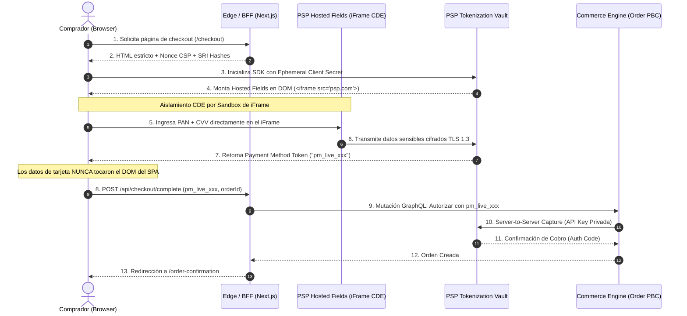
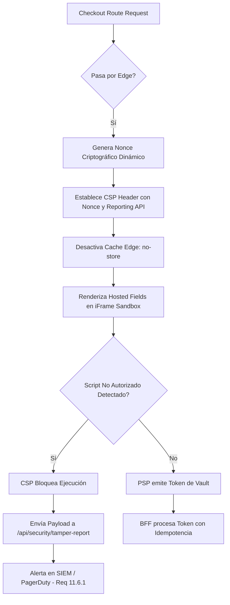

Un script de analítica inofensivo, inyectado mediante un Tag Manager en el Single Page Application (SPA) de un checkout desacoplado, muta su payload en runtime tras el compromiso de una CDN de terceros. Sin tocar una sola línea de código en el backend de comercio ni activar alertas en el pipeline de CI/CD, el script intercepta las pulsaciones de teclado del usuario en los inputs de tarjeta antes de que el formulario invoque el SDK del procesador de pagos. 

En menos de 48 horas, una empresa de retail enterprise con facturación superior a 80 millones de dólares ve degradada su certificación de cumplimiento: pasan de un esquema de auditoría simplificado **SAQ-A** (Self-Assessment Questionnaire A) a un catastrófico **SAQ A-EP** o **SAQ-D**, enfrentando multas contractuales de adquirentes, auditorías forenses externas (PFI) y la paralización inmediata de sus despliegues continuos.

Este escenario representa el fallo arquitectónico más recurrente en arquitecturas Composable: asumir que desacoplar la interfaz del motor de transacciones exime automáticamente a los sistemas del alcance del *Cardholder Data Environment* (CDE). Con la entrada en vigor obligatoria de **PCI-DSS v4.0**, los requisitos **6.4.3** (gestión estricta de scripts en páginas de pago) y **11.6.1** (detección de manipulación de encabezados y páginas en tiempo real) eliminan cualquier ambigüedad: si tu frontend headless carga scripts externos en la misma ventana donde reside el formulario de pago, eres responsable directo de la integridad de esa captura.

## Delimitación del CDE: El Abismo entre SAQ-A y SAQ A-EP

El principio rector de una arquitectura MACH segura es la reducción radical de la superficie de ataque mediante el patrón **Zero Trust Data Vaulting**. Para mantenerse estrictamente bajo el esquema SAQ-A (donde todo el procesamiento, almacenamiento y transmisión de datos de tarjeta se delega a un Payment Service Provider o PSP certificado PCI-DSS Nivel 1), el cliente JAMstack/Edge jamás debe tener acceso al Número de Cuenta Principal (PAN), fecha de caducidad ni código de verificación (CVV/CVC).



La diferencia fundamental entre los tipos de cuestionarios de evaluación de seguridad radica en cómo fluyen los datos en el navegador:

1. **SAQ-A:** El frontend utiliza campos alojados en iframes (*Hosted Fields*) provistos directamente por el PSP o una redirección completa (*Hosted Checkout*). La entrada de texto del PAN ocurre dentro de un marco aislado que pertenece al dominio de origen del procesador. El DOM de nuestra aplicación cliente no puede inspeccionar, interceptar ni acceder al contenido del iframe por políticas de *Same-Origin Policy* (SOP).
2. **SAQ A-EP:** El frontend renderiza inputs HTML directos controlados por el código del comercio y, mediante un SDK de JavaScript, toma los valores y los envía vía API REST al procesador para recibir un token. Aunque el PAN nunca llegue a los servidores backend del comercio, el código del navegador sí tocó los datos sensibles. Cualquier vulnerabilidad XSS o script malicioso inyectado puede exfiltrar el PAN, demandando más de 160 controles técnicos de seguridad sobre el servidor web y el pipeline de frontend.

---

## Implementación Técnica: Hosted Fields con Aislamiento Estricto y CSP Dinámico

Para blindar un checkout desacoplado bajo Next.js / Edge Runtime manteniendo SAQ-A y cumpliendo los requisitos 6.4.3 y 11.6.1 de PCI-DSS v4.0, es imperativo implementar un sistema de **Content Security Policy (CSP)** criptográficamente reforzado mediante nonces dinámicos generados por petición, complementado con el montaje de Hosted Fields aislados.

### 1. Middleware de Edge: Generación de Nonce y Encabezados PCI-DSS 4.0

El siguiente middleware intercepta cada solicitud al checkout, genera un nonce criptográfico para scripts legítimos y establece las cabeceras requeridas para mitigar el ataque de carga no autorizada de dependencias:

```typescript
// middleware.ts - Edge Runtime Checkout Security
import { NextRequest, NextResponse } from 'next/server';

export function middleware(request: NextRequest) {
  // Limitar la aplicación estricta de políticas a la ruta transaccional
  if (!request.nextUrl.pathname.startsWith('/checkout')) {
    return NextResponse.next();
  }

  // Generación de Nonce criptográfico aleatorio Base64 de 128 bits
  const nonceArray = new Uint8Array(16);
  crypto.getRandomValues(nonceArray);
  const nonce = Buffer.from(nonceArray).toString('base64');

  // Directiva Content Security Policy compatible con PCI-DSS v4.0 Req 6.4.3
  // Solo se permiten scripts con el nonce actual o dominios validados del PSP
  const cspHeader = `
    default-src 'self';
    script-src 'self' 'nonce-${nonce}' https://js.stripe.com https://cdn.cookielaw.org;
    frame-src 'self' https://js.stripe.com https://hooks.stripe.com;
    connect-src 'self' https://api.stripe.com;
    style-src 'self' 'unsafe-inline';
    img-src 'self' data: https://*.stripe.com;
    object-src 'none';
    base-uri 'none';
    form-action 'self';
    frame-ancestors 'none';
    report-uri /api/security/csp-violation-report;
  `.replace(/\s{2,}/g, ' ').trim();

  // Encabezado para PCI-DSS v4.0 Req 11.6.1 (Detección de Manipulación)
  // Utiliza Reporting API para alertar modificaciones de encabezados y scripts
  const response = NextResponse.next({
    request: {
      headers: new Headers(request.headers),
    },
  });

  response.headers.set('Content-Security-Policy', cspHeader);
  response.headers.set('x-nonce', nonce);
  response.headers.set('X-Frame-Options', 'DENY');
  response.headers.set('X-Content-Type-Options', 'nosniff');
  response.headers.set('Referrer-Policy', 'strict-origin-when-cross-origin');
  response.headers.set(
    'Reporting-Endpoints',
    'pci-tamper-alerts="/api/security/tamper-report"'
  );

  return response;
}

export const config = {
  matcher: ['/checkout/:path*'],
};
```

### 2. Frontend Component: Integración Segura de Hosted Fields

Este componente de React monta el formulario mediante el SDK del procesador dentro de un entorno estéril, evitando enlaces bidireccionales con estados de React (`useState` no debe almacenar datos de tarjeta) y exponiendo únicamente la mutación de tokenización:

```tsx
// components/checkout/SecureCardPayment.tsx
'use client';

import React, { useEffect, useRef, useState } from 'react';
import { loadStripe, Stripe, StripeElements } from '@stripe/stripe-js';

interface SecurePaymentProps {
  clientSecret: string; // Ephemeral Intent Secret emitido por el BFF
  onTokenCreated: (paymentMethodId: string) => Promise<void>;
  onError: (errorMessage: string) => void;
}

export const SecureCardPayment: React.FC<SecurePaymentProps> = ({
  clientSecret,
  onTokenCreated,
  onError,
}) => {
  const [stripe, setStripe] = useState<Stripe | null>(null);
  const [elements, setElements] = useState<StripeElements | null>(null);
  const [isProcessing, setIsProcessing] = useState(false);
  const paymentElementRef = useRef<HTMLDivElement>(null);

  useEffect(() => {
    let isMounted = true;

    async function initPSP() {
      try {
        // Carga del script oficial asegurado en CSP
        const stripeInstance = await loadStripe(
          process.env.NEXT_PUBLIC_STRIPE_PUBLISHABLE_KEY!
        );

        if (!stripeInstance || !isMounted) return;

        const elementsInstance = stripeInstance.elements({
          clientSecret,
          appearance: { theme: 'flat' },
        });

        const paymentElement = elementsInstance.create('payment', {
          layout: 'tabs',
        });

        if (paymentElementRef.current) {
          paymentElement.mount(paymentElementRef.current);
        }

        setStripe(stripeInstance);
        setElements(elementsInstance);
      } catch (err) {
        onError('Fallo crítico al inicializar el contenedor seguro de pago.');
      }
    }

    initPSP();

    return () => {
      isMounted = false;
      elements?.getElement('payment')?.destroy();
    };
  }, [clientSecret]);

  const handleSubmit = async (e: React.FormEvent) => {
    e.preventDefault();
    if (!stripe || !elements || isProcessing) return;

    setIsProcessing(true);

    // Ejecuta la tokenización directa contra los servidores del PSP
    // Los datos del PAN/CVV jamás se exponen en este contexto de ejecución
    const { error, paymentIntent } = await stripe.confirmPayment({
      elements,
      redirect: 'if_required',
    });

    if (error) {
      setIsProcessing(false);
      onError(error.message || 'Error en la autorización de la tarjeta.');
    } else if (paymentIntent && paymentIntent.status === 'Succeeded') {
      // El identificador devuelto es un token des-sensibilizado (Vault Token)
      await onTokenCreated(paymentIntent.payment_method as string);
      setIsProcessing(false);
    }
  };

  return (
    <form onSubmit={handleSubmit} className="w-full max-w-lg mx-auto space-y-4">
      {/* Contenedor DOM donde se inyecta el iFrame aislado (CDE protegido) */}
      <div 
        ref={paymentElementRef} 
        id="payment-element-mount" 
        className="min-h-[280px] p-4 border rounded-md border-neutral-200" 
      />
      <button
        type="submit"
        disabled={!stripe || isProcessing}
        className="w-full py-3 px-6 text-white bg-blue-600 rounded font-semibold disabled:bg-neutral-400"
      >
        {isProcessing ? 'Validando con el Emisor...' : 'Completar Orden Segura'}
      </button>
    </form>
  );
};
```

### 3. Backend For Frontend (BFF): Consumo Idempotente del Token

El servicio de orquestación en el backend solo debe manipular identificadores de métodos de pago (`pm_xxx`), procesándolos de manera idempotente contra el motor de comercio y el motor de pagos:

```typescript
// app/api/checkout/complete/route.ts
import { NextRequest, NextResponse } from 'next/server';
import crypto from 'crypto';

interface CheckoutPayload {
  orderId: string;
  paymentMethodId: string; // Token seguro, NO contiene PAN
  cartHash: string;
}

export async function POST(req: NextRequest) {
  try {
    const body: CheckoutPayload = await req.json();
    const { orderId, paymentMethodId, cartHash } = body;

    // Validación estricta del formato del token de pago para evitar inyecciones
    const tokenRegex = /^pm_[a-zA-Z0-9]{24,32}$/;
    if (!tokenRegex.test(paymentMethodId)) {
      return NextResponse.json(
        { error: 'Token de pago inválido o malformado.' },
        { status: 400 }
      );
    }

    // Clave de Idempotencia generada determinísticamente para evitar dobles cobros
    const idempotencyKey = crypto
      .createHash('sha256')
      .update(`${orderId}-${cartHash}-${paymentMethodId}`)
      .digest('hex');

    // Comunicación Machine-to-Machine con la API del PSP (Zero Trust mTLS / Private Key)
    const pspResponse = await fetch('https://api.stripe.com/v1/payment_intents', {
      method: 'POST',
      headers: {
        'Authorization': `Bearer ${process.env.STRIPE_SECRET_KEY}`,
        'Content-Type': 'application/x-www-form-urlencoded',
        'Idempotency-Key': idempotencyKey,
      },
      body: new URLSearchParams({
        amount: '125000', // Obtenido del Order Engine del servidor, NUNCA del cliente
        currency: 'usd',
        payment_method: paymentMethodId,
        confirm: 'true',
        'metadata[order_id]': orderId,
      }),
    });

    const paymentResult = await pspResponse.json();

    if (!pspResponse.ok) {
      return NextResponse.json(
        { error: paymentResult.error?.message || 'Rechazo de autorización.' },
        { status: 402 }
      );
    }

    // Registro de Auditoría inmutable sin datos sensibles (PCI-DSS Req 10)
    console.info(JSON.stringify({
      level: 'INFO',
      event: 'PAYMENT_CAPTURED',
      orderId,
      pspTransactionId: paymentResult.id,
      timestamp: new Date().toISOString(),
    }));

    return NextResponse.json({ success: true, transactionId: paymentResult.id });
  } catch (error) {
    return NextResponse.json(
      { error: 'Error interno en la orquestación de la transacción.' },
      { status: 500 }
    );
  }
}
```

---

## Comparativa de Trade-offs: Estrategias de Captura en Checkouts Headless

La elección de la técnica de checkout define el alcance de la auditoría y la gobernanza operativa de los ingenieros de plataforma:

| Dimensión de Análisis | Redirección Externa (Hosted Checkout) | Hosted Fields / iFrames (SAQ-A) | Direct API / Formulario Nativo (SAQ A-EP) |
| :--- | :--- | :--- | :--- |
| **Alcance PCI-DSS** | Mínimo absoluto (SAQ-A tradicional). | Aislado a SAQ-A (Bajo controles 6.4.3 y 11.6.1 de v4.0). | Alto impacto (SAQ A-EP / SAQ-D). Más de 160 controles. |
| **Experiencia de Usuario (UX)** | Quiebre de contexto: abandona el dominio y la marca. | Transparente: 100% integrado al diseño y layout del SPA. | Totalmente personalizada a nivel de pixel y estados de UI. |
| **Gobernanza de Scripts** | El PSP gestiona la seguridad de su propio checkout. | Requiere monitoreo activo e inventario de scripts del SPA. | Requiere validación estricta de cada script y pipeline de CI. |
| **Complejidad de Integración** | Muy baja: simple redirección HTTP y webhook. | Media: sincronización de estados y orquestación de estilos. | Muy alta: encriptación en el cliente y vaulting propio. |
| **Penetration Testing** | No requerido formalmente sobre el checkout web. | Recomendado; obligatorio en verificaciones de integridad. | Obligatorio de forma periódica por evaluador ASV externo. |

---

## Modos de Fallo Críticos y Mitigación en Operaciones de Día 2

### 1. Script Creep vía Google Tag Manager (GTM) en el SPA

*   **El Fallo:** El equipo de Growth Marketing agrega un píxel de retargeting o una herramienta de optimización de tasa de conversión (CRO) vía GTM. Dicho script no posee el atributo de hash SRI (*Subresource Integrity*) y su contenido es modificado dinámicamente desde el servidor del proveedor sin revisión técnica.
*   **Impacto:** Los auditores QSA declaran el entorno fuera de cumplimiento SAQ-A por violar la justificación de scripts del requisito **6.4.3**. Si el script analiza activamente el DOM, el incidente escala de inmediato a un evento de brecha de seguridad.
*   **Mitigación:** Aplicar una arquitectura de *Split-Host* o *Isolated Checkout Route*. Las páginas bajo la ruta `/checkout/*` deben excluir completamente el contenedor general de GTM. Solo se permite un micro-contenedor de GTM Server-Side operando exclusivamente mediante eventos HTTP salientes desde el Edge Worker, eliminando la inyección de JavaScript de terceros en el navegador.

### 2. Envenenamiento de Nonces y Ruptura de Caché SSR

*   **El Fallo:** Para optimizar métricas de Core Web Vitals (LCP y TTFB), un equipo de infraestructura habilita el almacenamiento en caché de la página `/checkout` a nivel de CDN (Fastly o Cloudflare).
*   **Impacto:** El primer visitante genera un nonce criptográfico válido que queda persistido en el caché edge. Las visitas subsiguientes reciben el mismo valor estático de nonce en el HTML, invalidando el modelo criptográfico Zero Trust. Los scripts dinámicos legítimos fallan al ejecutarse y la política CSP queda vulnerable a reutilización de nonces (*Nonce Replay Attacks*).
*   **Mitigación:** La ruta `/checkout` debe tener configuradas explícitamente las cabeceras `Cache-Control: no-store, no-cache, must-revalidate, max-age=0`. La inyección del nonce debe ocurrir estrictamente en el Edge Middleware o durante el renderizado dinámico por cada conexión TLS entrante.

### 3. Fuga de Datos de Tarjeta en Herramientas de Session Replay

*   **El Fallo:** Software como Datadog RUM, LogRocket o Hotjar se ejecutan en el checkout para diagnosticar caídas de usuarios. Aunque los inputs de tarjeta se encuentren dentro de un iFrame de Stripe o Adyen, los campos auxiliares (nombre del tarjetahabiente, código postal, dirección física y teléfono) residen en el DOM nativo del SPA.
*   **Impacto:** La captura inadvertida de datos personales protegidos (PII) junto con metadatos transaccionales en bases de datos de telemetría viola simultáneamente normativas GDPR y requisitos de segregación de PCI-DSS.
*   **Mitigación:** Implementar reglas de ofuscación a nivel de atributos HTML (`data-private`, `data-dd-privacy="mask-user-input"`) y auditar que las peticiones salientes de los agentes de APM filtren por regex cualquier secuencia numérica de 15 o 16 dígitos.



---

## Checklist de Implementación para Arquitectos Enterprise

Antes de solicitar la atestación formal de cumplimiento (AOC) bajo PCI-DSS v4.0 para un checkout desacoplado, valide exhaustivamente los siguientes puntos de arquitectura:

- [ ] **Aislamiento Total del DOM:** Comprobar que no existe ningún campo de entrada (`<input>`) que recolecte PAN o CVV/CVC directamente en el DOM de la aplicación SPA/SSR.
- [ ] **Cumplimiento PCI-DSS 6.4.3:** Mantener un inventario vivo y justificado documentalmente de cada script ejecutado en `/checkout`, auditando que se carguen únicamente desde orígenes autorizados con hashes SRI o Nonce dinámico.
- [ ] **Cumplimiento PCI-DSS 11.6.1:** Configurar un mecanismo de detección de manipulación en tiempo real (por ejemplo, directivas `report-uri` o `report-to` en el CSP acopladas a un endpoint de ingesta de alertas) con monitoreo activo cada 7 días o tras cada despliegue.
- [ ] **Idempotencia Estricta en el BFF:** Verificar que la llamada que orquesta la captura del token hacia el motor de pagos utilice una clave de idempotencia única basada en el hash del carrito y el ID de orden para prevenir duplicidad de cargos.
- [ ] **Supresión de Session Replay y GTM:** Eliminar scripts no esenciales (marketing, encuestas, CRO, chats en vivo) de todo el ciclo de checkout. Los scripts analíticos permitidos deben ofuscar automáticamente cualquier campo de formulario mediante directivas en el markup.
- [ ] **Validación de Tipos y Sanitización de Tokens:** El BFF debe validar mediante expresiones regulares estrictas que el identificador recibido sea efectivamente un token de bóveda emitido por el PSP y rechazar cualquier payload que contenga una cadena con estructura de tarjeta bancaria (algoritmo de Luhn).