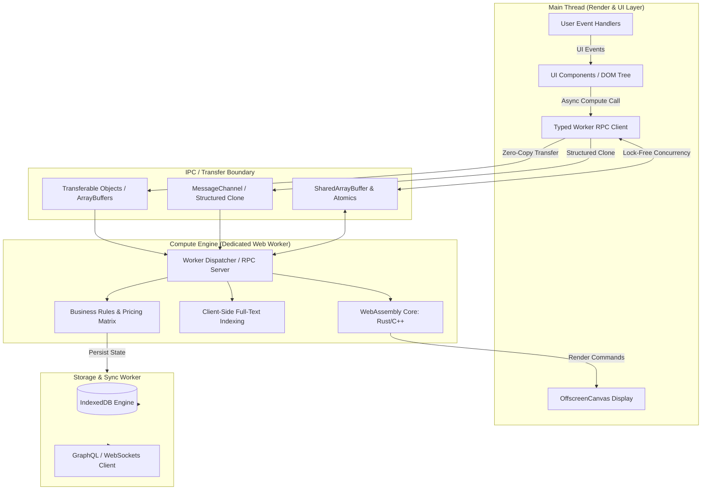

Durante el despliegue del catálogo dinámico B2B de un distribuidor industrial global, los reportes de telemetría de Real User Monitoring (RUM) revelaron un colapso en la interacción: el percentil 75 (p75) del *Interaction to Next Paint* (INP) escaló a 850 milisegundos en dispositivos de gama media. El frontend headless —construido sobre una arquitectura moderna basada en componentes— no sufría por latencia de red ni por demoras en el Edge CDN; el cuello de botella residía íntegramente en el cliente. 

Al evaluar un payload JSON desnormalizado de 18 MB con 45,000 SKUs, matrices de compatibilidad paramétrica y reglas de precios por volumen, el hilo principal de ejecución (*Main Thread*) del navegador quedó monopolizado durante ráfagas de 300 a 600 ms. En esos periodos, el ciclo de vida del *Event Loop* se congeló por completo: los eventos de entrada del usuario (*taps*, *clicks*, escritura en *inputs*) se encolaron indefinidamente, degradando drásticamente el Core Web Vital crítico y disparando el abandono en la conversión un 14.2%.

El modelo de ejecución tradicional de JavaScript en el navegador asume implícitamente que la computación pesada debe resolverse en el servidor. Sin embargo, en aplicaciones web modernas, ricas en capacidades fuera de línea, motores de búsqueda client-side, visualizadores 3D con Three.js o reconciliación criptográfica de identidades descentralizadas, delegar todo al backend destruye la interactividad instantánea y dispara los costos de infraestructura. 

La solución arquitectónica definitiva es desacoplar el procesamiento computacional de la capa de renderizado mediante una **Arquitectura Off-Main-Thread (OMT)**, relegando al *Main Thread* exclusivamente a la manipulación del DOM, el procesamiento de eventos de interfaz de usuario y la ejecución de animaciones fluidas a 60/120 fps.

---

## El Cuello de Botella del Hilo Principal: Anatomía de un Long Task

El *Main Thread* de los motores de navegación (V8, JavaScriptCore, SpiderMonkey) opera bajo un modelo cooperativo de un solo hilo donde compiten simultáneamente:
1. La ejecución de código JavaScript de la aplicación.
2. El análisis sintáctico y compilación de scripts.
3. El cálculo de estilos y layout (*Reflow*).
4. La rasterización y composición de capas (*Repaint*).
5. El despacho de eventos de interacción del usuario.

Cuando una tarea de JavaScript supera los 50 milisegundos, el navegador la clasifica formalmente como un **Long Task**. Si un usuario interactúa con la interfaz mientras un Long Task está en ejecución, el navegador no puede despachar el callback del evento ni programar el siguiente frame de renderizado hasta que el script actual agote su ejecución o ceda el control (*yield*).

```
Main Thread: [ Task A: 12ms ] [ LONG TASK: Matriz de Precios 380ms (INP Bloqueado) ] [ Render ]
                                     ▲
                              Click del Usuario (Encolado y congelado)
```

En aplicaciones headless complejas, operaciones como el cálculo de diferencias en grafos de estado profundos, la deserialización de grandes buffers JSON, el filtrado de árboles facetados y la indexación de texto completo (ej. MiniSearch o FlexSearch) deben erradicarse del hilo visual. Para ello, es indispensable estructurar un entorno concurrente aislado.

---

## Topología de Arquitectura Off-Main-Thread (OMT)

La arquitectura Off-Main-Thread divide el frontend en capas desacopladas que operan sobre procesos o hilos del sistema operativo independientes, comunicándose mediante paso de mensajes serializados o búferes de memoria compartida:



### Principios Fundamentales del Pipeline OMT
1. **Aislamiento del Estado Computacional:** Los modelos matemáticos, algoritmos de recomendación y motores de búsqueda residen exclusivamente en la memoria del Worker.
2. **Transferencia Zero-Copy:** Para evitar que la serialización de datos anule los beneficios de concurrencia, las estructuras de gran volumen se manejan como búferes binarios transferibles (`ArrayBuffer`, `ReadableStream`) donde la propiedad de la memoria se cede de un hilo a otro sin costo de clonación.
3. **RPC Tipado Asíncrono:** La comunicación asíncrona bidireccional se abstrae mediante una capa de llamada a procedimiento remoto (RPC) fuertemente tipada sobre `MessageChannel`, garantizando interfaces predictivas para los componentes visuales.

---

## Implementación de Producción: Pipeline Concurrente con Worker RPC y Transferables

A continuación se presenta una implementación tipada de producción en TypeScript, diseñada para descargar el procesamiento de un catálogo masivo y su cálculo dinámico a un hilo secundario utilizando `Transferable Objects`.

### 1. El Contrato de Comunicación y Tipado RPC

```typescript
// types/worker-contracts.ts

export interface CatalogItem {
  id: string;
  sku: string;
  basePrice: number;
  attributes: Record<string, string>;
  stockLevel: number;
}

export interface ComputeDiscountRequest {
  tierId: string;
  volume: number;
  catalogBuffer: ArrayBuffer; // Lista binaria codificada
}

export interface WorkerComputeResponse {
  success: boolean;
  processedCount: number;
  resultBuffer: ArrayBuffer;
  executionTimeMs: number;
}

export interface WorkerRPCMessage<T> {
  id: string;
  action: 'PROCESS_DISCOUNTS' | 'REINDEX_CATALOG';
  payload: T;
}
```

### 2. El Motor de Cómputo: Dedicated Web Worker

Este archivo se compila independientemente y corre en un hilo aislado sin acceso al objeto `window` ni al DOM.

```typescript
// workers/catalog-engine.worker.ts
import { WorkerRPCMessage, ComputeDiscountRequest, WorkerComputeResponse } from '../types/worker-contracts';

const ctx: Worker = self as unknown as Worker;

// Función de procesamiento intensivo de arrays binarios
function executePricingMatrix(
  inputBuffer: ArrayBuffer,
  tierMultiplier: number
): { resultBuffer: ArrayBuffer; count: number } {
  // Interpretamos el buffer de entrada como enteros/flotantes compactos
  const view = new Float64Array(inputBuffer);
  const length = view.length;
  
  // Creamos un nuevo buffer para el resultado
  const outputBuffer = new ArrayBuffer(length * Float64Array.BYTES_PER_ELEMENT);
  const outputView = new Float64Array(outputBuffer);

  for (let i = 0; i < length; i++) {
    // Simulación de lógica matemática pesada (matrices, límites de crédito, volumen)
    const basePrice = view[i];
    const discounted = basePrice * tierMultiplier;
    
    // Asignación directa en memoria contigua
    outputView[i] = Number((discounted + (Math.sin(basePrice) * 0.05)).toFixed(2));
  }

  return { resultBuffer: outputBuffer, count: length };
}

ctx.onmessage = (event: MessageEvent<WorkerRPCMessage<ComputeDiscountRequest>>) => {
  const { id, action, payload } = event.data;

  if (action === 'PROCESS_DISCOUNTS') {
    const startTime = performance.now();
    try {
      const { tierId, catalogBuffer } = payload;
      const tierMultiplier = tierId === 'ENTERPRISE_GOLD' ? 0.72 : 0.85;

      // Procesamiento de bajo nivel sin tocar el Main Thread
      const { resultBuffer, count } = executePricingMatrix(catalogBuffer, tierMultiplier);
      const executionTimeMs = performance.now() - startTime;

      const response: WorkerComputeResponse = {
        success: true,
        processedCount: count,
        resultBuffer,
        executionTimeMs
      };

      // Devolución mediante Transferable: Cero costo de clonado
      ctx.postMessage(
        { id, payload: response },
        [resultBuffer] // Transfer Ownership
      );
    } catch (error) {
      ctx.postMessage({
        id,
        payload: {
          success: false,
          error: (error as Error).message,
          executionTimeMs: performance.now() - startTime
        }
      });
    }
  }
};
```

### 3. El Cliente RPC en el Main Thread

Abstrae la interacción con el Worker mediante promesas estándar, garantizando que el ciclo de vida del componente UI permanezca limpio.

```typescript
// services/catalog-worker-client.ts
import { WorkerRPCMessage, ComputeDiscountRequest, WorkerComputeResponse } from '../types/worker-contracts';

export class CatalogWorkerClient {
  private worker: Worker;
  private pendingRequests: Map<string, {
    resolve: (val: WorkerComputeResponse) => void;
    reject: (reason: unknown) => void;
  }> = new Map();

  constructor() {
    this.worker = new Worker(
      new URL('../workers/catalog-engine.worker.ts', import.meta.url),
      { type: 'module' }
    );

    this.worker.onmessage = this.handleWorkerMessage.bind(this);
    this.worker.onerror = this.handleWorkerError.bind(this);
  }

  private handleWorkerMessage(event: MessageEvent<{ id: string; payload: WorkerComputeResponse }>) {
    const { id, payload } = event.data;
    const pending = this.pendingRequests.get(id);

    if (pending) {
      if (payload.success) {
        pending.resolve(payload);
      } else {
        pending.reject(new Error('Fallo computacional en Worker'));
      }
      this.pendingRequests.delete(id);
    }
  }

  private handleWorkerError(error: ErrorEvent) {
    console.error('[Worker Fatal Error]', error);
    // Vaciar y rechazar todas las promesas pendientes
    this.pendingRequests.forEach(({ reject }) => reject(error));
    this.pendingRequests.clear();
  }

  public async computeDynamicDiscounts(
    tierId: string,
    prices: Float64Array
  ): Promise<{ prices: Float64Array; executionTimeMs: number }> {
    const correlationId = crypto.randomUUID();
    
    // Obtenemos el buffer subyacente para transferencia Zero-Copy
    const buffer = prices.buffer;

    const request: WorkerRPCMessage<ComputeDiscountRequest> = {
      id: correlationId,
      action: 'PROCESS_DISCOUNTS',
      payload: {
        tierId,
        volume: prices.length,
        catalogBuffer: buffer
      }
    };

    return new Promise((resolve, reject) => {
      this.pendingRequests.set(correlationId, {
        resolve: (response: WorkerComputeResponse) => {
          // Reconstruir Float64Array desde el buffer transferido de vuelta
          const resultPrices = new Float64Array(response.resultBuffer);
          resolve({ prices: resultPrices, executionTimeMs: response.executionTimeMs });
        },
        reject
      });

      // Transferimos la propiedad del buffer al Worker (el Main Thread pierde acceso)
      this.worker.postMessage(request, [buffer]);
    });
  }

  public terminate(): void {
    this.worker.terminate();
    this.pendingRequests.clear();
  }
}
```

---

## Comparativa de Mecanismos de Comunicación Inter-Hilos

La selección del protocolo de paso de datos determina si la arquitectura OMT aportará mejoras netas de rendimiento o si la sobrecarga de serialización creará nuevos cuellos de botella en el hilo principal:

| Mecanismo | Sobrecarga de Serialización | Latencia de Transferencia | Acceso Concurrente | Complejidad de Implementación | Caso de Uso Óptimo | Cuándo Evitarlo |
| :--- | :--- | :--- | :--- | :--- | :--- | :--- |
| **Structured Clone (`postMessage`)** | Alta (copia profunda del objeto mediante serialización interna) | Media / Alta (~15ms para 5MB de objetos JSON complejos) | No (Copia desacoplada) | Mínima (Soporte nativo transparente) | Mensajes de control, configuraciones, estados reducidos (< 100KB) | Datasets masivos, buffers binarios, arrays numéricos densos. |
| **Transferable Objects (`ArrayBuffer`, `ImageBitmap`)** | Cero (Transfiere el puntero de memoria del buffer) | Sub-milisegundo (< 0.2ms sin importar el tamaño del buffer) | Exclusivo (El emisor pierde la propiedad del buffer) | Media (Requiere transformar datos a TypedArrays) | Matrices numéricas, streams de video/audio, payloads binarios de red | Grafos de objetos altamente interconectados con métodos. |
| **SharedArrayBuffer + `Atomics`** | Absolutamente nula (Misma dirección de memoria física) | Tiempo real (0ms, acceso directo por punteros) | Simultáneo (Requiere sincronización mediante primitivas atómicas) | Muy Alta (Riesgo de condiciones de carrera y deadlocks) | Motores WASM multihilo, simulaciones físicas, renderizado intensivo con WebGPU | Aplicaciones web estándar sin restricciones extremas de latencia. |

---

## Modos de Fallo Críticos y Mitigación en Operaciones de Día 2

Desplegar Workers en arquitecturas enterprise introduce retos operativos que difieren radicalmente de los problemas típicos del ciclo de vida de los componentes web convencionales:

### 1. La Paradoja de la Serialización del Algoritmo de Clonación Estructurada
* **El Fallo:** Si se envían objetos JSON anidados con miles de nodos mediante `postMessage(data)` estándar, el algoritmo de *Structured Clone* se ejecuta de forma síncrona en el *Main Thread*. La serialización de un árbol de 10 MB puede bloquear el hilo principal durante más de 70 ms, logrando exactamente el efecto adverso que se buscaba erradicar.
* **Mitigación:** Serializar estructuras de datos relacionales en búferes planos lineales utilizando FlatBuffers, Protocol Buffers o TypedArrays contiguos (`Int32Array`, `Float64Array`). Transferir siempre el `ArrayBuffer` subyacente mediante la sintaxis de transferencia: `postMessage(message, [buffer])`.

### 2. Aislamiento Cross-Origin y Restricciones de Headers (COOP / COEP)
* **El Fallo:** El uso de `SharedArrayBuffer` está bloqueado por defecto en todos los navegadores modernos tras las vulnerabilidades de canal lateral tipo Spectre. El intento de inicializar memoria compartida falla con `ReferenceError: SharedArrayBuffer is not defined`.
* **Mitigación:** El servidor Edge (Cloudflare Workers, Fastly o CDN) debe inyectar obligatoriamente los siguientes encabezados HTTP de aislamiento:
  ```http
  Cross-Origin-Opener-Policy: same-origin
  Cross-Origin-Embedder-Policy: require-corp
  ```
  *Riesgo Colateral:* Estas cabeceras impiden la carga de scripts de terceros (como procesadores de pago Stripe, iframes de autenticación o píxeles de analítica) que no implementen `Cross-Origin-Resource-Policy: cross-origin`. Si el stack no puede cumplir con COOP/COEP estricto, se debe descartar `SharedArrayBuffer` y emplear exclusivamente **Transferable Objects**.

### 3. Fugas de Memoria en Workers de Larga Duración
* **El Fallo:** Los Web Workers tienen su propio ciclo de Garbage Collection independiente. Si el Worker almacena en caché respuestas en variables globales dentro de su contexto (`self`), o si los callbacks de promesas en el Main Thread retienen referencias a instancias de Workers terminados, la memoria del proceso del navegador se disparará hasta provocar el cierre forzado de la pestaña (*out-of-memory crash* silencioso en navegadores móviles).
* **Mitigación:** Diseñar un *Worker Pool* elástico con tamaño máximo acotado. Implementar directivas explícitas de limpieza (`worker.terminate()`) cuando un módulo funcional se desmonte y utilizar un patrón de *LRU Cache* con desalojo por tiempo y tamaño dentro del Worker.

### 4. La Barrera del DOM y el Contexto Gráfico
* **El Fallo:** Un Worker no puede interactuar con `document`, `window` ni elementos visuales. Intentar renderizar canvas o actualizar componentes React directamente desde el worker arrojará errores de contexto nulo.
* **Mitigación:** Utilizar la API **`OffscreenCanvas`**. El elemento `<canvas>` se transfiere desde el hilo principal al Worker mediante `canvas.transferControlToOffscreen()`. El Worker asume el contexto WebGL o 2D y dibuja directamente en la GPU sin intervención del Main Thread.

```typescript
// En el Main Thread:
const canvas = document.querySelector('canvas')!;
const offscreen = canvas.transferControlToOffscreen();
worker.postMessage({ canvas: offscreen }, [offscreen]);

// En el Worker:
self.onmessage = (e) => {
  const offscreenCanvas = e.data.canvas as OffscreenCanvas;
  const ctx = offscreenCanvas.getContext('2d')!;
  // Renderizado a 60 FPS sin alterar el INP de la aplicación principal
  ctx.fillRect(0, 0, 100, 100);
};
```

---

## Checklist de Implementación para Equipos de Ingeniería

Antes de aprobar la adopción de una arquitectura Off-Main-Thread en producción, el equipo de ingeniería debe auditar el sistema bajo los siguientes criterios técnicos:

- [ ] **Métricas de Diagnóstico:** Identificar que el cálculo candidato represente un Long Task real (> 50ms) en la pestaña *Performance* de Chrome DevTools y que correlacione directamente con degradación del INP.
- [ ] **Estrategia de Payload:** Garantizar que los datos transmitidos entre hilos implementen `Transferable` (`ArrayBuffer`, `MessagePort`, `ReadableStream`) o utilicen serialización binaria para evitar clones estructurados profundos.
- [ ] **Encabezados de Red en Edge:** Si se requiere paralelismo multi-core con `SharedArrayBuffer` y WebAssembly multithreading, verificar que las respuestas HTML posean los headers `Cross-Origin-Opener-Policy: same-origin` y `Cross-Origin-Embedder-Policy: require-corp`.
- [ ] **Estrategia de Fallback (Graceful Degradation):** Comprobar que existe una ruta síncrona en el hilo principal protegida mediante `requestIdleCallback` o chunks divididos con `scheduler.yield()` para navegadores restrictivos o contextos embebidos (*WebViews* de aplicaciones móviles cerradas).
- [ ] **Tolerancia a Fallos y Reinicio Automático:** Integrar un supervisor de hilos en el *Main Thread* que capture el evento `onerror` del Worker, destruya la instancia averiada e inicialice un nuevo Worker reconectando la cola de mensajes pendientes.
- [ ] **Compilación de Módulos Worker:** Configurar el pipeline de bundling (Vite, Webpack, ESBuild) para compilar los Workers como módulos nativos ES (`{ type: "module" }`), permitiendo *tree-shaking* dinámico del código auxiliar.
- [ ] **Telemetría y Observabilidad:** Instrumentar el Worker para reportar la duración computacional (`performance.measure`) y enviar trazas de errores al sistema de observabilidad (Datadog, Sentry, New Relic) manteniendo el *Correlation ID* entre el Main Thread y los Workers.