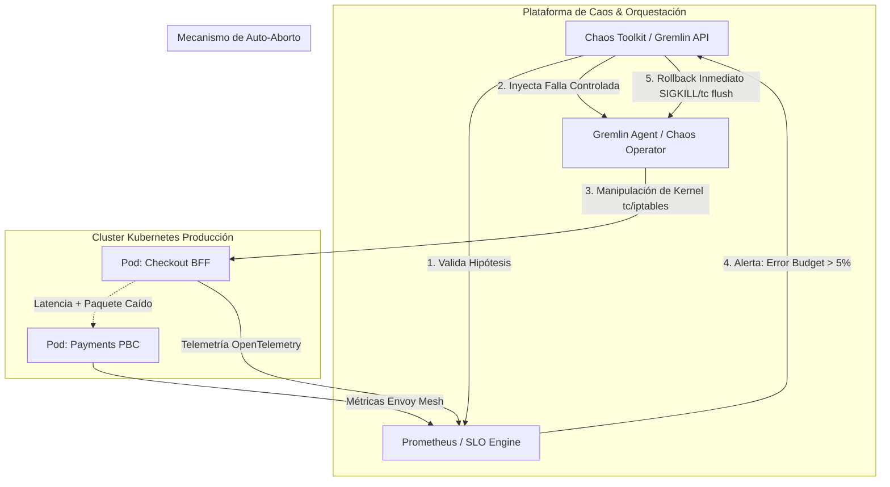
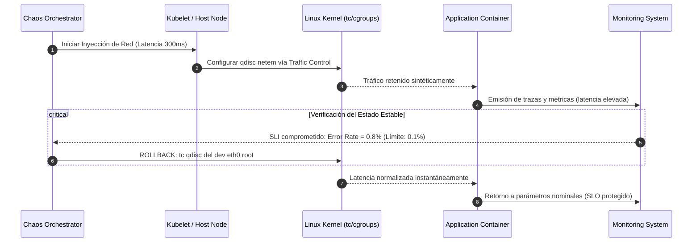

A las 14:22 UTC durante un evento de alta concurrencia, el servicio de pagos de un ecosistema de comercio composable comenzó a experimentar una degradación asimétrica: no devolvía errores HTTP 500 directos, sino una latencia parásita de 2,400 ms en el 12% de las transacciones hacia la pasarela adquirente. En papel, la arquitectura contaba con redundancia multi-AZ, auto-escalado horizontal de pods (HPA) y circuit breakers configurados en el service mesh Envoy. 

En la práctica, ocurrió una catástrofe silenciosa. Los hilos de ejecución de los *backends for frontends* (BFF) se saturaron esperando respuestas de sockets TCP abiertos. Las colas de conexión locales agotaron el pool de memoria del kernel (`nf_conntrack`), los health checks HTTP comenzaron a fallar por timeout y Kubernetes comenzó a reiniciar contenedores sanos de forma masiva en un ciclo de muerte en cascada (*cascading failure*). El SLA contractual del 99.99% anual se pulverizó en 18 minutos.

Las pruebas sintéticas en entornos de *staging* nunca detectan este comportamiento. Los entornos pre-productivos carecen de la topología de red real, la contención de noisy neighbors en nodos compartidos, los patrones de tráfico estocásticos y la degradación degradada de dependencias SaaS de terceros. La única forma empírica de validar si una arquitectura distribuida cumple sus Service Level Agreements (SLAs) bajo condiciones de falla real es ejecutando ingeniería de caos directamente en producción.



---

## El Bucle de Experimentación Científica y la Hipótesis del Estado Estable

Inyectar fallos en producción sin metodología formal es simplemente una negligencia operativa. La ingeniería de caos no busca "romper cosas en producción", sino verificar hipótesis científicas sobre el comportamiento de sistemas distribuidos ante turbulencias controladas.

El pilar de esta disciplina es la **Hipótesis del Estado Estable** (*Steady-State Hypothesis*). Antes de modificar el entorno, el sistema debe definir y medir cuantitativamente qué significa operar de forma aceptable utilizando sus Service Level Indicators (SLIs) y Service Level Objectives (SLOs):

$$\text{SLI}_{\text{Latencia}} = \frac{\text{Peticiones completadas en } \le 350\text{ms}}{\text{Peticiones totales válidas}} \ge 99.9\%$$

$$\text{SLI}_{\text{Disponibilidad}} = 1 - \left( \frac{\sum \text{Errores } 5xx}{\sum \text{Peticiones totales}} \right) \ge 99.95\%$$

El experimento es exitoso únicamente si, durante y después de la inyección de la falla, la hipótesis se sostiene o si los mecanismos de mitigación automática (degradación elegante, cache staling, circuit breakers) contienen el radio de impacto (*blast radius*) sin infringir el presupuesto de error (*Error Budget*).

---

## Automatización Declarativa de SLAs con Chaos Toolkit

Chaos Toolkit ofrece una arquitectura orientada a la extensibilidad mediante controladores desacoplados, permitiendo definir experimentos en YAML o JSON que pueden versionarse en Git y ejecutarse dentro de pipelines de GitOps o cronjobs orquestados.

El siguiente archivo de experimento demuestra cómo validar si el circuit breaker implementado en Envoy protege el SLA de un servicio crítico de inventario cuando la base de datos distribuida subyacente sufre un estrangulamiento de I/O a nivel de disco.

```yaml
version: 1.0.0
title: "Validar resiliencia del checkout ante degradación de I/O en Cassandra"
description: "Verifica que el degradado a caché en Redis evita violar el SLO de latencia (<400ms P99)"

tags:
  - environment: production
  - tier: tier-1
  - component: inventory-service

configuration:
  prometheus_url: "https://prometheus.internal.enterprise.domain"
  app_namespace: "core-commerce"
  app_label: "app=inventory-pbc"
  max_allowed_latency_p99: 0.400
  allowed_error_ratio: 0.001

steady-state-hypothesis:
  title: "SLO de Checkout y Tasa de Éxito dentro de límites operativos"
  probes:
    - type: probe
      name: "validar-p99-latencia-por-debajo-del-umbral"
      tolerance:
        type: probe
        name: "check-prometheus-latency"
        provider:
          type: python
          module: chaosprobes.prometheus
          func: "query_scalar"
          arguments:
            url: "${prometheus_url}"
            query: "histogram_quantile(0.99, sum(rate(http_request_duration_seconds_bucket{namespace='${app_namespace}', service='checkout-bff'}[2m])) by (le))"
        target: ${max_allowed_latency_p99}
        comparator: "<="

    - type: probe
      name: "validar-tasa-errores-5xx"
      tolerance:
        type: probe
        name: "check-http-5xx-ratio"
        provider:
          type: python
          module: chaosprobes.prometheus
          func: "query_scalar"
          arguments:
            url: "${prometheus_url}"
            query: "sum(rate(http_requests_total{namespace='${app_namespace}', status=~'5..'}[2m])) / sum(rate(http_requests_total{namespace='${app_namespace}'}[2m]))"
        target: ${allowed_error_ratio}
        comparator: "<="

method:
  - type: action
    name: "inyectar-io-stress-en-nodos-almacenamiento"
    provider:
      type: process
      path: "chaosnode"
      arguments:
        - "io"
        - "--workers"
        - "4"
        - "--io-mode"
        - "sync"
        - "--timeout"
        - "120s"
        - "--selector"
        - "app=inventory-storage"

rollbacks:
  - type: action
    name: "recuperacion-forzada-terminar-procesos-estres"
    provider:
      type: process
      path: "pkill"
      arguments:
        - "-9"
        - "-f"
        - "chaosnode"
```

Si en cualquier punto entre la ejecución de las acciones la prueba de estado estable devuelve un valor que sobrepasa el umbral definido (por ejemplo, la latencia P99 sube a 850 ms porque el fallback a Redis no funcionó), Chaos Toolkit invoca de inmediato el bloque de `rollbacks`, detiene la inyección y marca el experimento como fallido, generando un artefacto auditable en formato JSON.

---

## Gremlin Enterprise: Control Riguroso del Radio de Impacto y Dead Man's Switch

A escala enterprise, las plataformas centralizadas como Gremlin aportan una capa crítica ausente en scripts artesanales: **seguridad de ejecución con salvaguardas nativas y control criptográfico de radio de impacto**. 

Gremlin opera mediante agentes desplegados a nivel de nodo o sidecar que interactúan directamente con subsistemas del kernel de Linux utilizando primitivas `cgroups`, `tc` (Traffic Control) y `netfilter/iptables`. 

Uno de los mecanismos más avanzados de Gremlin es el **Status Check con Auto-Abort**. Si un webhook HTTP conectado a Datadog, Dynatrace o Prometheus detecta que el presupuesto de error (*Error Budget*) de un servicio crítico se está consumiendo más rápido del factor de quema (*Burn Rate*) admisible, aborta el ataque inmediatamente restaurando las tablas de enrutamiento y las configuraciones de red de los contenedores en milisegundos.

A continuación, se ilustra la ejecución automatizada de un ataque de latencia de red asimétrica utilizando la API REST v1 de Gremlin, restringido al 15% de las réplicas del servicio de catálogo en un clúster de producción de Kubernetes:

```bash
#!/usr/bin/env bash
set -euo pipefail

# Definición de parámetros de ejecución controlada
GREMLIN_TEAM_ID="c4b96f30-81d2-4bbf-9311-5db0d687ae88"
GREMLIN_API_KEY="${GREMLIN_PROD_API_KEY}"
TARGET_NAMESPACE="commerce-production"
TARGET_DEPLOYMENT="catalog-query-service"

# Payload de ataque con salvaguarda de detención automática
PAYLOAD=$(cat <<EOF
{
  "command": {
    "type": "latency",
    "command_args": {
      "-l": 450,
      "-j": 50,
      "-p": 443,
      "-h": "database.aurora.internal"
    }
  },
  "target": {
    "type": "Random",
    "exact": 2,
    "containers": {
      "labels": {
        "k8s-app": "${TARGET_DEPLOYMENT}"
      }
    },
    "k8s": {
      "namespaces": ["${TARGET_NAMESPACE}"]
    }
  },
  "labels": {
    "security-zone": "restricted-pci",
    "test-cycle": "sla-verification-q4"
  }
}
EOF
)

# Ejecución autenticada contra la API de Gremlin
ATTACK_ID=$(curl -s -X POST "https://api.gremlin.com/v1/attacks/new?teamId=${GREMLIN_TEAM_ID}" \
  -H "Authorization: Key ${GREMLIN_API_KEY}" \
  -H "Content-Type: application/json" \
  -d "${PAYLOAD}" | jq -r '.attackId // .')

echo "Ataque inicializado con ID: ${ATTACK_ID}"

# Monitoreo continuo de seguridad (Dead Man's Switch local)
for i in {1..12}; do
  STATUS=$(curl -s -X GET "https://api.gremlin.com/v1/attacks/${ATTACK_ID}?teamId=${GREMLIN_TEAM_ID}" \
    -H "Authorization: Key ${GREMLIN_API_KEY}" | jq -r '.stage')
  
  echo "Estado del experimento: ${STATUS} (Verificación ${i}/12)"
  
  if [ "${STATUS}" == "Completed" ]; then
    echo "Experimento concluido satisfactoriamente dentro de los parámetros del SLA."
    exit 0
  fi
  
  # Si un sistema externo detecta fallas severas, invocamos detención de emergencia
  if [ -f "/tmp/abort_chaos_signal" ]; then
    echo "¡Señal de aborto detectada! Ejecutando rollback forzado en Gremlin..."
    curl -s -X DELETE "https://api.gremlin.com/v1/attacks/${ATTACK_ID}?teamId=${GREMLIN_TEAM_ID}" \
      -H "Authorization: Key ${GREMLIN_API_KEY}"
    exit 1
  fi
  
  sleep 10
done
```

---

## Tabla Comparativa: Selección de Herramientas de Caos para Validación de SLAs

La elección del stack técnico impacta directamente en el cumplimiento de normativas (como SOC2, PCI-DSS e ISO 27001) y en el riesgo operacional al operar en capas productivas.

| Criterio de Selección | Chaos Toolkit | Gremlin Enterprise | LitmusChaos (CNCF) |
| :--- | :--- | :--- | :--- |
| **Arquitectura del Agente** | Sin agente (*agentless*) vía APIs o plugins puntuales. | Agente daemon optimizado con controladores eBPF y cgroups. | Operador nativo de Kubernetes y CRDs basados en Argo. |
| **Control de Blast Radius** | Basado en el alcance del script y lógica declarada manualmente. | Garantías deterministas a nivel de kernel; auto-stop nativo. | Políticas nativas de K8s y validaciones mediante probes de Argo. |
| **Mecanismo de Rollback** | Bloque `rollbacks` en YAML; riesgo de omisión si el worker muere. | Reversión garantizada por timeout en el kernel (*fail-safe local*). | Reversión declarativa gestionada por el reconciliador del operador. |
| **Integración CI/CD / GitOps** | Nativa mediante ejecución de binario CLI (`chaos run`). | API REST y Webhooks con SDKs para múltiples lenguajes. | Nativa en GitOps (gestión 100% declarativa de CRDs). |
| **Seguridad y Cumplimiento** | Depende de la cuenta/IAM que ejecute el pipeline. | RBAC multinivel, MFA, pistas de auditoría y soporte SOC2/PCI. | RBAC nativo de Kubernetes (requiere ServiceAccounts afinadas). |
| **Curva de Adopción** | Media: Requiere escribir probes Python/YAML personalizados. | Baja: Interfaz visual intuitiva, plantillas y SDK enterprise. | Alta: Requiere dominar CRDs, Argo Workflows y métricas Prometheus. |
| **Coste Total (TCO)** | Open source, pero con alto coste de mantenimiento ingenieril. | Suscripción SaaS por host/contenedor; bajo mantenimiento. | Open source; alto costo de computación y soporte interno. |

---

## Modos de Fallo Críticos al Inyectar Caos en Producción

La introducción de turbulencias en entornos productivos introduce vectores de fallo que deben ser anticipados a nivel de arquitectura:

### 1. El Dilema del Agente Ciego (*Telemetry Blind Spot*)
Si el ataque de caos interrumpe el subsistema de red utilizado por los exportadores de OpenTelemetry o los agentes de Prometheus para enviar métricas, la hipótesis de estado estable asumirá erróneamente que la tasa de error es cero cuando en realidad el sistema de observabilidad está desconectado. 
* **Mitigación:** Configurar canales de telemetría fuera de banda (*out-of-band*) o utilizar una verificación de estado activa (*Heartbeat probe*) contra un endpoint estático externo antes de evaluar cualquier métrica operativa.

### 2. Avenamiento de Memoria del Kernel (*Slab/Conntrack Exhaustion*)
Los experimentos que inyectan microcortes masivos de TCP (paquetes corruptos o `RST` continuos) obligan a los cortafuegos `iptables` y proxies de capa 4 a almacenar tracking states en memoria RAM no paginable del host. Esto puede provocar un bloqueo de kernel (*Kernel Panic*) en el nodo hipervisor subyacente, afectando a cargas de trabajo adyacentes que no formaban parte del experimento.
* **Mitigación:** Limitar estrictamente el uso de ataques a nivel de sockets mediante el aislamiento de cgroups y monitorizar la métrica `/proc/sys/net/netfilter/nf_conntrack_count` en tiempo real.



### 3. Falsa Mitigación por Caché de Capa Borde (*False Positives via Edge Caching*)
Al probar la degradación de un microservicio de catálogo bajo inyección de latencia, un API Gateway o CDN como Fastly o Cloudflare puede servir respuestas obsoletas con código HTTP 200 (*stale-while-revalidate*). Esto enmascara la caída del backend real, haciendo creer al equipo que el microservicio soportó la degradación cuando, en realidad, el origen estaba completamente colapsado.
* **Mitigación:** Instrumentar las llamadas de validación del estado estable agregando cabeceras de bypass de caché (`Cache-Control: no-cache, x-chaos-bypass: true`) que obliguen al tráfico a golpear directamente la lógica de computación del backend.

---

## Checklist de Implementación Operativa (Día 2)

Para transicionar de experimentos ad-hoc a una práctica enterprise continua de ingeniería de caos en producción, ejecute los siguientes pasos de validación:

- [ ] **Definir el Presupuesto de Error de Caos:** No ejecutar ningún experimento si el servicio objetivo ha consumido más del 20% de su Error Budget mensual en los últimos 7 días.
- [ ] **Configuración de Safe Ports y Exclusiones de Infraestructura:** Asegurar mediante configuración en agentes (Gremlin/Litmus) que los puertos de health checks de Kubernetes (`kubelet`, liveness/readiness probes como `:8080/healthz`) y puertos DNS (`53`) queden expresamente excluidos de los ataques de latencia y pérdida de paquetes.
- [ ] **Garantizar Mecanismos de Auto-Rollback Locales:** Verificar que los ataques cuenten con un tiempo de vida finito a nivel de hardware/kernel (TTL). Si el orquestador de caos pierde conectividad de red con el agente inyector, el agente debe purgar de forma autónoma las reglas de `iptables` y `tc` tras 60 segundos de desconexión.
- [ ] **Alineación con Equipos de SRE y Guardias Activas:** Notificar a través de canales automáticos (ChatOps en Slack/Teams) el inicio y fin exacto de cualquier ventana de inyección de caos, evitando falsas alarmas y llamadas de emergencia a los ingenieros de guardia.
- [ ] **Cierre de Brechas (Action Items Post-Mortem):** Cada fallo detectado en una hipótesis de estado estable debe traducirse de inmediato en una historia técnica en el backlog (por ejemplo, reajuste de timeouts en Envoy, dimensionamiento de pools de conexiones o implementación de patrones Bulkhead) con una fecha límite de resolución antes del siguiente ciclo de caos.