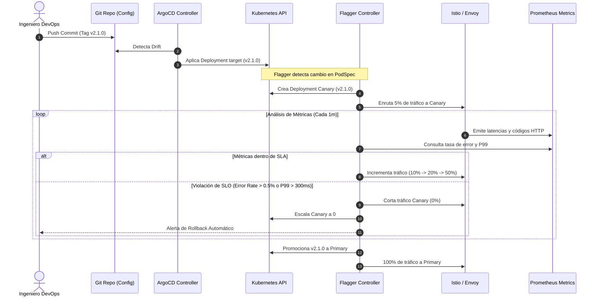
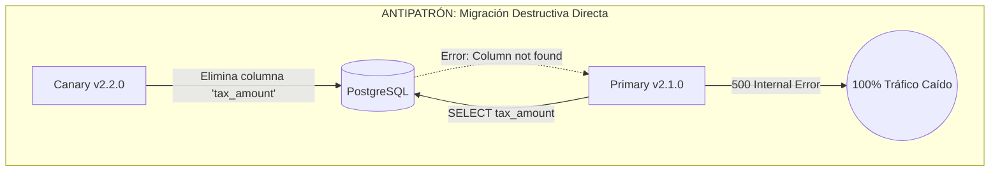

Durante un pico de transacciones en un cluster de Kubernetes para e-commerce enterprise, un `RollingUpdate` nativo actualizó 80 réplicas de un microservicio de checkout. El endpoint `/healthz` respondió `HTTP 200` inmediatamente, los probes de `readiness` y `liveness` se declararon satisfechos y Kubernetes terminó los pods antiguos. Treinta segundos después, ante tráfico real, un leak de memoria no detectado en el pool de conexiones JDBC saturó los workers de la base de datos relacional subyacente. El resultado: una caída en cascada de la pasarela de pagos durante 18 minutos y una pérdida neta millonaria antes de que el equipo de SRE pudiera ejecutar manualmente un `kubectl rollout undo`.

El mecanismo nativo de despliegue de Kubernetes es ciego al comportamiento operacional real. Valida la disponibilidad sintética del proceso en el contenedor, pero ignora la tasa de errores HTTP 5xx, el incremento de la latencia en el percentil 99 (P99) o la degradación de dependencias downstream. En arquitecturas MACH donde múltiples microservicios desacoplados interactúan sincrónica y asincrónicamente, reemplazar un despliegue sin validación de telemetría en tiempo real introduce un radio de explosión inaceptable.

Para mitigar este riesgo estructural, la integración de **GitOps declarativo (ArgoCD)** con **controladores de entrega progresiva (Flagger)** y una capa de datos de enrutamiento (**Istio** o **Envoy Gateway API**) permite automatizar análisis estadísticos y desvíos graduales de tráfico, ejecutando rollbacks automáticos en milisegundos sin intervención humana.

---

## La colisión de paradigmas: GitOps Declarativo frente a Mutación Progresiva

El mayor desafío arquitectónico al implementar despliegues Canary o Blue/Green en Kubernetes mediante GitOps radica en la aparente contradicción entre dos filosofías:

1. **GitOps Inmutable (ArgoCD):** El estado deseado vive exclusivamente en el repositorio de Git. Cualquier divergencia observada en el cluster (`Live State`) respecto a Git (`Target State`) es clasificada como *drift* y debe ser sobreescrita por el motor de sincronización.
2. **Entrega Progresiva Dinámica (Flagger):** Durante el análisis de una nueva versión, un controlador muta dinámicamente objetos en el cluster (pesos de tráfico en `VirtualServices`, número de réplicas en `Deployments`, selectores de etiquetas en `Services`) según la telemetría recolectada en Prometheus.

Si se implementa sin un desacoplamiento claro, ArgoCD y Flagger entran en una guerra de reconciliación en bucle infinito (*reconciliation storm*): Flagger reduce las réplicas del despliegue base o modifica los selectores del servicio para desviar tráfico de prueba, y ArgoCD inmediatamente lo revierte para forzar el estado declarado en Git.



### El patrón Target vs. Primary Deployment

Flagger resuelve este conflicto desacoplando el despliegue gestionado por GitOps del despliegue que realmente recibe tráfico en producción. El flujo operativo se define de la siguiente manera:

- El repositorio de Git gestiona un objeto base (ejemplo: `Deployment/checkout-service`).
- ArgoCD sincroniza y monitorea únicamente este objeto base.
- Flagger toma el objeto base como una plantilla (*target deployment*), pausa su escalado directo (`replicas: 0`) y genera dos nuevos despliegues administrados internamente:
  - `checkout-service-primary`: Contiene la versión estable actual (tráfico productivo).
  - `checkout-service-canary`: Contiene la versión candidata evaluada progresivamente.

Para que ArgoCD ignore estas mutaciones automáticas y no marque la aplicación como `OutOfSync`, es indispensable configurar reglas de omisión granular (`ignoreDifferences`) en la definición del recurso `Application` de ArgoCD.

---

## Implementación: Infraestructura de Despliegue Progresivo

A continuación se detalla la configuración técnica para instrumentar una estrategia de Canary Deployment sobre Istio Service Mesh, con validación continua de latencias P99 y tasas de error HTTP 5xx mediante Prometheus.

### 1. Definición de la ArgoCD Application con Exclusiones de Drift

Este manifiesto evita que el reconciliador de ArgoCD interfiera con los metadatos y réplicas gestionados por Flagger sobre el despliegue de destino:

```yaml
apiVersion: argoproj.io/v1alpha1
kind: Application
metadata:
  name: checkout-service-prod
  namespace: argocd
spec:
  project: core-commerce
  source:
    repoURL: 'git@github.com:enterprise-org/mach-deployments.git'
    targetRevision: HEAD
    path: k8s/overlays/production/checkout
  destination:
    server: 'https://kubernetes.default.svc'
    namespace: payments
  syncPolicy:
    automated:
      prune: true
      selfHeal: true
    syncOptions:
      - CreateNamespace=true
      - SkipDryRunOnMissingResource=true
  ignoreDifferences:
    # Ignorar réplicas en el Deployment original modificado por Flagger
    - group: apps
      kind: Deployment
      jsonPointers:
        - /spec/replicas
    # Ignorar mutaciones en el VirtualService de Istio generadas por Flagger
    - group: networking.istio.io
      kind: VirtualService
      jsonPointers:
        - /spec/http/0/route
```

### 2. Configuración del Recurso Flagger Canary

El Custom Resource Definition (CRD) `Canary` define la máquina de estados del despliegue: peso de los pasos de tráfico, duración de la ventana de análisis, umbrales de métricas (SLOs) y webhooks de pruebas sintéticas.

```yaml
apiVersion: flagger.app/v1beta1
kind: Canary
metadata:
  name: checkout-service
  namespace: payments
spec:
  # Referencia al Deployment gestionado por ArgoCD
  targetRef:
    apiVersion: apps/v1
    kind: Deployment
    name: checkout-service
  # HPA asociado para que Flagger gestione el autoescalado del Primary
  autoscalerRef:
    apiVersion: autoscaling/v2
    kind: HorizontalPodAutoscaler
    name: checkout-service-hpa
  service:
    port: 8080
    targetPort: 8080
    gateways:
      - mesh
      - istio-system/public-gateway
    hosts:
      - checkout.enterprise.internal
    trafficPolicy:
      tls:
        mode: ISTIO_MUTUAL
  analysis:
    # Intervalo de evaluación de métricas
    interval: 1m
    # Umbral de fallos antes de disparar el Rollback
    threshold: 3
    # Incremento porcentual por cada iteración exitosa
    stepWeight: 10
    # Peso máximo alcanzado antes de la promoción definitiva
    maxWeight: 50
    metrics:
      - name: request-success-rate
        thresholdRange:
          min: 99.5
        interval: 1m
      - name: request-duration
        thresholdRange:
          max: 350 # P99 < 350ms
        interval: 1m
      - name: database-pool-exhaustion
        templateRef:
          name: db-connection-saturation
          namespace: flagger-system
        thresholdRange:
          max: 0.85 # Alerta si el pool supera el 85% de saturación
        interval: 1m
    webhooks:
      # Webhook de verificación sintética previa a la inyección de tráfico
      - name: smoke-test
        type: pre-rollout
        url: http://flagger-loadtester.payments/
        timeout: 15s
        metadata:
          type: bash
          cmd: "curl -sf http://checkout-service-canary.payments:8080/ready"
      # Generación de carga balanceada para alimentar Prometheus
      - name: load-test
        type: rollout
        url: http://flagger-loadtester.payments/
        timeout: 5s
        metadata:
          cmd: "hey -z 1m -q 10 -c 2 http://checkout-service-canary.payments:8080/v1/health"
```

### 3. Definición de Métrica PromQL Avanzada (MetricTemplate)

Flagger evalúa métricas genéricas por defecto, pero en sistemas transaccionales críticos se requieren métricas de dominio. Este `MetricTemplate` detecta el agotamiento del pool de conexiones HikariCP/JDBC expuesto vía métricas de Spring Boot Actuator/Micrometer:

```yaml
apiVersion: flagger.app/v1beta1
kind: MetricTemplate
metadata:
  name: db-connection-saturation
  namespace: flagger-system
spec:
  provider:
    type: prometheus
    address: http://prometheus-k8s.monitoring:9090
  query: |
    sum(
      hikaricp_connections_active{namespace="payments", app="checkout-service-canary"}
    )
    /
    sum(
      hikaricp_connections_max{namespace="payments", app="checkout-service-canary"}
    )
```

---

## Blue/Green frente a Canary: Trade-offs de Arquitectura

La selección del patrón de despliegue no debe basarse en preferencias de tooling, sino en las restricciones de infraestructura, el modelo de datos y el impacto del radio de explosión en producción:

| Dimensión Arquitectónica | Despliegue Blue/Green | Despliegue Canary Progresivo |
| :--- | :--- | :--- |
| **Sobrecarga de Cómputo (CPU/RAM)** | **Alta (+100% transitorio):** Requiere duplicar la capacidad total del servicio en paralelo para absorber el tráfico instantáneo. | **Baja (+10% a +25% transitorio):** Solo requiere réplicas adicionales proporcionales al paso porcentual del canary. |
| **Complejidad de Enrutamiento** | **Baja:** Conmutación binaria de selectores DNS, balanceadores o servicios de Kubernetes (0% a 100%). | **Alta:** Requiere un Service Mesh (Istio/Linkerd) o un API Gateway con capacidades de *traffic splitting* a nivel de cabecera/peso. |
| **Gestión de Esquemas de Base de Datos** | **Crítica:** Requiere soporte absoluto del patrón *Expand and Contract*. Ninguna versión puede eliminar columnas activas. | **Crítica prolongada:** Ambas versiones coexisten durante minutos u horas; el esquema debe soportar retrocompatibilidad continua. |
| **Persistencia de Sesión (Sticky Sessions)** | **Compatible:** Toda la sesión del usuario se mantiene en el entorno Green sin mezclar estados intermedios. | **Problemática:** Puede romper flujos transaccionales si un usuario salta de Canary a Primary entre peticiones consecutivas (requiere cookie hashing). |
| **Radio de Explosión (Blast Radius)** | **Total (100% del tráfico):** Aunque el rollback es rápido, el 100% de los usuarios experimentan el fallo hasta que se detecta. | **Mínimo y Acotado:** Solo el subconjunto de usuarios asignado al canary (ej: 5%) percibe la degradación antes del aborto. |
| **Tiempo de Detección de Errores** | Instantáneo tras el corte total, pero depende de alertas reactivas externas (SRE). | Basado en telemetría continua automatizada (estadísticamente significativo en cada paso). |

---

## Modos de Fallo Críticos en Operaciones de Día 2 y Mitigación

Implementar estos controladores en entornos de alta transaccionalidad introduce desafíos operacionales que deben abordarse en la fase de diseño.

### 1. La Trampa del Retardo Métrico (Scrape Latency Window)

**El Problema:** Flagger evalúa métricas en ventanas de tiempo discretas (ej. cada 1 minuto). Si el intervalo de raspado de Prometheus (*scrape interval*) está configurado en 30 segundos, y la métrica analizada utiliza una función `rate(...[2m])`, existe un retraso matemático intrínseco de 60 a 90 segundos antes de que un error HTTP 500 impacte significativamente el promedio móvil. Flagger podría aprobar un paso de tráfico (por ejemplo, subir del 10% al 20%) antes de que la métrica de Prometheus refleje el colapso del paso anterior.

**La Mitigación:**
- Alinear el `interval` de Flagger para que sea al menos **2.5 veces** el scrape interval de Prometheus.
- Emplear ventanas de evaluación PromQL cortas (`rate(http_requests_total[1m])`) combinadas con un `threshold: 1` o `2` en la directiva de análisis. Si la degradación supera el umbral en un solo ciclo, el rollback debe ser implacable e inmediato.

### 2. Violación del Contrato de Datos: El Antipatrón "Breaking DB Migration"

**El Problema:** La entrega progresiva asume que el software es desacoplado, pero la base de datos suele ser compartida. Si el Canary de la versión v2.2.0 aplica una migración que renombra o elimina una columna en PostgreSQL, el Primary (v2.1.0) fallará instantáneamente, derribando el servicio en producción a pesar de que el tráfico Canary sea solo del 5%.



**La Mitigación:**
- Imponer el patrón **Expand and Contract** en el pipeline de CI/CD:
  1. *Fase de Expansión:* La migración agrega columnas nuevas o duplica datos mediante triggers; el software nuevo lee de la nueva columna y escribe en ambas.
  2. *Fase de Transición:* Se despliega el Canary. Ambas versiones conviven sin fricción con el esquema.
  3. *Fase de Contracción:* Tras la promoción definitiva de la v2.2.0 y el desmantelamiento de la v2.1.0, un job post-despliegue elimina las estructuras obsoletas de la base de datos.
- Bloquear despliegues automáticos progresivos si el PR contiene modificaciones destructivas en archivos de migración (Flyway/Liquibase).

### 3. Drenado Deficiente de Conexiones WebSocket y gRPC (Long-Lived Connections)

**El Problema:** Los balanceadores de capa 4 y los proxys de capa 7 manejan las conexiones persistentes de manera dispar. Cuando Flagger detecta una anomalía y escala el Canary a 0 réplicas, los pods reciben una señal `SIGTERM`. Si el servicio no implementa un apagado elegante (*graceful shutdown*), las conexiones HTTP/2 multiplexadas (gRPC) o WebSockets se cortan abruptamente, arrojando spikes de errores de transporte en el cliente.

**La Mitigación:**
- Configurar `terminationGracePeriodSeconds` en el `PodSpec` con un valor adecuado (ej. 45-60 segundos).
- Implementar hooks de pre-parada (`preStop`) en el contenedor para dormir el pod durante 10-15 segundos antes de cerrar los listeners, permitiendo que el Envoy proxy de Istio elimine el endpoint de los endpoints activos antes de que el proceso comience a denegar tráfico:

```yaml
lifecycle:
  preStop:
    exec:
      command: ["/bin/sh", "-c", "sleep 15"]
```

---

## Canary Basado en Cabeceras (A/B Testing Operacional)

En servicios altamente sensibles (como facturación o contabilidad), enrutar un 5% de usuarios aleatorios mediante pesos ponderados sigue representando un riesgo operacional. Flagger permite condicionar el Canary no al volumen de tráfico, sino a cabeceras HTTP específicas (*Header-based routing*), aislando la prueba exclusivamente a usuarios internos, bots sintéticos o cuentas de prueba predeterminadas.

```yaml
apiVersion: flagger.app/v1beta1
kind: Canary
metadata:
  name: billing-engine
  namespace: finance
spec:
  targetRef:
    apiVersion: apps/v1
    kind: Deployment
    name: billing-engine
  service:
    port: 8080
    match:
      - headers:
          x-canary-test:
            exact: "true"
      - headers:
          cookie:
            regex: ".*enterprise_internal_user=true.*"
  analysis:
    interval: 2m
    threshold: 2
    iterations: 10
    metrics:
      - name: request-success-rate
        thresholdRange:
          min: 99.9
        interval: 1m
```

En este modo, el tráfico general de producción permanece al 100% en el `Primary`. El Canary solo procesa peticiones que lleven la cabecera `x-canary-test: true` o una cookie de autenticación interna. Flagger ejecuta el análisis de salud exclusivamente sobre ese tráfico filtrado durante 10 iteraciones y, una vez validado, ejecuta la promoción completa al `Primary` sin haber expuesto a ningún cliente final al riesgo de regresión.

---

## Checklist de Producción para Equipos de Plataforma y SRE

Antes de habilitar despliegues progresivos automáticos en clusters productivos, el equipo de ingeniería debe verificar los siguientes prerrequisitos en su stack tecnológico:

- [ ] **Configuración de Drift en GitOps:** Validar que la aplicación de ArgoCD contiene reglas de `ignoreDifferences` para `/spec/replicas` en el Deployment base y para los objetos de enrutamiento del Service Mesh (`VirtualService`, `HTTPRoute`).
- [ ] **Instrumentación Homogénea de Métricas:** Confirmar que todos los microservicios exportan códigos de estado HTTP (o gRPC status) a Prometheus bajo una nomenclatura consistente (ej: standard Prometheus RED metrics: Rate, Errors, Duration).
- [ ] **Alineación de Ventanas de Telemetría:** El intervalo de evaluación del análisis de Flagger (`analysis.interval`) debe ser estrictamente mayor al doble del `scrape_interval` global de Prometheus.
- [ ] **Patrón Expand and Contract Validado:** Todas las migraciones de esquema de base de datos del pipeline deben ser 100% retrocompatibles con la versión N-1 del software.
- [ ] **Graceful Shutdown y Lifecycle Hooks:** Los contenedores deben interceptar `SIGTERM` y disponer de bloques `lifecycle.preStop` que permitan la convergencia del plano de datos antes de terminar los sockets de red.
- [ ] **Límites de Cuota y Recursos de Cómputo:** Los `ResourceQuotas` del namespace deben disponer de un margen mínimo de holgura (+20% en Canary, +100% en Blue/Green) para permitir la convivencia simultánea de las versiones evaluadas.
- [ ] **Canales de Alerta Bidireccionales:** Configurar webhooks en Flagger (`spec.analysis.webhooks`) integrados con Slack, Microsoft Teams o PagerDuty para notificar promociones exitosas, avisos de degradación y eventos de rollback automático con el contexto de la métrica violada.